# SimpleLay

> 제24회 임베디드SW경진대회 · 스마트가전 부문 · 팀 자비스
> 기존 가전을 교체하지 않고, 위에 얹어 조작을 대신해주는 부착형 AI 가전 제어 시스템

---

## 한 줄 정의

**SimpleLay는 XY 갠트리가 물리 버튼을 대신 눌러주는 부착형 장치에, 라즈베리파이 기반의
"자가 검증 + 선제 제어" 지능 레이어를 얹은 시스템이다.**

사용자의 목적(예: "우유 데워줘")을 버튼 입력 시퀀스로 바꿔 물리적으로 누르고, 전류·음향
센서로 **실제로 눌렸는지 검증**한 뒤 실패 시 재시도하는 폐루프 구조로 동작한다. 나아가 사용
패턴을 학습해 다음 조작을 먼저 제안하는 것을 목표로 한다.

---

## 시스템 구조 (Sense · Interpret · Act)

```mermaid
flowchart LR
    user(["사용자"])

    subgraph reused["Touch Bridge 재사용 영역"]
        app["Flutter 앱"]
        esp32["ESP32 브릿지"]
        grbl["Arduino Uno<br/>GRBL"]
        driver["TB6600 ×3"]
        gantry["NEMA17<br/>XYZ 갠트리"]
    end

    subgraph brain["라즈베리파이 · SimpleLay 신규 Brain 레이어"]
        direction TB
        api["api<br/>앱·로그 연동"]
        intent["intent<br/>목적 해석·패턴 학습"]
        controller["controller<br/>폐루프 제어·재시도"]
        verifier["verifier<br/>실행 결과 검증"]

        api --> intent --> controller
        verifier -->|"눌림 판정·신뢰도"| controller
        controller -->|"실행 상태"| api
    end

    sensors["전류·음향·접점 센서"]
    appliance["기존 가전 버튼"]

    user -->|"음성·터치"| app
    app -->|"BLE / Wi-Fi"| esp32
    esp32 -->|"UART"| grbl
    grbl --> driver --> gantry
    gantry -->|"물리 누름"| appliance

    app <-->|"요청·상태"| api
    controller -->|"버튼 누름 명령"| esp32
    appliance -.->|"반응"| sensors
    sensors -->|"원신호"| verifier

    classDef newLayer fill:#e8f5e9,stroke:#2e7d32,stroke-width:2px,color:#1b5e20;
    classDef reusedLayer fill:#e3f2fd,stroke:#1565c0,stroke-width:1.5px,color:#0d47a1;
    class api,intent,controller,verifier newLayer;
    class app,esp32,grbl,driver,gantry reusedLayer;
```



| 계층 | 역할 | 하드웨어 | 출처 |
| --- | --- | --- | --- |
| **Act** | 버튼 물리 누름 (XYZ 좌표 이동) | NEMA17 ×3 + TB6600 ×3 + Arduino Uno GRBL | Touch Bridge 플랫폼 공유 |
| **Bridge** | 앱 명령 수신 → GRBL G-code 전달 | ESP32 | Touch Bridge 플랫폼 공유 |
| **Brain** | **검증 · 폐루프 · 패턴 학습** | **라즈베리파이 (신규)** | **SimpleLay 신규** |
| **App** | 음성/원격 입력, 상태 확인 | Flutter | Touch Bridge 확장 |

> **핵심:** XY 갠트리(Act·Bridge)는 Touch Bridge 하드웨어 플랫폼을 공유하지만,
> **라즈베리파이가 얹는 "자가 검증 + 선제 제어" 레이어가 SimpleLay만의 신규 구현**이다.
> 재사용과 신규의 경계는 [docs/reuse-boundary.md](docs/reuse-boundary.md)에 명확히 구분해 둔다.

---

## 왜 폐루프인가 (Touch Bridge와의 결정적 차이)

- **Touch Bridge (한이음)** = 반응형. 사용자가 명령하면 누르고 끝난다.
- **SimpleLay (본 대회)** = 선제형 + **자가 검증**. 누른 뒤 전류·음향 센서로 실제 실행을
  확인하고, 실패하면 스스로 다시 시도한다. 나아가 사용 패턴을 학습해 먼저 제안한다.

이 **폐루프 검증**이 SimpleLay의 기술적 차별점이자, 결선 시연의 핵심 장면이다.
(일부러 실패시켜도 센서가 감지해 자동 재시도하는 것을 보여준다.)

---

## 디렉토리 구조

```
simplelay/
├── docs/                   # 설계 · 통신 프로토콜 · 버튼맵 · 폐루프 설계 문서
│   └── button-maps/        #   가전별 버튼 그리드 JSON (전자레인지 등)
├── rpi/                    # ★ 라즈베리파이 모듈 (SimpleLay 신규 핵심)
│   ├── verifier/           #   전류·음향 센서 기반 실행 검증
│   ├── controller/         #   폐루프 제어 (명령 → 검증 → 재시도)
│   ├── intent/             #   패턴 학습 + 의도 해석 (공감지능)
│   └── api/                #   앱/로그 연동 API
├── firmware/               # ESP32 펌웨어 (BLE 브릿지 · 센서 · LED UI)
└── app/                    # ★ Flutter 앱 (Sense 레이어)
    └── lib/
        ├── services/       #   BLE 서비스, 음성 STT
        ├── providers/      #   Riverpod 상태 관리
        ├── screens/        #   Home · Voice · Suggestion · Status · Settings
        └── models/         #   Suggestion, ExecutionStatus
```

---

## 개발 로드맵 (RPi 레이어 중심)

자세한 마일스톤은 [docs/roadmap.md](docs/roadmap.md) 참고.

| 마일스톤 | 내용 | 상태 |
| --- | --- | --- |
| M0 | Flutter 앱 MVP (BLE · STT · 제안 확인 · 실행 상태) | ✅ 완료 |
| M0 | RPi 패턴 학습 · 선제 제안 · 폐루프 제어 모듈 | ✅ 완료 |
| M1 | 전류·음향 센서 읽기 (버튼 눌림 신호 감지) | 🔧 진행 중 |
| M2 | RPi ↔ ESP32 BLE 통신 실기기 연결 | 예정 |
| M3 | **폐루프 E2E** — 앱 → BLE → RPi → 액추에이터 → 센서 검증 | 예정 |
| M4 | 공감지능 — 사용 이력 기반 선제 제안 앱 표시 | 예정 |
| M5 | 인덕션 이식 + 입력 정확도 ≥ 95% | 예정 |

---

## 팀

| 이름 | 역할 |
| --- | --- |
| 박성원 | Flutter 앱 · 라즈베리파이 연동 · 구동부 |
| 서예솔 | HW 총괄 · ESP32 · 솔레노이드 · 센서 · 하우징 |

---

## 관련 문서

| 문서 | 내용 |
| --- | --- |
| [docs/reuse-boundary.md](docs/reuse-boundary.md) | Touch Bridge 재사용 vs SimpleLay 신규 구현 경계 (대회 정당성) |
| [docs/architecture.md](docs/architecture.md) | 시스템 아키텍처 · 데이터 흐름 · 계층 계약 |
| [docs/closed-loop-design.md](docs/closed-loop-design.md) | 폐루프 검증 설계 (센서 → 판정 → 재시도) |
| [docs/roadmap.md](docs/roadmap.md) | 마일스톤 · 심사평 대응 계획 |
