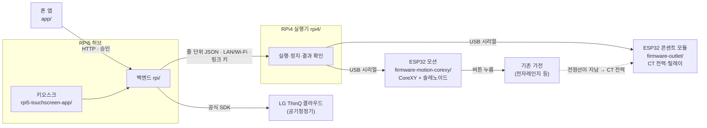

# SimpleLay

> 제24회 임베디드SW경진대회 · 스마트가전 부문 · 팀 자비스

**실제로 쓴 기록에서 일상을 알아채고, 사람이 있을 때 묻고, 사람이 맡긴 것만 알아서 하는 집 안 본체.** LG 가전은 공식 연동으로, 버튼만 있는 옛 가전은 조작부 위 누름 장치로 같은 흐름에 넣는다.

## 5분 평가 경로

**세 기둥(LG 공감지능에 맞춤)**
- ① **생활 — 알아챈다** — 앱·키오스크로 직접 쓴 기록에서 같은 시간대에 사흘 이상, 세 번 이상 되풀이한 일을 습관으로 알아챈다(카드에 쓴 날을 보임). 현재 시연 표현("공기가 텁텁하네")은 공기 불평 규칙이 켜기를 고른다. 규칙이 처리하지 못한 말에 한해 본체 안 언어 모델이 정해진 동작 목록에서 후보 하나를 고르고, 실행 전에는 사람이 확인한다.
- ② **조율 — 때와 기기를 맞춘다** — 사람이 있을 때, 평소 시각 10분 전에 "지금 할까요?"를 묻는다. 실내·바깥 공기, 날씨, 방 밝기를 엮어 제안하거나 조언만 한다.
- ③ **책임 — 맡긴 것만** — 자주 승인해도 저절로 맡기지 않는다. 사용자가 확인 칸을 보고 맡긴 위험 낮은 LG 가전 동작만 알아서 하고 결과를 알린다. 열 나는 가전은 매번 '네'. 판단은 집 안 본체에서, 카메라는 사람 있음/없음만.

**무엇이 실물이고 무엇이 모의인지는 [§6 표](#6-무엇이-실물이고-무엇이-아직인가) 하나에만 적었다.**

1. **구성(1분)** — [구성도](docs/submission/img/fig-architecture.svg): RPi5 허브 + 키오스크, RPi4 실행기 1대(Wi-Fi 링크), ESP32 모션(CoreXY + 솔레노이드), ESP32 콘센트 모듈(CT·릴레이·비상정지), 폰 앱, LG 클라우드(공기청정기). 설명은 [아키텍처](docs/architecture.md).
2. **시뮬레이터(3분, 하드웨어 없이)** — 저장소 루트에서:

   ```powershell
   py -m venv .venv; .\.venv\Scripts\python.exe -m pip install -e ".[test]"
   .\.venv\Scripts\python.exe -m rpi.simulator_main --port 8782
   ```

   http://127.0.0.1:8782/simulator 에서 보일 세 화면(모터·센서·가전은 모두 모의):
   - **가. 실행** — 전자레인지 버튼 순서 실행 → 통신 프레임에 `execute` → `result`, '모의' 표시.
   - **나. 실패** — 실패를 주입하고 다시 실행 → 실패가 결과로 그대로 남는다(성공으로 바꾸지 않음).
   - **다. 승인** — '키오스크에 시연 제안 띄우기' → `/kiosk/`의 제안 카드. 승인하기 전에는 실행하지 않는다(키오스크 웹은 먼저 빌드 — [브라우저 시뮬레이터 실행](docs/브라우저-시뮬레이터-실행.md)).
3. **실물 화면(1분)** — 실제 RPi5 허브에 붙은 화면: [키오스크 15.8형 실패널](docs/submission/img/kiosk-idle-real-panel-2026-10-24.png)(10/19) · [폰 홈](docs/submission/img/phone-home-2026-10-24.png) · [폰 루틴](docs/submission/img/phone-routines-2026-10-24.png) · [폰 기록](docs/submission/img/phone-history-2026-10-24.png)(폰은 10/24 최신 화면. 공기청정기 '켜짐 확인'은 상태를 다시 읽어 확인한 것. 누름 장치 실행은 모의 모션의 '연습'이며 실제 가전은 누르지 않음).
4. **시연 영상** — 영상 링크 자리(촬영 뒤 기입 — 다가가면 화면이 깸, "공기가 텁텁하네" → '네' → 실제 공기청정기 상태 다시 읽기, 습관 카드·맡기기, 끄기).

## 1. 누구를 위한가

작은 버튼과 여러 단계 조작이 어려운 **고령자·저시력 사용자**, 그리고 처음 설치·등록을 맡는 **보호자·설치자**.
등록(사진·버튼 위치)은 보호자가 폰으로 한 번 하고, 매일 쓰는 것(승인·거절·정지)은 당사자가 큰 글씨 키오스크와 폰으로 한다.

## 2. 어떤 문제인가

스마트홈은 늘 앱을 열고, 규칙을 짜고, 알림에 답하라고 한다. 고령자나 처음 쓰는 사람에게는 그 자체가 부담이다.
게다가 집에 있는 전자레인지 같은 옛 가전은 대부분 스마트 기능이 없어 그 흐름에 들어오지도 못한다.

## 3. SimpleLay가 하는 일 — 맡기기 다섯 단계

1. **직접 사용 기록** — 앱·키오스크로 쓴 것을 기록한다(실제·성공 사용만, 모의·연습 기록은 빼고).
2. **습관 알아채기** — 같은 시간대에 사흘 이상, 세 번 이상 되풀이하면 습관으로 본다. 학습이 아니라 설명할 수 있는 규칙이다.
3. **사람이 있을 때 묻기** — 평소 시각 10분 전에 "지금 할까요?" + "매일 이 시간에"를 묻는다. 아무도 없으면 +30분까지 기다렸다 한 번 묻는다.
4. **맡기기** — 사용자가 확인 칸(언제·무엇을·하지 않는 경우·끄는 곳)을 보고 눌러야 한다. 자주 '네'를 눌러도 저절로 맡기지 않는다.
5. **알아서 하고 결과만 알림** — 조용한 시간·비상정지 중엔 하지 않고, 언제든 끌 수 있다. 끝난 뒤 5분 동안 '되돌리기'.

말로 하기: 규칙으로 못 알아들은 말은 본체 안 공개 언어 모델(인터넷 없이, 2에폭 미세조정)이 정해진 동작 가운데 하나를 고르고, 사람이 '네'를 눌러야 실행된다. 열 나는 가전(전자레인지·인덕션)은 맡길 수 없고 매번 '네'를 받는다. 버튼만 있는 옛 가전은 조작부 위 누름 장치(CoreXY 갠트리)가 버튼을 순서대로 눌러 같은 흐름에 넣는다 — 하드웨어는 주인공이 아니라 수단이다.

정지는 폰·키오스크·음성 "멈춰"에서 언제든 걸 수 있고, "보냄 → 모션 보드 확인 → 멈춤 확인" 세 단계로 나눠 보고한다.

**다음 단계:** 콘센트 전류(CT)로 가열 시작·끝 확인 — 콘센트 모듈은 설계·펌웨어까지, 아직 연결하지 않았다.

**용어:** **CT** = 전원선에 거는 전류 센서. 코드와 [근거 부록](docs/submission/근거-부록.md)의 L1~L3는 누름 확인·가전 소리·전력 확인 단계 이름이다. **ThinQ** = LG 스마트 가전 클라우드.
화면 말은 처음 쓰는 사람 기준이라 기기는 '본체', 갠트리는 '누름 장치', ThinQ 가전은 'LG 가전'이라 부른다.

## 4. 하드웨어

> 사진 추가 예정 — 전자레인지에 붙인 갠트리, 콘센트 모듈, 무대 배치. 지금 있는 그림은 화면 캡처와 구성도([제출 그림](docs/submission/그림-대응표.md)).



- **RPi5 허브** — 백엔드와 15.8형 터치 키오스크. 승인한 명령과 같은지 대조한 뒤에만 실행기로 보낸다.
- **RPi4 실행기** — 버튼 순서를 모션 보드로 누르고 정지·결과를 보고한다(CT 결과 확인은 다음 단계).
- **ESP32 모션** — CoreXY 엔코더 모터 2개, Z는 솔레노이드. **ESP32 콘센트 모듈** — CT 전력·릴레이·비상정지 래치.
- **함께 쓰는 것 / 새로 만든 것:** 갠트리·모터·드라이버와 모션 펌웨어의 제어 핵심은 같은 팀 HW 담당의 다른 작품(Touch Bridge)과 같은 기계를 함께 쓴다.
  SimpleLay가 새로 만든 것은 그 위의 승인·확인·제안, 콘센트 모듈, 정지 규약과 안전 계층, 화면이다 — [재사용 경계](docs/reuse-boundary.md).
- 적용 경계: 평면 누름 버튼만(다이얼 제외), 조작부 하나에 갠트리 하나, 전자레인지 음식 넣고 빼기는 사람이 한다.

## 5. 시연 — 생활 · 조율 · 책임

[본선 시연 계획 v4](docs/본선-시연-계획-v4.md) · [결선 발표 대본](docs/발표/결선-발표-대본.md) — 10분 중 시연 약 6분.

1. **다가가면 화면이 깸** — 본체 카메라는 사람 있음/없음만, '언제 말을 걸지'에만 쓴다.
2. **"공기가 텁텁하네"** — 공기 불평 규칙이 '공기청정기를 켤까요?'를 만들고, '네'를 눌러야 켠다. 이 문장은 언어 모델이 고른 것이 아니다. 상태를 다시 읽어 확인.
3. **습관 카드** — 10/25부터 쌓은 실제 기록에서 나온 카드(쓴 날 근거). 모자라면 '학습 중'을 보이고 연습 카드라고 밝힌다.
4. **맡기기** — 확인 칸을 읽고 사용자가 누른다.
5. **알게 된 것 · '이미 했어요'** — 본체가 아는 것을 보이고 숨길 수 있다. '이미 했어요'는 그날 다시 묻지 않는다.
6. **끄기** — 맡긴 자동 실행과 카메라를 끈다.

조언 카드(환기)와 전자레인지(매번 '네')는 말로 한 줄씩만 한다. 실제 버튼 누름은 누름 성공 기록이 생기고 리허설에서 통과했을 때만 보인다.

## 6. 무엇이 실물이고, 무엇이 아직인가

**장면 단위로 처음부터 끝까지 실물로 성공한 장면은 아직 없다.** 조각으로는 사람 감지·말 알아듣기·실제 공기청정기 제어·시각 자동 실행을 실물로 확인했다. 실제 기록에서 습관 카드가 뜨는 것, 실제 버튼 누름은 아직이다.

**실물**은 실제 보드·모터·가전에서 본 것, **시험·배포까지**는 자동 시험을 통과해 보드에 올렸지만 그 상황을 실물로 만들어 보지 않은 것, **모의**는 가짜 장치·합성 입력으로만 본 것이다.

| 무엇 | 수준 | 남은 것 |
| --- | --- | --- |
| 폰·키오스크 → RPi5 → RPi4 → 모션 보드 실행 경로, 15.8형 키오스크 패널·부팅 자동 실행 | **실물** (9/30~10/14) | — |
| 모터 2개 구동·엔코더 계수, 누름 제어 신호, 실행 중 정지 세 단계, 모터 걸림 시 다시 누르지 않고 멈춤 | **실물** (10/12~14, 벨트·솔레노이드 없는 시험대 — 모터 축만 돎) | 캐리지 이동·원점 |
| 솔레노이드로 **실제 버튼 누름** | 제출 전 예정 (벨트·레일 조정 중) | 전부 |
| 다음 단계: 콘센트 전류(CT)로 가열 시작·끝 확인 | 모의 (설계·펌웨어 완료 — 컴파일·가짜 모듈 시험), **연결 안 함** | 회로·실측. 제출 영상에는 없음. 취소·문 열림과는 아직 구분 못 함 |
| LG ThinQ 공기청정기 찾기·추가·상태 표시·풍량·전원 변경 → 상태 재조회로 확인 | **실물** (10/15~16, 실제 공기청정기 1대, 집 Wi-Fi) | 대회장 인터넷 조건의 지연 |
| 정해진 시각에 카드 없이 공기청정기 켜기(22:00)·끄기(07:00) | **실물** (10/16~17, RPi5 허브, 각 1회) | — |
| 가열 종료 → 공기청정기 자동 실행 허용 | 두 보드를 거쳐 확인, 가열 종료는 **주입** | 실제 CT부터 실제 공기청정기까지 |
| 정해진 시각 루틴 '다음 한 번 건너뛰기'와 그 건너뛰기 취소(10/18 — 아래 '자동 실행 5분 되돌리기'와 다른 기능) | **실물** (10/18, 실제 본체에서 폰으로) | — |
| 자동 실행 뒤 5분 '되돌리기' · 아무도 없으면 미루기 · 연달아 거절·무반응이면 7일 쉼 | 모의 시험만(실물 확인 전) | 실제 공기청정기에서 확인 |
| 말 알아듣기(규칙 + 본체 안 언어 모델, 인터넷 없이) | **실물** (10/27, RPi5) — 보드에서 고정 50문장 동작 맞힘 29/30, 목록 밖·부정 오수락 0/16, 애매한 말 오수락 0/4. 학습에서 분리한 새 42문장은 전체 정답 38/42(동작 17/20, 목록 밖·부정 오수락 0/17, 애매한 말 오수락 1/5). 모델을 부른 31건의 시간은 가운데값 9.8초·90% 10.2초 — [평가](docs/발표/언어모델-평가-2026-10-26.md) §13 | 실행은 늘 '네'. 한 번씩 잰 작은 표본이며 표본을 더 늘려 평가 |
| 정지 경계 보강·같은 버튼 자동 재누름 금지 | 시험·배포까지 (두 보드에 같은 이미지) | 모션 보드 복귀 뒤 실물 시험 |
| 새 키오스크 화면(쉬운 말·큰 글씨·조용한 시간 어둡게·고대비) | 처음 화면·LG 가전 실행 화면은 **실패널** (10/16~18) | 실패·정지·비상 화면 상당수는 시험·골든까지. 어둡게 정도는 추측값 |
| 습관 제안(같은 시간대 사흘 이상·세 번 이상, 쓴 날 근거, 평소 시각 10분 전에 묻기, '이미 했어요'는 그날 다시 묻지 않음) | 시험·배포까지 — **10/25부터 실제 사용 기록을 모으는 중** | 실제 기록에서 습관 카드가 뜨는 것 |
| LG 앱·리모컨 조작도 직접 사용으로 기록 | 모의 시험만(실물 확인 전) | 실제 공기청정기에서 앱으로 바꿔 확인 |
| 방 안 사람 감지(본체 카메라, 있음/없음만, 기기 안에서 — 사진 저장·전송 없음, 끌 수 있음) | **실물** (10/25~26, 한 장 약 0.8초, 부팅 자동 시작) — '언제 말을 걸지'에만 쓰고 실행 근거로 쓰지 않음 | 결선장 조명·거리 조건 |
| 사진에서 버튼 등록, 눌렸는지·가전이 동작했는지 판정 코드 | 모의 (합성 좌표·합성 입력) | 실제 조작부 오차 |
| 비상정지 전원 차단 회로 | 미착수 | — |

### 잰 값과 잴 값

이미 잰 값은 조건과 함께 적고, 아직 재지 않은 값은 빈칸으로 둔다.

| 항목 | 값 | 조건 |
| --- | --- | --- |
| 정지: 보냄 → 모션 보드 확인 | 중앙값 약 11 ms (n=10) | 10/13, 모터 축(벨트 없음) |
| 정지: 보냄 → 멈춤 확인 | 중앙값 160 ms (n=10, 10회 모두 멈춤) | 같음 |
| 시각 규칙 → 공기청정기 상태 확인 | 2.3 s(켜기) · 2.7 s(끄기), 각 n=1 | 10/16~17, RPi5 허브, 집 Wi-Fi |
| 누름 성공률 | 측정 뒤 기입 | 전자레인지 '30초 → 시작', 반복, 사람 판정 |
| 가열 시작·종료 감지 지연 | 측정 뒤 기입 | 정상·취소·문 열림 각 3회 이상, 오판 수 함께 |
| 캐리지 이동 중 정지 지연 | 측정 뒤 기입 | 전송 시각·엔코더·영상 대조 |
| 승인 → 결과 표시 시간 | 측정 뒤 기입 | 장면 2 |
| ThinQ 대회장 조건 지연 | 측정 뒤 기입 | [ThinQ 실물 확인 절차](docs/ThinQ-실물-확인-절차.md) |
| 부품 원가 · 설치 시간 · 팀 밖 사용성 | 측정 뒤 기입 | [제출 전 검증 과업](docs/제출전-검증-과업.md) |

자동 시험(2026-10-19, 골든 제외): 백엔드+RPi4 3,811 · 폰 1,332 · 키오스크 1,179, 골든 따로 폰 69·키오스크 83 — 제출 직전 한 커밋에서 다시 돌려 적는다. 시험 통과는 실물 동작을 대신하지 않는다.
날짜별 빌드·커밋·작업 기록과 내부 점검 번호는 [근거 부록](docs/submission/근거-부록.md)에 있다.

## 7. 단일 버튼 푸셔와 설계가 다른 점

버튼 하나 위에 붙이는 장치(단일 버튼 푸셔)와 **설계가 어떻게 다른지**만 적는다. 성능 비교가 아니며 상용 제품을 사서 시험하지 않았다.

| | 단일 버튼 푸셔 — 공개 사양(SwitchBot Bot·Fingerbot Plus, 2026-10-14 확인) | SimpleLay |
| --- | --- | --- |
| 버튼 등록 | 누를 버튼 옆에 장치를 붙인다(S1) | 조작부 **사진에서** 버튼 위치·이름을 등록 |
| 여러 버튼 순서 | 장치 하나가 버튼 하나(S1)(S3). 여러 버튼을 순서대로 누르는 기능은 확인하지 못함 | 갠트리 하나가 **여러 버튼을 순서대로** |
| 가전이 동작했는지 | 상태값은 ON/OFF이며 스위치 모드에서만 유효(S2). 동작 확인 기능은 확인하지 못함 | 확인하지 못하면 그대로 보고하고 다시 보내지 않음. 콘센트 전류(CT)로 확인하는 것은 다음 단계(아직 연결 안 함) |
| 다른 기기와 함께 | 앱·허브 원격·음성 비서 연동(S1)(S3) | LG ThinQ 가전도 **같은 승인·결과 흐름** |
| 제안·자동 실행 | 앱 타이머·일정(S1)(S3) | 사용 기록에서 **습관 제안**, 허용한 낮은 위험 ThinQ 동작만 자동 |

"확인하지 못함"은 공개 사양에서 찾지 못했다는 뜻이다. 출처 전체는 [실측 기록표](docs/실측-기록표.md) §3, 확인 기능을 끈 비교 조건 실험은 [제출 전 검증 과업](docs/제출전-검증-과업.md) §1.

- S1 SwitchBot Bot 공식 제품 페이지 <https://www.switch-bot.com/products/switchbot-bot>
- S2 SwitchBot 공식 API 문서 Bot 항목 <https://github.com/OpenWonderLabs/SwitchBotAPI/blob/main/devices/others/bot.md>
- S3 Adaprox Fingerbot Plus 공식 제품 페이지 <https://www.adaprox.io/products/fingerbot-plus>

## 8. 제안과 자동 실행 (세부)

- **습관 근거:** 최근 28일의 실제·직접·성공 사용을 가전과 시간대별로 집계한다. 기본적으로 서로 다른 3일의 반복을 확인하며 모의·데모·추천 승인 기록은 뺀다. 폰 설정 '생활 습관' → '알아 둔 습관'에서 기록과 기준을 볼 수 있다.
- **사용자 선택 존중:** '이번엔 안 할게요'와 루틴 숨김을 구분하고, 같은 시간대의 반복 권유를 제한한다. '잠시 쉬기'(지금부터 정한 시간)와 매일 '조용한 시간'에 제안을 멈출 수 있고, 정해진 시각 루틴은 다음 한 번만 건너뛸 수 있다.
- **자동 실행:** 승인 없이 하는 것은 사용자가 카드에서 조건·동작을 확인하고 허용한 낮은 위험 ThinQ 동작뿐이다(끄기는 시각 규칙에서만). 이 허용은 사용자가 고른 것이며 습관 학습의 결과가 아니다.
- **가열 종료:** 취소·문 열림도 가열 종료로 감지될 수 있어 화면은 '조리 완료가 아닐 수 있어요'라고 말한다.

제안은 사용 기록에 기반한 통계·규칙이며, 개인 식별이나 선호도 모델 학습은 하지 않는다.

## 9. 직접 실행해 보기

하드웨어 없이 노트북 하나에서 모의 실행기(시뮬레이터)로 승인 → 실행 → 결과 흐름을 본다. 모터·센서·가전은 모두 모의다.

```powershell
py -m venv .venv; .\.venv\Scripts\python.exe -m pip install -e ".[test]"   # 1. 백엔드 환경
$env:SIMPLELAY_LOCAL_APPLIANCES = "home_mw,washer,intercom"                 # 2. 시연 등록 가전 ID
.\.venv\Scripts\python.exe -m rpi.simulator_main --port 8782              # 3. 시뮬레이터 서버
```

- 조작 패널: http://127.0.0.1:8782/simulator — 실행, 실패 주입, 중단, 시연 제안 띄우기.
- 키오스크 웹(`/kiosk/`)은 빌드 산출물을 git에 넣지 않아 `rpi5-touchscreen-app`에서 웹 빌드가 먼저 필요하다
  ([브라우저 시뮬레이터 실행](docs/브라우저-시뮬레이터-실행.md)).
- 시험: 백엔드+RPi4 `.\.venv\Scripts\python.exe -m pytest`(Windows는 `$env:PYTHONUTF8=1`),
  폰 `cd app; flutter test --exclude-tags screenshot`, 키오스크 `cd rpi5-touchscreen-app; flutter test --exclude-tags screenshot`.
- 보드 배포·결선 당일 절차는 [결선 운영 런북](docs/결선-운영-런북.md).

## 10. 폴더와 보드

| 폴더 | 무엇 | 어디서 돈다 |
| --- | --- | --- |
| [`rpi/`](rpi/README.md) | 허브 백엔드(FastAPI) — 의도 해석·승인·제안·실행 상태·폰/키오스크 API. `rpi/controller`·`rpi/verifier`는 RPi4도 쓰는 공용 라이브러리 | RPi5 (+공용) |
| [`rpi4/`](rpi4/README.md) | 실행·검증기 — 버튼 순서를 모션 보드로 누르고 센서·CT로 결과 확인, 정지 보고 | RPi4 |
| [`rpi5-touchscreen-app/`](rpi5-touchscreen-app/README.md) | 15.8형 터치 패널 키오스크(Flutter Linux) | RPi5 + 패널 |
| [`app/`](app/README.md) | 폰 앱(Flutter, Android) — 승인·실행·정지·기록·가전 추가 | 폰 |
| [`firmware-motion-corexy/`](firmware-motion-corexy/README.md) | ESP32 모션 펌웨어 — CoreXY(FIT0482 ×2, 엔코더 폐루프) + 솔레노이드 Z | ESP32(모션) |
| [`firmware-outlet/`](firmware-outlet/README.md) | ESP32 콘센트 모듈 — CT 전력 2채널·릴레이·비상정지 래치 | ESP32(콘센트) |
| [`firmware-motion/`](firmware-motion/README.md) | 모션 규약 표 [`protocol_table.json`](firmware-motion/protocol_table.json) 기준. 펌웨어 자체는 미채택 참고 구현 | — |
| [`firmware/`](firmware/README.md) · [`firmware-node/`](firmware-node/README.md) | 예비 경로(옛 설계: BLE 브리지·가전별 노드). 현행 구성의 경로 아님 | — |
| [`packages/`](packages/README.md) | 폰·키오스크가 함께 쓰는 Dart 패키지 | — |
| [`deploy/`](deploy/README.md) | 보드 배포 스크립트·Dockerfile | RPi5·RPi4 |
| [`scripts/`](scripts/README.md) | 키오스크 웹 빌드·실측 그래프·점검 도구 | 개발 PC |
| [`docs/`](docs/README.md) | 설계·시연·실측·제출 문서 | — |

규약은 [docs/protocol.md](docs/protocol.md).

## 11. 문서 입구

- [docs/README.md](docs/README.md) — 처음 볼 문서, 시연·하드웨어·ThinQ·제출 문서, devlog·archive 안내.
- [코드 구조](docs/코드-구조.md) — 보드별 모듈 지도, 안전 계약이 사는 코드와 시험, 요청 흐름 · [환경 변수](docs/환경변수.md) · [시험 지도](rpi/tests/README.md)
- 시연 [v4](docs/본선-시연-계획-v4.md) · 제출 전 검증 [과업](docs/제출전-검증-과업.md) · 실측 [기록표](docs/실측-기록표.md) · 제출 [체크리스트](docs/submission/제출-체크리스트.md) · [근거 부록](docs/submission/근거-부록.md)
- 일정: 결선 서류 제출 10/28(수) 14:00, 발표 11/6(금) — 공식 일정은 [본선 실행 계획 §0](docs/본선-실행계획-2026-09-30.md).
- 작업 기록은 날짜별 [docs/devlog/](docs/devlog/), 지난 인계·폐기 문서는 [docs/archive/](docs/archive/)에 보관한다.

## 팀

| 이름 | 역할 |
| --- | --- |
| 박성원 | SW 전반(앱 · 키오스크 · RPi) · 구동부 연동 |
| 서예솔 | HW 총괄 · ESP32 · 센서 · 하우징 |

## 라이선스

[MIT](LICENSE) — 팀 자비스(박성원·서예솔).
