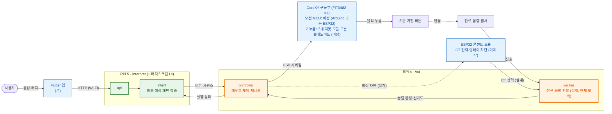

# SimpleLay

> 제24회 임베디드SW경진대회 · 스마트가전 부문 · 팀 자비스
> 기존 가전을 교체하지 않고, 위에 얹어 버튼 조작을 대신하도록 설계한 부착형 가전 제어 시스템(사용 패턴 기반 제안 + 사용자 승인) — 실물 모터·센서로는 아직 검증하지 않았다

---

## 5분 안에 보는 길

하드웨어 없이 노트북 하나에서 모의 실행기(시뮬레이터)로 승인 → 실행 → 결과 흐름을 본다. 모터·센서·가전은 모두 모의다.
자세한 범위는 [브라우저 시뮬레이터 실행](docs/브라우저-시뮬레이터-실행.md)과 [시나리오 v3 §3-1](docs/본선-시연-시나리오-v3.md).

```powershell
py -m venv .venv; .\.venv\Scripts\python.exe -m pip install -e ".[test]"   # 1. 백엔드 환경
$env:SIMPLELAY_LOCAL_APPLIANCES = "home_mw,washer,intercom"                 # 2. 시연 v3 등록 가전 ID
.\.venv\Scripts\python.exe -m rpi.simulator_main --port 8782              # 3. 시뮬레이터 서버
```

- 조작 패널: http://127.0.0.1:8782/simulator — 실행, 실패 주입, 중단, 시연 제안 띄우기.
- 키오스크 웹(`/kiosk/`)은 빌드 산출물을 git에 넣지 않아 `rpi5-touchscreen-app`에서 웹 빌드가 먼저 필요하다(위 문서).
- 시연 영상: 【영상 링크 예정】

## 한 줄 정의

**SimpleLay는 CoreXY 갠트리(조립 중)가 물리 버튼을 대신 누르도록 설계한 부착형 장치에, 라즈베리파이 기반의
"자가 검증 + 선제 제어" 지능 레이어를 얹은 시스템이다.**

사용자의 목적(예: "즉석밥 데워줘")을 버튼 입력 시퀀스로 바꿔 물리적으로 누르고, 전류·음향
센서로 눌렸는지 판정해 실패 시 재시도하는 **폐루프 구조로 설계**했다. 지금 이 판정과 재시도는
층별(L1~L3) 판정 계약과 모의 입력 시험까지이고, L2를 RPi4 운영 경로에 독립적으로 연결하는 일과 실제 센서 통합은 남았다. 실제 모터·센서로는 아직 확인하지 않았다. <!-- L2-C --> 반복 사용 이력(같은 시간대의
같은 조작)을 바탕으로 다음 조작을 먼저 제안하는 기능도 있으나, 실제 사용 이력은 아직 없다.

### 검증 수준 (2026-10-07)

| 항목 | 수준 |
| --- | --- |
| RPi5 ↔ RPi4 LAN 통신(모션은 모의) | 실기기 확인(2026-09-30) |
| 폰(Android 에뮬레이터) → RPi5 → RPi4 모의 실행 | 실기기 확인(2026-09-30) |
| 키오스크 앱 — 15.8형 실패널 표시·부팅 자동 실행 | 실기기 확인(2026-09-30~10-07, 1.8.2 설치) |
| 기상청 날씨 | 실제 호출 확인 |
| 모터 구동(CoreXY)·Z 누름 | 실물 검증 없음 — 갠트리 조립 중 |
| 전류·음향 센서 퓨전 판정(층별 L1~L3) | 층별 계약·모의 입력 시험만 — 독립 L2의 RPi4 운영 경로 연결·실물 센서 통합은 남음 <!-- L2-C --> |
| 비상정지 회로(콘센트 모듈 릴레이) | 회로 미제작 |
| ThinQ 가전 연동 | 모의만(가전 미보유) |
| 공간 감지(레이더) | 하드웨어 없음 |
| 사용 이력 기반 제안 | 시연·테스트 데이터만, 실제 사용 이력 없음 |

순서와 합격 기준은 [하드웨어 연결 설계](docs/하드웨어-연결-설계.md), 하드웨어 결정은
[하드웨어 방향 확정](docs/하드웨어-방향-확정-2026-09-30.md)이 기준이다.

---

## 시스템 구조 (Sense · Interpret · Act)



> **일반 실행 명령은 RPi 5(Interpret)를 거친다. 로컬 비상정지는 RPi 5와 독립이다**(콘센트 모듈 버튼이
> 호스트 응답 없이 릴레이를 여는 설계 — 펌웨어 컴파일까지, 회로 미조립). ESP32의 역할은 콘센트 모듈(CT 전력 측정·
> 릴레이 차단·대기 전력)이며 펌웨어는 컴파일·가짜 모듈 시험까지, 실물 회로는 아직 만들지 않았다. 예전 설계의 BLE↔Wi-Fi 브릿지(`firmware/`)는
> 현재 구성의 경로가 아니다. RPi 5는 의도를 버튼 시퀀스로 해석한 뒤 RPi 4(Act)에 실행을 위임하고,
> RPi 4가 폐루프 제어(누름 → 센서 판정 → 재시도, 현재 모의)를 맡는다. RPi5 → RPi4 실행은 UART 규약
> (`SIMPLELAY_ACT_MODE=uart`, [docs/protocol.md](docs/protocol.md))이며 지금은 LAN 위 TCP↔가상 시리얼로 확인했고, 가전마다 둔 ESP32
> 노드를 거치는 경로(HTTP·ESP-NOW)는 구 설계로 코드만 남아 있다(컴파일만, 현재 구성의 경로 아님). 배선 기준 전체 그림은
> [docs/개발현황.md](docs/개발현황.md) 참고.

| 계층 | 보드 | 역할 |
| --- | --- | --- |
| **Interpret** | RPi 5 (8GB) | 의도 해석(규칙 기반, LLM 계층은 선택·기본 꺼짐) · 선제 제안 · 앱/터치스크린 API |
| **Act** | RPi 4 (4GB) | 폐루프 제어(누름·재시도) · 전류/음향 판정(설계, 현재 모의) · 정지 요청. 가산점 구성에서 RPi Zero 자리를 맡는다(2026-10-05 팀 확정, 역할 매핑). 세 보드 실제 연동 증거는 모의·미측정([증거 대장](docs/가산점-증거-대장.md)) |
| **콘센트 모듈** | ESP32 | CT 전력 측정 · 릴레이 비상 차단 · 대기 전력 (펌웨어 컴파일·가짜 모듈 시험까지, 회로 미제작) |
| **Node (구 설계)** | ESP32 (가전마다) | 실행 중계 — HTTP 또는 ESP-NOW (구 설계·컴파일만, 현재 구성의 경로 아님) |
| **Act 하드웨어** | 모션 MCU + Z 누름 장치 | CoreXY(FIT0482 ×2). 모션 MCU는 미정(Arduino 또는 ESP32 — 10/5 팀원이 ESP32로 시험 중). Z는 스위치봇 모듈 또는 솔레노이드(미정). 갠트리 조립 중, 코드는 mock |
| **App** | Flutter 폰 앱 · Flutter 키오스크(RPi5) | 음성/터치 입력, 상태 확인. 키오스크는 15.8형 실패널에서 표시·부팅 자동 실행 확인 |

> **핵심:** 각 계층의 "자가 검증 + 선제 제어" 지능 레이어(intent/controller/verifier)가
> SimpleLay만의 신규 구현이다. 재사용과 신규의 경계는
> [docs/reuse-boundary.md](docs/reuse-boundary.md)에 명확히 구분해 둔다.

---

## 왜 폐루프인가 (Touch Bridge와의 결정적 차이)

- **Touch Bridge (한이음)** = 반응형. 사용자가 명령하면 누르고 끝난다.
- **SimpleLay (본 대회)** = 선제형 + **자가 검증**. L1은 누름 장치 전류로 반응을 판정하고 음향은 보조 신뢰도로 쓴다.
  L3는 대상 CT 전력으로 가전 동작 시작을 확인하며, 확인 실패 시 자동 재입력 없이 안전 정지한다(현재 모의 입력으로만 검증, 실물 미검증). 나아가 사용 패턴 통계로 먼저 제안한다.

이 **폐루프 검증**이 SimpleLay의 기술적 차별점이자, 결선 시연의 핵심 장면이다.
(시연의 실패는 소프트웨어로 주입하며, 재시도 흐름을 보여준다. 센서 판정 임계값은 실측 전 추정값이다.)

---

## 디렉토리 구조

```
simplelay/
├── docs/                   # 설계 · 통신 프로토콜 · 버튼맵 · 폐루프 설계 · devlog
│   └── button-maps/        #   가전별 버튼 그리드 JSON (격자 칸 번호, mm 좌표 아님)
├── rpi/                    # ★ RPi5 백엔드 (Interpret) + 공용 폐루프 모듈
│   ├── api/                #   FastAPI HTTP 레이어 (router · deps · schemas · service)
│   ├── intent/             #   의도 해석 · 반복 이력 기반 제안
│   ├── controller/         #   폐루프 제어 (명령 → 검증 → 재시도)
│   ├── verifier/           #   전류·음향 센서 판정
│   ├── services/           #   가전·노드 레지스트리, UART·노드 클라이언트, 이력, 개발자 세션
│   ├── bench/              #   원시 센서 기록기 (판정 없음, 하드웨어 수령 직후 측정용)
│   ├── tests/              #   백엔드 테스트
│   └── main.py             #   uvicorn 진입점 (python -m rpi.main)
├── rpi4/                   # RPi4 Act 실행기 (UART 수신 → 폐루프 실행, 모션은 아직 mock)
├── firmware-outlet/        # ESP32 콘센트 모듈 펌웨어 (CT 전력 · 릴레이 · 비상정지 래치, 컴파일만)
├── firmware-motion/        # 모션 MCU 참고 펌웨어 (CoreXY · Z 누름, board_config.h로 팀원 코드와 합칠 준비, 컴파일만)
├── firmware/               # 구 설계(미사용) — ESP32 BLE↔UART 브릿지
├── firmware-node/          # 구 설계(미사용) — ESP32 가전 노드 (HTTP · ESP-NOW)
├── app/                    # ★ Flutter 폰 앱 (음성 · 제안 · 상태 · 가전 등록 · 설정)
├── rpi5-touchscreen-app/   # Flutter 키오스크 (RPi5, 800x480 설계 캔버스를 15인치 패널에 비율 확대)
└── scripts/                # RPi 설치 · systemd 유닛 · 키오스크 배포
```

---

## 진행 상황

일정·완료 기준은 [docs/결선로드맵.md](docs/결선로드맵.md), 기능별 현황은
[docs/개발현황.md](docs/개발현황.md)가 기준이다. 최신 변경과 테스트 범위·수치는
`CLAUDE.md`의 "현재 기준" 절과 날짜별 `docs/devlog_YYYY-MM-DD*.md`에 기록했다. 전체 테스트와 일부 회귀 테스트를 구분해서 읽는다.

| 영역 | 상태 |
| --- | --- |
| 폰 앱 · 키오스크 · 백엔드 API · 제안 | ✅ 습관 근거·피드백·실행 복구 소프트웨어 검증, 실물 통합 대기 |
| RPi5 ↔ RPi4 실행·정지 경로 | ✅ LAN 통신·모의 모션으로 실기기 확인(2026-09-30), 모터 미연결 |
| ESP32 노드 (HTTP · ESP-NOW) | ⏳ 구 설계·컴파일만(현재 구성의 경로 아님) |
| **실제 모터 구동 · 센서 누름 판정 · 비상정지 회로** | ⏳ 갠트리 조립 중, 비상정지 회로 미제작. 다음은 H0~H1 ([설계](docs/하드웨어-연결-설계.md)) |
| 두 번째 가전 | ⏳ 전자레인지 1대 실제 폐루프 성공 뒤 |

---

## 공감지능 구현 현황 (9/21 구현, 시험은 모의·합성 이력)

- **습관 근거:** 최근 28일의 실제·직접·성공 사용을 가전과 시간대별로 집계한다. 기본적으로 서로 다른 3일의 반복을 확인하며 모의·데모·추천 승인 기록은 자연 습관 학습에서 제외한다.
- **설명 가능한 제안:** 앱과 키오스크 설정의 ‘생활 습관 알아가기’에서 기록과 기준을 확인한다. `/learning` 조회는 제안 생성이나 실행을 일으키지 않는다.
- **사용자 선택 존중:** 건너뛰기와 루틴 숨김을 구분하고, 같은 시간대의 반복 권유를 제한한다. 직접 완료한 조작이나 수동 재실 입력의 부재, 환경 근거 소멸로 무효해진 제안을 철회한다.
- **피드백 추적:** `/suggestions/events`에서 최근 생성·승인·건너뛰기·숨김·철회 사유를 조회한다. 최대 2,000건 보관이며 시연 출처를 구분한다. 생성은 실제 화면 노출을 뜻하지 않고, 실행 접수도 성공 완료를 뜻하지 않는다.
- **실행 상태:** 작업 ID로 완료를 대조하고, 이전 작업 결과가 새 실행에 섞이지 않게 한다. 결과 유실은 ‘확인 불가’로 표시하며 자동 재실행하지 않는다.

현재 공감지능은 사용 기록과 맥락에 기반한 통계·규칙 기반 적응이다. 개인 식별이나 피드백 기반 선호도 모델 학습, 승인 없는 자동 실행까지 구현한 것은 아니다. 습관 집계·제안 유효성·실행 게이트는 RPi 측에서 처리하며, 설정된 외부 의도 해석 서비스의 역할과 구분한다.

2026-10-07 기준 RPi5에 키오스크 앱(1.8.2)을 설치해 부팅 자동 실행까지 확인했고, 폰(에뮬레이터)→RPi5→RPi4 모의 실행을 같은 LAN에서 확인했다. 실폰 동시 조작·연결 끊김·재연결 실물 확인과 모터 시험은 아직 하지 않았다.

---

## 팀

| 이름 | 역할 |
| --- | --- |
| 박성원 | SW 전반(앱 · 키오스크 · RPi) · 구동부 연동 |
| 서예솔 | HW 총괄 · ESP32 · 센서 · 하우징 |

---

## 관련 문서

| 문서 | 내용 |
| --- | --- |
| [docs/본선-시연-시나리오-v3.md](docs/본선-시연-시나리오-v3.md) | 결선 시연 v3 — 전자레인지·세탁기·인터폰 "한 사람의 하루", 등급별 진행, §3 모의 리허설 |
| [docs/시연-v3-구현-갭.md](docs/시연-v3-구현-갭.md) | v3 시연의 남은 구현 갭 |
| [docs/결선-운영-런북.md](docs/결선-운영-런북.md) | 결선 당일 설치·리허설·장애 대응 |
| [docs/submission/개발완료보고서-초안.md](docs/submission/개발완료보고서-초안.md) · [작품소개서](docs/submission/작품소개서-초안.md) · [체크리스트](docs/submission/제출-체크리스트.md) | 제출 서류 초안 |
| [docs/가산점-증거-대장.md](docs/가산점-증거-대장.md) | 가산점 항목별 증거와 미측정 칸 |
| [docs/공감지능-기능-UI-실행계획-2026-09-21.md](docs/공감지능-기능-UI-실행계획-2026-09-21.md) | 기능·UI 계획 및 차수별 진행 |
| [docs/개발현황.md](docs/개발현황.md) | 실제 배선 기준 아키텍처 · 기능 현황 · 환경 변수 |
| [docs/결선로드맵.md](docs/결선로드맵.md) | 결선까지 주차별 일정 · 완료 기준 |
| [docs/하드웨어-연결-설계.md](docs/하드웨어-연결-설계.md) | 모션 어댑터 계약 · 센서 캡처 · 정지 명칭 · 수령 직후 검증 순서 |
| [docs/reuse-boundary.md](docs/reuse-boundary.md) | Touch Bridge 재사용 vs SimpleLay 신규 구현 경계 (대회 정당성) |
| [docs/architecture.md](docs/architecture.md) | 시스템 아키텍처 · 데이터 흐름 · 계층 계약 |
| [docs/actuator-design.md](docs/actuator-design.md) | 구동부(CoreXY) 기구 설계 확정 사항 |
| [docs/closed-loop-design.md](docs/closed-loop-design.md) | 폐루프 검증 설계 (센서 → 판정 → 재시도) |
| [docs/roadmap.md](docs/roadmap.md) | 마일스톤 · 심사평 대응 계획 |
| [docs/sensor-spec.md](docs/sensor-spec.md) | ACS712 전류 센서 + 음향 감지 명세 (M1 구현 참조) |
| [docs/esp32-firmware-spec.md](docs/esp32-firmware-spec.md) | ESP32 BLE GATT + UART 릴레이 펌웨어 명세 |
| [docs/design-system.md](docs/design-system.md) | Flutter 앱 디자인 시스템 — 색상 · 컴포넌트 · 애니메이션 |

## 라이선스

[MIT](LICENSE) — 팀 자비스(박성원·서예솔).
