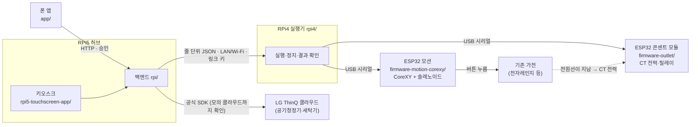

# SimpleLay

> 제24회 임베디드SW경진대회 · 스마트가전 부문 · 팀 자비스

**버튼식 가전을 바꾸지 않고, 위에 얹은 장치가 사용자 승인을 받아 버튼을 대신 누르고 전력(CT)으로 결과를 확인하는 부착형 가전 제어 시스템.**
라즈베리파이 두 대(RPi5 허브·RPi4 실행기)와 ESP32 두 개(CoreXY 모션·콘센트 CT 모듈), 폰 앱·터치 키오스크로 이루어진다.
2026-10-13 기준 모터는 실물로 돌려 봤지만 **실제 가전 버튼 누름과 CT 판정은 아직 실물 검증 전**이다(아래 검증 수준 표).

## 폴더와 보드

| 폴더 | 무엇 | 어디서 돈다 |
| --- | --- | --- |
| [`rpi/`](rpi/README.md) | 허브 백엔드(FastAPI) — 의도 해석·승인·제안·실행 상태·폰/키오스크 API. 이름 `rpi/`는 보드 하나로 설계하던 시절에서 왔다 | RPi5 |
| [`rpi4/`](rpi4/README.md) | 실행·검증기 — 버튼 순서를 모션 보드로 누르고 센서·CT로 결과 확인, 정지 보고 | RPi4 |
| [`rpi5-touchscreen-app/`](rpi5-touchscreen-app/README.md) | 15.8형 터치 패널 키오스크(Flutter Linux) | RPi5 + 패널 |
| [`app/`](app/README.md) | 폰 앱(Flutter, Android) — 승인·실행·정지·기록·가전 추가 | 폰 |
| [`firmware-motion-corexy/`](firmware-motion-corexy/README.md) | ESP32 모션 펌웨어 — CoreXY(FIT0482 ×2, 엔코더 폐루프) + 솔레노이드 Z | ESP32(모션) |
| [`firmware-outlet/`](firmware-outlet/README.md) | ESP32 콘센트 모듈 — CT 전력 2채널(L3 동작 확인)·릴레이·비상정지 래치 | ESP32(콘센트) |
| [`firmware-motion/`](firmware-motion/README.md) | 모션 규약 표 [`protocol_table.json`](firmware-motion/protocol_table.json) 기준(시험·현행 펌웨어가 따름). 펌웨어 자체는 미채택 참고 구현 | — |
| [`firmware/`](firmware/README.md) · [`firmware-node/`](firmware-node/README.md) | 예비 경로(옛 설계: BLE 브리지·가전별 노드). 현행 구성의 경로 아님 | — |
| [`packages/`](packages/) | 폰·키오스크가 함께 쓰는 Dart 패키지(루틴 리허설 모델) | — |
| [`deploy/`](deploy/) | 보드 배포 스크립트·Dockerfile(RPi5 백엔드·RPi4 실행기·키오스크 감시) | RPi5·RPi4 |
| [`scripts/`](scripts/) | 키오스크 배포·실측 그래프·점검 도구 | 개발 PC |
| [`docs/`](docs/README.md) | 설계·시연·실측·제출 문서. 입구는 [docs/README.md](docs/README.md) | — |

## 구조



일반 실행은 폰·키오스크 → RPi5(승인 결속) → RPi4(누름·확인) 순서로만 간다. 정지는 폰·키오스크·음성 "멈춰"·
콘센트 모듈 버튼(설계)에서 걸 수 있다. 규약은 [docs/protocol.md](docs/protocol.md), 배선 기준 그림은
[docs/개발현황.md](docs/개발현황.md), 재사용(팀원 Touch Bridge CoreXY 기구·펌웨어)과 신규의 경계는
[docs/reuse-boundary.md](docs/reuse-boundary.md).

## 검증 수준 (2026-10-13)

"실물 확인"은 실제 보드·기기에서 본 것, "모의만"은 가짜 장치·모의 클라우드·시험 코드로만 확인한 것이다. 근거는 날짜별 [devlog](docs/devlog/).

| 항목 | 수준 | 근거 |
| --- | --- | --- |
| RPi5 ↔ RPi4 통신(LAN, 모션은 모의) | **실물 확인** 9/30 | [lan-deploy](docs/devlog/devlog_2026-09-30-lan-deploy.md) |
| 폰(Android 에뮬레이터) → RPi5 → RPi4 모의 실행 | **실물 확인**(보드) 9/30 | [lan-deploy](docs/devlog/devlog_2026-09-30-lan-deploy.md) · [9/30 밤 인계](docs/archive/인계-2026-09-30-데스크톱-밤.md) |
| 키오스크 15.8형 실패널 표시·부팅 자동 실행 | **실물 확인** 9/30~10/7 | [lan-deploy](docs/devlog/devlog_2026-09-30-lan-deploy.md) · [desktop-s11-deploy](docs/devlog/devlog_2026-10-06-desktop-s11-deploy.md) |
| 기상청 날씨 | **실제 호출 확인**(로컬) 9/30 | [9/30 인계](docs/archive/인계-2026-09-30.md) |
| ESP32 모션 보드: 모터 A·B 개루프 구동·엔코더 계수 | **실물 확인** 10/12 | [motion-bringup](docs/devlog/devlog_2026-10-12-motion-bringup.md) |
| 폰(에뮬레이터) → RPi5 → RPi4(Wi-Fi) → ESP32 조이스틱 이동·정지 전달 | **실물 확인** 10/12(모터 축 기준, 벨트 미완성으로 캐리지는 안 움직임) | [motion-bringup](docs/devlog/devlog_2026-10-12-motion-bringup.md) |
| 모션 펌웨어 폐루프 이동·스톨 원점·솔레노이드 누름 | 컴파일만 | [motion-firmware-merge](docs/devlog/devlog_2026-10-10-motion-firmware-merge.md) |
| 누름·동작 확인(L1 전류·L3 CT, 음향은 보조) | 모의만 — 층별 계약·모의 입력 시험, L2는 RPi4 운영 경로 미연결 | [eval64-fix](docs/devlog/devlog_2026-10-08-eval64-fix.md) |
| 정지 확인 단계(보냄·모션 보드 확인·멈춤 확인) | 모의만(가짜 MCU) | [stop-confirm](docs/devlog/devlog_2026-10-13-stop-confirm.md) |
| 콘센트 모듈(CT 2채널·릴레이·비상정지 래치) | 컴파일·가짜 모듈 시험만, 회로 미제작 | [outlet-module](docs/devlog/devlog_2026-10-05-outlet-module.md) |
| LG ThinQ(공식 SDK, 기기 발견·추가, 세탁기·공기청정기 명령) | 모의만 — 모의 클라우드 끝-끝 시험, 실제 클라우드·실가전 미검증 | [thinq-sdk](docs/devlog/devlog_2026-10-13-thinq-sdk.md) · [thinq-discovery](docs/devlog/devlog_2026-10-13-thinq-discovery.md) |
| 사용 이력 기반 제안 | 모의만 — 시연·시험 데이터, 실제 사용 이력 없음 | [routines](docs/devlog/devlog_2026-09-30-routines.md) |
| CoreXY로 실제 가전 버튼 누름 | 미착수(갠트리 벨트·레일 조정 중) | [motion-bringup](docs/devlog/devlog_2026-10-12-motion-bringup.md) |
| CT로 실제 조리 시작·완료 판정 실측 | 미착수 | [실측 기록표](docs/실측-기록표.md) |
| 조리 완료 → 공기청정기 자동 실행 규칙(v4 시연) | 미착수 | [시연 계획 v4](docs/본선-시연-계획-v4.md) |
| 비상정지 전원 차단 회로 · 공간 감지(레이더) | 미착수(회로 미제작 · 하드웨어 없음) | [하드웨어 연결 설계](docs/하드웨어-연결-설계.md) |

## 실행 방법

하드웨어 없이 노트북 하나에서 모의 실행기(시뮬레이터)로 승인 → 실행 → 결과 흐름을 본다. 모터·센서·가전은 모두 모의다.

```powershell
py -m venv .venv; .\.venv\Scripts\python.exe -m pip install -e ".[test]"   # 1. 백엔드 환경
$env:SIMPLELAY_LOCAL_APPLIANCES = "home_mw,washer,intercom"                 # 2. 시연 등록 가전 ID
.\.venv\Scripts\python.exe -m rpi.simulator_main --port 8782              # 3. 시뮬레이터 서버
```

- 조작 패널: http://127.0.0.1:8782/simulator — 실행, 실패 주입, 중단, 시연 제안 띄우기.
- 키오스크 웹(`/kiosk/`)은 빌드 산출물을 git에 넣지 않아 `rpi5-touchscreen-app`에서 웹 빌드가 먼저 필요하다
  ([브라우저 시뮬레이터 실행](docs/브라우저-시뮬레이터-실행.md)).
- 시험: 백엔드+RPi4 `.\.venv\Scripts\python.exe -m pytest`(Windows는 `$env:PYTHONUTF8=1`),
  폰 `cd app; flutter test --exclude-tags screenshot`, 키오스크 `cd rpi5-touchscreen-app; flutter test --exclude-tags screenshot`.
- 보드 배포·결선 당일 절차는 [결선 운영 런북](docs/결선-운영-런북.md).
- 시연 영상: 【영상 링크 예정】

## 문서 입구

- [docs/README.md](docs/README.md) — 처음 볼 문서 5개, 시연·하드웨어·ThinQ·제출 문서, devlog·archive 안내.
- 시연: [본선 시연 계획 v4](docs/본선-시연-계획-v4.md) · 실측: [실측 기록표](docs/실측-기록표.md) · 제출: [제출 체크리스트](docs/submission/제출-체크리스트.md)
- 일정: 결선 서류 제출 10/28(수) 14:00, 발표 11/6(금) — 공식 일정은 [본선 실행 계획 §0](docs/본선-실행계획-2026-09-30.md).
- 작업 기록은 날짜별 [docs/devlog/](docs/devlog/), 지난 인계·폐기 문서는 [docs/archive/](docs/archive/)에 보관한다.

---

## 왜 폐루프인가 (Touch Bridge와의 결정적 차이)

- **Touch Bridge (한이음)** = 반응형. 폰 → ESP32(BLE)로 명령하면 누르고 끝난다. 갠트리·ESP32 모션 펌웨어는 SimpleLay와 같다.
- **SimpleLay (본 대회)** = 선제형 + **자가 검증**. L1은 누름 장치 전류로 반응을 판정하고 음향은 보조 신뢰도로 쓴다.
  L3는 대상 CT 전력으로 가전 동작 시작을 확인하며, 확인 실패 시 자동 재입력 없이 안전 정지한다(현재 모의 입력으로만 검증, 실물 미검증). 나아가 사용 패턴 통계로 먼저 제안한다.

이 **폐루프 검증**이 SimpleLay의 기술적 차별점이자, 결선 시연의 핵심 장면이다.
(시연의 실패는 소프트웨어로 주입하며, 재시도 흐름을 보여준다. 센서 판정 임계값은 실측 전 추정값이다.)

---

## 공감지능 구현 현황 (9/21 구현, 시험은 모의·합성 이력)

- **습관 근거:** 최근 28일의 실제·직접·성공 사용을 가전과 시간대별로 집계한다. 기본적으로 서로 다른 3일의 반복을 확인하며 모의·데모·추천 승인 기록은 자연 습관 학습에서 제외한다.
- **설명 가능한 제안:** 앱과 키오스크 설정의 ‘생활 습관 알아가기’에서 기록과 기준을 확인한다. `/learning` 조회는 제안 생성이나 실행을 일으키지 않는다.
- **사용자 선택 존중:** 건너뛰기와 루틴 숨김을 구분하고, 같은 시간대의 반복 권유를 제한한다. 직접 완료한 조작이나 수동 재실 입력의 부재, 환경 근거 소멸로 무효해진 제안을 철회한다.
- **피드백 추적:** `/suggestions/events`에서 최근 생성·승인·건너뛰기·숨김·철회 사유를 조회한다. 최대 2,000건 보관이며 시연 출처를 구분한다. 생성은 실제 화면 노출을 뜻하지 않고, 실행 접수도 성공 완료를 뜻하지 않는다.
- **실행 상태:** 작업 ID로 완료를 대조하고, 이전 작업 결과가 새 실행에 섞이지 않게 한다. 결과 유실은 ‘확인 불가’로 표시하며 자동 재실행하지 않는다.

현재 공감지능은 사용 기록과 맥락에 기반한 통계·규칙 기반 적응이다. 개인 식별이나 피드백 기반 선호도 모델 학습, 승인 없는 자동 실행까지 구현한 것은 아니다. 습관 집계·제안 유효성·실행 게이트는 RPi 측에서 처리하며, 설정된 외부 의도 해석 서비스의 역할과 구분한다.

2026-10-07 기준 RPi5에 키오스크 앱(1.8.2)을 설치해 부팅 자동 실행까지 확인했고, 폰(에뮬레이터)→RPi5→RPi4 모의 실행을 같은 LAN에서 확인했다. 실폰 동시 조작·연결 끊김·재연결 실물 확인과 모터 시험은 아직 하지 않았다.

---

## 팀

| 이름 | 역할 |
| --- | --- |
| 박성원 | SW 전반(앱 · 키오스크 · RPi) · 구동부 연동 |
| 서예솔 | HW 총괄 · ESP32 · 센서 · 하우징 |

---

## 라이선스

[MIT](LICENSE) — 팀 자비스(박성원·서예솔).
