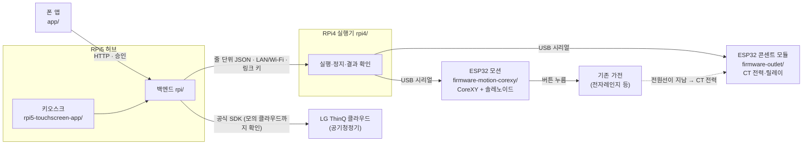

# SimpleLay

> 제24회 임베디드SW경진대회 · 스마트가전 부문 · 팀 자비스

**쓰던 버튼식 가전을 바꾸지 않고, 조작부 위에 얹은 장치가 사용자 승인을 받아 버튼을 대신 누르고 콘센트 전력으로 가전이 실제로 동작했는지 확인하는 부착형 가전 제어 시스템.**

## 누구를 · 왜

- **누구를:** 작은 버튼과 여러 단계 조작이 어려운 고령자·저시력 사용자, 그리고 처음 설치·등록을 맡는 보호자·설치자.
- **왜:** 스마트 기능이 없는 기존 가전을 새로 사지 않고도, 장치가 할 일을 **제안**하고 사용자가 **승인**한 것만 누르며 결과를 **확인**해 알려 준다.
- **역할:** 등록(사진·버튼 위치)은 보호자·설치자가 폰으로, 매일 쓰는 것(승인·거절·정지)은 당사자가 큰 글씨 키오스크와 폰으로 한다.

## 단일 버튼 푸셔 방식과 다른 점

버튼 위에 붙여 버튼 하나를 누르는 장치(단일 버튼 푸셔)와 **설계가 어떻게 다른지**를 적은 표다. 특정 상용 제품과 성능을 비교한 표가 아니다 —
상용 제품의 기능은 공개 사양에 적힌 것만 출처와 함께 [실측 기록표](docs/실측-기록표.md) §3에 따로 적고, 우리 장치에서 **동작 확인 기능을 끈 비교 조건** 실험은 [제출 전 검증 과업](docs/제출전-검증-과업.md) §1에서 한다.

| | 단일 버튼 푸셔 — 공개 사양 조사(SwitchBot Bot·Fingerbot Plus, 2026-10-14) | SimpleLay | 지금 검증 수준 |
| --- | --- | --- | --- |
| 버튼 등록 | 누를 스위치·버튼 옆에 장치를 붙인다(3M 스티커, 공구 없음)(S1) | 조작부 **사진에서** 버튼 위치·이름을 등록한다(폰 가전 추가 5단계) | 등록 화면·좌표 변환은 모의, 실제 조작부 보정은 예정 |
| 여러 버튼 순서 | 장치 하나가 붙인 스위치·버튼 하나를 누르는 구조(S1)(S3). 장치 하나로 여러 버튼을 순서대로 누르는 기능은 **확인하지 못함** | 갠트리 하나가 한 조작부의 **여러 버튼을 순서대로** 누른다(즉석밥 → 시작) | 모터·정지는 실물(모터 축), 캐리지 이동·실제 누름은 예정 |
| 눌렸는지·가전이 동작했는지 | SwitchBot Bot의 상태값 `power`는 ON/OFF 상태이며 스위치 모드에서만 유효하다(S2). 누름이 들어갔는지·가전이 동작했는지 확인하는 기능은 두 제품 공개 사양에서 **확인하지 못함** | 콘센트 전력(CT)으로 가열 시작·종료를 **센서로 확인**하고, 못 하면 "확인 못 함"·안전 정지로 **그대로 보고**, 결과를 잃으면 다시 보내지 않는다 | 판정 코드는 모의, CT 실측은 예정 |
| 정지 | 확인하지 못함 | 정지를 "보냄 → 모션 보드 확인 → 멈춤 확인" 세 단계로 나눠 보고한다 | 실물(모터 축, 10/13 10회) |
| 다른 기기와 함께 | 앱·허브 경유 원격·음성 비서(Alexa·Google·Siri) 연동(S1)(S3). LG ThinQ 가전과 한 흐름으로 다루는 기능은 **확인하지 못함** | LG ThinQ 가전도 **같은 승인·결과 흐름**으로 다룬다 | 공식 SDK, 실제 공기청정기 1대로 찾기·추가·상태·제어 확인(10/15) |
| 제안·자동 실행 | 앱 타이머·일정 실행(S1)(S3). 사용 기록에서 제안하는 기능은 **확인하지 못함** | 사용 기록에서 **습관을 제안**하고, 사용자가 허용한 조건에서만 낮은 위험 동작(공기청정기 풍량)을 자동으로 한다 | 모의(합성 이력·주입 사건) |

"확인하지 못함"은 공개 사양에서 찾지 못했다는 뜻이지 기능이 없다는 뜻이 아니다. 상용 제품을 사서 시험하지 않았고, 이 표로 성능 우위를 말하지 않는다. 출처 전체는 [실측 기록표](docs/실측-기록표.md) §3.

- S1 SwitchBot Bot 공식 제품 페이지 <https://www.switch-bot.com/products/switchbot-bot> (2026-10-14 확인).
- S2 SwitchBot 공식 API 문서(OpenWonderLabs/SwitchBotAPI) Bot 항목 <https://github.com/OpenWonderLabs/SwitchBotAPI/blob/main/devices/others/bot.md> (2026-10-14 확인).
- S3 Adaprox Fingerbot Plus 공식 제품 페이지 <https://www.adaprox.io/products/fingerbot-plus> (2026-10-14 확인).

적용 경계: 평면 누름 버튼만(다이얼 제외), 조작부 하나에 갠트리 하나, 전자레인지 음식 넣고 빼기는 사람이 한다.

## 시연 장면 (결선 v4 요약)

[본선 시연 계획 v4](docs/본선-시연-계획-v4.md) — 10분 중 시연 약 6분.

1. **제안 거절** — "안 할래요"를 누르면 장치는 움직이지 않는다.
2. **첫 조리 승인** — 갠트리가 전자레인지 버튼을 실제로 누름 → CT로 가열 시작 확인 → 가열 종료 감지(조리 완료가 아닐 수 있음) → 공기청정기 강풍 제안 → "다음부터도 자동으로" 허용(조건·대상·동작 확인 화면) → ThinQ로 바꾸고 상태 재조회로 확인.
3. **같은 조건에서 다시** — 조리는 다시 승인, 가열 종료 뒤 공기청정기는 추가 승인 없이 바뀐다.
4. **기록 확인 → 자동 실행 끄기.**
5. **일부 실패 처리** — 명령은 보냈지만 확인하지 못하면 "결과 확인 불가"로 남기고 다시 보내지 않는다.

버튼 누름은 매번 승인한다. 자동으로 하는 것은 허용한 조건의 공기청정기 풍량 변경 하나뿐이다.

## 사진 · 영상

> 사진 추가 예정 — 전자레인지에 붙인 갠트리, 콘센트 모듈, 무대 배치(실물 촬영 뒤 넣는다).
>
> 영상 추가 예정 — 승인 → 버튼 누름 → CT 확인 → 공기청정기 변경(30초).

지금 저장소에 있는 그림은 화면 캡처와 구성도뿐이다([제출 그림](docs/submission/그림-대응표.md)).

## 폴더와 보드

| 폴더 | 무엇 | 어디서 돈다 |
| --- | --- | --- |
| [`rpi/`](rpi/README.md) | 허브 백엔드(FastAPI) — 의도 해석·승인·제안·실행 상태·폰/키오스크 API. 이름 `rpi/`는 보드 하나로 설계하던 시절에서 왔다. `rpi/controller`·`rpi/verifier`는 RPi4도 쓰는 공용 라이브러리 | RPi5 (+공용) |
| [`rpi4/`](rpi4/README.md) | 실행·검증기 — 버튼 순서를 모션 보드로 누르고 센서·CT로 결과 확인, 정지 보고 | RPi4 |
| [`rpi5-touchscreen-app/`](rpi5-touchscreen-app/README.md) | 15.8형 터치 패널 키오스크(Flutter Linux) | RPi5 + 패널 |
| [`app/`](app/README.md) | 폰 앱(Flutter, Android) — 승인·실행·정지·기록·가전 추가 | 폰 |
| [`firmware-motion-corexy/`](firmware-motion-corexy/README.md) | ESP32 모션 펌웨어 — CoreXY(FIT0482 ×2, 엔코더 폐루프) + 솔레노이드 Z | ESP32(모션) |
| [`firmware-outlet/`](firmware-outlet/README.md) | ESP32 콘센트 모듈 — CT 전력 2채널(가전 동작 확인)·릴레이·비상정지 래치 | ESP32(콘센트) |
| [`firmware-motion/`](firmware-motion/README.md) | 모션 규약 표 [`protocol_table.json`](firmware-motion/protocol_table.json) 기준(시험·현행 펌웨어가 따름). 펌웨어 자체는 미채택 참고 구현 | — |
| [`firmware/`](firmware/README.md) · [`firmware-node/`](firmware-node/README.md) | 예비 경로(옛 설계: BLE 브리지·가전별 노드). 현행 구성의 경로 아님 | — |
| [`packages/`](packages/README.md) | 폰·키오스크가 함께 쓰는 Dart 패키지(루틴 리허설 모델) | — |
| [`deploy/`](deploy/README.md) | 보드 배포 스크립트·Dockerfile(RPi5 백엔드·RPi4 실행기·키오스크 감시) | RPi5·RPi4 |
| [`scripts/`](scripts/README.md) | 키오스크 웹 빌드·실측 그래프·점검 도구(옛 systemd 배포 파일 포함) | 개발 PC |
| [`docs/`](docs/README.md) | 설계·시연·실측·제출 문서. 입구는 [docs/README.md](docs/README.md) | — |



일반 실행은 폰·키오스크 → RPi5(승인한 명령과 같은지 대조) → RPi4(누름·확인) 순서로만 간다. 정지는 폰·키오스크·음성 "멈춰"·
콘센트 모듈 버튼(설계)에서 걸 수 있다. 규약은 [docs/protocol.md](docs/protocol.md). 갠트리와 모션 펌웨어의 제어 핵심은 팀원의 이전 작품(Touch Bridge)과
공유하고, SimpleLay가 새로 만든 것은 그 위의 승인·확인·제안·콘센트 모듈·화면이다 — [재사용 경계](docs/reuse-boundary.md).

**용어:** **CT** = 전원선에 거는 전류 센서(가전 소비 전력을 잼). **L1~L3** = 확인 단계 — L1 누름 장치 쪽 전류로 "눌렸나", L2 가전 소리로 "받아들였나"(실행 경로에 아직 연결 안 함), L3 CT 전력으로 "가전이 동작했나". **ThinQ** = LG 스마트 가전 클라우드.

## 검증 수준 (2026-10-15)

"실물 확인"은 실제 보드·기기에서 본 것, "모의까지"는 가짜 장치·모의 클라우드·시험 코드로만 확인한 것, "제출 전 예정"은 아직 하지 않은 것이다.
커밋·측정 조건은 각 날짜의 작업 기록(devlog)에 있다.

| 항목 | 수준 | 근거 |
| --- | --- | --- |
| 폰 → RPi5 → RPi4 실행 경로, 15.8형 키오스크 패널 표시·부팅 자동 실행 | **실물 확인** 9/30~10/7 | [9/30](docs/devlog/devlog_2026-09-30-lan-deploy.md) · [10/6](docs/devlog/devlog_2026-10-06-desktop-s11-deploy.md) |
| 모터 두 개 구동·엔코더 계수, 폰 조이스틱 → 모터 이동·정지 전달 | **실물 확인** 10/12 (벨트 없는 시험대 — 모터 축만 돎) | [10/12](docs/devlog/devlog_2026-10-12-motion-bringup.md) |
| 일반 실행 순서(이동 → 누름 신호 → 이동 → 사용자 정지) | **실물 확인** 10/13 (모터 축, 솔레노이드 없이 신호만) | [10/13](docs/devlog/devlog_2026-10-13-desktop-board.md) |
| 정지 확인 세 단계 | **실물 확인** 10/13 — 10회 모두 멈춤 확인, 모션 보드 응답 중앙 약 11 ms, 멈춤 확인까지 중앙 160 ms (모터 축, 개발자 조그 경로) | [10/13](docs/devlog/devlog_2026-10-13-desktop-board.md) |
| 모터 걸림 → 다시 누르지 않고 멈춤·원인 표시, USB 다시 꽂힘 → 실행기 재시작 없이 다시 연결, 키오스크 정지 문장 | **실물 확인** 10/14 (같은 커밋을 네 곳에 배포) | [10/14](docs/devlog/devlog_2026-10-14-desktop-board.md) |
| 두 보드를 거친 자동 실행 허용 흐름(가열 종료 **주입** → 허용 → 다음 사건에 승인 없이 전송) | **실물 보드, 입력은 모의** 10/14 (모션·ThinQ 모의) | [10/14](docs/devlog/devlog_2026-10-14-desktop-board.md) |
| 눌렸는지·가전 동작 판정(L1·L3), 습관 제안, 사진 버튼 등록 | 모의까지 — 합성 입력·합성 이력 시험 | [10/8](docs/devlog/devlog_2026-10-08-eval64-fix.md) · [9/30](docs/devlog/devlog_2026-09-30-routines.md) |
| 콘센트 모듈(CT·릴레이·비상정지 래치) | 모의까지 — 펌웨어 컴파일·가짜 모듈 시험, 회로 미제작 | [10/5](docs/devlog/devlog_2026-10-05-outlet-module.md) |
| LG ThinQ 공기청정기 — 실제 클라우드로 기기 찾기·추가, 지금 상태(전원·풍량·미세먼지) 표시, 폰에서 풍량 변경 → 상태 재조회로 변경 확인 | **실물 확인** 10/15 (실제 공기청정기 1대, 집 Wi-Fi, 허브는 노트북) | [10/15](docs/devlog/devlog_2026-10-15-thinq-real.md) |
| ThinQ 이미 목표값이면 보내지 않음, 가열 종료 → 공기청정기 자동 실행 허용 | 모의까지 — 모의 클라우드 끝-끝 | [SDK](docs/devlog/devlog_2026-10-13-thinq-sdk.md) · [자동 실행](docs/devlog/devlog_2026-10-13-auto-rule.md) |
| 캐리지 이동·원점, 솔레노이드로 실제 버튼 누름 | **제출 전 예정** — 벨트·레일 조정 중 | [제출 전 검증 과업](docs/제출전-검증-과업.md) §0 |
| CT로 실제 가열 시작·종료 판정(취소·문 열림과는 아직 구분 못 함) | **제출 전 예정** | [실측 기록표](docs/실측-기록표.md) §6 |
| ThinQ를 RPi5 허브에서(보드 인터넷 연결), 대회장 인터넷 조건 | **제출 전 예정** | [ThinQ 실물 확인 절차](docs/ThinQ-실물-확인-절차.md) |
| 확인 기능을 끈 비교 조건 실험, 팀 밖 초기 사용성 점검, 원가·설치 시간 | **제출 전 예정** | [제출 전 검증 과업](docs/제출전-검증-과업.md) |
| 비상정지 전원 차단 회로, 공간 감지(레이더) | 미착수 | [하드웨어 연결 설계](docs/하드웨어-연결-설계.md) |

자동 시험(골든 제외, 10/15): 백엔드+RPi4 3,189 · 폰 886 · 키오스크 400 통과 — 모의·합성 입력 중심이며 실물 동작을 대신하지 않는다.

## 실행 방법

하드웨어 없이 노트북 하나에서 모의 실행기(시뮬레이터)로 승인 → 실행 → 결과 흐름을 본다. 모터·센서·가전은 모두 모의다.

```powershell
py -m venv .venv; .\.venv\Scripts\python.exe -m pip install -e ".[test]"   # 1. 백엔드 환경
$env:SIMPLELAY_LOCAL_APPLIANCES = "home_mw,washer,intercom"                 # 2. 시연 등록 가전 ID
.\.venv\Scripts\python.exe -m rpi.simulator_main --port 8782              # 3. 시뮬레이터 서버
```

- 조작 패널: http://127.0.0.1:8782/simulator — 실행, 실패 주입, 중단, 시연 제안 띄우기.
- 키오스크 웹(`/kiosk/`)은 빌드 산출물을 git에 넣지 않아 `rpi5-touchscreen-app`에서 웹 빌드가 먼저 필요하다
  ([브라우저 시뮬레이터 실행](docs/브라우저-시뮬레이터-실행.md)).
- 시험: 백엔드+RPi4 `.\.venv\Scripts\python.exe -m pytest`(Windows는 `$env:PYTHONUTF8=1`),
  폰 `cd app; flutter test --exclude-tags screenshot`, 키오스크 `cd rpi5-touchscreen-app; flutter test --exclude-tags screenshot`.
- 보드 배포·결선 당일 절차는 [결선 운영 런북](docs/결선-운영-런북.md).

## 문서 입구

- [docs/README.md](docs/README.md) — 처음 볼 문서, 시연·하드웨어·ThinQ·제출 문서, devlog·archive 안내.
- [코드 구조](docs/코드-구조.md) — 보드별 모듈 지도, 안전 계약이 사는 코드와 시험, 요청 흐름 · [환경 변수](docs/환경변수.md) · [시험 지도](rpi/tests/README.md)
- 시연 [v4](docs/본선-시연-계획-v4.md) · 제출 전 검증 [과업](docs/제출전-검증-과업.md) · 실측 [기록표](docs/실측-기록표.md) · 제출 [체크리스트](docs/submission/제출-체크리스트.md)
- 일정: 결선 서류 제출 10/28(수) 14:00, 발표 11/6(금) — 공식 일정은 [본선 실행 계획 §0](docs/본선-실행계획-2026-09-30.md).
- 작업 기록은 날짜별 [docs/devlog/](docs/devlog/), 지난 인계·폐기 문서는 [docs/archive/](docs/archive/)에 보관한다.

---

## 제안과 자동 실행 (세부)

- **습관 근거:** 최근 28일의 실제·직접·성공 사용을 가전과 시간대별로 집계한다. 기본적으로 서로 다른 3일의 반복을 확인하며 모의·데모·추천 승인 기록은 습관 학습에서 뺀다.
- **설명 가능한 제안:** 앱과 키오스크 설정의 '생활 습관 알아가기'에서 기록과 기준을 확인한다. 조회만으로 제안·실행이 생기지 않는다.
- **사용자 선택 존중:** 건너뛰기와 루틴 숨김을 구분하고, 같은 시간대의 반복 권유를 제한한다. 방해 금지(제안 쉬기)를 켤 수 있다.
- **실행 상태:** 작업 ID로 완료를 대조하고, 결과 유실은 '확인 불가'로 표시하며 자동 재실행하지 않는다.
- **자동 실행:** 승인 없이 하는 것은 **낮은 위험 ThinQ 동작(공기청정기 풍량)만, 사용자가 카드에서 조건·동작을 확인하고 허용했을 때**다. 물리 버튼 누름은 매번 승인한다. 이 허용은 사용자가 명시적으로 고른 것이며 습관 학습의 결과가 아니다.
- **정책(10/14 확정):** 가열 종료가 감지되면 취소·문 열림이어도 제안·자동 실행이 일어날 수 있다 — 낮은 위험 동작이라 허용하고, 화면·문서에 '조리 완료가 아닐 수 있음'을 밝힌다.

지금의 제안은 사용 기록과 맥락에 기반한 통계·규칙 기반 적응이다. 개인 식별이나 선호도 모델 학습은 하지 않는다.

## 팀

| 이름 | 역할 |
| --- | --- |
| 박성원 | SW 전반(앱 · 키오스크 · RPi) · 구동부 연동 |
| 서예솔 | HW 총괄 · ESP32 · 센서 · 하우징 |

## 라이선스

[MIT](LICENSE) — 팀 자비스(박성원·서예솔).
