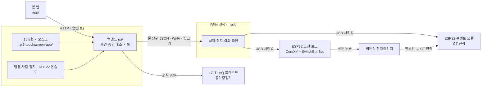

# SimpleLay

**실제 사용 기록에서 습관을 알아채 먼저 묻고, 사람이 맡긴 것만 알아서 하는 가정용 허브**

제24회 임베디드SW경진대회 · 스마트가전 부문 · 팀 자비스 · 개발 기간 2026.07 – 2026.11

[제출 시연 영상 (2026-10-28, 3분 29초)](https://www.youtube.com/watch?v=duf_ZUxTOUo)

| 본체 키오스크 (15.8형 실패널) | 폰 앱 홈 |
| :---: | :---: |
|  |  |

화면은 10/24 자료다. 다른 화면은 [제출 그림 대응표](docs/submission/그림-대응표.md)에 있다.

## 프로젝트 개요

SimpleLay는 앱·키오스크로 직접 쓴 기록에서 되풀이되는 일을 알아채고, 사람이 있을 때 평소 시각 전에 "지금 할까요?"라고 먼저 묻는다. 사용자가 확인 칸을 보고 맡긴 일만 알아서 하고 결과를 알린다.
LG ThinQ 가전은 공식 API로, 버튼만 있는 옛 가전은 조작부 위 누름 장치와 콘센트 전류(CT) 센서로 같은 승인·결과 확인 흐름에 넣는다. 대상은 작은 버튼과 여러 단계 조작이 어려운 고령자·저시력 사용자와, 처음 등록을 맡는 보호자·설치자다.

**주요 특징**

- **습관 알아채기** — 같은 시간대에 사흘 이상, 세 번 이상 되풀이한 실제 사용을 습관으로 본다. 학습 모델이 아니라 설명할 수 있는 규칙이며, 카드에 쓴 날을 근거로 보인다. 모의·연습 기록은 뺀다.
- **때맞춰 묻기** — 사람이 있을 때 평소 시각 10분 전에 "지금 할까요?" + "매일 이 시간에"를 묻는다. 실내·바깥 공기, 날씨, 방 밝기를 엮어 제안하거나 조언만 한다.
- **맡긴 것만 자동으로** — 자주 '네'를 눌러도 저절로 맡기지 않는다. 확인 칸(언제·무엇을·하지 않는 경우·끄는 곳)을 보고 사람이 눌러야 하며, 조용한 시간·비상정지 중에는 하지 않고 언제든 끌 수 있다.
- **열 나는 가전은 늘 확인** — 전자레인지·인덕션은 맡길 수 없고 매번 '네'를 받는다. 정지는 폰·키오스크·음성 "멈춰"에서 언제든 걸 수 있고 "보냄 → 모션 보드 확인 → 멈춤 확인" 세 단계로 보고한다.
- **판단은 집 안 본체에서** — 말 알아듣기와 사람 감지는 본체 안에서 돈다. 카메라는 사람 있음/없음만 판단하고 '언제 말을 걸지'에만 쓰며, 사진은 저장·전송하지 않는다.

## 시스템 아키텍처



본체는 승인한 명령과 같은지 대조한 뒤에만 실행기로 보낸다. 자세한 구성은 [아키텍처](docs/architecture.md), 장치 사이 규약은 [protocol.md](docs/protocol.md), 본체 안과 클라우드의 판단 경계는 [추론 경계](docs/inference-boundary.md)에 있다.

## 하드웨어 구성

| 구성 요소 | 모델/사양 | 역할 |
| --- | --- | --- |
| 본체(허브) | Raspberry Pi 5 + 15.8형 터치 패널 | 백엔드·키오스크. 제안·승인 대조·기록, 사람 감지·말 알아듣기 |
| 실행기 | Raspberry Pi 4 (본체와 Wi-Fi, 페어링 키 인증) | 버튼 순서 실행, 정지·결과 보고, 전력 값으로 작동·가열 종료 판정 |
| 모션 보드(누름 장치) | ESP32 + CoreXY 갠트리, 엔코더 모터 2개, SwitchBot Bot 누름 | 조작부 위 지정 좌표로 이동해 버튼을 누른다 |
| 콘센트 모듈 | ESP32 + DFRobot SEN0211 비침습 CT (0–20 A, 10 Hz 보고) | 가전 소비전력(220 V 가정 추정)으로 작동·가열 종료 판정 |
| 온습도 센서 | DHT22 (본체 GPIO4) | 키오스크 실내 온습도 표시, 환기 조언 |
| 카메라 | USB 웹캠 | 사람 있음/없음만 판단 (사진 저장·전송 없음) |
| LG 가전 | LG 공기청정기 (ThinQ) | 클라우드 공식 연동으로 제어·상태 재확인 |
| 버튼식 가전 | 전자레인지 | 누름 장치 + CT로 같은 흐름에 넣는 대상 |

갠트리·모터·드라이버와 모션 펌웨어의 제어 핵심은 같은 팀 HW 담당의 다른 작품(Touch Bridge)과 같은 기계를 함께 쓴다. SimpleLay가 새로 만든 것은 그 위의 승인·확인·제안, 콘센트 모듈, 정지 규약과 안전 계층, 화면이다 — [재사용 경계](docs/reuse-boundary.md).
적용 범위는 평면 누름 버튼(다이얼 제외), 조작부 하나에 갠트리 하나이며, 전자레인지에 음식을 넣고 빼는 것은 사람이 한다.

## 소프트웨어 구성

**본체 백엔드** (`rpi/`)
- Platform: Raspberry Pi 5 (Docker) · Framework: FastAPI · Language: Python
- 의도 해석·승인 대조·습관과 상황 제안·자동 실행 규칙·실행 상태·폰/키오스크 API
- 말 알아듣기: 규칙이 먼저 처리하고, 처리하지 못한 말만 본체 플랫폼 AI 런타임에서 도는 공개 사전학습 언어 모델(인터넷 없이)이 정해진 동작 목록에서 후보 하나를 고른다. 실행은 늘 사람 확인
- 사람 감지: 같은 런타임의 공개 사전학습 검출 모델로 있음/없음만 판단

**실행기** (`rpi4/`)
- Platform: Raspberry Pi 4 (Docker) · Language: Python
- 버튼 순서를 모션 보드로 보내고 정지·결과를 보고, 콘센트 모듈 전력 값으로 작동·가열 종료 판정

**키오스크** (`rpi5-touchscreen-app/`)
- Platform: Raspberry Pi 5 + 15.8형 터치 패널 · Framework: Flutter (Linux) · Language: Dart
- 제안 카드·승인·실행 중 상태·큰 정지 버튼, 사람이 다가가면 화면이 깸

**폰 앱** (`app/`)
- Platform: Android · Framework: Flutter · Language: Dart
- 가전 등록(조작부 사진에서 버튼 위치)·승인·실행·정지·기록·맡기기 설정

**펌웨어** (`firmware-motion-corexy/`, `firmware-outlet/`)
- Platform: ESP32 · Framework: Arduino (PlatformIO) · Language: C++
- 모션: CoreXY 이동·누름·정지 응답 / 콘센트: CT 전력 계측·보고

**공용·배포** (`packages/`, `deploy/`)
- 폰·키오스크가 함께 쓰는 Dart 패키지(가전 그림 등), 보드 배포 스크립트·Dockerfile

## 프로젝트 구조

```
Simplelay/
├── rpi/                     # 본체 백엔드(FastAPI). controller·verifier는 RPi4도 쓰는 공용 라이브러리
├── rpi4/                    # 실행·검증기
├── rpi5-touchscreen-app/    # 15.8형 키오스크(Flutter Linux)
├── app/                     # 폰 앱(Flutter Android)
├── firmware-motion-corexy/  # 모션 펌웨어 공개 기록(SwitchBot·솔레노이드 빌드)
├── firmware-outlet/         # 콘센트 모듈 펌웨어(CT 전력·릴레이·비상정지 래치)
├── firmware-motion/         # 모션 규약 표 기준(펌웨어는 미채택 참고 구현)
├── firmware/, firmware-node/# 옛 설계 예비 경로(현행 구성 아님)
├── packages/                # 폰·키오스크 공용 Dart 패키지
├── deploy/                  # 보드 배포 스크립트·Dockerfile
├── scripts/                 # 키오스크 웹 빌드·실측 그래프·점검 도구
└── docs/                    # 설계·시연·실측·제출 문서
```

| 폴더 | 무엇 | 어디서 돈다 |
| --- | --- | --- |
| [`rpi/`](rpi/README.md) | 허브 백엔드 — 의도 해석·승인·제안·실행 상태·폰/키오스크 API | RPi5 (+공용) |
| [`rpi4/`](rpi4/README.md) | 실행·검증기 — 버튼 순서 누름, CT로 결과 확인, 정지 보고 | RPi4 |
| [`rpi5-touchscreen-app/`](rpi5-touchscreen-app/README.md) | 터치 패널 키오스크 | RPi5 + 패널 |
| [`app/`](app/README.md) | 폰 앱 — 승인·실행·정지·기록·가전 추가 | 폰 |
| [`firmware-motion-corexy/`](firmware-motion-corexy/README.md) | 공개 모션 펌웨어 기록. 현장 HW 담당 원본과 구분 | ESP32(모션) |
| [`firmware-outlet/`](firmware-outlet/README.md) | ESP32 콘센트 모듈 | ESP32(콘센트) |
| [`firmware-motion/`](firmware-motion/README.md) | 규약 표 [`protocol_table.json`](firmware-motion/protocol_table.json) | — |
| [`firmware/`](firmware/README.md) · [`firmware-node/`](firmware-node/README.md) | 예비 경로(옛 설계) | — |
| [`packages/`](packages/README.md) | 폰·키오스크 공용 Dart 패키지 | — |
| [`deploy/`](deploy/README.md) | 보드 배포 | RPi5·RPi4 |
| [`scripts/`](scripts/README.md) | 빌드·점검 도구 | 개발 PC |
| [`docs/`](docs/README.md) | 설계·시연·실측·제출 문서 | — |

코드 지도와 안전 계약이 사는 곳은 [코드 구조](docs/코드-구조.md).

## 설치 및 실행

하드웨어 없이 PC 하나에서 모의 실행기(시뮬레이터)로 승인 → 실행 → 결과 흐름을 볼 수 있다. 모터·센서·가전은 모두 모의다. 저장소 루트에서:

```powershell
py -m venv .venv; .\.venv\Scripts\python.exe -m pip install -e ".[test]"   # 1. 백엔드 환경
$env:SIMPLELAY_LOCAL_APPLIANCES = "home_mw,washer,intercom"                 # 2. 시연 등록 가전 ID
.\.venv\Scripts\python.exe -m rpi.simulator_main --port 8782              # 3. 시뮬레이터 서버
```

http://127.0.0.1:8782/simulator 에서:

- **실행** — 전자레인지 버튼 순서 실행 → 통신 프레임에 `execute` → `result`, '모의' 표시.
- **실패** — 실패를 주입하고 다시 실행 → 실패가 결과로 그대로 남는다(성공으로 바꾸지 않음).
- **승인** — '키오스크에 시연 제안 띄우기' → `/kiosk/`의 제안 카드. 승인하기 전에는 실행하지 않는다. 키오스크 웹은 빌드 산출물을 git에 넣지 않아 먼저 빌드가 필요하다 — [브라우저 시뮬레이터 실행](docs/브라우저-시뮬레이터-실행.md).

자동 시험:

```powershell
$env:PYTHONUTF8=1; .\.venv\Scripts\python.exe -m pytest           # 백엔드 + RPi4
cd app; flutter test --exclude-tags screenshot                     # 폰
cd rpi5-touchscreen-app; flutter test --exclude-tags screenshot    # 키오스크
```

보드 배포·결선 당일 절차는 [결선 운영 런북](docs/결선-운영-런북.md), 환경 변수는 [환경 변수](docs/환경변수.md). 폰·허브 사이 HTTP 평문 위험은 미해결이며 전용 망·접근 제한은 TLS를 대신하지 않는다.

## 성능·실측 결과

실제 보드·가전에서 확인한 것만 날짜·조건과 함께 적는다. 모의·자동 시험만 거친 것은 넣지 않는다.

| 항목 | 결과 | 조건 |
| --- | --- | --- |
| 실행 경로 | 폰·키오스크 → RPi5 → RPi4(Wi-Fi) → 모션 보드, 키오스크 실패널·부팅 자동 실행 | 9/30–10/14 |
| LG 공기청정기 | 찾기·추가·상태 표시·풍량·전원 변경 뒤 상태를 다시 읽어 확인 | 10/15–16, 실제 1대 |
| 정해진 시각 자동 실행 | 22:00 켜기 2.3 s · 07:00 끄기 2.7 s (카드 없이 실행 → 상태 확인, 각 1회) | 10/16–17, 집 Wi-Fi |
| 습관 알아채기 | 실제 사용 기록에서 습관 3개(켜기 낮 1시쯤·평일 밤 10시쯤, 끄기 밤 10시쯤). 공기질 제안을 여러 번 승인했지만 자동 실행으로 저절로 바뀌지 않음 | 10/16 이후 기록 |
| 상황 제안 | 밤·불 끔·사람 있음·공기청정기 켜짐 → 수면 모드 제안 → 17초 뒤 승인 → 2초 뒤 상태 확인 | 10/28 0시 30분 |
| 가열 종료 판정(CT) | 사람이 시작한 1분 가열 4회 중 4회 종료 판정, 판정 작동 시간 60.6–60.7초. 손으로 쓴 것도 직접 사용으로 기록 | 11/2–3, 전자레인지 1대, 220 V 가정 추정치 |
| 전자레인지 전력(추정) | 시작 순간 1,628.7 W(10/30) · 약 3,550 W(11/2, 돌입 전류라 측정마다 다름), 가열 중 약 500–1,000 W | 220 V 가정, 전력계 대조 없음 |
| 판정 기준 | 100 W 이상 5초 → 작동, 15 W 이하 3초 → 가열 종료. 무부하 센서 출력 142 mV | 100 ms 창, 10 Hz 보고 |
| 누름 장치 | 모터 2개 구동·엔코더 계수, 이동 중 정지 → 모션 보드 응답 18 ms(시험대 1회), 지정 좌표 이동 확인. 실제 누름 정확도·복귀는 개선 중 | 10/12–14, 11/2 |
| 사람 감지 | 본체 카메라로 있음/없음만, 기기 안에서 한 장 약 0.8초 | 10/25–26 |
| 말 알아듣기 | 학습에서 분리한 새 42문장 중 38, 목록 밖·부정 오수락 0/17, 모델을 부른 31건 가운데값 9.8초. 실행은 늘 사람 확인 — [평가](docs/발표/언어모델-평가-2026-10-26.md) §13 | 본체, 인터넷 없이 |

CT 판정은 '가열 종료'까지이며 조리 완료를 뜻하지 않는다. 취소·문 열림도 가열 종료로 감지될 수 있어 화면은 '조리 완료가 아닐 수 있어요'라고 말한다 — [10/30 계측](docs/devlog/devlog_2026-10-30-outlet-sen0211-verification.md) · [11/3 반복 측정](docs/devlog/devlog_2026-11-03-ct-repeat-deck.md).

**다음 단계**

- 누름 장치의 실제 버튼 누름 정확도와 누름 뒤 복귀를 반복 확인한다 ([복귀 결함 수리 계획](docs/결선전-복귀결함과-첫연결-수리계획-2026-10-28.md)).
- 습관 카드에서 맡긴 일이 다음 날 알아서 실행되는 것까지 실제 가전으로 잇는다.
- CT는 가열 종료까지만 판정한다 — 정상 종료와 취소·문 열림을 구분하는 것은 범위 밖이다.

자동 시험 수는 날짜별 [개발 기록](docs/devlog/)과 [시험 지도](rpi/tests/README.md)를 따른다. 시험 통과는 실물 동작을 대신하지 않는다. 날짜별 빌드·커밋 근거는 [근거 부록](docs/submission/근거-부록.md), 전체 실측 표는 [실측 기록표](docs/실측-기록표.md).

### 단일 버튼 푸셔와 설계가 다른 점

버튼 하나 위에 붙이는 시판 장치와 **설계 방식**만 비교한다. 성능 비교가 아니며 상용 제품을 사서 시험하지 않았다. 앱 타이머·일정으로 정한 시각에 누르는 기능은 시판 제품에도 있다(S1)(S3).

| | 단일 버튼 푸셔 (공개 사양, 2026-10-14 확인) | SimpleLay |
| --- | --- | --- |
| 누르는 범위 | 장치 하나가 버튼 하나(S1)(S3) | 갠트리 하나가 조작부의 여러 버튼을 순서대로 |
| 언제 누를지 | 사용자가 정한 타이머·일정(S1)(S3) | 실제 사용 기록에서 습관을 알아채 먼저 묻고, 사람이 맡긴 것만 자동 |
| 결과 확인 | 상태값은 ON/OFF, 스위치 모드에서만 유효(S2) | 콘센트 전류로 작동·가열 종료 판정, 확인하지 못하면 그대로 보고하고 다시 보내지 않음 |
| 다른 가전과 | 앱·허브·음성 비서 연동(S1)(S3) | LG ThinQ 가전과 같은 승인·결과 흐름 |

출처: S1 [SwitchBot Bot 제품 페이지](https://www.switch-bot.com/products/switchbot-bot) · S2 [SwitchBot API 문서 Bot 항목](https://github.com/OpenWonderLabs/SwitchBotAPI/blob/main/devices/others/bot.md) · S3 [Adaprox Fingerbot Plus 제품 페이지](https://www.adaprox.io/products/fingerbot-plus). 전체 출처는 [실측 기록표](docs/실측-기록표.md) §3.

## 테스트 환경

| 구분 | 환경 |
| --- | --- |
| 본체·실행기 | Raspberry Pi 5 · Raspberry Pi 4, 각 Docker 컨테이너, 집 Wi-Fi(학교에서는 폰 핫스팟) |
| 화면 | 15.8형 터치 패널 키오스크, 폰 앱은 Android 폰·에뮬레이터 |
| 가전 | LG 공기청정기 1대(ThinQ 실제 클라우드), 버튼식 전자레인지 1대 |
| 센서 | DFRobot SEN0211 CT(콘센트 모듈), DHT22, USB 웹캠 |
| 개발 PC | Windows, Python 가상환경 + Flutter (하드웨어 없이 시뮬레이터 실행) |

## 문서 입구

- [docs/README.md](docs/README.md) — 처음 볼 문서, 시연·하드웨어·ThinQ·제출 문서, devlog·archive 안내
- [코드 구조](docs/코드-구조.md) · [환경 변수](docs/환경변수.md) · [시험 지도](rpi/tests/README.md)
- [본선 시연 계획 v4](docs/본선-시연-계획-v4.md) · [제출 전 검증 과업](docs/제출전-검증-과업.md) · [실측 기록표](docs/실측-기록표.md) · [제출 체크리스트](docs/submission/제출-체크리스트.md) · [근거 부록](docs/submission/근거-부록.md)
- 일정: 결선 서류 제출 10/28(수) 14:00, 발표 11/6(금) — [본선 실행 계획 §0](docs/본선-실행계획-2026-09-30.md)
- 작업 기록은 [docs/devlog/](docs/devlog/), 지난 인계·폐기 문서는 [docs/archive/](docs/archive/), [공개 점검 기록](docs/공개-점검-2026-10-28.md)
- [개발 도구 사용 고지 초안](docs/submission/개발도구-사용-고지-초안.md) — 코드·시험·문서 등에 AI 도구를 사용했다. 미확인 범위·규정 확인 상태는 해당 문서에서 구분한다. 개발 기록은 당시 실패·수정·실측 근거를 보존하며 소급해 성공 기록으로 바꾸지 않는다.

## 팀원 구성

| 이름 | 역할 |
| --- | --- |
| 박성원 | SW 전반(앱 · 키오스크 · 허브 · 실행기) · 구동부 연동 |
| 서예솔 | HW 총괄(ESP32 · 센서 · 누름 장치 · 콘센트 모듈) |

## 라이선스

[MIT](LICENSE) — 팀 자비스(박성원·서예솔). 외부 모델·SDK·참고 구현에는 각각의 배포 조건이 적용되며 팀의 라이선스가 이를 대체하지 않는다.
