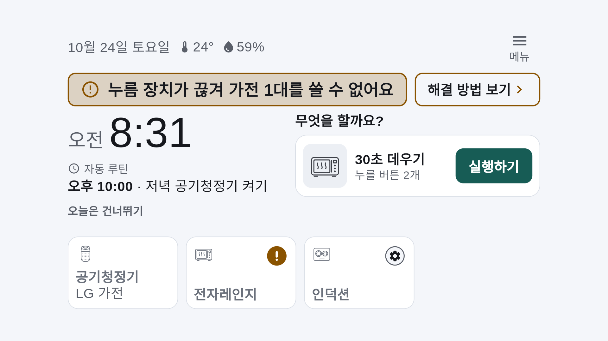
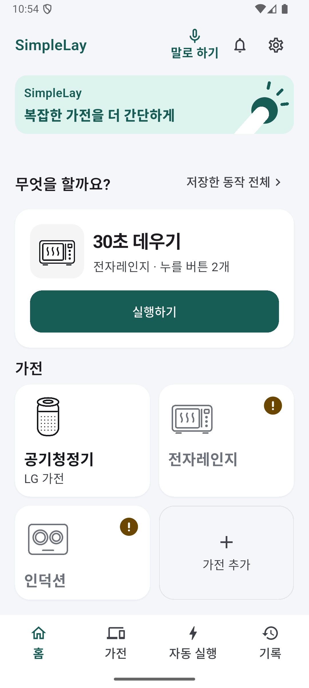
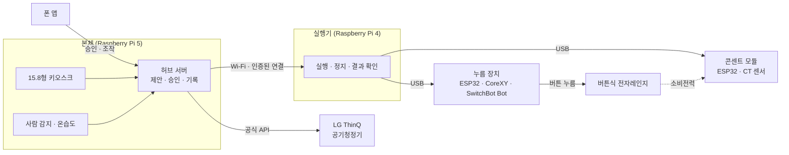

# SimpleLay

**실제 사용 기록에서 습관을 알아채 먼저 묻고, 맡겨 주신 일만 알아서 하는 가정용 허브**

제24회 임베디드SW경진대회 · 스마트가전 부문 · 팀 자비스 · 개발 기간 2026.07 – 2026.11

[제출 시연 영상 보기 (3분 29초)](https://www.youtube.com/watch?v=duf_ZUxTOUo)

| 본체 키오스크 (15.8형 터치 패널) | 폰 앱 |
| :---: | :---: |
|  |  |

더 많은 화면은 [제출 그림 모음](docs/submission/그림-대응표.md)에서 보실 수 있습니다.

## 프로젝트 개요

SimpleLay는 사용자가 매일 비슷한 시간에 하는 일을 기록에서 알아채고, 그 시간이 되기 전에 "지금 할까요?"라고 먼저 묻습니다. 사용자가 직접 맡겨 주신 일만 알아서 하고, 한 일은 결과로 알려 드립니다.

LG ThinQ 가전은 공식 API로 연결하고, 버튼만 있는 옛 가전은 조작부 위의 누름 장치와 콘센트 전류 센서(CT)로 같은 흐름에 넣습니다. 새 가전을 사지 않아도 지금 쓰는 가전부터 함께 쓸 수 있도록 하는 것이 목표입니다.

**주요 특징**

- **습관을 알아챕니다** — 같은 시간대에 서로 다른 날 사흘 이상, 세 번 이상 직접 쓴 일을 습관으로 봅니다. 학습 모델이 아니라 설명할 수 있는 규칙이어서, 카드에 실제로 쓴 날짜를 근거로 함께 보여 드립니다.
- **알맞은 때에 먼저 묻습니다** — 사람이 있을 때 평소 시각 10분 전에 묻습니다. 실내외 공기, 날씨, 방 밝기 같은 상황을 함께 보고 제안하거나 조언만 드리기도 합니다.
- **맡겨 주신 일만 알아서 합니다** — '네'를 자주 눌러도 저절로 자동으로 바뀌지 않습니다. 언제, 무엇을 하는지 확인하고 직접 맡겨 주셔야 하며, 언제든 다시 끌 수 있습니다.
- **열이 나는 가전은 매번 확인합니다** — 전자레인지와 인덕션은 맡길 수 없고, 실행할 때마다 '네'를 받습니다. 폰과 키오스크에서 언제든 멈출 수 있습니다.
- **판단은 집 안 본체에서 합니다** — 말 알아듣기와 사람 감지는 본체 안에서 처리합니다. 카메라는 사람이 있는지 없는지만 보며, 사진은 저장하거나 보내지 않습니다.

## 시스템 구성



본체는 사용자가 승인한 명령과 같은지 확인한 뒤에만 실행기로 보냅니다. 더 자세한 내용은 [아키텍처](docs/architecture.md), [장치 간 규약](docs/protocol.md), [본체와 클라우드의 판단 경계](docs/inference-boundary.md)에 정리했습니다.

## 하드웨어 구성

| 구성 요소 | 모델 / 사양 | 역할 |
| --- | --- | --- |
| 본체 | Raspberry Pi 5 + 15.8형 터치 패널 | 허브 서버와 키오스크, 사람 감지와 말 알아듣기 |
| 실행기 | Raspberry Pi 4 (본체와 Wi-Fi, 인증 키) | 버튼 누르기 실행, 정지와 결과 보고, 가열 작동·종료 판정 |
| 누름 장치 | ESP32 + CoreXY 갠트리 (엔코더 모터 2개) + SwitchBot Bot | 조작부 위 지정한 위치로 움직여 버튼을 누름 |
| 콘센트 모듈 | ESP32 + DFRobot SEN0211 CT 센서 (0–20 A) | 가전의 소비전력으로 작동과 가열 종료를 판정 |
| 온습도 센서 | DHT22 | 키오스크의 실내 온습도 표시, 환기 조언 |
| 카메라 | USB 웹캠 | 사람이 있는지 없는지만 판단 |
| LG 가전 | LG 공기청정기 (ThinQ) | 공식 클라우드 연동으로 제어하고 상태를 다시 확인 |
| 버튼식 가전 | 전자레인지 | 누름 장치와 CT 센서로 같은 흐름에 넣는 대상 |

갠트리·모터·드라이버와 모션 제어의 핵심은 같은 팀 하드웨어 담당이 다른 작품(Touch Bridge)을 위해 만든 기계를 함께 씁니다. SimpleLay에서 새로 만든 것은 그 위의 제안·승인·결과 확인, 콘센트 모듈, 정지 규약과 안전 계층, 화면입니다 — [재사용 경계](docs/reuse-boundary.md).

누름 장치는 평면 버튼(다이얼 제외)을 대상으로 하며, 조작부 하나에 한 대를 붙입니다. 전자레인지에 음식을 넣고 꺼내는 것은 사람이 합니다.

## 소프트웨어 구성

**허브 서버** (`rpi/`)
- Raspberry Pi 5 · Docker · Python · FastAPI
- 습관과 상황 제안, 승인, 자동 실행 규칙, 실행 상태 관리, 폰·키오스크 API
- 말 알아듣기: 정해진 규칙이 먼저 처리하고, 규칙으로 알아듣지 못한 말만 본체 플랫폼 AI 런타임에서 도는 공개 사전학습 언어 모델이 정해진 동작 가운데 하나를 고릅니다. 인터넷 없이 동작하며, 실행 전에는 늘 사람이 확인합니다.
- 사람 감지: 같은 런타임의 공개 사전학습 검출 모델로 사람이 있는지 없는지만 판단합니다.

**실행기** (`rpi4/`)
- Raspberry Pi 4 · Docker · Python
- 누름 장치에 버튼 순서를 보내고, 정지와 결과를 보고하며, 콘센트 모듈의 전력 값으로 가열 작동과 종료를 판정합니다.

**키오스크** (`rpi5-touchscreen-app/`)
- Raspberry Pi 5 + 15.8형 터치 패널 · Flutter (Linux) · Dart
- 큰 글씨의 제안 카드와 승인, 실행 상태, 큰 정지 버튼. 사람이 다가가면 화면이 깨어납니다.

**폰 앱** (`app/`)
- Android · Flutter · Dart
- 가전 등록(조작부 사진에서 버튼 위치 지정), 승인, 실행, 정지, 기록, 맡기기 설정

**펌웨어** (`firmware-motion-corexy/`, `firmware-outlet/`)
- ESP32 · Arduino (PlatformIO) · C++
- 누름 장치의 이동·누름·정지 응답, 콘센트 모듈의 전력 계측과 보고

**공용·배포** (`packages/`, `deploy/`)
- 폰과 키오스크가 함께 쓰는 Dart 패키지, 보드 배포 스크립트와 Dockerfile

## 프로젝트 구조

| 폴더 | 내용 | 실행 위치 |
| --- | --- | --- |
| [`rpi/`](rpi/README.md) | 허브 서버. `controller`·`verifier`는 실행기도 함께 쓰는 라이브러리 | 본체 |
| [`rpi4/`](rpi4/README.md) | 실행기 | 실행기 |
| [`rpi5-touchscreen-app/`](rpi5-touchscreen-app/README.md) | 터치 패널 키오스크 | 본체 + 패널 |
| [`app/`](app/README.md) | 폰 앱 | Android 폰 |
| [`firmware-motion-corexy/`](firmware-motion-corexy/README.md) | 누름 장치 펌웨어 기록 | ESP32 |
| [`firmware-outlet/`](firmware-outlet/README.md) | 콘센트 모듈 펌웨어 | ESP32 |
| [`firmware-motion/`](firmware-motion/README.md) | 모션 규약 표 ([`protocol_table.json`](firmware-motion/protocol_table.json)) | — |
| [`firmware/`](firmware/README.md) · [`firmware-node/`](firmware-node/README.md) | 초기 설계의 예비 경로 | — |
| [`packages/`](packages/README.md) | 공용 Dart 패키지 | — |
| [`deploy/`](deploy/README.md) | 보드 배포 | 본체 · 실행기 |
| [`scripts/`](scripts/README.md) | 빌드·점검 도구 | 개발 PC |
| [`docs/`](docs/README.md) | 설계·시연·실측·제출 문서 | — |

모듈별 지도와 안전 규칙이 들어 있는 코드 위치는 [코드 구조](docs/코드-구조.md)에 정리했습니다.

## 설치 및 실행

하드웨어 없이 PC 한 대에서 시뮬레이터로 승인 → 실행 → 결과 흐름을 확인하실 수 있습니다. 모터·센서·가전은 모두 모의로 동작합니다. 저장소 루트에서 실행합니다.

```powershell
py -m venv .venv; .\.venv\Scripts\python.exe -m pip install -e ".[test]"   # 1. 백엔드 환경
$env:SIMPLELAY_LOCAL_APPLIANCES = "home_mw,washer,intercom"                 # 2. 시연용 가전
.\.venv\Scripts\python.exe -m rpi.simulator_main --port 8782              # 3. 시뮬레이터
```

http://127.0.0.1:8782/simulator 에서 다음을 해 보실 수 있습니다.

- **실행** — 전자레인지 버튼 순서를 실행하면 `execute` → `result` 통신과 '모의' 표시가 나타납니다.
- **실패** — 실패를 넣고 다시 실행하면, 실패가 성공으로 바뀌지 않고 그대로 결과에 남습니다.
- **승인** — '키오스크에 시연 제안 띄우기'를 누르면 `/kiosk/`에 제안 카드가 뜨고, 승인하기 전에는 실행하지 않습니다. 키오스크 웹은 먼저 빌드해야 합니다 — [브라우저 시뮬레이터 실행](docs/브라우저-시뮬레이터-실행.md).

자동 시험은 다음과 같이 실행합니다.

```powershell
$env:PYTHONUTF8=1; .\.venv\Scripts\python.exe -m pytest           # 허브 서버 + 실행기
cd app; flutter test --exclude-tags screenshot                     # 폰 앱
cd rpi5-touchscreen-app; flutter test --exclude-tags screenshot    # 키오스크
```

보드 배포와 현장 절차는 [운영 런북](docs/결선-운영-런북.md), 설정 값은 [환경 변수](docs/환경변수.md)를 참고해 주세요.

## 실측 결과

실제 보드와 가전으로 확인한 결과입니다. 날짜와 조건을 함께 적었습니다.

| 항목 | 결과 | 조건 |
| --- | --- | --- |
| 실행 경로 | 폰·키오스크 → 본체 → 실행기(Wi-Fi) → 누름 장치까지 연결, 키오스크 부팅 자동 실행 | 9/30–10/14 |
| LG 공기청정기 | 찾기·추가·상태 표시·풍량·전원 변경 후 상태를 다시 읽어 확인 | 10/15–16, 실제 1대 |
| 정해진 시각 자동 실행 | 22:00 켜기 2.3초, 07:00 끄기 2.7초 만에 상태 확인 | 10/16–17, 각 1회 |
| 습관 알아채기 | 실제 사용 기록에서 습관 3개 확인 (낮 1시쯤 켜기, 평일 밤 10시쯤 켜기, 밤 10시쯤 끄기). 제안을 여러 번 승인해도 저절로 자동 실행으로 바뀌지 않음 | 10/16 이후 기록 |
| 상황 제안 | 밤에 불을 끄자 수면 모드를 제안 → 17초 뒤 사용자 승인 → 2초 뒤 공기청정기 상태 확인 | 10/28 0시 30분 |
| 가열 종료 판정 (CT) | 사람이 시작한 1분 가열 4회 모두 종료를 판정, 판정한 작동 시간 60.6–60.7초. 손으로 쓴 것도 사용 기록으로 남음 | 11/2–3, 전자레인지 1대 |
| 전자레인지 소비전력 (추정) | 가열 중 약 500–1,000 W, 켜는 순간 최대 약 1,600–3,550 W | 220 V 가정 |
| 판정 기준 | 100 W 이상이 5초 이어지면 작동, 15 W 이하가 3초 이어지면 가열 종료 | 0.1초 단위 측정 |
| 누름 장치 | 모터 구동과 엔코더 계수, 이동 중 정지 응답 18 ms, 지정한 위치로 이동 확인 | 10/12–14, 11/2 |
| 사람 감지 | 본체 카메라로 한 장 약 0.8초에 판단 | 10/25–26 |
| 말 알아듣기 | 처음 보는 문장 42개 중 38개 정답, 해당 없는 말 17개 모두 실행 안 함, 응답 가운데값 9.8초 — [평가 기록](docs/발표/언어모델-평가-2026-10-26.md) §13 | 본체, 인터넷 없이 |

CT 판정은 '가열이 끝났다'는 것까지 알려 드리며, 조리가 다 됐다는 뜻은 아닙니다. 그래서 화면에는 '조리 완료가 아닐 수 있어요'라고 함께 표시합니다. 측정 기록은 [10/30 계측](docs/devlog/devlog_2026-10-30-outlet-sen0211-verification.md)과 [11/3 반복 측정](docs/devlog/devlog_2026-11-03-ct-repeat-deck.md)에 있습니다.

**다음 단계**

- 누름 장치로 실제 버튼을 누르는 정확도와 누른 뒤 제자리로 돌아오는 동작을 반복해 다듬고 있습니다.
- 습관 카드에서 맡긴 일이 다음 날 알아서 실행되는 것까지 실제 가전으로 이어 확인합니다.
- 팀 밖 가정에서 설치와 사용을 시험해 볼 계획입니다.

날짜별 작업과 시험 기록은 [개발 기록](docs/devlog/)과 [시험 지도](rpi/tests/README.md), 전체 실측 표는 [실측 기록표](docs/실측-기록표.md)에 있습니다.

### 버튼 누름 장치와의 설계 차이

버튼 하나 위에 붙이는 시판 장치와 **설계 방식**을 비교했습니다. 성능 비교는 아니며, 시판 제품도 앱의 타이머나 일정으로 정한 시각에 버튼을 누를 수 있습니다 (S1)(S3).

| | 시판 버튼 누름 장치 (공개 사양, 2026-10-14 확인) | SimpleLay |
| --- | --- | --- |
| 누르는 범위 | 장치 하나가 버튼 하나 (S1)(S3) | 장치 하나가 조작부의 여러 버튼을 순서대로 |
| 언제 누를지 | 사용자가 정한 타이머·일정 (S1)(S3) | 사용 기록에서 습관을 알아채 먼저 묻고, 맡겨 주신 것만 자동으로 |
| 결과 확인 | 상태 값은 켜짐/꺼짐, 스위치 모드에서만 유효 (S2) | 소비전력으로 작동과 가열 종료를 판정하고, 확인하지 못하면 그대로 알림 |
| 다른 가전과 | 앱·허브·음성 비서 연동 (S1)(S3) | LG ThinQ 가전과 같은 승인·결과 흐름 |

출처: S1 [SwitchBot Bot 제품 페이지](https://www.switch-bot.com/products/switchbot-bot) · S2 [SwitchBot API 문서](https://github.com/OpenWonderLabs/SwitchBotAPI/blob/main/devices/others/bot.md) · S3 [Adaprox Fingerbot Plus 제품 페이지](https://www.adaprox.io/products/fingerbot-plus)

## 테스트 환경

| 구분 | 환경 |
| --- | --- |
| 본체 · 실행기 | Raspberry Pi 5, Raspberry Pi 4 (각각 Docker), 가정 Wi-Fi와 폰 핫스팟 |
| 화면 | 15.8형 터치 패널 키오스크, Android 폰과 에뮬레이터 |
| 가전 | LG 공기청정기 1대 (실제 ThinQ 클라우드), 버튼식 전자레인지 1대 |
| 센서 | DFRobot SEN0211 CT 센서, DHT22, USB 웹캠 |
| 개발 PC | Windows, Python 가상환경 + Flutter (하드웨어 없이 시뮬레이터 실행) |

## 문서 안내

- [문서 모음](docs/README.md) — 처음 보실 문서, 시연·하드웨어·ThinQ·제출 문서
- [코드 구조](docs/코드-구조.md) · [환경 변수](docs/환경변수.md) · [시험 지도](rpi/tests/README.md)
- [시연 계획](docs/본선-시연-계획-v4.md) · [실측 기록표](docs/실측-기록표.md) · [제출 체크리스트](docs/submission/제출-체크리스트.md) · [근거 부록](docs/submission/근거-부록.md)
- [개발 기록](docs/devlog/) · [지난 문서](docs/archive/) · [공개 점검 기록](docs/공개-점검-2026-10-28.md)
- [개발 도구 사용 고지](docs/submission/개발도구-사용-고지-초안.md) — 코드·시험·문서 작성에 AI 도구를 사용했습니다. 개발 기록은 당시의 실패와 수정 과정을 그대로 남겨 두었습니다.

## 팀원 구성

| 이름 | 역할 |
| --- | --- |
| 박성원 | 소프트웨어 전반 (폰 앱 · 키오스크 · 허브 서버 · 실행기), 구동부 연동 |
| 서예솔 | 하드웨어 총괄 (ESP32 · 센서 · 누름 장치 · 콘센트 모듈) |

## 라이선스

[MIT](LICENSE) — 팀 자비스 (박성원 · 서예솔). 외부 모델·SDK·참고 구현에는 각각의 배포 조건이 적용됩니다.
