# SimpleLay

> 제24회 임베디드SW경진대회 · 스마트가전 부문 · 팀 자비스
> 기존 가전을 교체하지 않고, 위에 얹어 조작을 대신해주는 부착형 AI 가전 제어 시스템

---

## 한 줄 정의

**SimpleLay는 XY 갠트리가 물리 버튼을 대신 눌러주는 부착형 장치에, 라즈베리파이 기반의
"자가 검증 + 선제 제어" 지능 레이어를 얹은 시스템이다.**

사용자의 목적(예: "우유 데워줘")을 버튼 입력 시퀀스로 바꿔 물리적으로 누르고, 전류·음향
센서로 **실제로 눌렸는지 검증**한 뒤 실패 시 재시도하는 폐루프 구조로 동작한다. 나아가 반복
사용 이력(같은 시간대의 같은 조작)을 바탕으로 다음 조작을 먼저 제안한다.

> **현재 상태:** 폰 앱·키오스크·백엔드·폐루프 제어 로직은 mock 모션 위에서 동작하고
> 테스트로 고정돼 있다. **실제 모터 구동과 센서 누름 검증은 아직 실기기에서 증명되지
> 않았다** — 하드웨어 도착 후 [하드웨어 연결 설계](docs/하드웨어-연결-설계.md)의 순서로 잰다.

---

## 시스템 구조 (Sense · Interpret · Act)

```mermaid
flowchart LR
    user(["사용자"])
    app["Flutter 앱<br/>(폰)"]
    esp32["ESP32<br/>BLE↔Wi-Fi 브릿지"]

    subgraph rpi5["RPi 5 · Interpret (+ 터치스크린 UI)"]
        direction TB
        api["api"]
        intent["intent<br/>의도 해석·패턴 학습"]
        api --> intent
    end

    subgraph rpi4["RPi 4 · Act"]
        direction TB
        controller["controller<br/>폐루프 제어·재시도"]
        verifier["verifier<br/>전류·음향 퓨전 검증"]
        verifier -->|"눌림 판정·신뢰도"| controller
    end

    hw["CoreXY 구동부<br/>(모터 제어 MCU + Z축 누름 장치 · 방식 결정 중)"]
    sensors["전류·음향 센서"]
    appliance["기존 가전 버튼"]

    user -->|"음성·터치"| app
    app -->|"HTTP (Wi-Fi 직통, 우선)"| api
    app -->|"BLE (폴백)"| esp32
    esp32 -->|"Wi-Fi"| api

    intent -->|"버튼 시퀀스"| controller
    controller -->|"실행 상태"| intent
    controller -->|"UART / GPIO"| hw
    hw -->|"물리 누름"| appliance
    appliance -.->|"반응"| sensors
    sensors -->|"원신호"| verifier

    classDef rpi5Layer fill:#e8f5e9,stroke:#2e7d32,stroke-width:2px,color:#1b5e20;
    classDef rpi4Layer fill:#fff3e0,stroke:#ef6c00,stroke-width:2px,color:#e65100;
    classDef bridgeLayer fill:#e3f2fd,stroke:#1565c0,stroke-width:1.5px,color:#0d47a1;
    class api,intent rpi5Layer;
    class controller,verifier rpi4Layer;
    class app,esp32,hw bridgeLayer;
```



> **앱은 ESP32로 직접 가지 않는다.** ESP32는 폰이 Wi-Fi에 못 붙었을 때만 쓰는 BLE→Wi-Fi
> 브릿지이며, 그 경우에도 결국 RPi 5의 FastAPI로 전달된다. 즉 **모든 명령은 RPi 5(Interpret)를
> 반드시 거친다.** RPi 5는 의도를 버튼 시퀀스로 해석한 뒤 RPi 4(Act)에 실행을 위임하고,
> RPi 4가 실제 폐루프 제어(누름 → 센서 검증 → 재시도)를 맡는다. RPi5 → RPi4 실행은 UART
> (`SIMPLELAY_ACT_MODE=uart`, [docs/protocol.md](docs/protocol.md))이고, 가전마다 둔 ESP32
> 노드를 거치는 경로(HTTP·ESP-NOW)도 있다. 배선 기준 전체 그림은
> [docs/개발현황.md](docs/개발현황.md) 참고.

| 계층 | 보드 | 역할 |
| --- | --- | --- |
| **Interpret** | RPi 5 (8GB) | 의도 해석(LLM/규칙 기반) · 선제 제안 · 앱/터치스크린 API |
| **Act** | RPi 4 (4GB) | 폐루프 제어(누름·재시도) · 전류/음향 센서 퓨전 검증 · 긴급 정지 |
| **Bridge** | ESP32 | BLE ↔ Wi-Fi 브릿지 (앱의 Wi-Fi 직통 실패 시 폴백 경로) · 물리 비상정지 버튼 신호 |
| **Node** | ESP32 (가전마다) | 실행 중계 — HTTP 또는 ESP-NOW (컴파일 검증, 실기기 대기) |
| **Act 하드웨어** | 모터 제어 MCU + Z축 누름 장치 | CoreXY X/Y 이동 + Z축 누름. 제어 펌웨어·Z축 방식은 결정 필요, 코드는 mock |
| **App** | Flutter 폰 앱 · Flutter 키오스크(RPi5) | 음성/터치 입력, 상태 확인. 키오스크는 RPi5+HDMI 구동 확인, 15인치 터치 패널 실기기 미검증 |

> **핵심:** 각 계층의 "자가 검증 + 선제 제어" 지능 레이어(intent/controller/verifier)가
> SimpleLay만의 신규 구현이다. 재사용과 신규의 경계는
> [docs/reuse-boundary.md](docs/reuse-boundary.md)에 명확히 구분해 둔다.

---

## 왜 폐루프인가 (Touch Bridge와의 결정적 차이)

- **Touch Bridge (한이음)** = 반응형. 사용자가 명령하면 누르고 끝난다.
- **SimpleLay (본 대회)** = 선제형 + **자가 검증**. 누른 뒤 전류·음향 센서로 실제 실행을
  확인하고, 실패하면 스스로 다시 시도한다. 나아가 사용 패턴을 학습해 먼저 제안한다.

이 **폐루프 검증**이 SimpleLay의 기술적 차별점이자, 결선 시연의 핵심 장면이다.
(일부러 실패시켜도 센서가 감지해 자동 재시도하는 것을 보여준다.)

---

## 디렉토리 구조

```
simplelay/
├── docs/                   # 설계 · 통신 프로토콜 · 버튼맵 · 폐루프 설계 · devlog
│   └── button-maps/        #   가전별 버튼 그리드 JSON (격자 칸 번호, mm 좌표 아님)
├── rpi/                    # ★ RPi5 백엔드 (Interpret) + 공용 폐루프 모듈
│   ├── api/                #   FastAPI HTTP 레이어 (router · deps · schemas · service)
│   ├── intent/             #   의도 해석 · 반복 이력 기반 제안
│   ├── controller/         #   폐루프 제어 (명령 → 검증 → 재시도)
│   ├── verifier/           #   전류·음향 센서 판정
│   ├── services/           #   가전·노드 레지스트리, UART·노드 클라이언트, 이력, 개발자 세션
│   ├── bench/              #   원시 센서 기록기 (판정 없음, 하드웨어 수령 직후 측정용)
│   ├── tests/              #   백엔드 테스트
│   └── main.py             #   uvicorn 진입점 (python -m rpi.main)
├── rpi4/                   # RPi4 Act 실행기 (UART 수신 → 폐루프 실행, 모션은 아직 mock)
├── firmware/               # ESP32 브릿지 펌웨어 (BLE · UART · 비상정지 버튼 · ESP-NOW 게이트웨이)
├── firmware-node/          # ESP32 가전 노드 펌웨어 (HTTP · ESP-NOW)
├── app/                    # ★ Flutter 폰 앱 (음성 · 제안 · 상태 · 가전 등록 · 설정)
├── rpi5-touchscreen-app/   # Flutter 키오스크 (RPi5, 800x480 설계 캔버스를 15인치 패널에 비율 확대)
└── scripts/                # RPi 설치 · systemd 유닛 · 키오스크 배포
```

---

## 진행 상황

일정·완료 기준은 [docs/결선로드맵.md](docs/결선로드맵.md), 기능별 현황은
[docs/개발현황.md](docs/개발현황.md)가 기준이다. 최신 테스트 수는 CLAUDE.md의
"최신 검증 기록"에 실행 날짜와 함께 적는다(이 README에는 숫자를 두지 않는다).

| 영역 | 상태 |
| --- | --- |
| 폰 앱 · 키오스크 · 백엔드 API · 제안 | ✅ mock 모션 위에서 동작, 테스트로 고정 |
| RPi5 ↔ RPi4 UART 실행·정지 경로 | ✅ 코드·통합 테스트, 실기기 배선 대기 |
| ESP32 노드 (HTTP · ESP-NOW) | ✅ 컴파일 검증, 실기기 대기 |
| **실제 모터 구동 · 센서 누름 검증 · 물리 비상정지** | ⏳ 하드웨어 도착 후 H0~H1 ([설계](docs/하드웨어-연결-설계.md)) |
| 두 번째 가전 | ⏳ 전자레인지 1대 실제 폐루프 성공 뒤 |

---

## 팀

| 이름 | 역할 |
| --- | --- |
| 박성원 | SW 전반(앱 · 키오스크 · RPi) · 구동부 연동 |
| 서예솔 | HW 총괄 · ESP32 · 센서 · 하우징 |

---

## 관련 문서

| 문서 | 내용 |
| --- | --- |
| [docs/개발현황.md](docs/개발현황.md) | 실제 배선 기준 아키텍처 · 기능 현황 · 환경 변수 |
| [docs/결선로드맵.md](docs/결선로드맵.md) | 결선까지 주차별 일정 · 완료 기준 |
| [docs/하드웨어-연결-설계.md](docs/하드웨어-연결-설계.md) | 모션 어댑터 계약 · 센서 캡처 · 정지 명칭 · 수령 직후 검증 순서 |
| [docs/reuse-boundary.md](docs/reuse-boundary.md) | Touch Bridge 재사용 vs SimpleLay 신규 구현 경계 (대회 정당성) |
| [docs/architecture.md](docs/architecture.md) | 시스템 아키텍처 · 데이터 흐름 · 계층 계약 |
| [docs/actuator-design.md](docs/actuator-design.md) | 구동부(CoreXY) 기구 설계 확정 사항 |
| [docs/closed-loop-design.md](docs/closed-loop-design.md) | 폐루프 검증 설계 (센서 → 판정 → 재시도) |
| [docs/roadmap.md](docs/roadmap.md) | 마일스톤 · 심사평 대응 계획 |
| [docs/sensor-spec.md](docs/sensor-spec.md) | ACS712 전류 센서 + 음향 감지 명세 (M1 구현 참조) |
| [docs/esp32-firmware-spec.md](docs/esp32-firmware-spec.md) | ESP32 BLE GATT + UART 릴레이 펌웨어 명세 |
| [docs/design-system.md](docs/design-system.md) | Flutter 앱 디자인 시스템 — 색상 · 컴포넌트 · 애니메이션 |
