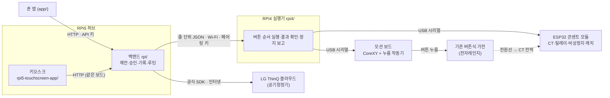

# 아키텍처 (보드 책임과 연결 구조)

2026-10-28 기준 보드 책임은 RPi5 본체·RPi4 실행기·모션 MCU로 나뉜다. 현재 원본 모션 어댑터는 `touchbridge-v2`, 누름 작동기는 SwitchBot Bot이다. 콘센트 CT·릴레이 계측은 실물 검증 전이다. 아래 10/19 설계의 솔레노이드·공개 펌웨어 경로는 당시 구성 기록이며 현재 보드 빌드로 가정하지 않는다. 실제 누름 뒤 복귀 문제는 [수리 계획](결선전-복귀결함과-첫연결-수리계획-2026-10-28.md)을 따른다.

> **이 문서가 보드 구성의 기준이다.** 모듈·파일 단위 지도는 [코드 구조](코드-구조.md), 줄 단위 규약은 [protocol.md](protocol.md),
> 검증 수준은 저장소 [README](../README.md) §6 표 하나로만 말한다. 8/17의 '가전마다 RPi4 한 대' 설계는 폐기했고 맨 아래에 한 절로만 남긴다.

## 한 줄 구성

**RPi5 허브 1대**(백엔드 + 15.8형 터치 키오스크) — **RPi4 실행기 1대**(Wi-Fi 링크) — **모션 보드**(CoreXY 엔코더 모터 2개 + SwitchBot 누름 작동기). **ESP32 콘센트 모듈**(CT 전력·릴레이·비상정지 래치)은 실물 연결·계측 검증 전이다.
사용자는 **폰 앱**과 키오스크로 승인·거절·정지하고, **LG 공기청정기**는 허브가 LG ThinQ 클라우드(공식 SDK)로 다룬다.



같은 그림의 제출용 판은 [`submission/img/fig-architecture.svg`](submission/img/fig-architecture.svg)다.

## 보드와 역할

| 보드 | 대수 | 역할 | 담당 계층 | 연결 |
|---|---|---|---|---|
| RPi5 허브 | 1 | 의도 해석·제안·승인 결속(명령 지문)·기록·루틴·자동 실행 허용 규칙, 폰·키오스크 API, ThinQ 연동 | intent, api, 제안 | 폰과 HTTP(API 키), 키오스크는 같은 보드 |
| 15.8형 터치 키오스크 | 1 (RPi5에) | 큰 글씨 처음 화면·제안 카드·실행·정지·결과 | 화면 | HDMI + USB 터치 |
| RPi4 실행기 | **1** | 버튼 순서를 모션 보드로 누르고, CT로 결과를 확인하고, 정지를 세 단계로 보고 | controller, verifier | RPi5와 Wi-Fi 위 줄 단위 JSON(페어링 키 `SIMPLELAY_LINK_KEY`, 실행 중 생존 신호) |
| ESP32 모션 | 1 | CoreXY 갠트리(엔코더 모터 2개, 폐루프) + 솔레노이드 Z 누름, 호스트 워치독·걸림 알람 | 펌웨어 | RPi4와 USB 시리얼 |
| ESP32 콘센트 모듈 | 1 | CT 전력 2채널(시연은 ch0 전자레인지), 릴레이, 비상정지 버튼·래치(호스트를 기다리지 않고 릴레이를 엶) | 펌웨어 | RPi4와 USB 시리얼 |
| 폰 앱 | 1 이상 | 가전 등록(조작부 사진·버튼 위치), 승인·정지·기록·루틴, LG 가전 상태 | 화면 | 허브와 HTTP |
| LG ThinQ 클라우드 | — | 공기청정기 상태 읽기·바람 세기·전원 | 외부 | 허브가 공식 SDK로, 계정 연결은 설치 때 허브에 한 번 |

갠트리·모터·드라이버·엔코더와 모션 펌웨어 제어 핵심은 같은 팀 HW 담당의 다른 작품과 **같은 기계 1대**를 함께 쓰고, ESP32 모션 보드만 프로젝트별로 따로다 — [재사용 경계](reuse-boundary.md).

## 요청 흐름 — 승인 → 누름 → 확인

```
[사용자] 제안 카드 승인 (폰·키오스크)
   │  카드에 명령 지문(대상·경로·동작·인자)이 묶여 있다
   ▼
[RPi5] 명령을 다시 만들어 지문이 같을 때만 job 접수 → 즉시 job_id (비동기)
   │  보내기 직전 정지 여부 재확인
   ▼  Wi-Fi 링크(줄 단위 JSON, 페어링 키, run_ref)
[RPi4] 버튼마다: 원점 확인 → XY 이동 → CT 관측 구간 열기 → 솔레노이드 누름
   │                     │
   ▼ USB 시리얼           ▼ USB 시리얼
[ESP32 모션]          [ESP32 콘센트 모듈] CT 전력 → 가열 시작 / 가열 종료 감지
   │
   ▼
[RPi4] 결과: 완료 / 실패 / 확인하지 못했어요(근거 미확인 — 다시 누르지 않음)
   ▼
[RPi5] /status·기록 → 폰·키오스크.  가열 종료 → (허용한 조건이면) ThinQ 공기청정기 → 상태 재조회로 확인
```

**정지**는 폰·키오스크 버튼·음성 정지어("멈춰"·"그만"·"정지")에서 같은 `/stop`으로 가고, ① 보냄 → ② 모션 보드 응답 → ③ 엔코더로 멈춤 확인의 세 단계로 보고한다. 엔코더로 멈춤을 본 때만 '멈췄어요'다.
비상정지 래치는 콘센트 모듈이 직접 릴레이를 열고, 사람이 확인해야 풀린다. 자세한 코드 위치는 [코드 구조](코드-구조.md) §2 '안전 계약이 사는 곳'.

## 계층 계약

| 계층 | 어디 | 입력 | 출력 | 모르는 것 |
|---|---|---|---|---|
| api·제안 | RPi5 `rpi/api`·`rpi/services` | 앱 요청, 사용 기록 | 제안 카드, 승인 결속 job, 기록 | 좌표·모터 제어 |
| intent | RPi5 `rpi/intent` | 사용자 목적 | 버튼 시퀀스 | 좌표·모터 제어 |
| controller | RPi4 (`rpi/controller` 공용) | 버튼 시퀀스 | 이동·누름 명령, 재시도·안전 정지 판단 | 센서 원신호 처리 |
| verifier | RPi4 (`rpi/verifier` 공용) | CT 전력·엔코더 | 눌림·가열 시작·가열 종료 판정 | 다음에 뭘 누를지 |
| 모션 펌웨어 | ESP32 모션 | 줄 단위 이동·누름·정지 | 응답·알람·엔코더 위치 | 의도·승인 |
| 콘센트 펌웨어 | ESP32 콘센트 | 릴레이·보고 요청 | CT 전력, 비상정지 상태 | 의도·승인 |

## 왜 이 구성인가

- **실행기를 한 대로:** 조작부 하나에 갠트리 하나이고, 시연 가전도 하나다. 허브와 실행기를 나눈 것은 실시간 제어·정지가 허브의 화면·제안·클라우드 대기에 막히지 않게 하려는 것이다.
- **Wi-Fi 링크:** 허브(키오스크 옆)와 실행기(가전 옆)는 떨어져 있다. 링크가 끊기면 RPi4가 스스로 멈추고 결과는 '눌렸는지 모름'으로 남긴다(자동 재전송 없음).
- **콘센트 모듈을 실행기에:** 누름 직전 CT 관측 구간을 열어야 하므로 누름과 같은 보드에서 시각을 맞춘다.
- **ThinQ는 허브에서:** 클라우드 호출은 인터넷이 필요하고 실시간 제어와 무관하다. 보낸 뒤 상태를 다시 읽어 바뀐 것을 본 때만 성공이다.

## 옛 설계 (8/17, 폐기)

8/17에는 **가전마다 RPi4 + ESP32 노드를 하나씩** 두고 ESP-NOW 게이트웨이로 묶는 다중 노드 설계를 적었다. 시연 범위가 조작부 하나·실행기 하나로 정해지며 폐기했다.
그 설계의 코드(`firmware-node/`·`firmware/` BLE 브리지, `NodeRegistry`)는 예비 경로로 남아 있지만 현재 구성의 경로가 아니다. 당시 본문은 git 이력에 있다.

## 관련 문서

- [코드 구조](코드-구조.md) · [프로토콜](protocol.md) · [하드웨어 연결 설계](하드웨어-연결-설계.md)
- [폐루프 설계](closed-loop-design.md) · [재사용 경계](reuse-boundary.md) · [구동부 설계](actuator-design.md) · [로드맵](roadmap.md)
