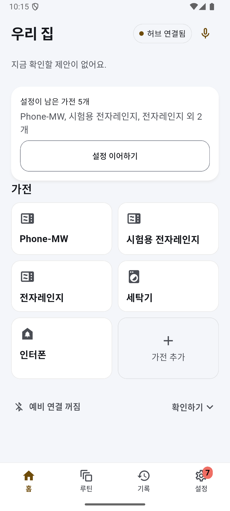
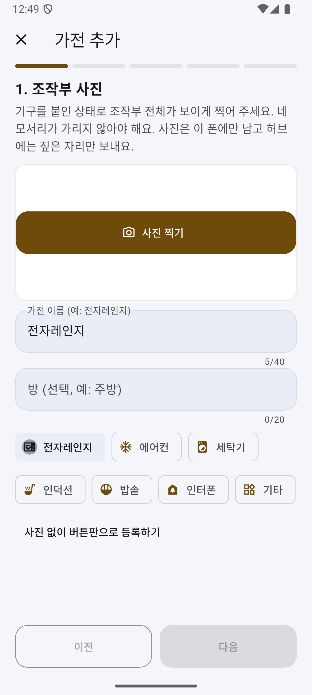
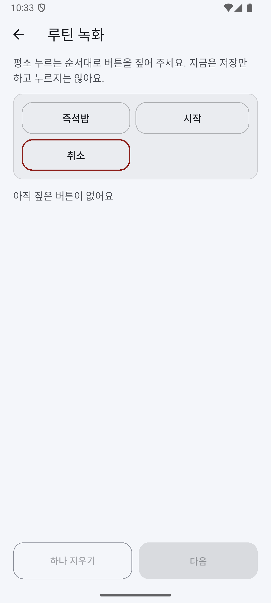
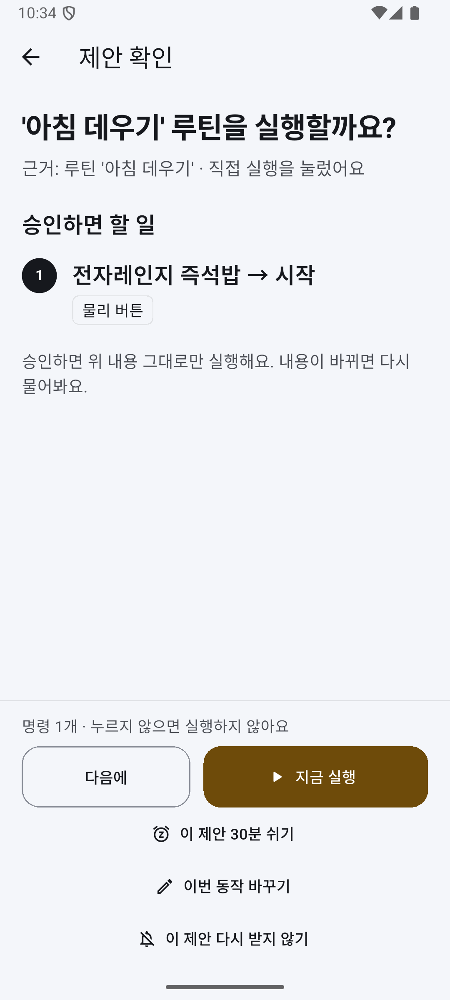
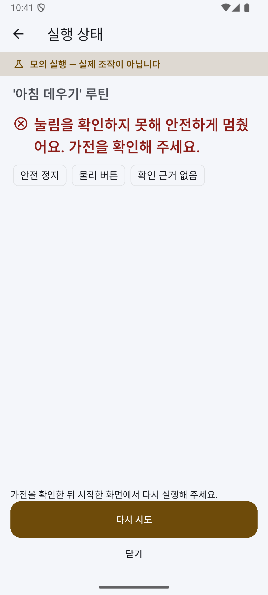
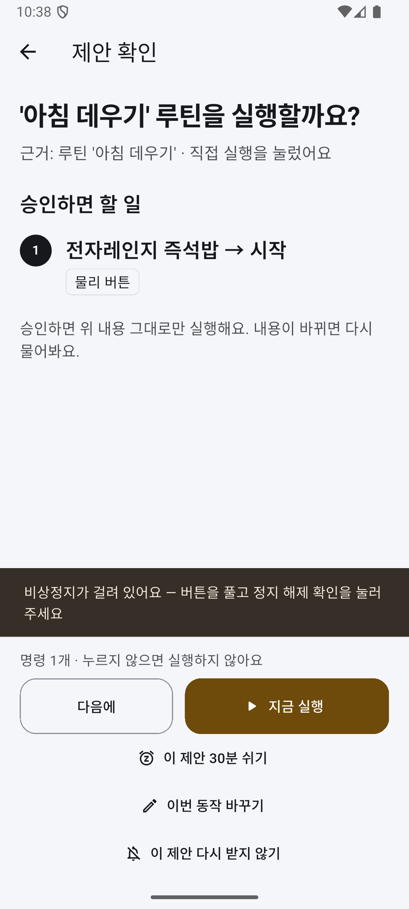

# 개발완료보고서 — SimpleLay

제24회 임베디드SW경진대회 결선 · 팀 자비스
박성원(소프트웨어) · 서예솔(하드웨어)
작성 기준: 2026-10-14(시연 v4) · 제출 예정: 2026-10-28 14:00

검증 수준은 세 가지로 나눠 적는다. **실물 확인**은 실제 보드·모터·기기에서 날짜와 빌드를 남기고 본 것, **모의까지**는 가짜 장치·모의 클라우드·시험 코드로 확인한 것,
**제출 전 수행**은 [제출 전 검증 과업](../제출전-검증-과업.md)에 따라 10/28 전에 할 것이다. 측정하지 않은 값은 【기입】으로 남기고, 수행하지 못한 칸은 문장째 지운다.

분량 목표는 A4 20쪽 이하다(그림·표 포함). PDF 쪽수는 최종 양식에서 다시 확인한다.

## 1. 문제와 목표

### 1-1. 누구를, 왜

작은 버튼을 정확히 누르고 여러 단계 메뉴를 기억하는 일은 고령자와 저시력 사용자에게 부담이다. 집에 있는 전자레인지·세탁기 같은 버튼식 가전은 기능에 문제가 없어도
원격 조작이나 상태 알림을 붙일 수 없고, 스마트 가전으로 바꾸는 데는 비용이 든다. SimpleLay는 가전을 바꾸지 않고 조작부 위에 누름 장치를 얹는다.
장치가 할 일을 **제안**하고, 사용자가 **승인**한 명령만 누르며, 콘센트 전력으로 가전이 실제로 동작했는지 **확인**해 알려 준다.

사용자는 둘로 나눈다.
- **보호자·설치자:** 장치를 붙이고, 폰으로 조작부 사진을 찍어 버튼 위치·이름을 등록하고, 자주 쓰는 순서를 루틴으로 만든다.
- **당사자:** 큰 글씨 키오스크와 폰에서 제안을 보고 승인·거절하고, 언제든 멈추고, 제안을 잠시 쉬게 한다.

명령을 보냈다고 가전이 동작한 것은 아니다. 버튼이 덜 눌리거나, 가전이 입력을 받지 않거나, 통신 중에 결과를 잃을 수 있다. 그래서 핵심 과제를 이렇게 잡았다.
- 명령 전송·버튼 눌림·가전 동작을 나눠 확인한다.
- 확인하지 못한 결과는 "확인하지 못했다"고 그대로 보고하고, 결과를 잃으면 자동으로 다시 보내지 않는다.

### 1-2. 무엇이 다른가 — 단일 버튼 푸셔 방식과의 설계 차이

| | 단일 버튼 푸셔(공개 사양: SwitchBot Bot·Fingerbot Plus) | SimpleLay |
|---|---|---|
| 버튼 등록 | 누를 스위치·버튼 옆에 장치를 붙임(스티커 부착, 공구 없음) | 조작부 사진에서 버튼 위치·이름을 등록(가전 추가 5단계) |
| 여러 버튼 순서 | 장치 하나가 버튼 하나를 누르는 구조. 한 장치로 여러 버튼 순서 조작은 확인하지 못함 | 갠트리 하나가 한 조작부의 여러 버튼을 순서대로 |
| 눌림·가전 동작 확인 | 누름·가전 동작 확인 기능은 확인하지 못함(SwitchBot 상태값 ON/OFF는 스위치 모드에서만 유효) | CT 전력으로 가열 시작·종료 확인, 실패·정지를 단계별로 보고 |
| 스마트 가전과 함께 | 앱·허브 경유 원격·음성 비서 연동. ThinQ 가전과 한 흐름은 확인하지 못함 | ThinQ 가전도 같은 승인·결과 흐름(명령 지문·상태 재조회) |
| 제안 | 앱 타이머·일정 실행. 사용 기록 기반 제안은 확인하지 못함 | 사용 기록 기반 습관 제안 + 사용자가 허용한 조건에서만 낮은 위험 동작 자동 실행 |

이 표는 설계 차이다. 상용 제품을 시험하지 않았고 성능을 비교하지 않았다. 공개 사양 출처(2026-10-14 확인): SwitchBot Bot 제품 페이지 https://www.switch-bot.com/products/switchbot-bot · SwitchBot 공식 API 문서 https://github.com/OpenWonderLabs/SwitchBotAPI/blob/main/devices/others/bot.md · Fingerbot Plus 제품 페이지 https://www.adaprox.io/products/fingerbot-plus. '확인하지 못함'은 공개 사양에서 찾지 못했다는 뜻이지 기능이 없다는 뜻이 아니다. 표 전체는 [실측 기록표](../실측-기록표.md) §3.
대신 같은 장치에서 **동작 확인 기능을 끈 비교 조건**과 SimpleLay를 비교한다(§6-4). 그 결과로 상용 제품보다 낫다고 주장하지 않는다.

### 1-3. 적용 경계

- 평면 누름 버튼만 다룬다. 다이얼식 조작부는 실행을 거절한다.
- 조작부 하나에 갠트리 하나다. 집 안의 여러 가전을 장치 하나로 누르는 것이 아니다.
- 음식을 넣고 빼는 일, 문을 닫는 일은 사람이 한다.
- 가열 종료 감지는 정상 종료와 취소·문 열림을 아직 구분하지 못한다(§4-3).

## 2. 시스템 구성

### 2-1. 보드 역할과 확인 범위

| 구성 | 역할 | 확인 범위 |
|---|---|---|
| RPi5 허브 | 의도 해석·제안·승인·이력·루틴, 앱 API, 15.8형 키오스크, ThinQ 연동 | 실물: 백엔드·키오스크 배포, 패널 표시·부팅 자동 실행(9/30~) |
| RPi4 실행기 | 버튼 순서 실행·결과 확인·정지 보고, 모션 보드·콘센트 모듈 연결 | 실물: RPi5와 Wi-Fi 통신, ESP32 모션 보드와 USB 시리얼(10/12~) |
| ESP32 모션 | CoreXY 구동(FIT0482 엔코더 모터 2개) + 솔레노이드 누름 | 실물: 시험대 빌드로 모터 축 구동·정지(10/12~14). 캐리지·솔레노이드는 제출 전 수행 |
| ESP32 콘센트 모듈 | CT 전력 계측, 전자레인지 릴레이, 비상정지 버튼·래치 | 모의까지: 펌웨어 컴파일·가짜 모듈 시험. 회로는 제출 전 제작 |

계획서의 RPi Zero 자리는 RPi4가 맡는다(팀이 확정한 역할 매핑). 통신 구간은 셋이다.
- **폰·키오스크 ↔ RPi5:** HTTP.
- **RPi5 ↔ RPi4:** 줄 단위 JSON(Wi-Fi/LAN 위 TCP). 두 보드에 같은 페어링 키가 있어야 연결된다.
- **RPi4 ↔ ESP32 두 개:** USB 시리얼. 모션 보드는 10/12부터 실물로 연결했다. USB가 다시 잡혀도 장치 고유 경로로 다시 연다(10/14 실물 확인).

그림 1. 시스템 구성. 초록 실선은 실제 보드에서 확인한 구간, 주황 점선은 설계·실물 미연결 구간이다. 【10/14 실물 연결(RPi4 ↔ ESP32 모션)을 반영해 다시 그림】

### 2-2. 기구와 전력 계측

CoreXY는 FIT0482 엔코더 모터 2개와 벨트로 움직이고, 솔레노이드가 버튼을 누른다. 갠트리와 ESP32 모션 펌웨어의 제어 핵심(PID·궤적·원점·솔레노이드 구동)은
팀원의 이전 작품(Touch Bridge)과 공유한다([재사용 경계](../reuse-boundary.md)). 이 저장소에서 그 펌웨어를 RPi4 줄 단위 JSON 규약으로 옮기고
호스트 워치독·명령 기한·알람 뒤 재원점 같은 안전 규약을 더했다. SimpleLay가 새로 만든 것은 그 위의 승인·확인·제안·콘센트 모듈·화면이다.

모터 축 엔코더만으로는 벨트 미끄럼을 잡을 수 없다. 그래서 원점 확인 전에는 실행을 시작하지 않는다(10/14 실물: 원점 미확인이면 "준비 안 됨"으로 실행 차단).

콘센트 모듈은 CT로 가전 소비 전력을 잰다. 시연은 ch0(전자레인지, 릴레이 경로)만 쓴다. 코드는 ch1(계측 전용)도 받는다.
센서 연결이 끊기면 0 W로 채우지 않고 읽기 실패로 처리한다 — 센서가 없는 것을 가전 종료로 오인하지 않기 위해서다. CT 보정·판정 기준값은 실측 전이다.

그림 2. 콘센트 모듈 CT 경로(설계). ch0 전자레인지는 릴레이 경로, ch1은 계측 전용이다. 회로는 제출 전 제작.

### 2-3. 소프트웨어 구성

| 부분 | 구성 |
|---|---|
| 허브 | Python·FastAPI·SQLite. 실행은 비동기 작업 단위로, 요청 접수와 작업 종료를 따로 반환하고 클라이언트가 작업 ID로 대조한다 |
| 화면 | 폰 앱(Android)과 키오스크(Linux)는 Flutter |
| RPi4 실행기 | 모션·판정 어댑터로 모의와 실물 경로를 분리한다. 실행 대상마다 CT 채널과 판정기를 결속한다 |
| ThinQ | 공식 Python SDK(`thinqconnect`)를 부르는 클라이언트. 모드: 꺼짐 / 모의 / 모의 클라우드 / 실제 |
| 배포 | 컨테이너와 시작 스크립트. 10/14 같은 커밋을 RPi5·RPi4·폰·키오스크에 배포했다 |

## 3. 사용자 기능과 시연

### 3-1. 가전 등록과 루틴 (보호자·설치자)

가전 등록은 다섯 단계다: ① 조작부 사진 ② 프레임 모서리 4점 ③ 버튼 위치와 이름 ④ 정지 버튼과 보관 위치 ⑤ 확인 주행.
사진 좌표를 기구 좌표로 옮겨 저장한다. 시험은 합성 좌표와 모의 모션으로 했고, 실제 조작부의 위치 오차는 제출 전 설치 시간 측정 때 함께 잰다. 외부 사진 인식은 선택 보조이며 필수가 아니다.

루틴은 사진 위 버튼을 순서대로 짚어 저장한다("지금은 저장만 하고 누르지는 않아요"). 루틴을 부르면 제안 카드가 나오고, 승인해야 실행한다.

   

그림 P1~P4. 폰 앱(에뮬레이터, 실제 RPi5 백엔드 연결, 2026-10-07 캡처) — 홈, 가전 추가 1단계(조작부 사진), 루틴 녹화, 승인 전 확인 화면. 캡처의 실행은 모의 실행이다. 【10/14 화면으로 다시 캡처】

### 3-2. 매일 쓰는 화면 (당사자)

**키오스크**(15.8형)는 평소·다가오면·동작 중·내 가전 네 상태다. 제안 카드는 누를 순서를 보여 주고, 승인·거절·정지 버튼을 크게 둔다.
'다가오면'은 접근 감지가 아니다(레이더 없음). **폰**은 홈·루틴·기록·설정 네 탭이고, 실행 중에는 화면 정지와 음성 "멈춰"(폰 음성 인식)로 멈출 수 있다.
설정에서 방해 금지(제안 쉬기)를 켤 수 있다. 큰 글꼴(2.0배)에서도 승인 화면의 할 일이 첫 화면에 보이도록 고쳤다(10/14 에뮬레이터 확인). 실제 TalkBack 낭독은 확인하지 못했다.

### 3-3. 시연 v4

| # | 장면 | 시간 | 보이는 것 | 확인 근거 |
|---|---|---|---|---|
| 1 | 제안 거절 | 0:20 | "안 할래요" → 장치가 움직이지 않음 | 기록에 '건너뜀', 실행 없음 |
| 2 | 첫 조리 승인 → 공기청정기 + 자동 허용 | 2:20 | 승인 → 갠트리가 전자레인지 버튼을 누름 → CT 가열 시작 → 가열 종료 감지 → 공기청정기 강풍 + "다음부터도 자동으로"(조건·대상·동작 확인 화면) | CT 시작·종료, ThinQ 상태 재조회 |
| 3 | 같은 조건에서 다시 | 1:40 | 조리 재승인 → 가열 종료 감지 → 추가 승인 없이 강풍 | 상태 재조회로 '변경 성공' |
| 4 | 기록 확인 → 자동 실행 끄기 | 0:30 | 두 가전 결과, 자동 실행 끄기 | 루틴 목록 '자동 실행 꺼짐' |
| 5 | 일부 실패 처리 | 0:30 | 명령은 보냈지만 확인 못 함 → '결과 확인 불가', 다시 보내지 않음 | 그날 얻은 결과 문구 그대로 |

【그림 자리: 시연 v4 다섯 장면과 장면별 검증 수준 — 새로 그림(기존 그림의 v3 여섯 장면은 쓰지 않음)】

- 버튼 누름은 매번 승인한다. 자동으로 하는 것은 허용한 조건의 공기청정기 풍량 변경 하나뿐이다.
- 전자레인지 가열은 [운영 런북](../결선-운영-런북.md) §3-7 안전 체크리스트(빈 상태 가열 금지·짧은 시간·사람 입회)를 통과했을 때만 한다.
- 실물이 준비되지 않은 장면은 시연 전에 "모의"라고 먼저 말하고, 사전 녹화 영상이나 모의 클라우드로 대신한다(시연 계획 §7 백업).

## 4. 핵심 기술과 안전 처리

### 4-1. 단계별 확인

| 단계 | 확인 대상 | 입력 | 실패 처리 | 운영 상태 |
|---|---|---|---|---|
| L1 | 버튼이 눌렸나 | 누름 장치 쪽 전류(음향은 보조 신뢰도) | 위치 보정 재시도, 상한에서 안전 정지 | 전류 센서 배선 전이라 실물에서는 모의 판정기 |
| L2 | 가전이 받아들였나 | 가전 소리 | — | **RPi4 실행 경로에 연결하지 않음** |
| L3 | 가전이 동작했나 | CT 전력 상승·유지 | 자동 재시도 없이 안전 정지 | 실행 대상마다 CT 채널을 결속, 실측 전 |

L1은 전류로 판정하고 음향만으로는 눌림 판정이 되지 않는다(진리표 시험). L3는 실행마다 대상 가전의 CT 채널로 판정하며, 채널이 없는 대상은 실행 전에 거절한다.
누름 단위 관측 구간은 XY 이동 뒤 Z 누름 직전에 열고(원시 기록기가 있든 없든 같은 훅), 오래된 표본·표본 부족·센서 끊김은 성공이 아니라 "센서 불가"로 처리한다. 판정 임계값은 실측으로 정한다.

### 4-2. 승인 결속과 결과 보고

제안 카드에는 명령 지문(대상·경로·동작·인자)을 묶는다. 승인하면 서버가 명령을 다시 만들어 지문이 같을 때만 실행한다. 카드가 나온 뒤 루틴이 바뀌면 그대로 실행하지 않는다.

결과는 확인한 사실만큼만 말한다.
- **버튼 경로:** 요청 접수 / 실행기 보고 / 동작 확인 / 확인 불가. 모터 걸림·재시작·기한 초과·준비 안 됨은 재시도하지 않고 멈추며 원인을 폰·키오스크에 보인다(10/14 실물: "모터가 걸려 멈췄어요. 다시 누르지 않았어요.").
- **ThinQ 경로:** 보내기 전에 상태를 조회해 이미 목표값이면 보내지 않고("이미 강풍으로 설정돼 있어요"), 보낸 뒤 상태 재조회로 바뀐 것을 본 때만 "바꿨어요", 접수만 됐으면 "결과 확인 불가"(다시 보내지 않음).

### 4-3. 가열 종료 감지와 자동 실행 허용

CT 전력이 운전 수준을 일정 시간 넘긴 뒤 대기 수준으로 내려와 머물면 "가열 종료"로 본다. 이 모양은 취소 버튼·문 열림으로 끝난 경우와 같아서 **정상 조리 완료와 구분하지 못한다.**
그래서 화면·기록은 "가열 종료를 감지했어요(조리 완료가 아닐 수 있어요)"라고만 말한다. 팀 정책(10/14): 공기청정기 풍량 변경은 낮은 위험 동작이라 취소·문 열림 뒤에도 일어날 수 있게 두고, 그렇게 밝힌다.
출력 조절로 전력이 잠깐 내려가는 구간과 종료 뒤 팬만 도는 구간을 종료로 잘못 잡지 않는지는 제출 전 실측한다([실측 기록표](../실측-기록표.md) §6 B·D). 잘못 잡으면 자동 실행 조건을 다시 설계한다.

자동 실행 허용은 사용자가 카드에서 "다음부터도 자동으로"를 고르고 조건·대상·동작 확인 화면에서 허용했을 때만 생긴다. 서버가 다음을 강제한다.
- 낮은 위험 ThinQ 동작만, 같은 사건에 한 번만, 오래된 사건·재시작 전 사건은 보류, 보내기 직전에 규칙이 꺼졌거나 바뀌었으면 보내지 않음.
- 비상정지 중에는 보내지 않고, 정지가 끼면 늦게 도착한 허용이 규칙을 켜지 않는다. 사용자는 루틴 목록에서 언제든 끈다.
이 허용은 사용자가 명시적으로 고른 것이며 습관 학습의 결과로 자동 실행하지 않는다.

### 4-4. 정지와 복구

정지는 세 단계로 나눠 보고한다: **보냄**(정지 줄을 씀) → **모션 보드 확인**(MCU 응답) → **멈춤 확인**(엔코더가 두 번 연속 같음). 화면은 확인한 단계까지만 "멈춘 것을 확인했어요"라고 말한다.
USB가 끊긴 순간의 정지는 "정지 미확인 — 기기 잠김"으로 잠그고, 다시 정지해 확인되면 풀린다(10/13 실물).

| 측정(10/13, 모터 축, 개발자 조그 경로, 5 mm 이동 시작 약 88 ms 뒤 정지) | n | 중앙값 |
|---|---|---|
| 보냄 → 모션 보드 확인 | 10 | 10.95 ms |
| 보냄 → 멈춤 확인 | 10 | 160 ms (10/10 멈춤 확인) |

벨트가 없는 시험대라 캐리지 정지 지연은 아니다. 캐리지·누름 중 정지는 제출 전 다시 잰다.

콘센트 모듈 펌웨어는 비상 버튼을 감지하면 호스트를 기다리지 않고 릴레이를 열고 래치를 보존하며, 버튼을 푼 뒤 사람이 확인해야 풀린다(컴파일·가짜 모듈 시험).
콘센트 릴레이는 전자레인지 전원만 끊으므로 갠트리의 마지막 수단은 별도 모터 전원 스위치다. 전원 차단 회로와 차단 지연은 회로 제작 뒤 확인한다.
장애 8상황(실행기 늦게 켜짐, 실행 중 링크 끊김, 결과 유실, 모션 보드 재부팅 등)에서 자동 재전송·재개가 없는지는 모의로 시험했다([장애 복구 결과표](../장애-복구-결과표.md)).

그림 3. 비상정지 발생 → 실행 차단 → 버튼 해제 → 사람 확인 흐름(설계, 펌웨어 컴파일·가짜 모듈 시험).

### 4-5. 제안과 외부 기능의 경계

- **습관 제안:** 최근 28일의 실제·직접·성공 사용 기록을 가전과 시간대별로 모아, 서로 다른 3일 이상이면 제안한다. 시연·모의·제안 승인 기록은 학습에서 뺀다. '다음에'·숨김·시스템 철회는 다른 사건으로 기록한다. 합성 이력으로 시험했고 실제 생활 이력에서의 효과는 확인하지 않았다.
- **해석:** 규칙 해석이 먼저이고, 기기 안 보조 해석과 외부 해석은 선택 계층이다. 해석하지 못한 명령을 임의 버튼으로 바꾸지 않는다.
- **확장(모의):** 세탁 완료를 CT 전력 하강과 종료음 교차로 판정하는 경로가 있다. 합성 입력 시험까지이며 v4 주 시연에는 넣지 않는다.

## 5. 플랫폼 활용과 전문가 의견 반영

RPi5와 RPi4에는 대회 제공 임베디드 SW 플랫폼 이미지를 쓰고, 자체 백엔드와 실행기를 컨테이너로 배포했다. 키오스크 설치와 부팅 자동 실행을 확인했다.
앱 계정으로 플랫폼 시스템 서비스 읽기 호출을 RPi5·RPi4 각 1건 성공시켰다(조건부 — [가산점 증거 대장](../가산점-증거-대장.md)). 시연 흐름 안의 플랫폼 기능 사용은 증거 대장의 미측정 칸이며, 가산점을 확정하지 않는다.

| 전문가 의견·요구 | 반영 내용(현재) | 남은 확인 |
|---|---|---|
| 하나의 가전이 아닌 복합 상황·공조(9/29) | 물리 가전(전자레인지)의 CT 가열 종료 사건이 ThinQ 공기청정기의 제안·허용된 자동 실행으로 이어지는 v4 흐름 | 실제 CT 판정·ThinQ 실가전 |
| 소프트웨어적 가전 제어 포함(9/29) | ThinQ 공식 SDK 클라이언트, 기기 찾기·사용자 확인 뒤 추가, 같은 승인·결과 계약 — 실제 공기청정기로 제어·상태 재조회 확인(10/15) | RPi5 허브·대회장 인터넷 조건 |
| 동작 확인과 실패 복구(예선) | 단계별 확인(L1·L3), 확인 불가 보고, 모터 걸림 시 재시도 없이 정지 | L1 전류 센서 배선, CT 실측, 누름 성공률 |
| 먹통 시 정지 수단(9/22) | 화면·음성 정지, 정지 세 단계 보고, 콘센트 모듈 비상정지 래치 | 전원 차단 회로·캐리지 정지 실측 |
| 사용자 개입 지점(9/22) | 매회 승인(버튼 누름), 조건부 사전 허용(낮은 위험 ThinQ만), 언제든 끄기 | 초기 사용성 점검 |
| 통신 간섭과 회복(9/22) | 결과 유실 시 확인 불가·재전송 금지, 링크 재연결, USB 재열거 뒤 다시 열기(실물) | 실제 가열 중 통신 시험 |

의견별 전후 비교는 [피드백 전후](피드백-전후.md)에 있다. 접근성은 저장소의 [사용자 편의 기준](../사용자편의-가이드-체크리스트.md)(큰 글씨·넓은 터치 영역·문구와 아이콘 병행·동작 줄이기)을 참고했다. 표준 적합성 인증이나 당사자 평가는 하지 않았다.

## 6. 검증 결과

### 6-1. 실물 확인 (날짜·빌드)

| 날짜 | 무엇 | 조건 | 근거 |
|---|---|---|---|
| 9/30~10/7 | RPi5 ↔ RPi4 통신, 폰(에뮬레이터) → RPi5 → RPi4 실행 왕복, 15.8형 패널 표시·부팅 자동 실행 | 모션은 모의 | [9/30](../devlog/devlog_2026-09-30-lan-deploy.md) · [10/6](../devlog/devlog_2026-10-06-desktop-s11-deploy.md) |
| 10/12 | ESP32 모터 A·B 구동·엔코더 계수, 폰 → RPi5 → RPi4(Wi-Fi) → ESP32 조이스틱 이동·정지 | 시험대 빌드, 모터 축 | [10/12](../devlog/devlog_2026-10-12-motion-bringup.md) |
| 10/13 | 일반 실행 순서(이동 → 누름 신호 → 이동 → 사용자 정지), 정지 세 단계 10회 | 모터 축, 솔레노이드 없음(신호만) | [10/13](../devlog/devlog_2026-10-13-desktop-board.md) |
| 10/14 | 같은 커밋 4곳 배포, 모터 걸림 → 1회 이동 뒤 정지·원인 표시(재시도 0), 키오스크 짧은 실행·정지 문장, USB 재열거 뒤 실행기 재시작 없이 다시 연결, 원점 미확인 시 실행 차단 | 모터 축 | [10/14](../devlog/devlog_2026-10-14-desktop-board.md) · [10/14 수리](../devlog/devlog_2026-10-14-codex-fix.md) |
| 10/14 | 두 보드를 거친 자동 실행 허용 흐름(가열 종료 **주입** → 허용 → 다음 주입에 승인 없이 전송), 보드 시계 기준점 60초 교환 | 모션·ThinQ 모의 | [10/14](../devlog/devlog_2026-10-14-desktop-board.md) |
| 10/15 | LG ThinQ 실제 클라우드: 공기청정기 찾기 → 사용자 추가 → 지금 상태(전원·풍량·미세먼지) → 폰에서 풍량 변경 → 상태 재조회로 변경 확인(`state_confirmed`) | 실제 공기청정기 1대, 집 Wi-Fi, 허브는 노트북 | [10/15](../devlog/devlog_2026-10-15-thinq-real.md) |

### 6-2. 모의까지

| 항목 | 범위 |
|---|---|
| 눌림·가전 동작 판정(L1·L3), 관측 구간 | 합성 전류·전력 입력 시험 |
| 콘센트 모듈 CT·릴레이·비상정지 래치 | 펌웨어 컴파일, 가짜 모듈 시험 |
| ThinQ 이미 목표값(보내지 않음), 자동 실행 허용 경로의 ThinQ 단계 | 저장소 안 모의 클라우드 끝-끝 |
| 자동 실행 허용 규칙(지문·사건 신선도·정지 경계) | 모의 사건 → 모의 클라우드 끝-끝, 교차 시험 |
| 습관 제안, 사진 버튼 등록 | 합성 이력·합성 좌표 |

자동 시험(골든 제외): 백엔드+RPi4 **2,969**(10/14) · 폰 **844**(10/15) · 키오스크 **318**(10/14) 통과, 골든 화면 폰 55·키오스크 44장(별도).
제출 직전에 한 커밋에서 다시 실행해 날짜·커밋과 함께 갱신한다. 위젯·골든 시험은 실제 패널 시연을 대신하지 않고, 펌웨어 빌드 성공은 회로가 동작한다는 뜻이 아니다.

### 6-3. 제출 전 수행 (하드웨어)

| 항목 | 수행 계획 | 결과 |
|---|---|---|
| 캐리지 이동·원점 | 벨트·레일 조정 → 폐루프 이동 → 원점 | 【기입】 |
| 솔레노이드 실제 누름 | 전자레인지 즉석밥·시작, 버튼 3개 × 반복(사람 판정 기준) | 첫 시도 성공률 【기입】 · 재시도 포함 【기입】 |
| CT 가열 판정 | 정상 30초(A)·출력 감소(B)·취소(C1)·문 열림(C2)·팬만(D) 각 3회 이상 | 시작 판정 지연 【기입】 · 종료 판정 지연 【기입】 · B·D 오판 【기입】 |
| 캐리지 이동 중 정지 | 보냄 → 멈춤 확인 | 【기입】 |
| ThinQ 공기청정기 실가전 | [ThinQ 실물 확인 절차](../ThinQ-실물-확인-절차.md), 대회장과 같은 핫스팟 조건 왕복 지연 | 제어·상태 재조회 확인(10/15, §6-1). 핫스팟 조건 왕복 지연 【기입】 |

### 6-4. 제출 전 수행 (비교 조건 실험 · 초기 사용성 점검 · 원가)

방법·횟수·담당은 [제출 전 검증 과업](../제출전-검증-과업.md)에 있다.

| 과업 | 방법 | 결과 |
|---|---|---|
| 비교 조건 실험 | 전자레인지 "즉석밥 → 시작"을 ① 사람 직접 ② 같은 장치에서 **동작 확인 기능을 끈 비교 조건** ③ SimpleLay로, 정상·누름 실패·시작 전 문 열림(가전 시작 거부) 조건에서 총 40회(조건별 반복 수·성공 기준·오류 검출 기준은 [조건표](../제출전-검증-과업.md), 정답은 영상·관찰 기록의 사람 판정) | 잘못된 상태로 끝남 ② 【기입】 / ③ 【기입】 · 알아챈 시간 p50 ② 【기입】 / ③ 【기입】 |
| 초기 사용성 점검 | 팀 밖 1~2명, 모의 화면 과업 5개(제안 이해·승인·거절·정지·방해 금지), 익명 기록 | 도움 없이 완료 【기입】 · 잘못 누른 횟수 【기입】 · 도움 요청 지점과 고친 것 【기입】 |
| 원가 | 실제 구매가 BOM(지급품 구분) | 시연 1대 【기입】원 |
| 설치 시간 | 처음 붙이기·재부착·처음 해 보는 사람 각 1회 | 【기입】 |

- 비교 조건 실험은 상용 제품을 시험한 것이 아니다. 결과로 상용 제품보다 낫다고 말하지 않는다.
- 초기 사용성 점검은 접근성 검증이나 당사자 평가가 아니다. 고령자·시각장애인이 참여하지 않았다면 그 사용자를 위한 접근성을 검증했다고 말하지 않는다.

【그림 자리: 실측 그래프 — 버튼별 성공률, 정지 지연 분포, 전자레인지 CT 파형 위 시작·종료 판정 시점. 실측 데이터로 만든 그림만 넣는다】

## 7. 개발 과정과 역할

| 담당 | 맡은 일 |
|---|---|
| 박성원 | 허브·실행기·폰 앱·키오스크·배포, 소프트웨어 연동, 보드 시험 진행 |
| 서예솔 | 갠트리·모션 펌웨어(원작)·콘센트 모듈·센서·하우징, 배선·조립 |

| 시기 | 진행 내용 |
|---|---|
| 8월 | 확인 구조(폐루프)와 폰·키오스크 초기 개발 |
| 9/9~9/17 | 제어권·정지 경합 수리, 단계별 판정·버튼맵·좌표 보정 모의 시험 |
| 9/27~9/29 | 시뮬레이터·디지털 트윈, 모션 어댑터, ThinQ 명령 계약, 전문가 의견 정리 |
| 9/30 | 보드 수령, LAN 배포·모의 왕복, 화면 구조 확정 |
| 10/1~10/8 | 콘센트 모듈 펌웨어·비상정지 래치, 실행 대상별 CT 결속, 장애 복구 시험, 음성 정지 |
| 10/10 | 팀원 ESP32 모션 펌웨어를 SimpleLay 규약으로 합침 |
| 10/12~10/14 | 모션 보드 실물 연결(모터 축), 정지 세 단계 실측, ThinQ 공식 SDK, 자동 실행 허용 규칙, 시연 v4 확정 |
| 10/15~10/27 | 【제출 전 수행: 캐리지·누름·CT 실측, 비교 조건 실험, 초기 사용성 점검, 원가·설치 시간】 |

하드웨어 통합 전에는 같은 API의 모의 실행기와 디지털 트윈으로 흐름을 확인했다. 실패 경로는 이렇게 반복 시험할 수 있었지만, 누름 성능은 실물로만 확인한다.

【개발 도구 사용 고지 — 대회 규정 확인 뒤 확정. 초안: [개발도구 사용 고지 초안](개발도구-사용-고지-초안.md)】

## 8. 한계와 다음 단계

- 가열 종료 감지는 취소·문 열림과 정상 종료를 구분하지 못한다. 구분 근거(종료음·남은 시간·문 스위치)는 실측에서 찾는다.
- L2(가전 소리로 입력 수용 확인)는 실행 경로에 연결하지 않았다. L1 전류 센서 배선이 없으면 누름 확인은 CT(L3)에 기댄다.
- 비상정지 전원 차단 회로, 공간 감지(레이더)는 없다. 정지는 화면·음성·모터 전원 스위치로 한다.
- ThinQ는 클라우드가 필요하다. 대회장 인터넷이 안 되면 모의 클라우드로 돌리고 그렇게 먼저 말한다. 이미 보낸 ThinQ 명령의 취소는 보장하지 않는다.
- 다른 조작부로 옮겨 붙이는 범용성은 두 번째 조작부에서 다시 보정·측정해야 말할 수 있다.

## 9. 근거 문서

- [README](../../README.md) · [시연 v4](../본선-시연-계획-v4.md) · [제출 전 검증 과업](../제출전-검증-과업.md) · [실측 기록표](../실측-기록표.md)
- [재사용 경계](../reuse-boundary.md) · [하드웨어 방향 확정](../하드웨어-방향-확정-2026-09-30.md) · [정지 확인 계획](../계획-정지-확인-2026-10-12.md)
- [전문가 의견 대응](../전문가의견-대응-2026-09-29.md) · [피드백 전후](피드백-전후.md) · [가산점 증거 대장](../가산점-증거-대장.md) · [장애 복구 결과표](../장애-복구-결과표.md)
- 개발 기록: [10/12 모션](../devlog/devlog_2026-10-12-motion-bringup.md) · [10/13 보드](../devlog/devlog_2026-10-13-desktop-board.md) · [10/13 ThinQ SDK](../devlog/devlog_2026-10-13-thinq-sdk.md) · [10/13 자동 실행](../devlog/devlog_2026-10-13-auto-rule.md) · [10/14 보드](../devlog/devlog_2026-10-14-desktop-board.md) · [10/14 이미 목표값](../devlog/devlog_2026-10-14-already-at-target.md)

## 10. 그림·캡처 편집

그림 자리에는 새 구성도, 직접 촬영한 실물, 모의 표시가 보이는 화면만 쓴다. 비공개 제공 자료나 발표 파일은 가져오지 않는다. 아직 없는 실물 사진은 자리표시로 두고 설계도라고 밝힌다.

【그림 자리: 전자레인지에 붙인 갠트리와 콘센트 모듈 — 실물 촬영 뒤 삽입】

그림 4. 승인 카드 — 실제 15.8형 패널 캡처(2026-10-06). 누를 순서를 보여 주고, 누르지 않으면 실행하지 않는다. 캡처 당시 실행은 모의 실행이다.

 

그림 P5~P6. 확인 실패로 자동 중단(**시연용 실패 주입**)과 정지 상태에서 추가 실행 차단(**시연 주입**한 모의 래치) — 에뮬레이터, 실제 RPi5·RPi4 연결, 모션은 모의(2026-10-07).
【10/14 실물 화면으로 교체 후보: 모터 걸림 "다시 누르지 않았어요", 키오스크 정지 문장 — [10/14 캡처](../ui-review/2026-10-14/)】
