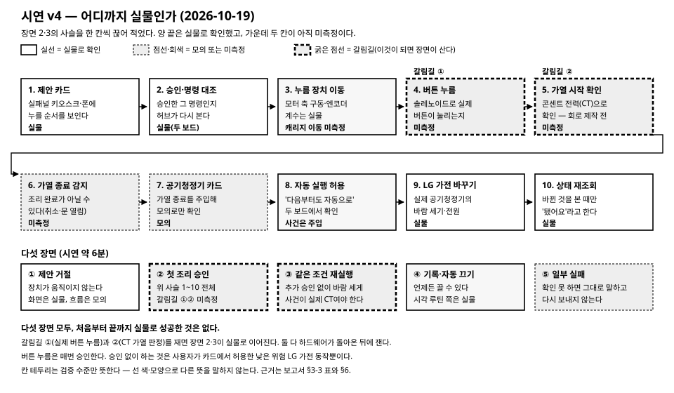
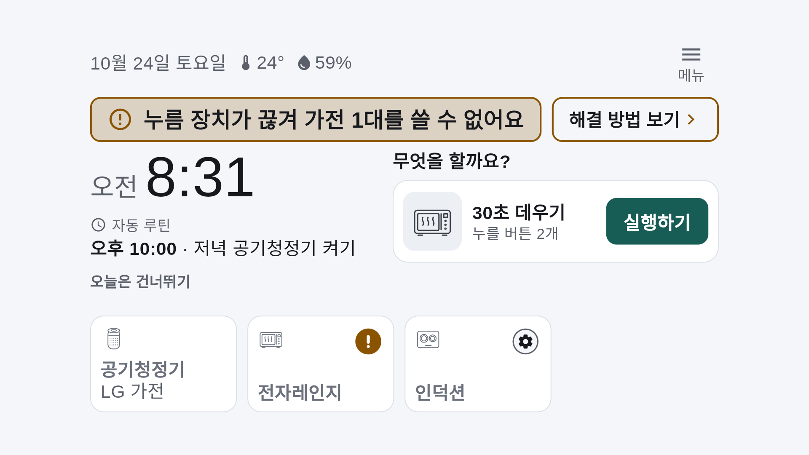
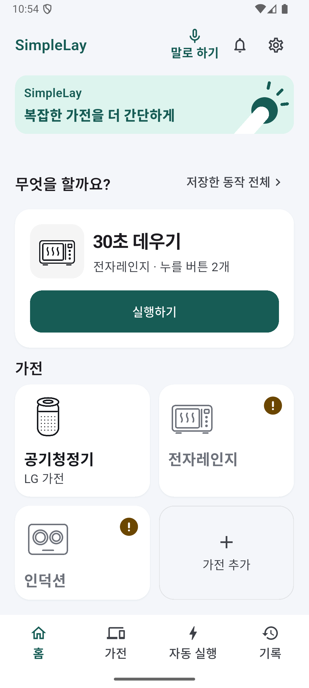
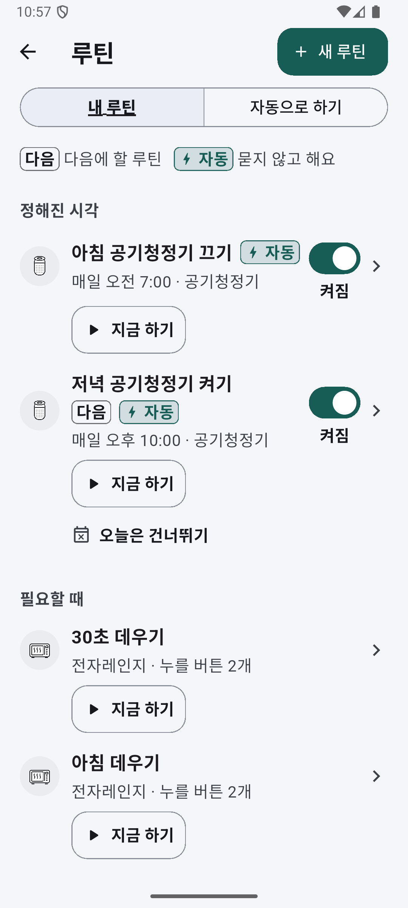
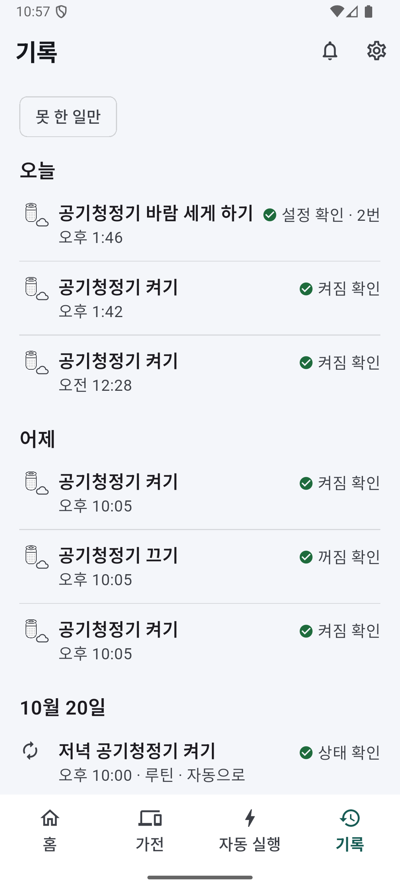

# 개발완료보고서 — SimpleLay

> 작성용 초안이다. 2026-10-28 제출한 최종 PDF는 저장소 밖에 보관하며 이 파일과 동일하다고 가정하지 않는다. 제출 후 확인 범위는 [README](../../README.md#6-무엇이-실물이고-무엇이-아직인가), 결선 전 우선 수리는 [복귀·첫 연결 계획](../결선전-복귀결함과-첫연결-수리계획-2026-10-28.md)을 따른다. 아래 과거 수치·구성·그림은 당시 초안으로 읽는다.

제24회 임베디드SW경진대회 결선 · 팀 자비스
박성원(소프트웨어) · 서예솔(하드웨어)
작성 기준: 2026-10-19(시연 v4) · 제출 예정: 2026-10-28 14:00

사진 자리(촬영 예정 — 세 장을 이 쪽 맨 위에 나란히)

그림 1. 왼쪽부터 전자레인지 조작부에 얹은 누름 장치(CoreXY 갠트리 + 솔레노이드), 콘센트 모듈, 15.8형 키오스크 처음 화면. 실물 사진.

## 0. 세 가지 주장

작은 버튼과 여러 단계 메뉴가 어려운 사람을 위해, **쓰던 가전을 바꾸지 않고** 조작부 위에 버튼 누름 장치를 얹었다. 이 보고서는 세 가지만 주장한다.

| 주장 | 뜻 | 근거 절 |
|---|---|---|
| ① **여러 버튼 개조** | 갠트리 하나가 한 조작부의 **여러 버튼을 순서대로** 누른다(예: 30초 → 시작). 버튼은 조작부 사진에서 등록 | §2·§3 |
| ② **승인에 묶인 실행** | 사용자가 승인한 **그 명령만** 실행한다. 거절하면 움직이지 않고, 자동 실행은 사용자가 허용한 낮은 위험 LG 가전 동작뿐 | §2·§6 |
| ③ **따로 확인한 결과** | 명령을 보낸 길과 **다른 근거**로 결과를 본다 — 전자레인지는 콘센트 전력(CT), 공기청정기는 상태 다시 읽기, 정지는 모터 엔코더. 확인 못 하면 '몰라요'로 남기고 다시 누르지 않는다 | §3-2·§6 |

무엇이 실물이고 무엇이 모의인지는 **§5-1 표 하나**에만 적었다.

## 1. 누구의, 어떤 문제인가

**사용자.** 두 사람이다.
- **당사자**(고령자·저시력 사용자): 큰 글씨 키오스크와 폰에서 제안을 보고 승인·거절하고, 언제든 멈춘다.
- **보호자·설치자:** 장치를 붙이고, 폰으로 조작부 사진을 찍어 버튼 위치·이름을 등록하고, 자주 쓰는 순서를 루틴으로 만든다.

**문제.** 전자레인지·세탁기 같은 버튼식 가전은 기능에 문제가 없어도 원격 조작이나 상태 알림을 붙일 수 없고, 스마트 가전으로 바꾸는 데는 비용이 든다.
버튼을 대신 눌러 주는 장치도 있지만, **명령을 보냈다고 가전이 동작한 것은 아니다.** 버튼이 덜 눌리거나, 가전이 입력을 받지 않거나, 통신 중에 결과를 잃을 수 있다.

**목표.** 명령 전송·버튼 눌림·가전 동작을 나눠 확인하고, 확인하지 못한 결과는 그대로 보고하며, 결과를 잃으면 자동으로 다시 보내지 않는다.

**적용 경계.** 평면 누름 버튼만 다룬다(다이얼식은 실행 거절). 조작부 하나에 갠트리 하나다. 음식을 넣고 빼거나 문을 닫는 일은 사람이 한다.

## 2. SimpleLay가 하는 일 — 승인 → 누름 → 전력으로 확인 → 이어서 공기청정기

| 단계 | 하는 일 | 사용자가 보는 것 |
|---|---|---|
| ① 제안 | 사용 기록(최근 28일, 서로 다른 날 사흘 이상·세 번 이상)이나 정해진 시각으로 할 일을 제안 | 카드: 누를 순서, '지금 하기'·'이번엔 안 할게요', 큰 정지 버튼 |
| ② 승인 | 카드에 명령 내용(대상·경로·동작·값)을 묶는다. 승인하면 서버가 명령을 다시 만들어 내용이 같을 때만 실행 | 승인한 그 명령만 실행된다. 카드가 나온 뒤 루틴이 바뀌면 실행하지 않는다 |
| ③ 누름 | RPi4 실행기가 갠트리를 움직이고 솔레노이드로 버튼을 차례로 누름 | 버튼판 위에 누를 순서와 지금 위치 |
| ④ 확인 | 콘센트 CT 전력이 오르고 유지되면 "가열 시작", 대기 수준으로 내려와 머물면 "가열 종료 감지" | 확인한 단계까지만 말한다. 확인 못 하면 '눌렸는지 몰라요', 다시 누르지 않음 |
| ⑤ 이어서 | 가열 종료 뒤 '공기청정기 바람을 세게 할까요?' → LG ThinQ로 보내고 **상태를 다시 읽어** 바뀐 것을 본 때만 성공 | '다음부터도 자동으로'를 고르면 같은 조건에서 승인 없이 실행 |

- **버튼 누름은 매번 승인한다.** 자동으로 하는 것은 사용자가 카드에서 명시적으로 허용한 **낮은 위험 ThinQ 동작**뿐이다(가열 종료 뒤 바람 세기, 정해진 시각의 전원 켜기·끄기). 습관 학습 결과로 자동 실행하지 않는다.
- **가열 종료 감지(조리 완료가 아닐 수 있음).** 전력 모양만으로는 취소·문 열림과 정상 종료를 구분하지 못해, 카드는 '전자레인지가 멈춘 것 같아요. 조리 완료가 아닐 수 있어요.'라고만 말한다. 바람 세기 변경은 낮은 위험 동작이라 취소·문 열림 뒤에도 일어날 수 있게 두었다.
- **화면 말**은 처음 쓰는 사람 기준이다: 기기는 '본체', 누름 장치는 '누름 장치', ThinQ 가전은 'LG 가전'. 매일 '조용한 시간'(정한 시간대)에는 처음 화면만 어둡게 하고, '잠시 쉬기'(지금부터 정한 시간)로 제안을 멈춘다. 큰 글씨·고대비를 켤 수 있다.
- **등록**은 다섯 단계다: 조작부 사진 → 버튼판 네 귀퉁이 → 버튼 고르고 이름 붙이기 → 정지 버튼과 기다리는 자리 → 자리 확인. 정해진 시각 루틴은 '오늘은 건너뛰기'로 다음 한 번만 건너뛸 수 있다.

### 2-1. 단일 버튼 푸셔와의 설계 차이

| | 단일 버튼 푸셔(공개 사양: SwitchBot Bot·Fingerbot Plus) | SimpleLay |
|---|---|---|
| 버튼 등록 | 누를 버튼 옆에 장치를 붙임(스티커 부착) | 조작부 사진에서 버튼 위치·이름을 등록 |
| 여러 버튼 순서 | 장치 하나가 버튼 하나. 여러 버튼 순서 조작은 확인하지 못함 | 갠트리 하나가 한 조작부의 여러 버튼을 순서대로 |
| 눌림·가전 동작 확인 | 확인하지 못함(SwitchBot 상태값 ON/OFF는 스위치 모드에서만 유효) | CT 전력으로 가열 시작·종료 확인, 단계별 보고 |
| 스마트 가전과 함께 | 앱·허브 경유 원격·음성 비서. ThinQ 가전과 한 흐름은 확인하지 못함 | ThinQ 가전도 같은 승인·결과 흐름(승인한 명령만·상태 다시 읽기) |
| 제안 | 앱 타이머·일정. 사용 기록 기반 제안은 확인하지 못함 | 사용 기록 기반 제안 + 허용한 조건의 낮은 위험 동작만 자동 |

설계 차이이며 성능 비교가 아니다(상용 제품을 시험하지 않았다). '확인하지 못함'은 공개 사양에서 찾지 못했다는 뜻이다. 출처(2026-10-14 확인): https://www.switch-bot.com/products/switchbot-bot · https://github.com/OpenWonderLabs/SwitchBotAPI/blob/main/devices/others/bot.md · https://www.adaprox.io/products/fingerbot-plus. 표 전체는 [실측 기록표](../실측-기록표.md) §3.

## 3. 하드웨어

사진 자리(촬영 예정 — 세 장 나란히)

그림 2. 함께 쓰는 것과 새로 만든 것. 왼쪽부터 다른 프로젝트와 함께 쓰는 갠트리 기계 한 대, 프로젝트마다 따로인 ESP32 모션 보드와 이번에 만든 콘센트 모듈, 이번에 만든 키오스크 화면. 실물 사진.

그림 3. 보드 역할과 통신 경로. 선 색·모양은 검증 수준과 관계없다(§5-1).

| 보드 | 역할 | 연결 |
|---|---|---|
| RPi5 허브 | 제안·승인·기록·루틴, 앱 API, 15.8형 터치 키오스크, ThinQ 연동 | 폰·키오스크와 HTTP |
| RPi4 실행기 | 버튼 순서 실행·결과 확인·정지 보고(계획서의 RPi Zero 자리) | RPi5와 줄 단위 JSON(같은 페어링 키가 있어야 연결) |
| ESP32 모션 | CoreXY 갠트리(엔코더 모터 2개) + 솔레노이드 누름 | RPi4와 USB 시리얼 |
| ESP32 콘센트 모듈 | CT 전력 계측, 전자레인지 릴레이, 비상정지 버튼·래치 | RPi4와 USB 시리얼 |

### 3-1. 함께 쓰는 것 / 이번에 새로 만든 것

갠트리와 모션 제어 핵심은 **같은 팀 하드웨어 담당이 만든 기계 1대와 원작 펌웨어를 다른 프로젝트(Touch Bridge)와 함께 쓴다.** 선은 **"누가 무엇을 판단하고 확인하느냐"**에 긋는다 — 누르는 몸은 함께 쓰고, 무엇을 누를지 승인받고 눌렸는지 확인하는 계층이 이 대회의 출품 대상이다.

| | 함께 쓰는 것 (기계 1대·원작 코드) | 이번 대회에서 새로 만든 것 |
|---|---|---|
| 기구 | CoreXY 갠트리 프레임·벨트·레일, XY 엔코더 모터 2개·드라이버·엔코더 | 조작부에 얹는 부착·하우징 설계(작업 중) |
| 모션 보드 | — | ESP32 모션 보드(프로젝트마다 따로) |
| 모션 펌웨어 | PID, CoreXY 기구학, 사다리꼴 궤적, 걸림 뒤 원점 복귀, 추종 오차 감시, 솔레노이드 구동 | 실행기와 주고받는 규약, 호스트 워치독, 명령 기한, 알람 순서, 솔레노이드 켜짐 상한·냉각 |
| 콘센트 쪽 | — | **ESP32 콘센트 모듈 전부** — CT 2채널, 릴레이, 비상정지 래치 |
| 승인·확인 | — | 승인 결속, 누름·전력 확인과 재시도·안전 정지 정책, 정지 세 단계 보고, 실행 대상별 CT 채널 결속 |
| 제안·자동 실행 | 의도 해석 외부 연동(선택 계층) | 사용 기록 기반 제안, 자동 실행 허용 규칙과 서버 강제, ThinQ 공식 SDK 연동 |
| 화면 | 폰 앱 골격(프로젝트 구조·일부 화면 틀) | **키오스크 앱 전체**, 폰의 상태·승인·기록·루틴·LG 가전 화면, 가전 등록·버튼판 편집기 |

재사용 비율은 숫자로 말하지 않는다(원 프로젝트와 줄 단위로 대조하지 않았다). 원작 파일에는 머리말로 출처를 적었다. 근거 표 전체는 [재사용 경계](../reuse-boundary.md).

### 3-2. 전력 확인(콘센트 모듈)

콘센트 모듈은 CT로 가전 소비 전력을 잰다. 시연은 첫째 채널(전자레인지, 릴레이를 거침)만 쓰고, 둘째 채널(계측만)도 받을 수 있다.
센서 연결이 끊기면 0 W로 채우지 않고 읽기 실패로 처리한다 — 센서가 없는 것을 가전 종료로 오인하지 않기 위해서다. 누를 때마다 전력을 보는 구간은 갠트리가 버튼 위로 옮겨 간 뒤, 누르기 직전에 연다(파형 기록기를 켰든 아니든 같다). 오래된 값·값 부족·센서 끊김은 성공으로 치지 않는다. 판정 기준값은 실측으로 정한다.

그림 4. 콘센트 모듈의 CT 두 채널 경로(설계도). 시연은 첫째 채널(ch0, 전자레인지)만 쓴다.

### 3-3. 소프트웨어

허브는 Python·FastAPI·SQLite, 화면은 Flutter(폰 Android·키오스크 Linux). 실행은 비동기 작업 단위로, 요청 접수와 작업 종료를 따로 돌려준다.
모든 실기기 연결은 환경 설정으로 켜고, 기본은 모의라서 개발 PC에서도 전 흐름이 돈다. RPi5·RPi4·폰·키오스크는 같은 날 같은 빌드로 배포한다(두 보드 사이 규약이 함께 바뀌기 때문).

## 4. 시연 — 다섯 장면 (v4, 약 6분)

결선 당일 기준이다. 실물이 준비되지 않은 장면(예: 콘센트 모듈 전의 가열 시작·종료 감지)은 먼저 말하고 **모의 실행**(실제 가전은 누르지 않음, 화면에는 '연습'으로 표시)으로 보인다.

| # | 장면 | 보이는 것 | 확인 근거 |
|---|---|---|---|
| 1 | 제안 거절 | '이번엔 안 할게요' → 장치가 움직이지 않음 | 기록에 '건너뜀', 실행 없음 |
| 2 | 첫 조리 승인 → 공기청정기 + 자동 허용 | 승인 → 갠트리가 전자레인지 버튼을 누름 → 가열 시작 → 가열 종료 감지 → '공기청정기 바람을 세게 할까요?' → '다음부터도 자동으로' → '허락하고 이번에도 하기' | 전력 시작·종료, 공기청정기 상태 재조회 |
| 3 | 같은 조건에서 다시 | 조리 재승인 → 가열 종료 감지 → 추가 승인 없이 바람 세게 | 상태 재조회(이미 그 설정이면 변경 명령 0회) |
| 4 | 기록 확인 → 자동 실행 끄기 | 두 가전 결과, 루틴 탭 '자동 규칙'에서 끄기 | '자동 실행 꺼짐' |
| 5 | 정지 · 일부 실패 | 실행 중 정지 → 엔코더로 멈춤을 본 때만 '누름 장치가 멈췄어요', 그 밖은 '멈췄는지 몰라요'. 명령은 보냈지만 확인 못 함 → '보냈지만 설정이 바뀌었는지 몰라요', 다시 보내지 않음 | 정지 단계(보냄 → 모션 보드 확인 → 멈춤 확인), 그날 얻은 결과 문구 그대로 |

그림 5. 시연 v4 장면 2·3의 사슬과 장면별 검증 수준. 양 끝(제안·승인과 LG 가전 제어·상태 재조회)은 실물이고, 가운데 두 칸(실제 버튼 누름, 전력 판정)이 미측정이다. 테두리 모양이 수준을 뜻하며 내용은 §5-1 표와 같다.

전자레인지 가열은 [운영 런북](../결선-운영-런북.md) §3-7 안전 체크리스트(빈 상태 가열 금지·짧은 시간·사람 입회)를 통과했을 때만 한다.

그림 6. 15.8형 실패널의 키오스크 처음 화면(2026-10-19, RPi5 허브에서 실제 화면 캡처). 날짜·시각, 다음 루틴과 '오늘은 안 해요', 날씨, 가전 타일(전자레인지·LG 공기청정기·인덕션). LG 가전 실행 화면 사진은 촬영 예정.

| (가) 홈 | (나) 루틴 | (다) 기록 |
|---|---|---|
|  |  |  |

그림 7. 폰 앱(2026-10-24, 실제 RPi5 허브에 연결한 최신 화면 캡처). (가) 홈 — 말로 하기·알림 종·설정, 저장한 동작 '30초 데우기'와 실행하기, 가전 그림 타일(누름 장치 연결이 없으면 느낌표로 '지금은 쓸 수 없어요' 표시) (나) 루틴 — 정해진 시각·필요할 때, '다음'·'자동' 표시와 자동 실행 허용 스위치 (다) 기록 — 공기청정기는 상태를 다시 읽어 '켜짐 확인'·'설정 확인'. 가전 추가·승인 전 확인 화면은 [그림 대응표](그림-대응표.md)의 10/24 캡처.

## 5. 무엇이 실물이고, 무엇이 아직인가

### 5-1. 장면별 실물 / 모의 (이 표가 기준이다)

이 보고서에서 검증 수준을 말하는 표는 이것 하나다. **실물**은 실제 보드·모터·가전에서 본 것, **시험·배포까지**는 자동 시험을 통과해 보드에 올렸지만 그 상황을 실물로 만들어 보지 않은 것, **모의**는 가짜 장치·합성 입력으로만 본 것이다.

| # | 장면 | 실물로 확인한 부분 | 아직 모의·미측정인 부분 |
|---|---|---|---|
| 1 | 제안 거절 | 키오스크가 실패널에서 도는 것(처음 화면), 폰·허브 경로 | 거절 뒤 실행이 없는 것은 시험 조건·모의까지. 무대 그대로의 리허설은 아직 |
| 2 | 첫 조리 승인 → 공기청정기 + 자동 허용 | 승인 뒤 실행 경로(폰·키오스크 → 허브 → 실행기 → 모션 보드), 모터 축 구동·엔코더 계수, 누름 제어 신호, 실행 중 정지(10/12~14, 벨트·솔레노이드 없는 시험대). 실제 공기청정기 제어·상태 재조회(10/15~16) | **갠트리 캐리지 이동과 솔레노이드의 실제 버튼 누름**(장착 전), **전력으로 가열 시작·종료 판정**(콘센트 모듈 회로 제작 중 — 제출 영상에는 없음, 결선 목표). 자동 허용 흐름은 가열 종료를 주입해 확인 |
| 3 | 같은 조건에서 다시 | 허용된 조건에서 추가 승인 없이 ThinQ 동작이 나가는 것(두 보드를 거쳐, 사건은 주입). 정해진 시각 규칙으로 실제 공기청정기 22:00 켜기·다음 날 07:00 끄기(10/16~17, 각 1회) | 실제 가열 종료로 일으킨 재실행 |
| 4 | 기록 확인 → 자동 실행 끄기 | 실제 본체에서 폰으로 다음 한 번 건너뛰기·되돌리기, 시각 규칙 끄고 켜기(10/18) | 사건 규칙 끄기와 기록 화면은 시험 조건까지 |
| 5 | 일부 실패 | '확인 못 함' 결과 문구와 자동 재전송 없음 | ThinQ 경로에서 실제로 얻은 실패 기록은 아직 없음 |
| — | 정지 경계 보강·재누름 금지(§6) | — | 시험·배포까지(10/16 밤부터 두 보드에 같은 이미지). 실제 모션 보드로 그 상황을 만드는 시험은 모션 보드 복귀 뒤 |
| — | 화면 | 15.8형 실패널 설치·부팅 자동 실행, 처음 화면, LG 가전 실행 화면(10/16~18) | 실패·정지·비상 화면 상당수는 위젯 시험·골든 렌더까지 |
| — | 습관 제안 | 10/25부터 실제 사용 기록을 모으는 중(습관 판단은 본체에 배포) | 실제 기록에서 습관 카드가 뜨는 것은 결선 전 확인 |
| — | 방 안 사람 감지 | 본체 카메라로 사람 있음/없음만, 기기 안에서(사진 저장·전송 없음, 끌 수 있음) — '언제 말을 걸지'에만 씀(10/25~26) | 결선장 조건 |
| — | 버튼 등록 | — | 모의(합성 좌표). 실제 조작부의 위치 오차는 미측정 |

**다섯 장면 모두, 처음부터 끝까지 실물로 성공한 것은 없다.** 갈림길은 장면 2의 실제 버튼 누름과 전력 판정이다.
자동 시험(2026-10-19, 골든 제외): 백엔드+RPi4 3,811 · 폰 1,332 · 키오스크 1,179(골든 따로 폰 69·키오스크 83). 제출 커밋 기준 수는 [근거 부록](근거-부록.md) §5에 적는다. 시험 통과·골든 렌더·펌웨어 컴파일은 실물 동작·패널 사진·회로 검증을 대신하지 않는다.

### 5-2. 잰 값과 잴 값

이미 잰 값은 조건과 함께 적고, 아직 재지 않은 값은 빈칸으로 둔다.

| 항목 | 값 | 조건 |
|---|---|---|
| 정지: 보냄 → 모션 보드 확인 | 중앙값 10.95 ms (n=10) | 10/13, 모터 축(벨트 없음), 5 mm 이동 시작 약 88 ms 뒤 정지 |
| 정지: 보냄 → 멈춤 확인 | 중앙값 160 ms (n=10, 10회 모두 멈춤 확인) | 같음 |
| 시각 규칙 → 공기청정기 상태 확인 | 2.3 s(켜기) · 2.7 s(끄기), 각 n=1 | 10/16~17, RPi5 허브, 집 Wi-Fi |
| **누름 성공률** | 측정 뒤 기입 (n/N, 첫 시도·재시도 포함) | 전자레인지 '30초 → 시작', 버튼 3개 × 반복, 사람 판정 |
| **가열 시작 감지 지연** | 측정 뒤 기입 | 정상 30초 가열 3회 이상 |
| **가열 종료 감지 지연** | 측정 뒤 기입 | 정상·출력 감소·취소·문 열림·팬만 각 3회 이상, 오판 수 함께 |
| **캐리지 이동 중 정지 지연** | 측정 뒤 기입 (중앙/최대 ms, 정지 거리 mm) | 전송 시각·엔코더·영상 대조 |
| **승인 → 결과 표시 시간** | 측정 뒤 기입 | 장면 2, 승인 누른 순간부터 결과 화면까지 |
| **ThinQ 대회장 조건 지연** | 측정 뒤 기입 | 대회장과 같은 핫스팟·공유기([절차](../ThinQ-실물-확인-절차.md)) |
| **부품 원가(BOM)** | 측정 뒤 기입 | 시연 1대 실제 구매가, 지급품 구분 |
| **설치 시간** | 측정 뒤 기입 | 처음 붙이기·재부착·처음 해 보는 사람 각 1회 |
| **팀 밖 사용자 사용성** | 측정 뒤 기입 | 1~2명, 핵심 과업 3개(제안 이해·승인 / 거절 / 실행 중 정지) 도움 없이 완료 여부 |

그래프 자리(측정 뒤 기입 — 실측 데이터로만 그린다)

그림 8. 버튼별 누름 성공률, 캐리지 이동 중 정지 지연 분포, CT 전력 파형 위 가열 시작·종료 판정 시점.

### 5-3. 제출 전 수행 — 비교 조건 실험 · 사용성 · 원가

방법·횟수는 [제출 전 검증 과업](../제출전-검증-과업.md), 현장 기록지는 [활용성 숫자 기록지](활용성-숫자-기록지.md)에 있다.
- **비교 조건 실험:** 같은 과업을 ① 사람 직접 ② 같은 장치에서 **동작 확인 기능을 끈 비교 조건** ③ SimpleLay로, 정상·누름 실패·시작 전 문 열림 조건에서 총 40회. 잘못된 상태로 끝난 횟수와 알아챈 시간을 ②·③으로 비교한다.
- **사용성 점검:** 팀 밖 1~2명, 모의 화면, 핵심 과업 3개 + 선택 2개(잠시 쉬기 / 오늘은 건너뛰기).

**결과: 미수행(제출 전 수행 뒤 기입).**

## 6. 안전 설계

원칙은 하나다: **확인한 만큼만 말하고, 모르면 다시 누르지 않는다.**

**정지 경로(3단계).** 화면 정지 버튼이나 음성 정지어("멈춰"·"그만"·"정지") → ① **보냄**(실행기가 정지 줄을 씀) → ② **모션 보드 확인**(보드 응답) → ③ **멈춤 확인**(엔코더가 두 번 연속 같음). 화면은 확인한 단계까지만 말한다 — 엔코더로 멈춤을 본 때만 '누름 장치가 멈췄어요', 그 밖에는 '누름 장치가 멈췄는지 몰라요'와 '다시 멈추기'. 실측은 §5-2(모터 축, n=10).

**재시도하지 않는 경우.**
- 모터 엔코더만으로는 벨트 미끄럼을 잡을 수 없어 원점을 확인하기 전에는 실행을 시작하지 않는다('준비 안 됨'). 실행기를 다시 켜거나 모션 보드가 다시 연결돼도 원점부터 다시 잡는다.
- 모터 걸림·재시작·기한 초과·원점 미확인은 재시도 없이 멈추고 원인과 '다시 누르지 않았어요'를 보인다.
- 토글 버튼(누를 때마다 켜짐·꺼짐이 바뀌는 버튼)과 성질을 모르는 버튼은 눌림을 확인하지 못해도 다시 누르지 않는다. 다시 눌러도 되는 것으로 표시한 시간 버튼만 재시도한다.
- 결과를 잃거나 링크가 끊기면 '눌렸는지 모름'으로 기록하고 자동 재전송·재개하지 않는다([장애 복구 결과표](../장애-복구-결과표.md)). USB가 다시 잡히면 실행기 재시작 없이 다시 연다.
- ThinQ는 보내기 전에 상태를 읽어 이미 목표값이면 보내지 않고, 보낸 뒤 상태를 다시 읽어 바뀐 것을 본 때만 성공이다. 접수만 됐으면 '보냈지만 설정이 바뀌었는지 몰라요'.

**자동 실행의 울타리.** 사용자가 카드와 확인 시트에서 두 번 고른 때만 생긴다. 서버가 강제한다: 낮은 위험 ThinQ 동작만, 같은 사건에 한 번만, 오래된 사건·재시작 전 사건은 보류, 보내기 직전에 규칙이 꺼졌으면 보내지 않음, 전원 끄기는 시각 규칙에서만, 비상정지 중에는 보내지 않음. 루틴 탭에서 언제든 끈다.

**하드웨어 마지막 수단.** 콘센트 모듈은 비상 버튼을 감지하면 호스트를 기다리지 않고 릴레이를 열고 래치를 보존하며, 사람이 확인해야 풀린다. 릴레이는 전자레인지 전원만 끊으므로 갠트리는 별도 모터 전원 스위치로 끊는다.

그림 9. 비상정지 흐름 — 비상 버튼 → 릴레이 열림·실행 차단 → 버튼 해제 → 사람 확인 뒤 풀림. 설계도다.

**그 밖의 정지 보강.** 보내기 전·루틴 구간 사이·쓰기 직전에 정지를 다시 확인하고, 실행 중 생존 신호가 끊기면 실행기가 스스로 멈추며, 엔코더 근거가 있을 때만 '멈춤 확인'이라 한다. 음성 '멈춰'나 실행 접수 전에 누른 정지도 정지 단계를 보이고, 못 보냈으면 그렇다고 말한다. 수준은 §5-1, 안전 인증은 아니다.

## 7. 플랫폼 활용과 전문가 의견 반영

RPi5와 RPi4에는 대회 제공 임베디드 SW 플랫폼 이미지를 쓰고, 자체 백엔드와 실행기를 컨테이너로 배포했다. 키오스크 설치와 부팅 자동 실행을 확인했다.
앱 계정으로 플랫폼 시스템 서비스 읽기 호출을 RPi5·RPi4 각 1건 성공시켰다([가산점 증거 대장](../가산점-증거-대장.md)).

| 의견 | 반영 | 남은 확인 |
|---|---|---|
| 복합 상황·공조(9/29) | 전자레인지 가열 종료 → ThinQ 공기청정기 제안·허용된 자동 실행 | 실제 CT와 실제 공기청정기를 잇는 통합 실측 |
| 소프트웨어적 가전 제어(9/29) | ThinQ 공식 SDK, 같은 승인·결과 계약, 실제 공기청정기 제어·시각 자동 실행 | 대회장 네트워크 지연 |
| 동작 확인과 실패 복구(예선) | 누름·전력 확인, 확인 불가 보고, 재시도 없는 정지, 토글 재누름 금지 | 누름 성공률, 전력 실측 |
| 먹통 시 정지 수단(9/22) | 화면·음성 정지, 정지 세 단계, 생존 신호, 비상정지 래치 | 전원 차단 회로, 캐리지 정지 실측 |
| 사용자 개입 지점(9/22) | 매회 승인, 조건부 사전 허용, 언제든 끄기, 다음 한 번 건너뛰기 | 팀 밖 사용성 점검 |
| 통신 간섭과 회복(9/22) | 결과 유실 시 재전송 금지, 링크 재연결, USB 재열거 뒤 다시 열기(실물) | 실제 가열 중 통신 |
| 처음 쓰는 사람의 말(10/17 지도교수) | 쉬운 말('본체'·'누름 장치'·'LG 가전'), 탭 넷·행마다 할 일 하나 | 팀 밖 사용성 점검 |

의견별 전후 비교는 [피드백 전후](피드백-전후.md). 접근성은 [사용자 편의 기준](../사용자편의-가이드-체크리스트.md)을 따랐고, 인증·당사자 평가·실제 화면 낭독 확인은 하지 않았다.

## 8. 개발 과정과 역할

| 담당 | 맡은 일 |
|---|---|
| 박성원 | 허브·실행기·폰 앱·키오스크·배포, 소프트웨어 연동, 보드 시험 진행 |
| 서예솔 | 갠트리·모션 펌웨어(원작)·콘센트 모듈·센서·하우징, 배선·조립 |

| 시기 | 진행 |
|---|---|
| 8월~9/17 | 확인 구조와 폰·키오스크 초기 개발, 제어권·정지 경합 수리, 판정·버튼맵 모의 시험 |
| 9/27~10/8 | 디지털 트윈, ThinQ 명령 계약, 보드 수령·배포, 콘센트 모듈 펌웨어·비상정지 래치, 장애 복구 시험 |
| 10/10~10/14 | 모션 펌웨어를 SimpleLay 규약으로 합침, 모션 보드 실물 연결(모터 축), 정지 세 단계 실측, 자동 실행 허용 규칙, 시연 v4 확정 |
| 10/15~10/18 | 실제 공기청정기 연동·시각 자동 실행, 정지 경계 보강·재누름 금지 배포, 쉬운 말 화면 개편 |
| 10/19~10/27 | 모션 보드 복귀 뒤 실제 버튼 누름부터 — 캐리지·누름 실측, 비교 조건 실험, 사용성 점검, 원가·설치 시간(예정) |
| 10/28~11/5 | 콘센트 모듈 회로 제작·CT 실측(목표) |

하드웨어 통합 전에는 같은 API의 모의 실행기와 디지털 트윈으로 흐름을 확인했다. 실패 경로는 이렇게 반복 시험했지만, 누름 성능은 실물로만 확인한다.
개발 도구 사용 고지는 대회 규정을 확인한 뒤 이 자리에 넣는다([초안](개발도구-사용-고지-초안.md)).

## 9. 한계와 다음 단계

- 실제 버튼 누름·캐리지 이동·전력 판정은 미측정이다. ESP32 모션 보드는 솔레노이드·레일 작업 중이고, 콘센트 모듈은 설계·펌웨어 완료(컴파일·가짜 모듈 시험), 회로 제작 중이다. 그래서 **제출 영상(10/28)에는 전력 확인 장면이 없다.** 결선(11/6) 전 완성이 목표이며, 못 하면 결선에서도 '실측 전'이라고 말한다.
- 비상정지 전원 차단 회로는 없다. 공간 감지는 본체 카메라의 사람 있음/없음만 하고(말을 걸 때 고르기에만), 레이더는 쓰지 않는다. 정지는 화면·음성·모터 전원 스위치로 한다.
- 가열 종료 감지는 취소·문 열림과 정상 종료를 구분하지 못한다. 출력 조절·팬만 도는 구간의 오판 여부도 실측으로 본다([실측 기록표](../실측-기록표.md) §6). 잘못 잡으면 자동 실행 조건을 다시 설계한다.
- 시간 버튼은 재누름을 허용한 분류라 첫 누름을 놓치면 시간이 누적될 수 있다. 사람이 전체 순서를 새로 요청하면 앞의 성공한 버튼도 다시 누를 수 있다.
- 가전 소리로 입력을 확인하는 단계는 실행 경로에 연결하지 않았고, 전류 센서 배선이 없으면 누름 확인은 전력에 기댄다.
- ThinQ는 클라우드가 필요하다. 대회장 인터넷이 안 되면 모의 클라우드로 돌리고 먼저 말한다. 이미 보낸 ThinQ 명령의 취소는 보장하지 않는다.
- 조용한 시간 어둡게의 정도는 추측값이고, 다른 조작부로 옮겨 붙이는 범용성은 두 번째 조작부에서 다시 재야 말할 수 있다.

## 10. 근거 문서

- [README](../../README.md) · [시연 v4](../본선-시연-계획-v4.md) · [제출 전 검증 과업](../제출전-검증-과업.md) · [실측 기록표](../실측-기록표.md)
- [재사용 경계](../reuse-boundary.md) · [하드웨어 방향 확정](../하드웨어-방향-확정-2026-09-30.md) · [정지 확인 계획](../계획-정지-확인-2026-10-12.md) · [안전 계약 적용 보고](../안전계약-적용-보고-2026-10-15.md)
- [전문가 의견 대응](../전문가의견-대응-2026-09-29.md) · [피드백 전후](피드백-전후.md) · [가산점 증거 대장](../가산점-증거-대장.md) · [장애 복구 결과표](../장애-복구-결과표.md)

그림 원칙: 새 구성도, 직접 촬영한 실물, 모의 표시가 보이는 화면만 쓴다. 비공개 제공 자료나 발표 파일은 가져오지 않는다. 골든 렌더를 패널 사진으로 쓰지 않는다.

---

## 부록 — 근거 기록

날짜별 빌드·커밋, 작업 기록 링크, 팀 내부 점검 번호(안전 점검 항목 번호 등)와 본문 표현의 대응은 공개 저장소의 [근거 부록](근거-부록.md)에 모았다. 제출 PDF에는 이 한 줄만 둔다.
