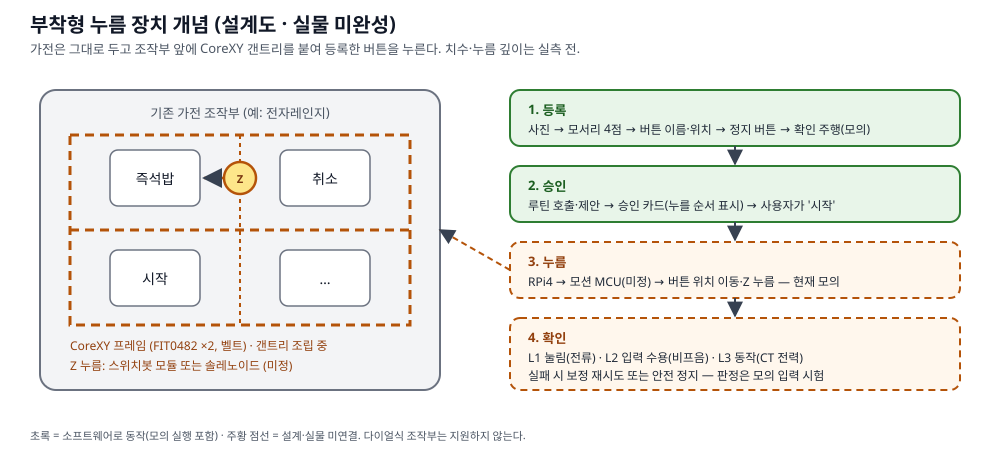
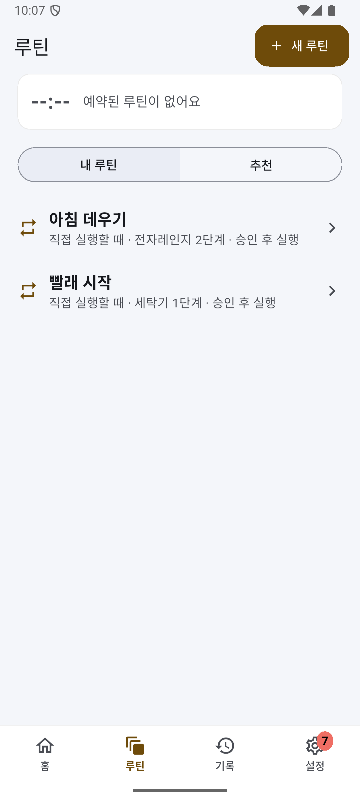
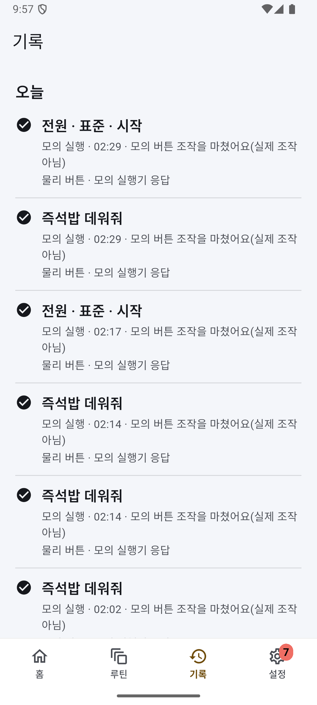
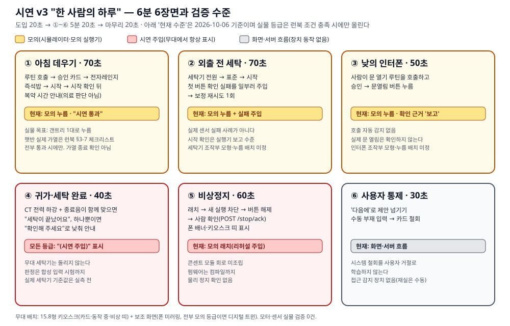
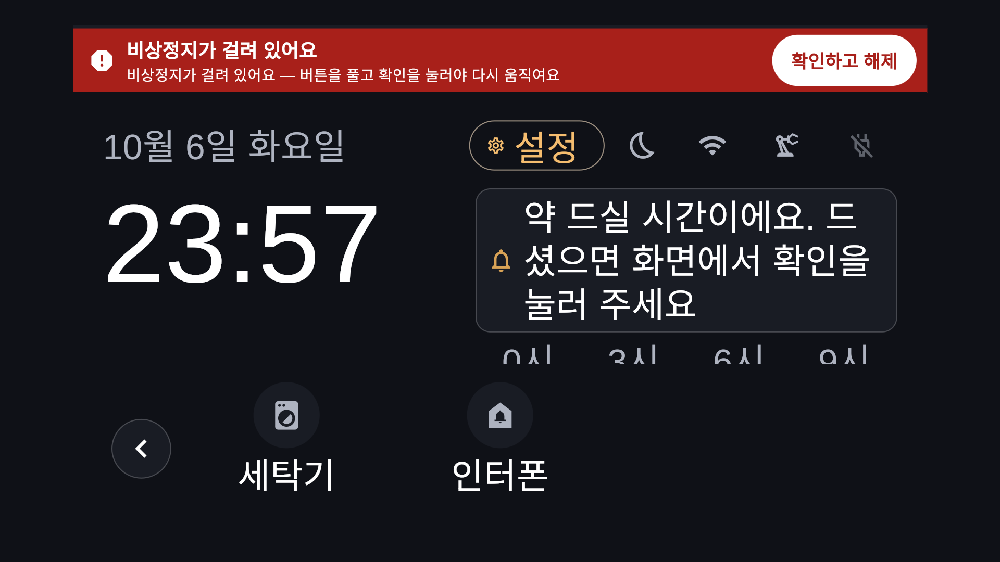
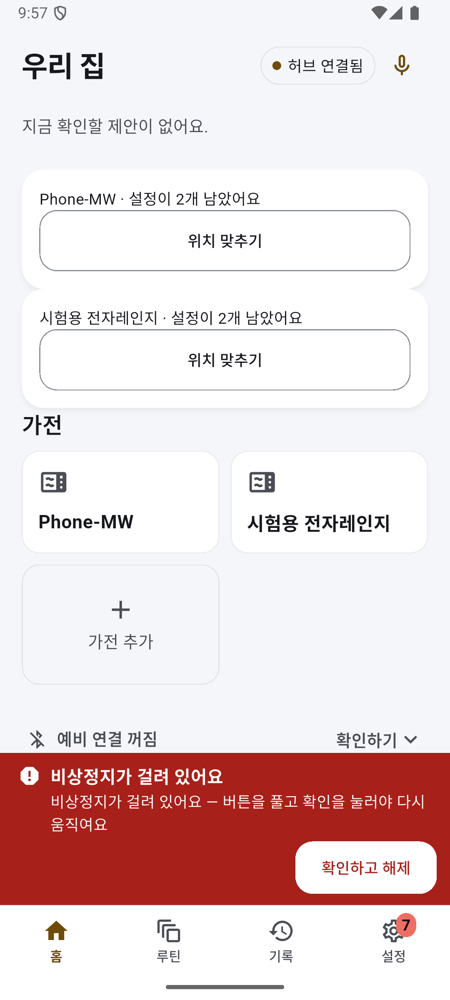
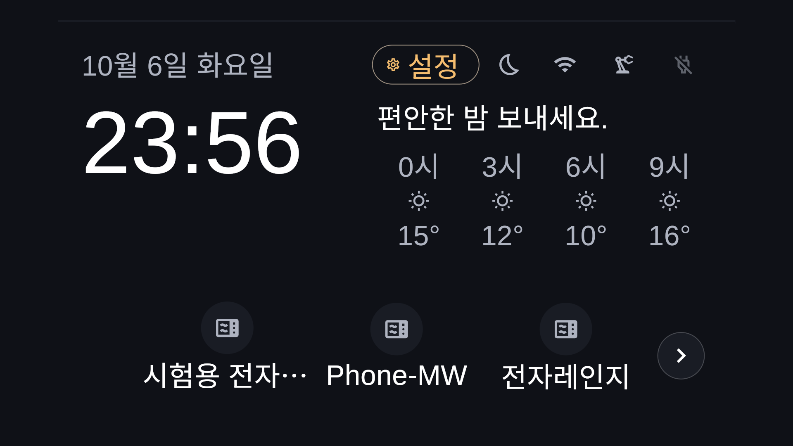
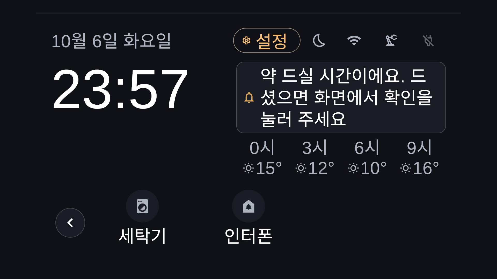

# 개발완료보고서 — SimpleLay

제24회 임베디드SW경진대회 결선 · 팀 자비스
박성원(소프트웨어) · 서예솔(하드웨어)
작성 기준: 2026-10-06 · 제출 예정: 2026-10-28 14:00

본 보고서는 현재 저장소의 구현과 검증 기록을 정리한 초안이다. 보고서 명칭의 '개발완료'가 실물 시스템의 완성을 뜻하지는 않는다. 모터·센서 실물 검증은 0건이며, 소프트웨어 완료 항목은 모의 입력 시험 또는 컴파일 수준으로 구분했다. 측정하지 않은 값은 【실측 후 기입】으로 남긴다.

편집은 A4 본문과 그림·표를 합쳐 20쪽 이하를 목표로 한다. 개요 1쪽, 구성 2쪽, 기능 2쪽, 핵심 기술 3쪽, 플랫폼 1쪽, 검증 3쪽, 개발 과정 1쪽, 한계·과제 1쪽, 참고·그림 2쪽 등 약 16쪽을 배정한다. 이는 편집 계획이며 PDF 쪽수를 확인한 결과는 아니다. 원본 사진과 캡처는 아래 자리표시자에 넣고 최종 양식에서 쪽수를 확인한다.

## 1. 개발 목적과 범위

### 1-1. 배경

기존 버튼식 가전은 기능에 문제가 없어도 원격 조작과 상태 알림을 추가하기 어렵다. 작은 버튼을 정확히 누르거나 여러 메뉴를 같은 순서로 반복하는 일은 고령자나 손 사용이 불편한 사람에게 부담이 될 수 있다. SimpleLay는 가전을 교체하는 대신 조작부에 부착하는 누름 장치와 사용자 승인 화면을 결합하는 방법을 택했다. 사용 편의와 교체 비용 감소는 개발 목표이며, 당사자 평가나 가격 비교로 효과를 입증한 상태는 아니다.

명령을 보냈다는 사실만으로 가전이 동작했다고 판단할 수는 없다. 버튼이 덜 눌리거나 입력이 수용되지 않을 수 있고, 통신 중 결과를 잃을 수도 있다. 따라서 명령 전송, 버튼 눌림, 가전 입력 수용, 실제 동작을 구분하고 확인하지 못한 결과를 화면에서도 구분하는 것을 핵심 과제로 삼았다.

### 1-2. 구현 범위

폰에서 가전을 등록하고 버튼 순서를 루틴으로 저장하면 RPi5가 제안과 승인을 관리하고 RPi4가 실행과 검증을 맡는 구조를 구현했다. 모션·센서 입력을 대신하는 시뮬레이터로 승인, 재시도, 정지, 결과 표시의 연결을 시험했다. RPi5↔RPi4 실제 보드 사이의 LAN 통신은 모의 모션으로 확인했지만 버튼을 누르는 기구와 센서 판정의 실물 성능은 확인하지 않았다.

결선 시연의 기준은 전자레인지·세탁기·인터폰으로 구성한 v3 '한 사람의 하루'다. ThinQ 경로는 별도 모의 클라이언트로 공통 승인·결과 계약을 시험했으며 본 시연 여섯 장면에는 포함하지 않는다. 다이얼식 조작부는 지원하지 않는다.

그림 1. 부착형 누름 장치 개념(설계도). 갠트리는 조립 중이며 누름과 확인 단계는 현재 모의 수준이다.

그림 2. 사용자 승인 화면 — 실제 15.8형 패널 캡처(2026-10-06). 루틴 승인 카드에 누를 순서가 표시되며, 누르지 않으면 실행하지 않는다. 이후 실행은 모의 실행이다.

## 2. 시스템 구성

### 2-1. 보드 역할과 통신

| 구성 | 역할 | 현재 확인 범위 |
|---|---|---|
| RPi5 | 의도 해석, 제안, 승인, 이력, 루틴, 앱 API, 15.8형 키오스크 | 백엔드·키오스크 배포, 실제 패널 표시와 부팅 자동 실행 |
| RPi4 | 시퀀스 실행, 판정, 재시도, 정지, 모션 링크와 콘센트 모듈 수신 | 실제 보드에서 LAN 통신과 모의 모션 실행 |
| 모션 MCU | CoreXY 모터 구동과 시간 기반 Z 누름 | Arduino 또는 ESP32 중 미정. 참고 펌웨어 컴파일·가짜 MCU 시험 |
| ESP32 콘센트 모듈 | CT 계측, 릴레이 차단, 비상정지 버튼·래치 | 펌웨어 컴파일, 가짜 출력 시험. 실물 회로 미조립 |

대체 근거(역할 매핑): 팀은 RPi4가 계획서의 RPi Zero 자리를 맡는 것으로 확정했다. 이는 보드 구성의 설명이며 연동 증거가 아니다. 실제 3종 연동 증거는 현재 모의·미측정이다 — RPi5↔RPi4는 LAN 위 모의 모션까지, ESP32 콘센트 모듈은 펌웨어 컴파일·가짜 모듈 시험까지이고 세 보드가 한 흐름에서 함께 동작한 기록은 없다. RPi5는 해석·제안과 키오스크를 함께 맡고 RPi4는 실행·검증을 분리해 담당한다. 콘센트 모듈용 ESP32와 모션 MCU는 역할이 다르다. 모션 MCU도 ESP32로 확정되면 두 역할에 각각 보드가 필요하다.

폰과 RPi5는 HTTP로 통신한다. RPi5와 RPi4는 줄 단위 JSON 규약을 사용하며 현재 실제 보드 시험은 LAN 위 TCP와 가상 시리얼 연결로 진행했다. 최종 UART 배선의 검증과 구분한다. RPi4와 모션 MCU는 USB 시리얼을 사용할 계획이며, ESP32 콘센트 모듈의 CT 값도 USB 시리얼로 RPi4에 전달하는 경로를 작성했다(가짜 모듈 시험까지, 실물 미연결).

그림 3. 시스템 구성. 초록 실선은 실제 보드에서 확인한 구간(모션·판정 입력은 모의), 주황 점선은 설계·실물 미연결 구간이다.

### 2-2. 기구와 전력 계측

CoreXY는 FIT0482 모터 2개와 벨트로 구성하며 갠트리는 조립 중이다. 모터 축의 엔코더 값만으로 벨트 미끄럼을 직접 검출할 수 없으므로 기구 고정과 원점 확인이 필요하다. Z 누름은 스위치봇 또는 솔레노이드 중 미정이다. 팀원 코드와 핀맵을 받은 뒤 모션 MCU와 함께 확정한다. 누름 시간·구동 전류·좌표 보정값은 실측 없이 확정하지 않는다.

콘센트 모듈은 CT 2개를 사용하는 구성이다. ch0은 전자레인지, ch1은 세탁기에 대응한다. ADS1115 구성은 ch0 AIN0-AIN1, ch1 AIN2-AIN3를 사용하도록 작성했다. 채널별 데이터 버퍼와 신선도 확인을 분리했으며 두 채널 펌웨어는 컴파일, 호스트 경로는 가짜 모듈 시험까지 확인했다. 두 번째 CT 구매, 실제 배선, 채널별 보정은 남아 있다.

릴레이 뒤에는 전자레인지만 연결하고 세탁기는 릴레이를 거치지 않고 CT로 계측만 한다. CT 출력으로 계산한 전력은 보정이 필요한 추정값이며 계측 정확도를 입증하지 않았다. 콘센트 릴레이가 차단하는 것은 전자레인지 전원이다. 갠트리 모터 전원은 별도 개별 스위치로 차단하는 운영 계획이다.

그림 4. 콘센트 모듈 CT 두 채널 경로(설계). ch0 전자레인지는 릴레이 경로, ch1 세탁기는 계측 전용이다. 회로 미조립, 펌웨어 컴파일·가짜 모듈 시험까지.

### 2-3. 소프트웨어 구성

허브는 Python·FastAPI와 SQLite를 사용하고 실행은 비동기 작업 단위로 관리한다. 요청의 접수와 작업 종료를 분리해 반환하며 클라이언트는 작업 식별자와 상태를 대조한다. 폰 앱과 키오스크는 Flutter로 작성했다. RPi4 실행기는 모션·판정 어댑터를 통해 모의 입력과 실제 연결 경로를 분리한다. 펌웨어는 콘센트 모듈과 모션 참고 구현을 별도로 관리한다.

기기 배포는 컨테이너와 시작 스크립트로 구성했다. 10/6에는 RPi5·RPi4에 CT 2채널과 세탁 완료 관련 코드를 배포했고, 키오스크는 10/7에 1.8.2를 설치했다. 배포 사실을 센서 연결이나 새 화면 전체의 현장 검증으로 해석하지 않는다. 같은 날 후속 결함 수리는 개발 로그에 기록되어 있으며 촬영 전 배포본과 소스 기준을 다시 맞춰야 한다.

## 3. 사용자 기능과 시연

### 3-1. 가전 등록과 루틴

가전 등록은 사진 촬영, 프레임 모서리 4점 지정, 버튼 위치와 이름 지정, 정지 버튼과 보관 위치 지정, 확인 주행의 다섯 단계다. 사진 좌표를 기구 좌표로 옮기고 사용자가 확인한 버튼 정보를 저장하는 구조다. 합성 좌표와 모의 모션으로 시험했으며 실제 사진과 기구의 위치 오차는 측정하지 않았다. 외부 사진 인식은 선택적 초안 보조이며 등록의 필수 경로가 아니다.

사용자는 사진 위 버튼을 순서대로 선택해 루틴을 저장한다. 녹화 중에는 실행하지 않는다. 루틴을 호출하면 제안 카드를 만들고 사용자가 승인한 뒤 실행하도록 구성했다. 고정된 즉석밥 메뉴를 홈에 두는 대신 사용자가 만든 루틴과 제안을 표시한다.

폰 앱은 홈·루틴·기록·설정 네 탭이며 개발자 기능은 별도 설정을 켰을 때만 나타난다. 키오스크는 평소·다가오면·동작 중·내 가전 네 상태다. '다가오면'이라는 상태 이름이 실제 접근 감지를 뜻하지는 않는다. 현재 레이더는 없으며 서버 제안이나 루틴 선택으로 화면을 전환한다. 부재 처리는 수동 재실 입력을 사용한다.

   

그림 P1~P4. 폰 앱(안드로이드 에뮬레이터, 실제 RPi5 백엔드에 연결, 2026-10-07 캡처) — 홈(설정이 남은 가전 묶음 카드와 가전 5개), 가전 추가 1단계(조작부 사진), 루틴 목록, 실행 기록. 기록의 실행은 모두 **모의 실행 화면**이다("모의 버튼 조작을 마쳤어요(실제 조작 아님)", "모의 실행기 응답"). 가전 이름 중 'Phone-MW'·'시험용 전자레인지'는 시험 등록이다. 루틴 녹화 화면과 확인 주행(모의)은 별도 캡처 예정.

### 3-2. 시연 v3: 한 사람의 하루

도입 20초와 마무리 20초를 포함해 총 6분으로 구성한다. 장면별 실물·부분 실물·전부 모의 등급은 런북 진행 조건에 따라 정하고 화면과 설명에 표시한다. 전자레인지 갠트리 1대를 먼저 준비하며 세탁기·인터폰은 조작부 모형으로 계획했다. 두 모형의 누름 장치 배치는 미정이다.

| 장면 | 배정 | 보일 내용과 한계 |
|---|---|---|
| ① 아침 데우기 | 70초 | 루틴 호출 → 승인 → 즉석밥·시작 순서 → 시작 확인 뒤 복약 시간 안내. 현재 누름은 모의이며 복약 안내는 의료 판단이 아니다 |
| ② 외출 전 세탁 | 70초 | 전원·표준·시작 순서와 실패 주입 후 보정 재시도. 실제 센서 실패 사례가 아니며 시작 확인은 실행기 보고 수준이다 |
| ③ 낮의 인터폰 | 50초 | 사람이 루틴을 호출하고 승인하는 문열림 명령. 호출 자동 감지와 실제 문 열림 확인은 없다 |
| ④ 귀가·세탁 완료 | 40초 | CT 전력 하강 + 종료음 교차 확인에 따른 안내. 무대에서는 세탁기를 돌리지 않고 '시연 주입'을 표시한다 |
| ⑤ 비상정지 | 60초 | 콘센트 모듈 비상정지 래치·실행 차단·사람 확인 해제. 현재는 모의 흐름이며 실물 차단 회로는 미검증이다 |
| ⑥ 사용자 통제 | 30초 | '다음에'로 넘기기와 수동 부재에 따른 제안 철회. 시스템 철회를 사용자 거절로 학습하지 않는다 |

햇반 실제 가열은 [운영 런북](../결선-운영-런북.md) §3-7 체크리스트를 모두 통과한 경우에만 한다. 부하 투입, 포장 기준 조리 시간 상한, 비상정지 차단·래치·복구 확인, 문 닫힘·환기·내열 장갑 조건을 확인한다. 회로가 없거나 한 조건이라도 충족하지 못하면 가열하지 않는다. ①은 가열 완료가 아닌 시작 확인 뒤 시간 안내를 보이는 장면이며, 실제 가열 종료를 확인했다고 설명하지 않는다.

그림 5. 시연 v3 여섯 장면과 장면별 현재 검증 수준(2026-10-06). ④ 세탁 완료는 모든 등급에서 시연 주입, ⑤ 비상정지는 모의 래치다.

## 4. 핵심 기술과 안전 처리

### 4-1. 층별 판정과 재시도

| 층 | 확인 대상 | 설계한 입력 | 실패 처리 |
|---|---|---|---|
| L1 | 버튼의 물리 눌림 | 누름 장치 쪽(Z 구동부) 전류 변화로 판정(가전을 열지 않음, 정확한 측정 지점은 HW 확정 전). 음향은 신뢰도를 더하는 보조 입력 | 위치·누름 조건 보정 재시도, 상한 도달 시 안전 정지 |
| L2 | 가전의 입력 수용 | 마이크 비프음(RPi4 운영 경로 미연결 <!-- L2-C -->) | 제한된 재입력 후 확인, 카메라 비교는 후보 |
| L3 | 가전의 실제 동작 | CT 전력 상승·유지(설계) | 자동 재시도 없이 안전 정지 |

정리하면 L1은 전류 판정이고 음향은 보조 신뢰도, L3는 CT 전력(설계)이며, L2 음향은 RPi4 운영 경로에 아직 연결하지 않았다. <!-- L2-C --> 기본 설정(전류 가중 0.55·음향 0.45·임계 0.50)에서 음향만으로는 눌림으로 판정하지 않고 전류만으로는 판정한다(`rpi/tests/test_fusion_truth_table.py`). L1 관측 구간은 지금 XY 이동 전체와 Z 누름을 함께 덮는다. Z 누름 구간(MCU `press_start` 기준)으로 좁히는 일은 남은 과제다.

현재 구현은 층별 판정 계약과 모의 입력 시험까지다. 세 층의 판정 로직과 실패 처리를 모의 입력으로 시험했으며, L2를 RPi4 운영 경로에 독립적으로 연결하는 일과 실제 센서 통합은 남아 있다. <!-- L2-C --> L1의 누름 깊이 보정은 구동 방식에 따라 적용 가능성이 다르며, 솔레노이드 선택 시 시간 기반 누름 규약과 맞춰야 한다. 판정에 사용할 전류·전력·음향 임계값은 실제 센서로 측정한 값이 아니다.

콘센트 연결이 끊기면 0 W로 채우지 않고 읽기 실패로 처리한다. 따라서 센서 부재를 가전 종료로 오인하지 않도록 했다. CT 동작 확인, 완료 뒤 잔여 전력 기록 경로도 가짜 출력 시험까지다. 실물 경로를 켜는 설정값이 존재한다는 사실만으로 실제 계측을 검증했다고 보지 않는다.

### 4-2. 승인과 결과 표시

제안 카드에는 대상·경로·동작·인자를 묶은 명령 지문을 연결했다. 승인 시 서버가 명령을 다시 만들고 카드의 지문과 맞는 경우에만 실행한다. 카드가 나온 뒤 루틴 정의가 바뀌거나 다른 명령으로 바뀌면 그대로 실행하지 않도록 했다. 여러 단계 루틴도 승인한 범위 안에서 진행한다.

화면은 요청 접수, 실행기 보고, 상태 확인, 확인 불가를 구분한다. 결과를 잃으면 자동 재전송하지 않는다. 사용자 정지와 판정 실패에 따른 안전 정지도 다른 문구로 표시한다. 이러한 처리는 모의 통신·판정 시험의 결과이며 실제 움직임 정지를 입증하지 않는다.

### 4-3. 세탁 완료: 전력 하강과 종료음

CT 전력이 일정 시간 운전 수준에 머문 뒤 대기 수준으로 내려오는 구간을 찾는다. 짧은 전력 하강은 담금·헹굼 사이 정지일 수 있어 완료로 바로 판단하지 않는다. 끊긴 센서 구간은 대기 시간으로 합산하지 않는다. 음향 입력에서는 일정한 종료음 묶음과 뒤따르는 조용한 구간을 찾고, 계속 반복되는 경보는 구분하도록 설계했다.

두 신호가 정해진 시간 창 안에서 맞으면 완료로 안내한다. 한 신호만 들어오면 완료를 단정하지 않고 확인을 요청하며 다음 루틴 단계는 보내지 않는다. 같은 사이클에서 중복 안내하거나 해당 동작을 시작한 루틴을 다시 깨우는 경우도 방지하도록 보완했다. 실제 세탁기의 멜로디와 긴 담금 구간에서는 판정이 달라질 수 있으므로 표준 코스 전력과 종료음 기록이 필요하다.

가짜 콘센트 모듈과 합성 음으로 RPi4 판정에서 RPi5 안내까지 시험했으며 이 경로가 세탁기 릴레이 차단 명령을 보내지 않는 것도 확인했다. 실제 CT·마이크로 얻은 완료 판정 결과는 없다. 입력 출처는 모의·주입·실물로 구분하고 무대의 주입 표시를 유지한다.

### 4-4. 비상정지와 복구

콘센트 모듈 펌웨어는 버튼을 감지하면 호스트 응답을 기다리지 않고 릴레이를 열도록 작성했다. 래치를 보존하고 RPi4에도 전달해 새 실행을 차단하는 구조다. 버튼을 푼 뒤 사람이 `POST /stop/ack`로 확인해야 래치를 해제하며 버튼이 눌린 상태에서는 해제를 거절한다. 정상 비상정지 래치 해제만으로 릴레이를 다시 켠다고 가정하지 않는다. 실제 복전 절차는 회로 조립 후 런북에서 검증해야 한다.

폰 배너와 키오스크 띠는 래치 상태를 알린다. 화면 정지는 `POST /stop`으로 요청한다. 콘센트 릴레이는 전자레인지 전원을 대상으로 하므로 갠트리가 계속 움직일 때의 마지막 수단은 별도 모터 전원 스위치다. 통신 ACK와 실제 정지는 구분한다. 펌웨어는 컴파일, 래치와 확인 해제는 가짜 모듈·시뮬레이터까지 검증했다.

그림 6. 비상정지 발생 → 실행 차단 → 버튼 해제 → 사람 확인(`POST /stop/ack`) 흐름. 펌웨어 컴파일, 래치·확인 해제는 가짜 모듈·시뮬레이터 시험까지다.

그림 7. 키오스크 비상정지 띠 — 실제 15.8형 패널 캡처(2026-10-06). 시연 주입으로 만든 모의 래치이며 실제 콘센트 모듈·릴레이 동작이 아니다.

그림 P5. 폰 비상정지 배너(에뮬레이터, 2026-10-07) — 시연 주입으로 만든 모의 래치다. 실제 콘센트 모듈·릴레이 동작이 아니다. "확인하고 해제"는 사람이 버튼을 푼 뒤 누른다.

### 4-5. 제안과 외부 기능의 경계

습관 제안은 최근 28일의 실제·직접·성공 사용 기록을 가전과 시간대별로 집계하고 서로 다른 3일 이상을 기준으로 삼는 규칙이다. 시연·모의·제안 승인 기록은 학습 대상에서 제외한다. 지금은 합성 이력으로 조건을 시험했으며 실제 생활 이력에 대한 효과는 확인하지 않았다. '다음에'와 숨김, 시스템 철회는 서로 다른 사건으로 기록한다.

핵심 해석·승인·실행 경로는 로컬에서 동작하도록 구성했다. 규칙 해석을 먼저 사용하고 기기 안 보조 해석과 외부 해석은 선택 계층으로 두었다. 해석하지 못한 명령을 임의 버튼으로 바꾸지 않는다. 날씨 실제 호출은 확인했지만 날씨가 사용자 편의에 미치는 효과는 평가하지 않았다.

ThinQ는 같은 승인·확인 계약을 사용하는 모의 클라이언트 범위다. 실제 가전과 연결하는 클라이언트 구현·속성 확인은 남아 있다. 이미 보낸 원격 명령의 취소를 보장하지 않으며 자동 물리 대체 실행을 완료했다고 주장하지 않는다. 본 시연 밖의 질의응답에서 모의 장애 처리 구조를 설명할 수 있다.

## 5. 플랫폼 활용과 전문가 의견 반영

RPi5와 RPi4에는 LG 제공 임베디드 SW 플랫폼 이미지를 사용하고 자체 백엔드와 실행기를 컨테이너로 배포했다(9/30 LAN 배포 기록 — 두 보드의 플랫폼 제약과 플랫폼 앱 설치 경로를 적었다). 키오스크 설치와 부팅 자동 실행을 확인했다. 플랫폼의 선택적 해석 기능과 자체 승인·정지 로직은 구분한다. 플랫폼 추론이 꺼지거나 실패하더라도 사용자의 승인과 로컬 정지 경로를 유지하는 것이 설계 원칙이다.

가산점의 세 보드 연동은 RPi5·RPi4·ESP32 콘센트 모듈의 역할로 대응한다. 그러나 보드별 최소 호출과 실제 제안 → 승인 → 실행 → CT 검증은 별개의 증거다. 증거 대장의 미측정 칸을 성공으로 간주하지 않으며 가산점 획득을 확정하지 않는다. 전력과 종료음의 융합도 구현 여부와 정확도 향상 입증을 구분한다.

| 전문가 의견·요구 | 반영 내용 | 남은 확인 |
|---|---|---|
| 여러 가전에 적용 | 여러 종류의 가전(전자레인지·세탁기·인터폰)에 같은 승인·조작 흐름. 세탁 완료는 알림까지이며 다른 가전 동작으로 이어지지 않는다 | 모형 누름 경로와 실물 검증 |
| 동작 확인과 실패 복구 | 층별(L1~L3) 판정 계약과 모의 시험, 보정 재시도·안전 정지 <!-- L2-C --> | 독립 L2의 RPi4 운영 경로 연결, 실제 센서 통합·오판정과 누름 성능 |
| 먹통 시 정지 수단 | 화면 정지와 콘센트 모듈 비상정지 래치 분리 | 회로 차단 지연·모터 정지 실측 |
| 소프트웨어 가전 제어 | ThinQ 공통 계약·모의 장애 처리 | 실제 클라이언트·가전 연동 |
| 여러 입력의 상황 판단 | CT 전력 하강과 종료음 교차 확인 | 단일 입력 대비 정확도 비교 |
| 통신 간섭과 회복 | 유실 시 확인 불가·자동 재전송 금지 | 실제 가열 중 통신 시험 |

접근성은 큰 글씨, 넓은 터치 영역, 문구·아이콘 병행, 동작 줄이기 등 저장소의 사용자 편의 기준을 참고했다. 가장자리 터치로 앱이 닫히는 문제에는 안전 여백과 감시 실행을 적용했다. 표준 적합성 인증, TalkBack 전체 흐름, 당사자 평가를 완료한 것은 아니다.

## 6. 검증 결과와 실측 계획

### 6-1. 자동 시험 기준

| 대상 | 보고 기준 수 | 범위 |
|---|---|---|
| 백엔드+rpi4 | 2,493 통과 | 모의·합성 입력 중심의 자동 시험 |
| 폰 앱 | 541 통과 | 골든 제외 |
| 키오스크 | 255 통과 | 골든 제외 |
| 골든 화면 비교 | 폰 55장·키오스크 42장 통과 | 위 수치와 별도 |

위 수치는 2026-10-07 `9e276eb`에서 데스크톱으로 직접 실행한 중간 기록이다(analyze error·warning 0). 제출 직전에 한 커밋에서 다시 실행해 갱신한다.

자동 시험은 승인 결속, 모의 실패와 재시도, 오래된 입력 거절, 중복 완료 방지, 단일 신호에서 다음 단계 차단, 정지와 루틴 대기 경합 등을 확인한다. 펌웨어 빌드 성공은 회로와 모터가 동작한다는 뜻이 아니며 위젯·골든 시험은 실제 패널 전체 시연을 대체하지 않는다. 이번 문서 작업에서는 전체 시험을 다시 실행하지 않았다.

### 6-2. 실기기와 모의 검증의 구분

| 항목 | 기록된 결과 |
|---|---|
| RPi5↔RPi4 통신 | 9/30 LAN 통신 확인, 모션은 모의 |
| 폰 → RPi5 → RPi4 | 에뮬레이터 폰에서 모의 실행 왕복 확인 |
| 15.8형 패널 | 9/30~10/5 표시와 부팅 자동 실행 확인 |
| 날씨 | 기상청 실제 호출 확인 |
| 10/6~10/7 배포 | RPi5·RPi4 재배포(10/6)와 키오스크 1.8.2 설치(10/7) 기록 |
| CT 두 채널 | 펌웨어 컴파일·가짜 모듈 시험, 실물 미연결 |
| 세탁 완료 | 합성 전력·종료음으로 판정·안내 연결 시험 |
| 비상정지 | 펌웨어 컴파일·래치 모의 시험, 회로 미조립 |
| 모터·센서 통합 | 실물 검증 0건 |
| ThinQ | 모의만, 실제 가전 미보유 |

### 6-3. 측정 항목과 기록 방법

실측은 구성·부하·센서 위치·측정 시각과 반복 횟수를 함께 기록한다. 1회 누름 성공률과 재시도 포함 성공률을 분리하고, 통신 응답 시간과 실제 모터 정지 시간을 분리한다. 버튼 3개를 각각 30~50회 시험하는 것은 계획 횟수이며 이미 수행한 횟수가 아니다. 공개 보고서에는 집계 결과를 넣고 원시 기록은 별도 관리한다.

| 항목 | 측정 방법 | 결과 |
|---|---|---|
| 1회 누름 성공률 | 버튼별 첫 시도 성공 수 / 전체 시도 수 | 【실측 후 기입】 |
| 재시도 포함 성공률 | 재시도 상한 내 성공 수 / 전체 시도 수 | 【실측 후 기입】 |
| 정지 지연 | 요청·ACK·출력 차단·실제 움직임 정지 시각 분리 | 【실측 후 기입】 |
| 비상 버튼 차단 지연 | 버튼 접점 변화 → 릴레이 출력 차단 | 【실측 후 기입】 |
| 모터·Z 구동 전류 | 기동·이동·누름·정지 상태별 기록 | 【실측 후 기입】 |
| CT 채널별 보정·잡음 | ch0·ch1 무부하와 기준 부하 비교 | 【실측 후 기입】 |
| CT 동작·대기 임계값 | 전자레인지·세탁기 운전과 대기 분포 비교 | 【실측 후 기입】 |
| 잔여 전력 복귀 | 완료 뒤 기준선 복귀 시간·평균·최대 | 【실측 후 기입】 |
| 세탁 완료 기준 | 표준 코스의 가장 긴 하강 구간·대기 유지 시간 | 【실측 후 기입】 |
| 종료음 기준 | 주파수·개수·간격·센서 위치별 녹음 비교 | 【실측 후 기입】 |
| 융합 효과 | 전력 단독·음향 단독·교차 확인의 오탐·미탐 비교 | 【실측 후 기입】 |
| 가열 중 통신 | 유실·확인 불가·재연결과 회복 시간 | 【실측 후 기입】 |
| 보드별 최소 호출·시연 연동 | 증거 대장의 두 증거 종류를 각각 기록 | 【실측 후 기입】 |
| 사용 편의 | 당사자 과업 성공·오조작·도움 요청 기록 | 【실측 후 기입】 |

【그림 예정: 실측 후 작성할 ch0·ch1 전력 파형과 종료음 시각 비교 — 실측 데이터 없음】

## 7. 개발 과정과 역할

박성원은 허브·실행기·폰 앱·키오스크·배포와 소프트웨어 연동을 맡고 서예솔은 갠트리·모션 MCU·콘센트 모듈·센서·하우징을 맡는다.

| 시기 | 진행 내용과 검증 수준 |
|---|---|
| 8월 | 폐루프 구조와 폰·키오스크 초기 개발 |
| 9/9~9/17 | 제어권·정지 경합 수리, 층별 판정·버튼맵·좌표 보정의 모의 시험 |
| 9/27~9/29 | 시뮬레이터·디지털 트윈, 모션 어댑터, ThinQ 모의 계약과 전문가 의견 정리 |
| 9/30 | 보드 수령, LAN 배포·모의 왕복, 화면과 하드웨어 방향 정리 |
| 10/1~10/5 | 사용자 화면 보완, 패널 운영 수리, 콘센트 모듈 컴파일·가짜 출력 시험, 비상정지 래치 |
| 10/6 | 시연 v3, 세탁 완료 모의 판정, CT 2채널, 보드 재배포, 루틴·정지·주입 결함 수리 |

하드웨어 통합 전에는 같은 API의 모의 실행기와 디지털 트윈으로 흐름을 확인했다. 이 방법으로 소프트웨어 실패 경로를 반복할 수 있었지만 누름 성능을 검증할 수는 없었다. 기구의 벨트 헛돎은 장력과 고정 보강이 필요한 별도 문제이며 소프트웨어 보정으로 해결했다고 주장하지 않는다.

실행기 보드의 읽기 전용 루트 환경에서는 재부팅 뒤 도커 수동 시작이 필요하다. 키오스크 가장자리 조작 문제에는 여백과 재실행 감시를 적용했다. 현장 설치는 전용 공유기와 백업 영상, 예비 SD를 사용하는 런북으로 관리하되 설치 30분 달성 여부는 리허설에서 확인한다.

## 8. 한계와 다음 단계

모터·센서 실물 검증 0건이 현재 가장 큰 한계다. 먼저 모션 MCU와 Z 방식을 확정하고 원점·단일 이동·단일 누름부터 확인해야 한다. 이후 콘센트 모듈을 배선하고 CT 채널 보정, 비상정지와 복구를 검증한 다음 가열 체크리스트를 적용한다. 안전 조건을 갖추기 전에는 햇반 가열로 시연 수준을 올리지 않는다.

세탁기·인터폰 조작부 모형과 누름 장치 배치는 미정이며 실제 문 열림을 확인하는 기능도 없다. 세탁 완료 기준은 실측 전이므로 정상 코스 중 정지 구간과 종료음을 기록한 뒤 정해야 한다. ThinQ 실제 연동, 생활 이력에 대한 제안 효과, 접근성·사용성 평가는 후속 과제다.

제출 전에는 같은 소스 기준에서 시험 수치를 통일하고, 실측한 항목만 결과 표를 갱신한다. 그림·캡처에 모의·주입 표시가 보이도록 하며 시연 영상·보고서·작품소개서의 검증 수준을 맞춘다. 문서의 S12 종료는 v3 정합성을 정리했다는 뜻이며 하드웨어 과제 종료를 뜻하지 않는다.

## 9. 근거 문서

- [README](../../README.md): 작품 정의와 실제 확인 범위
- [본선 실행계획](../본선-실행계획-2026-09-30.md): 일정·기능 계획·역할
- [UI 확정](../UI-확정-2026-09-30.md): 폰 네 탭·가전 등록·키오스크 네 상태
- [시연 v3](../본선-시연-시나리오-v3.md), [운영 런북](../결선-운영-런북.md): 여섯 장면·등급·가열 조건
- [하드웨어 방향 확정](../하드웨어-방향-확정-2026-09-30.md): 기구·모션 MCU와 Z의 미결 사항
- [전문가 의견 대응](../전문가의견-대응-2026-09-29.md), [가산점 증거 대장](../가산점-증거-대장.md): 의견별 대응과 미측정 증거
- [10/5 콘센트 모듈](../devlog_2026-10-05-outlet-module.md): 컴파일·가짜 출력·비상정지 래치
- [10/6 세탁 완료](../devlog_2026-10-06-washer-done.md), [CT 두 채널](../devlog_2026-10-06-dual-ct.md), [평가 수리](../devlog_2026-10-06-eval-fixes.md): 구현·시험 범위와 후속 변경

## 10. 그림·캡처 편집

본문의 그림 자리에는 새 구성도와 직접 촬영한 실물, 모의 표시가 보이는 화면을 사용한다. 비공개 제공 자료나 발표 파일을 가져오지 않는다. 아직 없는 실물 사진은 구성도로 대신하고 설계도라고 표시한다. 현재 본문에 둔 그림 외에 필요하면 다음 두 장을 붙이되 20쪽 상한 안에서 배치한다.

【그림 예정: 15.8형 패널 설치 사진 — 실물 사진 미촬영】

그림 8. 키오스크 평소 화면 — 실제 15.8형 패널 캡처(2026-10-06). 시계·인사와 기상청 날씨(실제 호출), 등록 가전 줄을 보인다. 가전 이름은 시험용 등록이며 실내 센서는 연결되어 있지 않다.

그림 9. 내 가전 줄(세탁기·인터폰)과 복약 시간 안내 — 실제 15.8형 패널 캡처(2026-10-06). 안내는 루틴 알림이며 의료 판단이 아니다.

그림 10. 완료 화면 — 실제 15.8형 패널 캡처(2026-10-06), 모의 실행 화면. "모의 실행 · 실제 조작 아님" 표시가 붙는다.

【그림 예정: 재시도·확인 불가·사용자 정지·안전 정지 결과 화면 비교 — 미캡처(2026-10-06, 동작 중 화면이 짧아 캡처하지 못함)】
