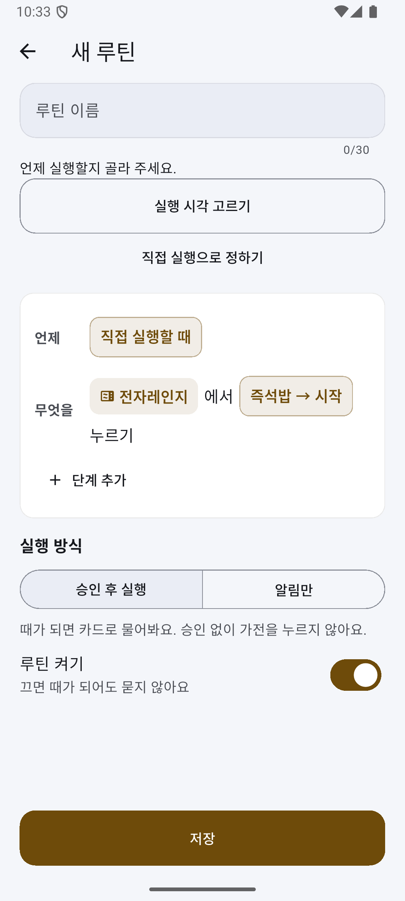
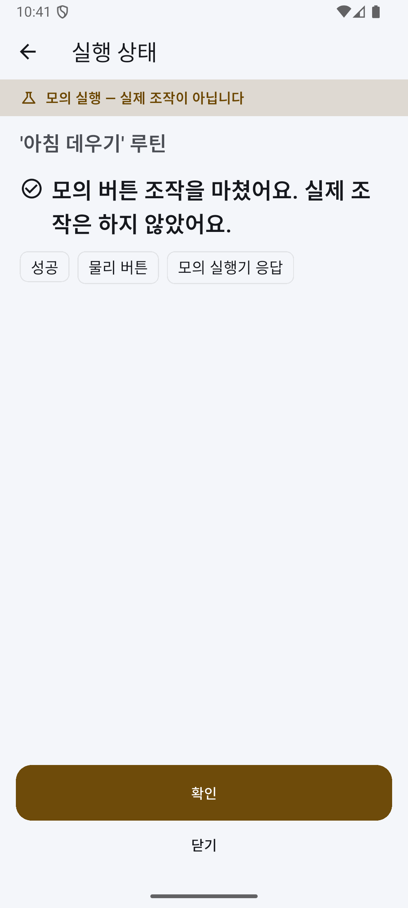
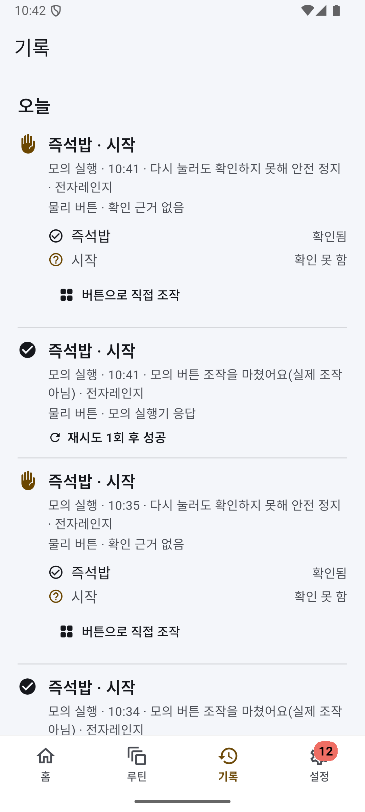

# 개발완료보고서 — SimpleLay

제24회 임베디드SW경진대회 결선 · 팀 자비스
박성원(소프트웨어) · 서예솔(하드웨어)
작성 기준: 2026-10-10 · 제출 예정: 2026-10-28 14:00

이 보고서는 저장소의 현재 구현과 검증 기록을 정리한 초안이다. 제목의 '개발완료'가 실물 시스템의 완성을 뜻하지는 않는다.
- 모터·센서 실물 검증은 0건이다.
- 소프트웨어 항목은 모의 입력 시험 또는 컴파일 수준으로 나눠 적었다.
- 측정하지 않은 값은 【실측 후 기입】으로 남겼다.

분량 목표는 A4 20쪽 이하다(그림·표 포함, 약 16쪽 배정). PDF 쪽수는 최종 양식에서 다시 확인한다.

## 1. 개발 목적과 범위

### 1-1. 배경

버튼식 가전은 기능에 문제가 없어도 원격 조작이나 상태 알림을 붙이기 어렵다. 작은 버튼을 정확히 누르고 같은 메뉴 순서를 반복하는 일은 고령자나 손 사용이 불편한 사람에게 부담이 될 수 있다. SimpleLay는 가전을 바꾸는 대신 두 가지를 더한다. 조작부에 붙이는 누름 장치와 사용자 승인 화면이다. 사용 편의와 교체 비용 절감은 목표다. 당사자 평가나 가격 비교로 입증하지는 않았다.

명령을 보냈다고 가전이 동작한 것은 아니다. 버튼이 덜 눌리거나, 가전이 입력을 받지 않거나, 통신 중에 결과를 잃을 수 있다. 그래서 핵심 과제를 이렇게 잡았다.
- 명령 전송·버튼 눌림·입력 수용·실제 동작을 나눠 확인한다.
- 확인하지 못한 결과는 화면에서도 따로 보인다.

### 1-2. 구현 범위

흐름은 다음과 같다.
1. 폰에서 가전을 등록하고 버튼 순서를 루틴으로 저장한다.
2. RPi5가 제안과 승인을 관리한다.
3. RPi4가 실행과 검증을 맡는다.

모션·센서 입력은 시뮬레이터로 대신했다. 이것으로 승인·재시도·정지·결과 표시의 연결을 시험했다. RPi5↔RPi4 실제 보드 사이의 LAN 통신은 모의 모션으로 확인했다. 누름 기구와 센서 판정의 실물 성능은 확인하지 않았다.

결선 시연 기준은 v3 '한 사람의 하루'다(전자레인지·세탁기·인터폰).
- ThinQ 경로는 별도 모의 클라이언트로 같은 승인·결과 계약을 시험했다. 본 시연 여섯 장면에는 넣지 않는다.
- 다이얼식 조작부는 지원하지 않는다.

그림 1. 부착형 누름 장치 개념(설계도). 갠트리는 조립 중이며 누름과 확인 단계는 현재 모의 수준이다.

그림 2. 사용자 승인 화면 — 실제 15.8형 패널 캡처(2026-10-06). 루틴 승인 카드에 누를 순서가 표시되며, 누르지 않으면 실행하지 않는다. 이후 실행은 모의 실행이다.

## 2. 시스템 구성

### 2-1. 보드 역할과 통신

| 구성 | 역할 | 현재 확인 범위 |
|---|---|---|
| RPi5 | 의도 해석, 제안, 승인, 이력, 루틴, 앱 API, 15.8형 키오스크 | 백엔드·키오스크 배포, 실제 패널 표시와 부팅 자동 실행 |
| RPi4 | 시퀀스 실행, 판정, 재시도, 정지, 모션 링크와 콘센트 모듈 수신 | 실제 보드에서 LAN 통신과 모의 모션 실행 |
| 모션 MCU | CoreXY 모터 구동과 시간 기반 Z 누름 | ESP32. 팀원의 Touch Bridge CoreXY 펌웨어(제어 핵심 재사용)를 SimpleLay 규약으로 옮겨 컴파일까지, 실물 미연결 |
| ESP32 콘센트 모듈 | CT 계측, 릴레이 차단, 비상정지 버튼·래치 | 펌웨어 컴파일, 가짜 출력 시험. 실물 회로 미조립 |

계획서의 RPi Zero 자리는 RPi4가 맡는다. 팀이 확정한 역할 매핑이며 연동 증거는 아니다. 세 보드가 한 흐름에서 함께 동작한 기록은 없다(모의·미측정). 콘센트 모듈 ESP32와 모션 MCU는 역할이 달라 보드가 각각 필요하다.

통신 구간은 셋이다.
- **폰↔RPi5:** HTTP.
- **RPi5↔RPi4:** 줄 단위 JSON. 실제 보드 시험은 LAN 위 TCP와 가상 시리얼로 했다. 최종 UART 배선 검증과는 다르다.
- **RPi4↔모션 MCU·콘센트 모듈:** USB 시리얼(계획). 콘센트 모듈 경로는 가짜 모듈 시험까지다.

그림 3. 시스템 구성. 초록 실선은 실제 보드에서 확인한 구간(모션·판정 입력은 모의), 주황 점선은 설계·실물 미연결 구간이다.

### 2-2. 기구와 전력 계측

CoreXY는 FIT0482 모터 2개와 벨트로 구성하며, 갠트리는 조립 중이다. 갠트리와 ESP32 모션 펌웨어는 팀원의 Touch Bridge와 같은 것을 쓴다(공유). SimpleLay가 새로 만든 것은 그 위의 승인·확인·제안 계층이다. 모터 축 엔코더만으로는 벨트 미끄럼을 잡을 수 없다. 그래서 기구 고정과 원점 확인이 필요하다.

10/10에 팀원의 ESP32 모션 펌웨어(Touch Bridge CoreXY 펌웨어 v3, Z는 솔레노이드)를 받아 합쳤다.
- 제어 핵심은 그대로 두었다.
- 통신은 RPi4 USB 시리얼 줄 단위 JSON으로 바꿨다.
- 안전 규약(호스트 워치독·명령 기한·알람 뒤 재원점)은 SimpleLay에 맞게 고쳤다.

컴파일만 했고 보드에 올리지 않았다. 모션 MCU와 Z 방식은 실물 시험 뒤 확정한다. 누름 시간·구동 전류·좌표 보정값도 실측 없이 확정하지 않는다.

콘센트 모듈은 CT 2개를 쓴다.
- **ch0 전자레인지:** ADS1115 AIN0-AIN1. 릴레이를 거친다.
- **ch1 세탁기:** AIN2-AIN3. 릴레이를 거치지 않고 계측만 한다.

채널별 버퍼와 신선도 확인은 분리했다. 펌웨어는 컴파일, 호스트 경로는 가짜 모듈 시험까지다. 두 번째 CT 구매, 배선, 채널별 보정은 남았다. CT로 계산한 전력은 보정 전 추정값이다. 갠트리 모터 전원은 별도 스위치로 끊는다.

그림 4. 콘센트 모듈 CT 두 채널 경로(설계). ch0 전자레인지는 릴레이 경로, ch1 세탁기는 계측 전용이다. 회로 미조립, 펌웨어 컴파일·가짜 모듈 시험까지.

### 2-3. 소프트웨어 구성

| 부분 | 구성 |
|---|---|
| 허브 | Python·FastAPI·SQLite. 실행은 비동기 작업 단위로, 요청 접수와 작업 종료를 따로 반환한다. 클라이언트는 작업 식별자와 상태를 대조한다 |
| 화면 | 폰 앱과 키오스크는 Flutter |
| RPi4 실행기 | 모션·판정 어댑터로 모의 입력과 실제 연결 경로를 분리한다 |
| 펌웨어 | 콘센트 모듈과 모션 MCU를 따로 관리한다. 모션 펌웨어의 재사용 경계는 재사용 경계 문서에 있다 |

기기 배포는 컨테이너와 시작 스크립트로 한다. 최근 배포 상태는 다음과 같다.
- **RPi5·RPi4:** 10/8 재배포, 모의 왕복 확인.
- **키오스크:** 10/7 1.8.2 설치.

배포는 센서 연결이나 새 화면의 현장 검증을 뜻하지 않는다. 촬영 전에 배포본과 소스 기준을 다시 맞춘다.

## 3. 사용자 기능과 시연

### 3-1. 가전 등록과 루틴

가전 등록은 다섯 단계다.
1. 사진 촬영
2. 프레임 모서리 4점 지정
3. 버튼 위치와 이름
4. 정지 버튼과 보관 위치
5. 확인 주행

사진 좌표를 기구 좌표로 옮기고, 사용자가 확인한 버튼 정보를 저장한다. 시험은 합성 좌표와 모의 모션으로 했다. 실제 사진과 기구의 위치 오차는 재지 않았다. 외부 사진 인식은 선택 보조이며 필수가 아니다.

루틴은 사진 위 버튼을 순서대로 짚어 저장한다. 녹화 중에는 누르지 않는다. 루틴을 호출하면 제안 카드가 나오고, 승인해야 실행한다. 홈에는 고정 메뉴 대신 사용자가 만든 루틴과 제안이 보인다.

**폰 앱**은 홈·루틴·기록·설정 네 탭이다. 개발자 기능은 별도 설정을 켰을 때만 보인다.
**키오스크**는 평소·다가오면·동작 중·내 가전 네 상태다.
- '다가오면'은 접근 감지가 아니다. 레이더가 없어서 서버 제안이나 루틴 선택으로 화면을 바꾼다.
- 부재는 수동 입력이다.

   

그림 P1~P4. 폰 앱(안드로이드 에뮬레이터, 실제 RPi5 백엔드에 연결, 2026-10-07 캡처) — 홈(설정이 남은 가전 묶음 카드와 가전 5개), 가전 추가 1단계(조작부 사진), 루틴 목록, 실행 기록. 기록의 실행은 모두 **모의 실행 화면**이다("모의 버튼 조작을 마쳤어요(실제 조작 아님)", "모의 실행기 응답"). 가전 이름 중 'Phone-MW'·'시험용 전자레인지'는 시험 등록이다. 확인 주행은 가전 위치(mm)를 맞춘 뒤에만 열리므로, 위치 미설정인 지금은 캡처하지 않았다.

  

그림 P6~P8. 루틴 녹화(에뮬레이터, 2026-10-07) — 조작부 버튼판에서 누를 순서를 짚으면("지금은 저장만 하고 누르지는 않아요") 편집 화면에 "전자레인지에서 즉석밥 → 시작 누르기"로 들어간다. 오른쪽은 루틴 카드를 승인하기 전 확인 화면으로, 승인하면 보인 내용 그대로만 실행한다.

### 3-2. 시연 v3: 한 사람의 하루

총 6분이다(도입·마무리 각 20초 포함). 장면마다 실물·부분 실물·전부 모의 등급을 런북 진행 조건에 따라 정하고, 화면과 설명에 밝힌다. 전자레인지 갠트리 1대를 먼저 준비한다. 세탁기·인터폰은 조작부 모형이며 누름 장치 배치는 미정이다.

| 장면 | 배정 | 보일 내용과 한계 |
|---|---|---|
| ① 아침 데우기 | 70초 | 루틴 호출 → 승인 → 즉석밥·시작 순서 → 시작 확인 뒤 복약 시간 안내. 현재 누름은 모의이며 복약 안내는 의료 판단이 아니다 |
| ② 외출 전 세탁 | 70초 | 전원·표준·시작 순서와 실패 주입 후 보정 재시도. 실제 센서 실패 사례가 아니며 시작 확인은 실행기 보고 수준이다 |
| ③ 낮의 인터폰 | 50초 | 사람이 루틴을 호출하고 승인하는 문열림 명령. 호출 자동 감지와 실제 문 열림 확인은 없다 |
| ④ 귀가·세탁 완료 | 40초 | CT 전력 하강 + 종료음 교차 확인에 따른 안내. 무대에서는 세탁기를 돌리지 않고 '시연 주입'을 표시한다 |
| ⑤ 비상정지 | 60초 | 콘센트 모듈 비상정지 래치·실행 차단·사람 확인 해제. 현재는 모의 흐름이며 실물 차단 회로는 미검증이다 |
| ⑥ 사용자 통제 | 30초 | '다음에'로 넘기기와 수동 부재에 따른 제안 철회. 시스템 철회를 사용자 거절로 학습하지 않는다 |

햇반 실제 가열은 [운영 런북](../결선-운영-런북.md) §3-7 체크리스트를 모두 통과했을 때만 한다.
- 확인 항목: 부하 투입, 포장 기준 조리 시간 상한, 비상정지 차단·래치·복구, 문 닫힘·환기·내열 장갑.
- 회로가 없거나 한 조건이라도 못 채우면 가열하지 않는다.
- ①은 시작 확인 뒤 시간 안내를 보이는 장면이다. 가열 종료를 확인했다고 설명하지 않는다.

그림 5. 시연 v3 여섯 장면과 장면별 현재 검증 수준(2026-10-06). ④ 세탁 완료는 모든 등급에서 시연 주입, ⑤ 비상정지는 모의 래치다.

## 4. 핵심 기술과 안전 처리

### 4-1. 층별 판정과 재시도

| 층 | 확인 대상 | 설계한 입력 | 실패 처리 |
|---|---|---|---|
| L1 | 버튼의 물리 눌림 | 누름 장치 쪽(Z 구동부) 전류 변화로 판정(가전을 열지 않음, 정확한 측정 지점은 HW 확정 전). 음향은 신뢰도를 더하는 보조 입력 | 위치·누름 조건 보정 재시도, 상한 도달 시 안전 정지 |
| L2 | 가전의 입력 수용 | 마이크 비프음(RPi4 운영 경로 미연결 <!-- L2-C -->) | 제한된 재입력 후 확인, 카메라 비교는 후보 |
| L3 | 가전의 실제 동작 | CT 전력 상승·유지(설계) | 자동 재시도 없이 안전 정지 |

L1은 전류로 판정하고 음향은 보조 신뢰도다. 기본 설정(전류 가중 0.55·음향 0.45·임계 0.50)에서 전류만으로는 눌림 판정이 되고, 음향만으로는 안 된다(`rpi/tests/test_fusion_truth_table.py`). L3는 CT 전력(설계)이다. L2 음향은 RPi4 운영 경로에 아직 연결하지 않았다. <!-- L2-C -->

**관측 구간.**
- **열림:** 모션 어댑터의 자동 원점·XY 이동 뒤, Z 명령 직전 호스트 훅에서 연다.
- **포함:** 누름·냉각 대기와 설정된 후속 관측까지 덮는다.
- **기록기:** 기록기가 있든 없든 같은 훅을 전달한다(모의 회귀 시험).
- **센서 불가:** ADC 읽기 스레드 미종료, 오래된 마지막 표본, 표본 부족, 구간 공백은 성공이 아니라 센서 불가로 처리한다.
- **L3 표본:** 관측 시작 이후 표본을 보존해, 누름·L1 검증이 늦어진 뒤에도 판정에 쓴다.

MCU 실제 Z 시각과의 정렬, 신선도·커버리지 임계값은 실측이 필요하다.

현재 구현은 층별 판정 계약과 모의 입력 시험까지다. 남은 일은 L2를 RPi4 운영 경로에 독립적으로 연결하는 것과 실제 센서 통합이다. <!-- L2-C --> 누름 깊이 보정은 구동 방식에 따라 달라진다. 솔레노이드를 쓰면 시간 기반 누름 규약에 맞춰야 한다. 판정 임계값(전류·전력·음향)은 실제 센서로 잰 값이 아니다.

콘센트 연결이 끊기면 0 W로 채우지 않고 읽기 실패로 처리한다. 센서가 없는 것을 가전 종료로 오인하지 않기 위해서다. CT 동작 확인과 완료 뒤 잔여 전력 기록은 가짜 출력 시험까지다. 실물 경로를 켜는 설정이 있다고 실제 계측을 검증한 것은 아니다.

### 4-2. 승인과 결과 표시

제안 카드에는 명령 지문(대상·경로·동작·인자)을 묶는다. 승인하면 서버가 명령을 다시 만들어 지문이 맞을 때만 실행한다. 카드가 나온 뒤 루틴이 바뀌면 그대로 실행하지 않는다. 여러 단계 루틴도 승인한 범위 안에서만 진행한다.

화면은 다음을 서로 구분한다.
- **결과 단계:** 요청 접수, 실행기 보고, 상태 확인, 확인 불가.
- **정지 관련 세 사건:** 사용자 비상정지 요청, 눌림 검증 실패로 자동 중단, 정지 상태에서 추가 실행 차단.

결과를 잃으면 자동으로 다시 보내지 않는다. 이 처리는 모의 통신·판정 시험 결과이며 실제 움직임 정지를 입증하지 않는다.

### 4-3. 세탁 완료: 전력 하강과 종료음

**전력.** CT 전력이 운전 수준에 일정 시간 머문 뒤 대기 수준으로 내려오는 구간을 찾는다.
- 짧은 하강은 담금·헹굼 사이 정지일 수 있어 완료로 보지 않는다.
- 센서가 끊긴 구간은 대기 시간에 넣지 않는다.

**음향.** 종료음 묶음과 뒤따르는 조용한 구간을 찾는다. 계속 반복되는 경보는 종료음으로 보지 않는다.

**판정.**
- 두 신호가 시간 창 안에서 맞으면 완료로 안내한다.
- 한 신호만 오면 완료를 단정하지 않고 확인을 요청하며, 다음 루틴 단계는 보내지 않는다.
- 같은 사이클의 중복 안내와, 그 동작을 시작한 루틴을 다시 깨우는 것도 막았다.

실제 세탁기의 멜로디나 긴 담금 구간에서는 판정이 달라질 수 있다. 표준 코스의 전력과 종료음 기록이 필요하다.

시험은 가짜 콘센트 모듈과 합성 음으로 했다. RPi4 판정에서 RPi5 안내까지 이어지고, 세탁기 릴레이 차단 명령은 보내지 않음을 확인했다. 실제 CT·마이크로 얻은 판정 결과는 없다. 입력 출처는 모의·주입·실물로 구분하고, 무대에서는 주입 표시를 유지한다.

### 4-4. 비상정지와 복구

콘센트 모듈 펌웨어의 동작은 다음과 같다.
1. 버튼을 감지하면 호스트 응답을 기다리지 않고 릴레이를 연다.
2. 래치를 보존하고 RPi4에도 전달해 새 실행을 막는다.
3. 버튼을 푼 뒤 사람이 `POST /stop/ack`로 확인해야 래치가 풀린다. 버튼이 눌린 채이면 해제를 거절한다.

래치 해제만으로 릴레이가 다시 켜진다고 가정하지 않는다. 실제 복전 절차는 회로 조립 뒤 런북에서 검증한다.

정지 수단은 셋이다.
- **화면:** 폰 배너와 키오스크 띠가 래치 상태를 알린다. 화면 정지는 `POST /stop` 요청이다.
- **음성:** 폰은 실행 중에만 음성 "멈춰"를 듣고, 화면 정지와 같은 요청을 보낸다. 폰 음성 인식이며 정지만 하고 실행은 시작하지 않는다.
- **모터 전원 스위치:** 콘센트 릴레이는 전자레인지 전원만 끊는다. 갠트리가 계속 움직일 때의 마지막 수단은 이 별도 스위치다.

통신 ACK와 실제 정지는 구분한다. 펌웨어는 컴파일까지, 래치와 확인 해제는 가짜 모듈·시뮬레이터 시험까지다.

장애 8상황(RPi4 늦게 켜짐, 실행 중 링크 끊김, 결과 유실, 모션 MCU 재부팅, 콘센트 모듈 재부팅, 센서 단절, 비상 버튼 유지 등)을 따로 시험했다. 각 상황에서 자동 재전송·재개가 없는지와 무엇이 막히는지를 모의로 확인했다([장애 복구 결과표](../장애-복구-결과표.md)). 이 과정에서 결함 하나를 고쳤다. MCU 재부팅 뒤 같은 실행이 원점 복귀 후 다시 누르던 문제다. 실물 정지 지연은 미측정이다.

그림 6. 비상정지 발생 → 실행 차단 → 버튼 해제 → 사람 확인(`POST /stop/ack`) 흐름. 펌웨어 컴파일, 래치·확인 해제는 가짜 모듈·시뮬레이터 시험까지다.

그림 7. 키오스크 비상정지 띠 — 실제 15.8형 패널 캡처(2026-10-06). 시연 주입으로 만든 모의 래치이며 실제 콘센트 모듈·릴레이 동작이 아니다.

그림 P5. 폰 비상정지 배너(에뮬레이터, 2026-10-07) — 시연 주입으로 만든 모의 래치다. 실제 콘센트 모듈·릴레이 동작이 아니다. "확인하고 해제"는 사람이 버튼을 푼 뒤 누른다.

### 4-5. 제안과 외부 기능의 경계

**습관 제안.**
- 최근 28일의 실제·직접·성공 사용 기록을 가전과 시간대별로 모은다. 서로 다른 3일 이상이면 제안한다.
- 시연·모의·제안 승인 기록은 학습에서 뺀다.
- '다음에', 숨김, 시스템 철회는 서로 다른 사건으로 기록한다.
- 합성 이력으로 조건만 시험했다. 실제 생활 이력에서의 효과는 확인하지 않았다.

**해석.** 해석·승인·실행 경로는 로컬에서 동작한다. 규칙 해석이 먼저이고, 기기 안 보조 해석과 외부 해석은 선택 계층이다. 해석하지 못한 명령을 임의 버튼으로 바꾸지 않는다. 날씨는 실제 호출을 확인했다. 날씨가 사용 편의에 주는 효과는 평가하지 않았다.

**ThinQ.** 같은 승인·확인 계약을 쓰는 모의 클라이언트까지다. 실제 가전 클라이언트와 속성 확인은 남았다. 이미 보낸 원격 명령의 취소는 보장하지 않는다. 자동 물리 대체 실행도 완료했다고 하지 않는다.

## 5. 플랫폼 활용과 전문가 의견 반영

RPi5와 RPi4에는 LG 제공 임베디드 SW 플랫폼 이미지를 쓰고, 자체 백엔드와 실행기를 컨테이너로 배포했다. 두 보드의 플랫폼 제약과 앱 설치 경로는 9/30 LAN 배포 기록에 있다. 키오스크 설치와 부팅 자동 실행을 확인했다. 플랫폼 추론이 꺼지거나 실패해도 사용자 승인과 로컬 정지 경로는 유지된다.

앱 계정으로 플랫폼 시스템 서비스 읽기 호출 1건을 성공시켰다(RPi5·RPi4 각 1건, 조건부 — 증거 대장). 가산점 증거는 두 가지로 나눠 본다.
- 보드별 최소 호출
- 실제 '제안 → 승인 → 실행 → CT 검증' 연동(아직 없음)

증거 대장의 미측정 칸을 성공으로 치지 않으며, 가산점 획득을 확정하지 않는다.

의견별 전후 비교는 [피드백 전후](피드백-전후.md) 한 장에 정리했다. 요약하면 다음과 같다.

| 전문가 의견·요구 | 반영 내용 | 남은 확인 |
|---|---|---|
| 여러 가전에 적용 | 전자레인지·세탁기·인터폰에 같은 승인·조작 흐름, 실행 대상별 CT 채널 결속. 세탁 완료는 알림까지이며 다른 가전 동작으로 이어지지 않는다 | 모형 누름 경로와 실물 검증 |
| 동작 확인과 실패 복구 | 층별(L1~L3) 판정 계약과 모의 시험, 보정 재시도·안전 정지 <!-- L2-C --> | 독립 L2의 RPi4 운영 경로 연결, 실제 센서 통합·오판정과 누름 성능 |
| 먹통 시 정지 수단 | 화면 정지·음성 정지와 콘센트 모듈 비상정지 래치 분리 | 회로 차단 지연·모터 정지 실측 |
| 소프트웨어 가전 제어 | ThinQ 공통 계약·모의 장애 처리 | 실제 클라이언트·가전 연동 |
| 여러 입력의 상황 판단 | CT 전력 하강과 종료음 교차 확인 | 단일 입력 대비 정확도 비교 |
| 통신 간섭과 회복 | 유실 시 확인 불가·자동 재전송 금지, 링크 재연결 뒤 래치 재확인 | 실제 가열 중 통신 시험 |

접근성은 저장소의 사용자 편의 기준을 참고했다(큰 글씨, 넓은 터치 영역, 문구·아이콘 병행, 동작 줄이기). 가장자리 터치로 앱이 닫히는 문제에는 안전 여백과 감시 실행을 적용했다. 표준 적합성 인증, TalkBack 전체 흐름, 당사자 평가는 하지 않았다. 당사자 의견은 [계획](../사용자-의견-계획.md)만 있다.

## 6. 검증 결과와 실측 계획

### 6-1. 자동 시험 기준

| 대상 | 보고 기준 수 | 범위 |
|---|---|---|
| 백엔드+rpi4 | 2,538 통과 | 모의·합성 입력 중심의 자동 시험 |
| 폰 앱 | 576 통과 | 골든 제외 |
| 키오스크 | 255 통과 | 골든 제외 |
| 골든 화면 비교 | 폰 55장·키오스크 42장 통과 | 위 수치와 별도 |

위 수치는 2026-10-08 `8b70fff`에서 데스크톱으로 직접 실행한 기록이다(analyze error·warning 0). 이후 `3e6c688`에서 모션 펌웨어 정적 시험(`rpi/tests/test_motion_corexy_firmware.py`)이 더해졌고, 전체는 다시 돌리지 않았다. 제출 직전에 한 커밋에서 다시 실행해 갱신한다.

자동 시험이 확인하는 것:
- 승인 결속
- 모의 실패와 재시도
- 오래된 입력 거절과 중복 완료 방지
- 단일 신호에서 다음 단계 차단
- 정지와 루틴 대기 경합
- 장애 상황별 재전송 금지

한계도 있다. 펌웨어 빌드 성공은 회로와 모터가 동작한다는 뜻이 아니다. 위젯·골든 시험은 실제 패널 시연을 대신하지 않는다.

### 6-2. 실기기와 모의 검증의 구분

| 항목 | 기록된 결과 |
|---|---|
| RPi5↔RPi4 통신 | 9/30 LAN 통신 확인, 모션은 모의. RPi4 실행기 재시작 뒤 백엔드 재시작 없이 재연결 확인(모의 모션) |
| 폰 → RPi5 → RPi4 | 에뮬레이터 폰에서 모의 실행 왕복 확인 |
| 15.8형 패널 | 9/30~10/5 표시와 부팅 자동 실행 확인 |
| 날씨 | 기상청 실제 호출 확인 |
| 10/6~10/8 배포 | RPi5·RPi4 재배포(10/8)와 키오스크 1.8.2 설치(10/7) 기록 |
| 모션 펌웨어 | 팀원 코드를 규약에 맞춰 컴파일(10/10), 보드 미기록 |
| CT 두 채널 | 펌웨어 컴파일·가짜 모듈 시험, 실물 미연결 |
| 세탁 완료 | 합성 전력·종료음으로 판정·안내 연결 시험 |
| 비상정지 | 펌웨어 컴파일·래치 모의 시험, 회로 미조립 |
| 모터·센서 통합 | 실물 검증 0건 |
| ThinQ | 모의만, 실제 가전 미보유 |

### 6-3. 측정 항목과 기록 방법

실측할 때는 구성·부하·센서 위치·측정 시각·반복 횟수를 함께 적는다.
- 1회 누름 성공률과 재시도 포함 성공률을 나눈다.
- 통신 응답 시간과 실제 모터 정지 시간을 나눈다.
- 버튼 3개 × 30~50회는 계획 횟수이며, 아직 하지 않았다.
- 공개 보고서에는 집계만 넣고 원시 기록은 따로 둔다.

그래프 4종(G1~G4)의 방법·횟수·합격선은 [실측 계획](../실측-계획-결선.md)을 따른다.

| 항목 | 측정 방법 | 결과 |
|---|---|---|
| 1회 누름 성공률 | 버튼별 첫 시도 성공 수 / 전체 시도 수 | 【실측 후 기입】 |
| 재시도 포함 성공률 | 재시도 상한 내 성공 수 / 전체 시도 수 | 【실측 후 기입】 |
| 누름 위치 오차 | 목표 좌표 대비 실제 누른 위치(버튼별) | 【실측 후 기입】 |
| 정지 지연 | 요청·ACK·출력 차단·실제 움직임 정지 시각 분리 | 【실측 후 기입】 |
| 비상 버튼 차단 지연 | 버튼 접점 변화 → 릴레이 출력 차단 | 【실측 후 기입】 |
| 모터·Z 구동 전류 | 기동·이동·누름·정지 상태별 기록 | 【실측 후 기입】 |
| CT 채널별 보정·잡음 | ch0·ch1 무부하와 기준 부하 비교 | 【실측 후 기입】 |
| CT 동작·대기 임계값 | 전자레인지·세탁기 운전과 대기 분포 비교 | 【실측 후 기입】 |
| 잔여 전력 복귀 | 완료 뒤 기준선 복귀 시간·평균·최대 | 【실측 후 기입】 |
| 세탁 완료 기준 | 표준 코스의 가장 긴 하강 구간·대기 유지 시간 | 【실측 후 기입】 |
| 종료음 기준 | 주파수·개수·간격·센서 위치별 녹음 비교 | 【실측 후 기입】 |
| 융합 효과 | 전력 단독·음향 단독·교차 확인의 오탐·미탐 비교 | 【실측 후 기입】 |
| 가열 중 통신 | 유실·확인 불가·재연결과 회복 시간 | 【실측 후 기입】 |
| 보드별 최소 호출·시연 연동 | 증거 대장의 두 증거 종류를 각각 기록 | 【실측 후 기입】 |
| 사용 편의 | 당사자 과업 성공·오조작·도움 요청 기록 | 【실측 후 기입】 |

【그림 자리: 실측 그래프 G1~G4 — 누름 위치 오차, 버튼별 성공률, 정지 지연 분포, 전자레인지 CT 파형 위 시작 확인 시점. 실측 데이터로 만든 그림만 넣으며 합성 데이터 예시 그림은 쓰지 않는다】

【그림 자리: 실기기 센서 측정 후 삽입 — ch0·ch1 전력 파형과 종료음 시각 비교. 센서 미연결로 지금은 측정값이 없으며 모의 파형으로 채우지 않는다】

## 7. 개발 과정과 역할

| 담당 | 맡은 일 |
|---|---|
| 박성원 | 허브·실행기·폰 앱·키오스크·배포, 소프트웨어 연동 |
| 서예솔 | 갠트리·모션 MCU·콘센트 모듈·센서·하우징 |

| 시기 | 진행 내용과 검증 수준 |
|---|---|
| 8월 | 폐루프 구조와 폰·키오스크 초기 개발 |
| 9/9~9/17 | 제어권·정지 경합 수리, 층별 판정·버튼맵·좌표 보정의 모의 시험 |
| 9/27~9/29 | 시뮬레이터·디지털 트윈, 모션 어댑터, ThinQ 모의 계약과 전문가 의견 정리 |
| 9/30 | 보드 수령, LAN 배포·모의 왕복, 화면과 하드웨어 방향 정리 |
| 10/1~10/5 | 사용자 화면 보완, 패널 운영 수리, 콘센트 모듈 컴파일·가짜 출력 시험, 비상정지 래치 |
| 10/6~10/8 | 시연 v3, 세탁 완료 모의 판정, CT 2채널, 실행 대상별 CT 결속, 누름 단위 관측 구간, 장애 복구 결과표, 음성 정지, 보드 재배포 |
| 10/10 | 팀원 ESP32 모션 펌웨어를 SimpleLay 규약으로 합침(컴파일까지) |

하드웨어 통합 전에는 같은 API의 모의 실행기와 디지털 트윈으로 흐름을 확인했다. 소프트웨어 실패 경로는 이렇게 반복 시험할 수 있었지만, 누름 성능은 검증할 수 없었다. 벨트 헛돎은 장력과 고정 보강의 문제이며 소프트웨어 보정으로 해결했다고 하지 않는다.

운영상 주의할 점은 셋이다.
- 실행기 보드는 루트가 읽기 전용이라 재부팅 뒤 도커를 손으로 시작해야 한다.
- 키오스크 가장자리 조작 문제에는 여백과 재실행 감시를 적용했다.
- 현장 설치는 전용 공유기·백업 영상·예비 SD를 쓰는 런북으로 관리한다. 설치 30분 달성 여부는 리허설에서 확인한다.

## 8. 한계와 다음 단계

가장 큰 한계는 모터·센서 실물 검증 0건이다. 다음 순서로 진행한다.
1. 모션 MCU와 Z 방식 확정
2. 원점·단일 이동·단일 누름 확인
3. 콘센트 모듈 배선과 CT 채널 보정
4. 비상정지와 복구 검증
5. 가열 체크리스트 적용

안전 조건을 갖추기 전에는 햇반 가열로 시연 수준을 올리지 않는다.

그 밖에 남은 것:
- 세탁기·인터폰 조작부 모형과 누름 장치 배치는 미정이다.
- 실제 문 열림을 확인하는 기능이 없다.
- 세탁 완료 기준은 정상 코스의 정지 구간과 종료음을 기록한 뒤 정한다.
- ThinQ 실제 연동, 생활 이력에 대한 제안 효과, 접근성·사용성 평가는 후속 과제다.

제출 전에 할 일:
- 같은 소스 기준에서 시험 수치를 통일한다.
- 실측한 항목만 결과 표에 채운다.
- 그림·캡처에 모의·주입 표시가 보이게 한다.
- 영상·보고서·작품소개서의 검증 수준을 맞춘다.

## 9. 근거 문서

- [README](../../README.md): 작품 정의와 실제 확인 범위
- [본선 실행계획](../본선-실행계획-2026-09-30.md): 일정·기능 계획·역할
- [UI 확정](../UI-확정-2026-09-30.md): 폰 네 탭·가전 등록·키오스크 네 상태
- [시연 v3](../본선-시연-시나리오-v3.md), [운영 런북](../결선-운영-런북.md): 여섯 장면·등급·가열 조건·영상 촬영 목록
- [하드웨어 방향 확정](../하드웨어-방향-확정-2026-09-30.md): 기구·모션 MCU와 Z의 미결 사항
- [전문가 의견 대응](../전문가의견-대응-2026-09-29.md), [피드백 전후](피드백-전후.md), [가산점 증거 대장](../가산점-증거-대장.md): 의견별 대응과 미측정 증거
- [장애 복구 결과표](../장애-복구-결과표.md): 장애 8상황의 모의 시험
- [10/5 콘센트 모듈](../devlog/devlog_2026-10-05-outlet-module.md): 컴파일·가짜 출력·비상정지 래치
- [10/6 세탁 완료](../devlog/devlog_2026-10-06-washer-done.md), [CT 두 채널](../devlog/devlog_2026-10-06-dual-ct.md), [평가 수리](../devlog/devlog_2026-10-06-eval-fixes.md): 구현·시험 범위와 후속 변경
- [10/7 대상 결속](../devlog/devlog_2026-10-07-target-binding.md), [음성 정지](../devlog/devlog_2026-10-07-voice-stop.md), [10/10 모션 펌웨어](../devlog/devlog_2026-10-10-motion-firmware-merge.md)

## 10. 그림·캡처 편집

그림 자리에는 새 구성도, 직접 촬영한 실물, 모의 표시가 보이는 화면만 쓴다. 비공개 제공 자료나 발표 파일은 가져오지 않는다. 아직 없는 실물 사진은 구성도로 대신하고 설계도라고 밝힌다. 아래 그림은 20쪽 상한 안에서 배치한다.

【그림 자리: 실제 15.8형 패널을 설치한 뒤 촬영해 삽입】

그림 8. 키오스크 평소 화면 — 실제 15.8형 패널 캡처(2026-10-06). 시계·인사와 기상청 날씨(실제 호출), 등록 가전 줄을 보인다. 가전 이름은 시험용 등록이며 실내 센서는 연결되어 있지 않다.

그림 9. 내 가전 줄(세탁기·인터폰)과 복약 시간 안내 — 실제 15.8형 패널 캡처(2026-10-06). 안내는 루틴 알림이며 의료 판단이 아니다.

그림 10. 완료 화면 — 실제 15.8형 패널 캡처(2026-10-06), 모의 실행 화면. "모의 실행 · 실제 조작 아님" 표시가 붙는다.

   

그림 P9~P12. 같은 루틴('아침 데우기', 전자레인지 즉석밥 → 시작)을 같은 조건에서 실행한 결과(에뮬레이터, 실제 RPi5·RPi4 연결, 모션은 모의, 2026-10-07). 모두 모의 실행 화면이다.
① 재시도 후 성공: **시연용 실패 주입** 1회(시작 버튼 검증을 한 번 실패로 만듦) → 한 번 더 눌러 성공.
② 눌림 검증 실패로 자동 중단(**시연용 실패 주입** 3회): 재시도를 다 써서 실행을 멈추고 "눌림을 확인하지 못해 안전하게 멈췄어요"를 보인다.
③ 기록: 두 결과와 버튼별 확인됨/확인 못 함.
④ 정지 상태에서 추가 실행 요청 차단: 정지 래치(**시연 주입**한 모의 래치)가 걸린 상태에서 승인하면 서버가 신규 실행을 거절한다(412). 액추에이터의 물리 정지 완료를 증명하는 결과는 아니다.
**세 사건은 서로 다르다** — 눌림 검증 실패로 자동 중단(재시도 소진), 사용자 비상정지 요청(사람이 정지 버튼을 누름), 정지 상태에서 추가 실행 차단(412 거절). 사용자 비상정지 요청 결과 화면은 실제 모터 이동 중 정지 시험 뒤 캡처한다.
