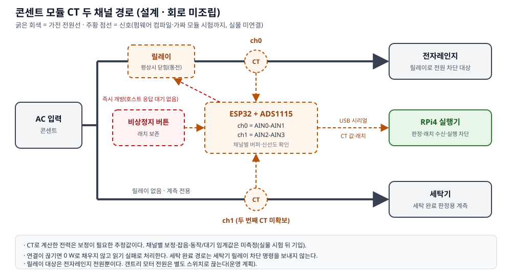
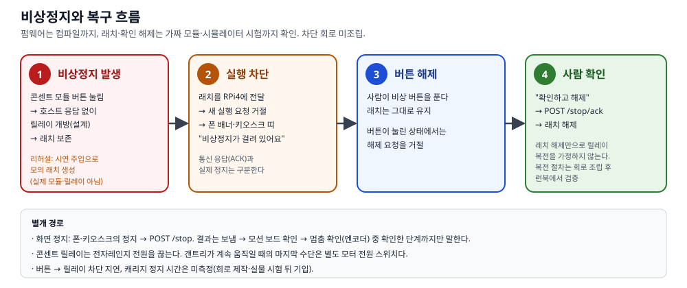

# 개발완료보고서 — SimpleLay

제24회 임베디드SW경진대회 결선 · 팀 자비스
박성원(소프트웨어) · 서예솔(하드웨어)
작성 기준: 2026-10-18(시연 v4) · 제출 예정: 2026-10-28 14:00

검증 수준은 다섯 가지로 나눠 적는다.
- **실물 확인:** 실제 보드·모터·가전에서 본 것.
- **실물 보드·모의 입력:** 보드는 실물이지만 모터·센서·사건 입력은 모의인 것.
- **시험 조건 통과·배포됨:** 자동 시험을 통과해 보드에 올렸지만 실물로 그 상황을 만들어 보지 않은 것.
- **모의까지:** 가짜 장치·모의 클라우드·합성 입력으로만 확인한 것.
- **미측정:** 아직 재지 않은 것. 숫자를 쓰지 않고 "미측정(실물 시험 뒤 기입)"으로 적는다.

본문은 무엇을 어떤 수준으로 확인했는지만 적는다. 날짜별 작업 기록·커밋은 끝의 [부록 — 근거 기록](#부록--근거-기록)에 모았다.
분량 목표는 A4 20쪽 이하다(그림·표 포함). PDF 쪽수는 최종 양식에서 다시 확인한다.

## 1. 문제와 목표

### 1-1. 누구를, 왜

작은 버튼을 정확히 누르고 여러 단계 메뉴를 기억하는 일은 고령자와 저시력 사용자에게 부담이다. 집에 있는 전자레인지·세탁기 같은 버튼식 가전은 기능에 문제가 없어도
원격 조작이나 상태 알림을 붙일 수 없고, 스마트 가전으로 바꾸는 데는 비용이 든다. SimpleLay는 가전을 바꾸지 않고 조작부 위에 누름 장치를 얹는다.
장치가 할 일을 **제안**하고, 사용자가 **승인**한 명령만 누르며, 콘센트 전력으로 가전이 실제로 동작했는지 **확인**해 알려 준다.

사용자는 둘로 나눈다.
- **보호자·설치자:** 장치를 붙이고, 폰으로 조작부 사진을 찍어 버튼 위치·이름을 등록하고, 자주 쓰는 순서를 루틴으로 만든다.
- **당사자:** 큰 글씨 키오스크와 폰에서 제안을 보고 승인·거절하고, 언제든 멈추고, 제안을 잠시 쉬게 한다.

명령을 보냈다고 가전이 동작한 것은 아니다. 버튼이 덜 눌리거나, 가전이 입력을 받지 않거나, 통신 중에 결과를 잃을 수 있다. 그래서 핵심 과제를 이렇게 잡았다.
- 명령 전송·버튼 눌림·가전 동작을 나눠 확인한다.
- 확인하지 못한 결과는 "확인하지 못했다"고 그대로 보고하고, 결과를 잃으면 자동으로 다시 보내지 않는다.

### 1-2. 무엇이 다른가 — 단일 버튼 푸셔 방식과의 설계 차이

| | 단일 버튼 푸셔(공개 사양: SwitchBot Bot·Fingerbot Plus) | SimpleLay |
|---|---|---|
| 버튼 등록 | 누를 스위치·버튼 옆에 장치를 붙임(스티커 부착, 공구 없음) | 조작부 사진에서 버튼 위치·이름을 등록(가전 추가 5단계) |
| 여러 버튼 순서 | 장치 하나가 버튼 하나를 누르는 구조. 한 장치로 여러 버튼 순서 조작은 확인하지 못함 | 갠트리 하나가 한 조작부의 여러 버튼을 순서대로 |
| 눌림·가전 동작 확인 | 누름·가전 동작 확인 기능은 확인하지 못함(SwitchBot 상태값 ON/OFF는 스위치 모드에서만 유효) | CT 전력으로 가열 시작·종료 확인, 실패·정지를 단계별로 보고 |
| 스마트 가전과 함께 | 앱·허브 경유 원격·음성 비서 연동. ThinQ 가전과 한 흐름은 확인하지 못함 | ThinQ 가전도 같은 승인·결과 흐름(명령 지문·상태 재조회) |
| 제안 | 앱 타이머·일정 실행. 사용 기록 기반 제안은 확인하지 못함 | 사용 기록 기반 습관 제안 + 사용자가 허용한 조건에서만 낮은 위험 동작 자동 실행 |

이 표는 설계 차이다. 상용 제품을 시험하지 않았고 성능을 비교하지 않았다. 공개 사양 출처(2026-10-14 확인): SwitchBot Bot 제품 페이지 https://www.switch-bot.com/products/switchbot-bot · SwitchBot 공식 API 문서 https://github.com/OpenWonderLabs/SwitchBotAPI/blob/main/devices/others/bot.md · Fingerbot Plus 제품 페이지 https://www.adaprox.io/products/fingerbot-plus. '확인하지 못함'은 공개 사양에서 찾지 못했다는 뜻이지 기능이 없다는 뜻이 아니다. 표 전체는 [실측 기록표](../실측-기록표.md) §3.
대신 같은 장치에서 **동작 확인 기능을 끈 비교 조건**과 SimpleLay를 비교한다(§6-4). 그 결과로 상용 제품보다 낫다고 주장하지 않는다.

### 1-3. 적용 경계

- 평면 누름 버튼만 다룬다. 다이얼식 조작부는 실행을 거절한다.
- 조작부 하나에 갠트리 하나다. 집 안의 여러 가전을 장치 하나로 누르는 것이 아니다.
- 음식을 넣고 빼는 일, 문을 닫는 일은 사람이 한다.
- 가열 종료 감지는 정상 종료와 취소·문 열림을 아직 구분하지 못한다(§4-3).

## 2. 시스템 구성

### 2-1. 보드 역할과 확인 범위

| 구성 | 역할 | 확인 범위 |
|---|---|---|
| RPi5 허브 | 의도 해석·제안·승인·이력·루틴, 앱 API, 15.8형 키오스크, ThinQ 연동 | 실물: 백엔드·키오스크 배포, 패널 표시·부팅 자동 실행, 실제 공기청정기 ThinQ 제어와 시각 자동 실행(10/16~17) |
| RPi4 실행기 | 버튼 순서 실행·결과 확인·정지 보고, 모션 보드·콘센트 모듈 연결 | 실물: RPi5와 Wi-Fi 통신, ESP32 모션 보드와 USB 시리얼(10/12~14). 10/16부터는 모션 보드가 하드웨어 작업 중이라 **모의 모션**으로 돈다 |
| ESP32 모션 | CoreXY 구동(FIT0482 엔코더 모터 2개) + 솔레노이드 누름 | 실물: 시험대 빌드로 모터 축 구동·엔코더 계수·정지(10/12~14, 벨트·솔레노이드 없이). 캐리지 이동·실제 누름은 미측정 |
| ESP32 콘센트 모듈 | CT 전력 계측, 전자레인지 릴레이, 비상정지 버튼·래치 | 모의까지: 펌웨어 컴파일·가짜 모듈 시험. 회로는 제작 전 |

계획서의 RPi Zero 자리는 RPi4가 맡는다(팀이 확정한 역할 매핑). 통신 구간은 셋이다.
- **폰·키오스크 ↔ RPi5:** HTTP.
- **RPi5 ↔ RPi4:** 줄 단위 JSON(Wi-Fi/LAN 위 TCP). 두 보드에 같은 페어링 키가 있어야 연결된다.
- **RPi4 ↔ ESP32 두 개:** USB 시리얼. 모션 보드는 10/12부터 실물로 연결했다. USB가 다시 잡혀도 장치 고유 경로로 다시 연다(10/14 실물 확인).

그림 1. 보드 역할과 통신 경로(10/18 새로 그림). 선 색·모양은 검증 수준을 뜻하지 않는다 — 검증 수준은 위 표와 §6 표로만 말한다.

### 2-2. 기구와 전력 계측

CoreXY는 FIT0482 엔코더 모터 2개와 벨트로 움직이고, 솔레노이드가 버튼을 누른다. 갠트리와 ESP32 모션 펌웨어의 제어 핵심(PID·궤적·원점·솔레노이드 구동)은
팀원의 이전 작품(Touch Bridge)과 공유한다([재사용 경계](../reuse-boundary.md)). 이 저장소에서 그 펌웨어를 RPi4 줄 단위 JSON 규약으로 옮기고
호스트 워치독·명령 기한·알람 뒤 재원점 같은 안전 규약을 더했다. SimpleLay가 새로 만든 것은 그 위의 승인·확인·제안·콘센트 모듈·화면이다.

모터 축 엔코더만으로는 벨트 미끄럼을 잡을 수 없다. 그래서 원점 확인 전에는 실행을 시작하지 않는다(10/14 실물: 원점 미확인이면 "준비 안 됨"으로 실행 차단).

콘센트 모듈은 CT로 가전 소비 전력을 잰다. 시연은 ch0(전자레인지, 릴레이 경로)만 쓴다. 코드는 ch1(계측 전용)도 받는다.
센서 연결이 끊기면 0 W로 채우지 않고 읽기 실패로 처리한다 — 센서가 없는 것을 가전 종료로 오인하지 않기 위해서다. CT 보정·판정 기준값은 미측정이다.

그림 2. 콘센트 모듈 CT 경로(설계). ch0 전자레인지는 릴레이 경로, ch1은 계측 전용이다. 회로는 제작 전이다.

### 2-3. 소프트웨어 구성

| 부분 | 구성 |
|---|---|
| 허브 | Python·FastAPI·SQLite. 실행은 비동기 작업 단위로, 요청 접수와 작업 종료를 따로 반환하고 클라이언트가 작업 ID로 대조한다 |
| 화면 | 폰 앱(Android)과 키오스크(Linux)는 Flutter |
| RPi4 실행기 | 모션·판정 어댑터로 모의와 실물 경로를 분리한다. 실행 대상마다 CT 채널과 판정기를 결속한다 |
| ThinQ | 공식 Python SDK(`thinqconnect`)를 부르는 클라이언트. 모드: 꺼짐 / 모의 / 모의 클라우드 / 실제 |
| 배포 | 컨테이너와 시작 스크립트(재부팅 뒤 다시 뜨도록 재시작 정책 '항상'). RPi5·RPi4는 같은 이미지를 쓴다 — 두 보드 사이 규약이 함께 바뀌기 때문이다. 폰·키오스크도 같은 날 빌드로 맞춘다 |

## 3. 사용자 기능과 시연

화면 말은 처음 쓰는 사람 기준으로 정했다(지도교수 의견, 10/17~18 개편). 기기는 **'본체'**, 누르는 장치는 **'작은 팔'**, ThinQ 가전은 **'LG 가전'**으로 부른다.
이 보고서의 기술 설명은 허브·갠트리·ThinQ라는 이름을 그대로 쓴다.

### 3-1. 가전 등록과 루틴 (보호자·설치자)

가전 등록은 다섯 단계다: ① 조작부 사진 ② 버튼판 네 귀퉁이 고르기 ③ 버튼 고르고 이름 붙이기 ④ 정지 버튼과 기다리는 자리 ⑤ 자리 확인.
⑤를 건너뛰고 '자리 확인 없이 끝내기'를 고를 수 있고, 그때 화면은 '아직 자리 확인을 안 했어요'로 남긴다.
사진 좌표를 기구 좌표로 옮겨 저장한다. 시험은 합성 좌표와 모의 모션으로 했고, 실제 조작부의 위치 오차는 미측정이다(설치 시간 측정 때 함께 잰다). 외부 사진 인식은 선택 보조이며 필수가 아니다.

루틴은 사진 위 버튼을 순서대로 짚어 저장한다("지금은 저장만 하고 누르지는 않아요"). 루틴을 부르면 제안 카드가 나오고, 승인해야 실행한다.
정해진 시각의 루틴은 **다음 한 번만 건너뛰기**('오늘은 건너뛰기')와 되돌리기가 된다. 그 회차만 카드·자동 실행 없이 기록에 남고, 본체를 다시 켜도 유지된다(10/18 실제 본체에서 폰으로 확인).

그림 P1~P4(최신 폰 화면으로 다시 캡처 예정) — 홈, 가전 추가, 루틴 저장, 승인 전 확인.

### 3-2. 매일 쓰는 화면 (당사자)

**키오스크**(15.8형, 실패널 설치)
- 처음 화면: 큰 시계, 날씨 예보(맨 앞 칸 '지금'), 다음 자동 루틴 한 줄('자동 루틴 / 오후 10:00 · 이름')과 '오늘은 건너뛰기'. 실내 공기 줄은 나쁠 때만, 상태 칩은 연결 문제가 있을 때만('연결 확인 필요 N') 보인다.
- 제안 카드: 누를 순서를 보여 주고 '지금 하기'·'이번엔 안 할게요'와 정지 버튼을 크게 둔다.
- 실행 화면: 버튼 경로는 버튼판과 누를 순서, LG 가전 경로는 '공기청정기를 켜고 있어요' → 결과. 본체가 상태를 확인했을 때만 체크를 보이고, 확인하지 못하면 '켜졌는지는 아직 몰라요'로 남긴다.
- 정지 결과: 엔코더로 멈춤을 본 때만 '작은 팔이 멈췄어요', 그 밖에는 '작은 팔이 멈췄는지 몰라요'와 '다시 멈추기'.
- 매일 조용한 시간에는 처음 화면만 어둡게 한다(실행·정지·결과·제안·비상 화면은 어둡게 하지 않는다). 메뉴 '잠시 쉬기와 설정'에서 제안을 잠시 쉬게 하고, 설정에서 큰 글씨·고대비를 켠다. 어둡게 하는 정도는 추측값이며 실패널에서 보이는지 측정이 필요하다.
- 접근 감지(레이더)는 없다.

**폰**은 홈·루틴·기록·설정 네 탭이다. 루틴 탭은 '내 루틴'과 '자동 규칙' 두 칸이다. 실행 중에는 화면 정지와 음성 정지어("멈춰"·"그만"·"정지", 폰 음성 인식)로 멈춘다.
설정에는 '잠시 쉬기'(제안을 정한 시간 동안 쉬기)와 매일 '조용한 시간'이 따로 있고, '생활 습관' 구획의 '알아 둔 습관'에서 제안 근거를 본다.
큰 글꼴(2.0배)에서도 승인 화면의 할 일이 첫 화면에 보이도록 고쳤다(에뮬레이터·골든 확인). 실제 TalkBack 낭독은 확인하지 못했다.

**확인 수준:** 위 키오스크 화면은 10/16~18에 여러 차례 실패널에 설치했고, 처음 화면·건너뛰기·LG 가전 실행 화면(실제 공기청정기 켜기)은 실패널에서 보았다. 실패·정지·비상 화면의 상당수는 위젯 시험·골든(시험 렌더) 조건에서만 보았다. 골든은 패널 사진이 아니다.

그림 7(실패널 촬영 예정) — 키오스크 처음 화면과 LG 가전 실행 화면.

### 3-3. 시연 v4

| # | 장면 | 시간 | 보이는 것 | 확인 근거 |
|---|---|---|---|---|
| 1 | 제안 거절 | 0:20 | '이번엔 안 할게요' → 장치가 움직이지 않음 | 기록에 '건너뜀', 실행 없음 |
| 2 | 첫 조리 승인 → 공기청정기 + 자동 허용 | 2:20 | 승인 → 갠트리가 전자레인지 버튼을 누름 → CT 가열 시작 → 가열 종료 감지 → 카드 '공기청정기 바람을 세게 할까요?' → '다음부터도 자동으로' → 확인 시트 '허락하고 이번에도 하기' | CT 시작·종료, ThinQ 상태 재조회 |
| 3 | 같은 조건에서 다시 | 1:40 | 조리 재승인 → 가열 종료 감지 → 추가 승인 없이 바람 세게 | 상태 재조회로 확인(이미 그 설정이면 변경 명령 0회) |
| 4 | 기록 확인 → 자동 실행 끄기 | 0:30 | 두 가전 결과, 루틴 탭 '자동 규칙'에서 끄기 | 규칙 상태 '자동 실행 꺼짐' |
| 5 | 일부 실패 처리 | 0:30 | 명령은 보냈지만 확인 못 함 → '보냈지만 설정이 바뀌었는지 몰라요', 다시 보내지 않음 | 그날 얻은 결과 문구 그대로 |

그림 4(새로 그릴 예정) — 시연 v4 다섯 장면과 장면별 검증 수준.

- **지금 상태:** 다섯 장면 중 실물로 처음부터 끝까지 성공한 장면은 없다. 장면 2·3의 실제 누름과 CT 판정이 미측정이기 때문이다. 화면 흐름은 연습 모드(모의 모션·가열 종료 주입)로 돌려 보았다.
- 버튼 누름은 매번 승인한다. 자동으로 하는 것은 사용자가 카드에서 허용한 조건의 낮은 위험 ThinQ 동작뿐이다 — 가열 종료 감지 뒤 공기청정기 바람 세기 변경, 정해진 시각의 공기청정기 전원 켜기·끄기(시각 규칙). 시각 규칙은 실제 공기청정기로 22:00 켜기와 다음 날 07:00 끄기를 확인했다(10/16~17).
- 전자레인지 가열은 [운영 런북](../결선-운영-런북.md) §3-7 안전 체크리스트(빈 상태 가열 금지·짧은 시간·사람 입회)를 통과했을 때만 한다.
- 실물이 준비되지 않은 장면은 시연 전에 "연습"이라고 먼저 말하고, 사전 녹화 영상이나 모의 클라우드로 대신한다(시연 계획 §7 백업).

## 4. 핵심 기술과 안전 처리

### 4-1. 단계별 확인

| 단계 | 확인 대상 | 입력 | 실패 처리 | 운영 상태 |
|---|---|---|---|---|
| L1 | 버튼이 눌렸나 | 누름 장치 쪽 전류(음향은 보조 신뢰도) | 재시도 허용 버튼만 보정 재시도, 토글·미상 버튼은 미확인에서 종료 | 전류 센서 배선 전이라 실물에서는 모의 판정기 |
| L2 | 가전이 받아들였나 | 가전 소리 | — | **RPi4 실행 경로에 연결하지 않음** |
| L3 | 가전이 동작했나 | CT 전력 상승·유지 | 자동 재시도 없이 안전 정지 | 실행 대상마다 CT 채널을 결속, 미측정 |

L1은 전류로 판정하고 음향만으로는 눌림 판정이 되지 않는다(진리표 시험). L3는 실행마다 대상 가전의 CT 채널로 판정하며, 채널이 없는 대상은 실행 전에 거절한다.
누름 단위 관측 구간은 XY 이동 뒤 Z 누름 직전에 열고, 오래된 표본·표본 부족·센서 끊김은 성공으로 처리하지 않는다. 판정 임계값은 실측으로 정한다.

**같은 버튼 두 번 누름(R1).** 토글 버튼(누를 때마다 켜짐·꺼짐이 바뀌는 버튼)과 성질을 모르는 버튼은 눌림을 확인하지 못해도 자동으로 다시 누르지 않고 '눌렸는지 몰라요'로 남긴다.
시간 버튼처럼 다시 눌러도 되는 것으로 표시한 버튼만 재시도한다. 버튼 성질은 RPi4까지 전달된다. 시험 조건 통과·보드 배포됨, 실제 버튼 시험은 미측정.

### 4-2. 승인 결속과 결과 보고

제안 카드에는 명령 지문(대상·경로·동작·인자)을 묶는다. 승인하면 서버가 명령을 다시 만들어 지문이 같을 때만 실행한다. 카드가 나온 뒤 루틴이 바뀌면 그대로 실행하지 않는다.

결과는 확인한 사실만큼만 말한다.
- **버튼 경로:** 요청 접수 / 실행기 보고 / 동작 확인 / 확인 불가. 모터 걸림·재시작·기한 초과·준비 안 됨은 재시도하지 않고 멈추며 원인을 폰·키오스크에 보이고 '다시 누르지 않았어요'라고 알린다(10/14 실물, 모터 축).
- **ThinQ 경로:** 보내기 전에 상태를 조회해 이미 목표값이면 보내지 않고('이미 그 설정이라 보내지 않았어요'), 보낸 뒤 상태 재조회로 바뀐 것을 본 때만 성공으로, 접수만 됐으면 '보냈지만 설정이 바뀌었는지 몰라요'(배지 '몰라요', 다시 보내지 않음).
- **연습:** 모의 실행은 폰 배지 '연습', 키오스크 띠 '연습이에요. 실제 가전은 그대로예요'로 표시한다.

### 4-3. 가열 종료 감지와 자동 실행 허용

CT 전력이 운전 수준을 일정 시간 넘긴 뒤 대기 수준으로 내려와 머물면 "가열 종료"로 본다. 이 모양은 취소 버튼·문 열림으로 끝난 경우와 같아서 **정상 조리 완료와 구분하지 못한다.**
그래서 카드 근거는 '전자레인지가 멈춘 것 같아요. 조리 완료가 아닐 수 있어요.', 허용 확인 시트는 '가전이 전기를 덜 쓰면 가열이 끝났다고 봐요. 요리가 다 된 건 아닐 수 있어요.'라고만 말한다.
팀 정책(10/14): 공기청정기 바람 세기 변경은 낮은 위험 동작이라 취소·문 열림 뒤에도 일어날 수 있게 두고, 그렇게 밝힌다.
출력 조절로 전력이 잠깐 내려가는 구간과 종료 뒤 팬만 도는 구간을 종료로 잘못 잡지 않는지는 미측정이다([실측 기록표](../실측-기록표.md) §6 B·D). 잘못 잡으면 자동 실행 조건을 다시 설계한다.

자동 실행 허용은 사용자가 카드에서 '다음부터도 자동으로'를 고르고 확인 시트('이번에 실행하고 다음부터 자동으로 할까요?')에서 '허락하고 이번에도 하기'를 눌렀을 때만 생긴다. 서버가 다음을 강제한다.
- 낮은 위험 ThinQ 동작만, 같은 사건에 한 번만, 오래된 사건·재시작 전 사건은 보류, 보내기 직전에 규칙이 꺼졌거나 바뀌었으면 보내지 않음.
- 전원 끄기는 시각 규칙에서만 허용한다(사건 규칙은 켜기·바람 세기만).
- 비상정지 중에는 보내지 않고, 정지가 끼면 늦게 도착한 허용이 규칙을 켜지 않는다.
- 사용자는 루틴 탭에서 언제든 끈다 — 사건 규칙은 '자동 규칙' 칸, 시각 루틴은 '내 루틴' 줄의 '자동'(끄면 '자동 꺼짐').
이 허용은 사용자가 명시적으로 고른 것이며 습관 학습의 결과로 자동 실행하지 않는다.

### 4-4. 정지와 복구

정지는 세 단계로 나눠 보고한다: **보냄**(정지 줄을 씀) → **모션 보드 확인**(MCU 응답) → **멈춤 확인**(엔코더가 두 번 연속 같음). 화면은 확인한 단계까지만 말한다.
USB가 끊긴 순간의 정지는 "정지 미확인 — 기기 잠김"으로 잠그고, 다시 정지해 확인되면 풀린다(10/13 실물).

| 측정(10/13, 모터 축, 개발자 조그 경로, 5 mm 이동 시작 약 88 ms 뒤 정지) | n | 중앙값 |
|---|---|---|
| 보냄 → 모션 보드 확인 | 10 | 10.95 ms |
| 보냄 → 멈춤 확인 | 10 | 160 ms(10회 모두 멈춤 확인) |

벨트가 없는 시험대라 캐리지 정지 지연은 아니다. 캐리지·누름 중 정지(PS-1)는 미측정이다.

**정지 경계 보강(10/15~16).** 접수와 전송 사이의 정지, 루틴 구간 사이의 정지, 쓰기 직전 정지 재확인, 링크가 끊겼을 때 '눌렸는지 모름' 기록,
실행 중 생존 신호가 끊기면 실행기가 스스로 정지, 엔코더 움직임을 본 실행에서만 '멈춤 확인'을 고쳤다(안전 빈칸 G1~G5·G7·G9·G11).
**수준:** 시험 조건 통과, RPi4·RPi5에 같은 이미지로 배포됨(10/16 밤부터). 실제 모션 보드로 그 상황을 만드는 실물 시험(PS-1)은 아직이다 — 지금 RPi4는 모의 모션이다.

콘센트 모듈 펌웨어는 비상 버튼을 감지하면 호스트를 기다리지 않고 릴레이를 열고 래치를 보존하며, 버튼을 푼 뒤 사람이 확인해야 풀린다(컴파일·가짜 모듈 시험).
콘센트 릴레이는 전자레인지 전원만 끊으므로 갠트리의 마지막 수단은 별도 모터 전원 스위치다. 전원 차단 회로와 차단 지연은 회로 제작 뒤 확인한다.
장애 8상황(실행기 늦게 켜짐, 실행 중 링크 끊김, 결과 유실, 모션 보드 재부팅 등)에서 자동 재전송·재개가 없는지는 모의로 시험했다([장애 복구 결과표](../장애-복구-결과표.md)).

그림 3. 비상정지 발생 → 실행 차단 → 버튼 해제 → 사람 확인 흐름(설계, 펌웨어 컴파일·가짜 모듈 시험).

### 4-5. 제안과 외부 기능의 경계

- **습관 제안:** 최근 28일의 실제·직접·성공 사용 기록을 가전과 시간대별로 모아, 서로 다른 3일 이상이면 제안한다. 시연·모의·제안 승인 기록은 학습에서 뺀다. '이번엔 안 할게요'·숨김·시스템 철회는 다른 사건으로 기록한다. 합성 이력으로 시험했고 실제 생활 이력에서의 효과는 확인하지 않았다.
- **조용한 시간·잠시 쉬기:** 매일 정한 시간대(조용한 시간)와 지금부터 정한 시간 동안(잠시 쉬기) 제안을 멈춘다. 잠시 쉬기를 켤 때 그 안에 드는 자동 실행을 이름·시각으로 미리 알려 준다.
- **해석:** 규칙 해석이 먼저이고, 기기 안 보조 해석과 외부 해석은 선택 계층이다. 해석하지 못한 명령을 임의 버튼으로 바꾸지 않는다.
- **확장(모의):** 세탁 완료를 CT 전력 하강과 종료음 교차로 판정하는 경로가 있다. 합성 입력 시험까지이며 v4 주 시연에는 넣지 않는다.

## 5. 플랫폼 활용과 전문가 의견 반영

RPi5와 RPi4에는 대회 제공 임베디드 SW 플랫폼 이미지를 쓰고, 자체 백엔드와 실행기를 컨테이너로 배포했다. 키오스크 설치와 부팅 자동 실행을 확인했다.
앱 계정으로 플랫폼 시스템 서비스 읽기 호출을 RPi5·RPi4 각 1건 성공시켰다(조건부 — [가산점 증거 대장](../가산점-증거-대장.md)). 시연 흐름 안의 플랫폼 기능 사용은 증거 대장의 미측정 칸이며, 가산점을 확정하지 않는다.

| 전문가 의견·요구 | 반영 내용(현재) | 남은 확인 |
|---|---|---|
| 하나의 가전이 아닌 복합 상황·공조(9/29) | 물리 가전(전자레인지)의 CT 가열 종료 사건이 ThinQ 공기청정기의 제안·허용된 자동 실행으로 이어지는 v4 흐름 | 실제 CT와 실제 공기청정기를 잇는 통합 실측 |
| 소프트웨어적 가전 제어 포함(9/29) | ThinQ 공식 SDK 클라이언트, 기기 찾기·사용자 확인 뒤 추가, 같은 승인·결과 계약 — 실제 공기청정기로 제어·상태 재조회 확인(노트북 허브 10/15, RPi5 허브 10/16), 시각 자동 실행 켜기·끄기 실물(10/16~17) | 대회장 인터넷·핫스팟 조건의 지연 |
| 동작 확인과 실패 복구(예선) | 단계별 확인(L1·L3), 확인 불가 보고, 모터 걸림 시 재시도 없이 정지, 토글 버튼 자동 재누름 금지 | L1 전류 센서 배선, CT 실측, 누름 성공률 |
| 먹통 시 정지 수단(9/22) | 화면·음성 정지, 정지 세 단계 보고, 실행 중 생존 신호, 콘센트 모듈 비상정지 래치 | 전원 차단 회로·캐리지 정지 실측 |
| 사용자 개입 지점(9/22) | 매회 승인(버튼 누름), 조건부 사전 허용(낮은 위험 ThinQ만), 언제든 끄기, 다음 한 번 건너뛰기 | 초기 사용성 점검 |
| 통신 간섭과 회복(9/22) | 결과 유실 시 확인 불가·재전송 금지, 링크 재연결, USB 재열거 뒤 다시 열기(실물) | 실제 가열 중 통신 시험 |
| 처음 쓰는 사람의 말(10/17 지도교수) | 화면 말을 쉬운 말로('본체'·'작은 팔'·'LG 가전', '이번엔 안 할게요'), 탭 넷·행마다 할 일 하나 | 팀 밖 사용자 점검 |

의견별 전후 비교는 [피드백 전후](피드백-전후.md)에 있다. 접근성은 저장소의 [사용자 편의 기준](../사용자편의-가이드-체크리스트.md)(큰 글씨·넓은 터치 영역·문구와 아이콘 병행·동작 줄이기)을 참고했다. 표준 적합성 인증이나 당사자 평가는 하지 않았다.

## 6. 검증 결과

### 6-1. 실물 확인

| 날짜 | 무엇 | 조건·한계 |
|---|---|---|
| 9/30~10/7 | RPi5 ↔ RPi4 통신, 폰(에뮬레이터) → RPi5 → RPi4 실행 왕복, 15.8형 패널 표시·부팅 자동 실행 | 모션은 모의 |
| 10/12 | ESP32 모터 A·B 구동·엔코더 계수, 폰 → RPi5 → RPi4(Wi-Fi) → ESP32 조이스틱 이동·정지 | 시험대 빌드, 모터 축 |
| 10/13 | 일반 실행 순서(이동 → 누름 신호 → 이동 → 사용자 정지), 정지 세 단계 10회 | 모터 축, 솔레노이드 없음(신호만) |
| 10/14 | 4곳 같은 빌드 배포, 모터 걸림 → 1회 이동 뒤 정지·원인 표시(재시도 0), USB 재열거 뒤 실행기 재시작 없이 다시 연결, 원점 미확인 시 실행 차단, 루틴 실제 경로·이동 중 정지 | 모터 축 |
| 10/14 | 두 보드를 거친 자동 실행 허용 흐름(가열 종료 **주입** → 허용 → 다음 주입에 승인 없이 전송) | 실물 보드·모의 입력(모션·ThinQ 모의) |
| 10/15 | 실제 ThinQ 클라우드로 공기청정기 찾기 → 추가 → 지금 상태 → 바람 세기 변경 → 상태 재조회로 확인. 이미 목표값이면 변경 명령 0회, 꺼진 상태 바람 세기 요청은 클라우드가 거절 | 실제 공기청정기 1대, 집 Wi-Fi, 허브는 노트북 |
| 10/15 | 공기청정기 꺼짐 + 종합 공기질 나쁨 → 켜기 제안 → 승인 → 실제 켜짐 확인 | 노트북 허브, 승인은 API로만(폰·키오스크 승인은 미확인). 클라우드 반영이 수 분 걸려 주 시연에서 뺌 |
| 10/16 | **RPi5 허브**에서 실제 공기청정기 찾기·추가·상태 읽기·전원 켜기, 상태 재조회로 확인(사용자 육안) | 집 Wi-Fi |
| 10/16 22:00 | 시각 규칙으로 **카드 없이** 공기청정기 켜기 → 상태 재조회로 확인(2.3 s) | RPi5 허브, n=1 |
| 10/17 07:00 | 시각 규칙으로 **카드 없이** 공기청정기 끄기 → 상태 재조회로 확인(2.7 s). 밤사이 서버 끊김·재시작 없음 | RPi5 허브, n=1 |
| 10/16~18 | 새 키오스크를 실패널에 설치(여러 차례). 처음 화면, LG 가전 실행 화면(실제 공기청정기 켜기), 폰에서 다음 한 번 건너뛰기 → 되돌리기 | 실패·정지·비상 화면 상당수는 골든·시험 조건만 |

### 6-2. 시험 조건 통과 · 보드 배포됨 · 실물 미확인

| 무엇 | 수준 |
|---|---|
| 정지 경계 보강 G1·G2·G3·G4·G5·G7·G9·G11(§4-4), G10은 정지 의미 표 고정 | 시험 조건 통과, RPi4·RPi5 같은 이미지로 배포(10/16 밤부터). 실물 PS-1은 ESP32 모션 보드 복귀 뒤 |
| R1 토글·미상 버튼 자동 재누름 금지, 시간 버튼 재시도 유지(§4-1) | 같음. 사람이 전체 순서를 새로 실행하면 앞의 성공한 토글도 다시 누를 수 있다 |
| 남은 안전 빈칸 G6·G8 | 미수리 |

### 6-3. 모의까지

| 항목 | 범위 |
|---|---|
| 눌림·가전 동작 판정(L1·L3), 관측 구간 | 합성 전류·전력 입력 시험 |
| 콘센트 모듈 CT·릴레이·비상정지 래치 | 펌웨어 컴파일, 가짜 모듈 시험 |
| 가열 종료 사건 → 공기청정기 자동 실행 | 모의 사건 → 모의 클라우드 끝-끝, 교차 시험. 실제 CT부터 실제 공기청정기까지는 미검증 |
| 습관 제안, 사진 버튼 등록 | 합성 이력·합성 좌표 |

**자동 시험 수(10/18 오후 개발자 보고, 골든 제외):** 백엔드+RPi4 3,565 · 폰 1,177 · 키오스크 1,046. 골든(화면 렌더 비교) 폰 61 · 키오스크 76.
**제출 직전 한 커밋에서 다시 돌려 적는다.** 위젯·골든은 패널·TalkBack 실측을, 펌웨어 컴파일은 회로 검증을 대신하지 않는다.

### 6-4. 미측정 (하드웨어)

| 항목 | 측정 방법 |
|---|---|
| 캐리지 이동·원점 | 벨트·레일 조정 → 폐루프 이동 → 원점, 오차(mm) |
| 솔레노이드 실제 누름 | 전자레인지 30초·시작, 버튼 3개 × 반복, 첫 시도·재시도 포함 성공률(n/N), 사람 판정 |
| CT 가열 판정 | 정상 30초(A)·출력 감소(B)·취소(C1)·문 열림(C2)·팬만(D) 각 3회 이상, 시작·종료 판정 지연과 B·D 오판 |
| 캐리지 이동 중 정지(PS-1) | 전송 시각·엔코더·영상 대조, 정지 거리(mm)·시간(중앙/최대 ms) |
| ThinQ 대회장 조건 | 대회장과 같은 핫스팟·공유기 조건의 명령 왕복·상태 재조회 지연([ThinQ 실물 확인 절차](../ThinQ-실물-확인-절차.md)) |

**결과: 모두 미측정(실물 시험 뒤 기입).** 모터 축의 옛 수치나 합성 입력으로 대신 채우지 않는다. 집 Wi-Fi에서 시각 자동 실행 두 번의 지연(2.3 s·2.7 s, n=1씩)은 §6-1에 있다.

그림 5(실측 뒤 작성) — 버튼별 성공률, 정지 지연 분포, 전자레인지 CT 파형 위 시작·종료 판정 시점. 실측 데이터로 만든 그림만 넣는다.

### 6-5. 제출 전 수행 (비교 조건 실험 · 초기 사용성 점검 · 원가)

방법·횟수·담당은 [제출 전 검증 과업](../제출전-검증-과업.md)에 있다.

| 과업 | 방법 |
|---|---|
| 비교 조건 실험 | 전자레인지 '30초 → 시작'(시연과 같은 과업)을 ① 사람 직접 ② 같은 장치에서 **동작 확인 기능을 끈 비교 조건** ③ SimpleLay로, 정상·누름 실패·시작 전 문 열림 조건에서 총 40회(조건별 반복 수·성공 기준은 [조건표](../제출전-검증-과업.md)). 잘못된 상태로 끝난 횟수와 알아챈 시간(p50)을 ②·③으로 비교(정답은 영상·관찰 기록의 사람 판정) |
| 초기 사용성 점검 | 팀 밖 1~2명, 화면 과업 5개(제안 이해·승인·거절·정지·잠시 쉬기), 도움 없이 완료·잘못 누른 횟수·도움 요청 지점과 고친 것, 익명 기록 |
| 원가 | 실제 구매가 BOM(지급품 구분), 시연 1대 |
| 설치 시간 | 처음 붙이기·재부착·처음 해 보는 사람 각 1회 |

**결과: 미수행(제출 전 수행 뒤 기입).**
- 비교 조건 실험은 상용 제품을 시험한 것이 아니다. 결과로 상용 제품보다 낫다고 말하지 않는다.
- 초기 사용성 점검은 접근성 검증이나 당사자 평가가 아니다. 고령자·시각장애인이 참여하지 않았다면 그 사용자를 위한 접근성을 검증했다고 말하지 않는다.

## 7. 개발 과정과 역할

| 담당 | 맡은 일 |
|---|---|
| 박성원 | 허브·실행기·폰 앱·키오스크·배포, 소프트웨어 연동, 보드 시험 진행 |
| 서예솔 | 갠트리·모션 펌웨어(원작)·콘센트 모듈·센서·하우징, 배선·조립 |

| 시기 | 진행 내용 |
|---|---|
| 8월 | 확인 구조(폐루프)와 폰·키오스크 초기 개발 |
| 9/9~9/17 | 제어권·정지 경합 수리, 단계별 판정·버튼맵·좌표 보정 모의 시험 |
| 9/27~9/29 | 시뮬레이터·디지털 트윈, 모션 어댑터, ThinQ 명령 계약, 전문가 의견 정리 |
| 9/30 | 보드 수령, LAN 배포·모의 왕복, 화면 구조 확정 |
| 10/1~10/8 | 콘센트 모듈 펌웨어·비상정지 래치, 실행 대상별 CT 결속, 장애 복구 시험, 음성 정지 |
| 10/10 | 팀원 ESP32 모션 펌웨어를 SimpleLay 규약으로 합침 |
| 10/12~10/14 | 모션 보드 실물 연결(모터 축), 정지 세 단계 실측, ThinQ 공식 SDK, 자동 실행 허용 규칙, 시연 v4 확정 |
| 10/15~10/16 | 실제 공기청정기 ThinQ 연동(노트북 → RPi5 허브), 공기질 제안, 정지 경계 보강·R1 수리와 보드 배포, 시각 자동 실행 |
| 10/17~10/18 | 지도교수 의견에 따른 쉬운 말 화면 개편, 다음 한 번 건너뛰기, LG 가전 실행 화면, 조용한 시간 어둡게·고대비, 하우징 설계 |
| 10/19~10/27 | 제출 전 수행(예정): 캐리지·누름·CT 실측, 비교 조건 실험, 초기 사용성 점검, 원가·설치 시간 |

하드웨어 통합 전에는 같은 API의 모의 실행기와 디지털 트윈으로 흐름을 확인했다. 실패 경로는 이렇게 반복 시험할 수 있었지만, 누름 성능은 실물로만 확인한다.
개발 도구 사용 고지는 대회 규정을 확인한 뒤 이 자리에 넣는다([초안](개발도구-사용-고지-초안.md)).

## 8. 한계와 다음 단계

- 실제 버튼 누름·캐리지 이동·CT 판정은 미측정이다. ESP32 모션 보드는 솔레노이드·레일 작업 중이고, 콘센트 모듈 회로는 제작 전이다.
- 정지 경계 보강·R1은 시험 조건 통과와 보드 배포까지이며 안전 인증이 아니다. 실물 시험(PS-1)과 남은 안전 빈칸 G6·G8이 남아 있다.
- R1의 시간 버튼은 사용자가 허용한 재누름 분류다. 첫 누름을 놓치면 시간이 누적될 수 있다. 사람이 전체 순서를 새로 요청하면 앞의 성공한 버튼도 다시 누를 수 있다.
- 가열 종료 감지는 취소·문 열림과 정상 종료를 구분하지 못한다. 구분 근거(종료음·남은 시간·문 스위치)는 실측에서 찾는다.
- L2(가전 소리로 입력 수용 확인)는 실행 경로에 연결하지 않았다. L1 전류 센서 배선이 없으면 누름 확인은 CT(L3)에 기댄다.
- 비상정지 전원 차단 회로, 공간 감지(레이더)는 없다. 정지는 화면·음성·모터 전원 스위치로 한다.
- ThinQ는 클라우드가 필요하다. 대회장 인터넷이 안 되면 모의 클라우드로 돌리고 그렇게 먼저 말한다. 이미 보낸 ThinQ 명령의 취소는 보장하지 않는다.
- 조용한 시간 어둡게의 정도는 추측값이고, 큰 글씨 화면의 실제 TalkBack 낭독은 확인하지 못했다.
- 다른 조작부로 옮겨 붙이는 범용성은 두 번째 조작부에서 다시 보정·측정해야 말할 수 있다.

## 9. 근거 문서

- [README](../../README.md) · [시연 v4](../본선-시연-계획-v4.md) · [제출 전 검증 과업](../제출전-검증-과업.md) · [실측 기록표](../실측-기록표.md)
- [재사용 경계](../reuse-boundary.md) · [하드웨어 방향 확정](../하드웨어-방향-확정-2026-09-30.md) · [정지 확인 계획](../계획-정지-확인-2026-10-12.md) · [안전 계약 적용 보고](../안전계약-적용-보고-2026-10-15.md)
- [전문가 의견 대응](../전문가의견-대응-2026-09-29.md) · [피드백 전후](피드백-전후.md) · [가산점 증거 대장](../가산점-증거-대장.md) · [장애 복구 결과표](../장애-복구-결과표.md)

그림 원칙: 새 구성도, 직접 촬영한 실물, 연습·모의 표시가 보이는 화면만 쓴다. 비공개 제공 자료나 발표 파일은 가져오지 않는다. 골든 렌더를 패널 사진으로 쓰지 않는다.
그림 6(촬영 예정) — 전자레인지에 붙인 갠트리와 콘센트 모듈.

---

## 부록 — 근거 기록

실물 결과는 각 날짜 작업 기록(devlog)의 개발자 보고를 인용한다. 이 문서를 고치며 실물을 다시 시험하지 않았다.
커밋은 그 날짜에 보드에 올린 빌드 또는 기록 커밋이다. 기록에 실측 실행 빌드가 따로 없으면 기록 커밋을 실측 빌드라고 단정하지 않는다.

### 부록 A. 실물 확인 (§6-1)

| 날짜 | 빌드·커밋 | 기록 |
|---|---|---|
| 9/30~10/7 | — | [9/30](../devlog/devlog_2026-09-30-lan-deploy.md) · [10/6](../devlog/devlog_2026-10-06-desktop-s11-deploy.md) |
| 10/12 | 두 보드 `83ecc7e`, 시험대 빌드 `0f95ed7` | [10/12 모션](../devlog/devlog_2026-10-12-motion-bringup.md) |
| 10/13 | — | [10/13 보드](../devlog/devlog_2026-10-13-desktop-board.md) · [정지 확인](../devlog/devlog_2026-10-13-stop-confirm.md) |
| 10/14 | 4곳 같은 커밋 `6ea19be` | [10/14 보드](../devlog/devlog_2026-10-14-desktop-board.md) · [10/14 마감 '보드' 절](../devlog/devlog_2026-10-14-desktop-close.md) · [10/14 수리](../devlog/devlog_2026-10-14-codex-fix.md) |
| 10/15 ThinQ 실가전 | 기록 `dbea669`·`c6e6714`(실측 실행 빌드는 노트북 기록에만 있어 미기재) | [첫 연동](../devlog/devlog_2026-10-15-thinq-real.md) · [추가 확인](../devlog/devlog_2026-10-15-thinq-review-server.md) · [이미 목표값](../devlog/devlog_2026-10-14-already-at-target.md) |
| 10/15 켜기 제안 | 구현 `d549a02`, 기록 `1d18733` | [꺼짐 켜기 제안 §0](../devlog/devlog_2026-10-15-air-off-power.md) |
| 10/16 RPi5 ThinQ | 4곳 같은 커밋 `ffe7540` | [10/16 데스크톱](../devlog/devlog_2026-10-16-desktop-home.md) §2·§4 |
| 10/16 22:00 켜기 | 백엔드 `c4d1c1d` | 같은 기록 §14 |
| 10/17 07:00 끄기 | 백엔드 `845569e` | 같은 기록 §17 |
| 10/16~18 키오스크 실패널·건너뛰기 | 키오스크 `ffe7540` → `55ef511` → `1c4258e` → `d46e94c8`, 백엔드 `02db959` → `bcae40f6` 이후, 폰 APK `d2b7b0c0`, 건너뛰기 서버 `f37d82e5` | 같은 기록 §2·§15 · [10/18](../devlog/devlog_2026-10-18-professor-ui.md) §3·§5 |

### 부록 B. 시험 조건 통과 · 보드 배포 (§6-2)

| 무엇 | 커밋 | 기록 |
|---|---|---|
| G2 보내기 전 정지, G1 링크 끊김 '눌렸는지 모름', G11 엔코더 근거 있는 멈춤 확인 | `626cc20`·`019e237`(G2), `284856f`(G1), `7b10375`(G11) | [G1·G2·G11](../devlog/devlog_2026-10-15-safety-g2-g1-g11.md) |
| G3 루틴 구간 사이 정지, G7 정지어 | `fdc21f6` | [G3·G7](../devlog/devlog_2026-10-16-safety-g3-g7.md) |
| G5 실행 중 생존 신호 | `89a0bff` | [G5](../devlog/devlog_2026-10-16-safety-g5.md) |
| G4 쓰기 직전 재확인, G9 정지 대기와 수신, G10 정지 의미 표 | `13deede` | [G4·G9·G10](../devlog/devlog_2026-10-16-safety-g4-g9-g10.md) |
| R1 같은 버튼 두 번 누름 | `1ed0c21` | [R1](../devlog/devlog_2026-10-16-r1-docs.md) |
| 위 전부를 담은 보드 배포 | RPi4·RPi5 같은 이미지 `845569e`(10/16 밤), 이후 `55ef511`(10/17)·`02db959`(10/18 오전)·`bcae40f6` 이후(10/18 오후) | [10/16 데스크톱](../devlog/devlog_2026-10-16-desktop-home.md) §14·§15 · [10/18](../devlog/devlog_2026-10-18-professor-ui.md) §3 |

전체 목록과 남은 빈칸은 [안전 계약 적용 보고](../안전계약-적용-보고-2026-10-15.md) §2.

### 부록 C. 화면·기능 (§3)

| 무엇 | 기록 |
|---|---|
| 키오스크 상태 띠·정지 규격·확인 수준·큰 글자(10/16) | [디자인](../devlog/devlog_2026-10-16-kiosk-design.md) · [큰 글자](../devlog/devlog_2026-10-16-kiosk-large.md) · [평가 수리](../devlog/devlog_2026-10-16-kiosk-eval5.md) |
| UI 평가와 수리(10/17) | [10/17 UI 평가](../devlog/devlog_2026-10-17-ui-eval.md) |
| 쉬운 말 개편, 처음 화면, 건너뛰기, LG 가전 실행 화면, 어둡게·고대비(10/18) | [10/18](../devlog/devlog_2026-10-18-professor-ui.md) |
| 자동 실행 허용 규칙(10/13), ThinQ 공식 SDK·발견(10/13) | [자동 실행](../devlog/devlog_2026-10-13-auto-rule.md) · [ThinQ SDK](../devlog/devlog_2026-10-13-thinq-sdk.md) · [ThinQ 발견](../devlog/devlog_2026-10-13-thinq-discovery.md) |

### 부록 D. 시험 수

| 날짜 | 백엔드+RPi4 | 폰 | 키오스크 | 골든 | 기록 |
|---|---|---|---|---|---|
| 10/18 오후 | 3,565 | 1,177 | 1,046 | 폰 61·키오스크 76 | [10/18](../devlog/devlog_2026-10-18-professor-ui.md) §5 |

골든 제외 수다. 같은 날 뒤 커밋이 더 있으므로 제출 직전 한 커밋에서 다시 세어 이 표를 바꾼다.
