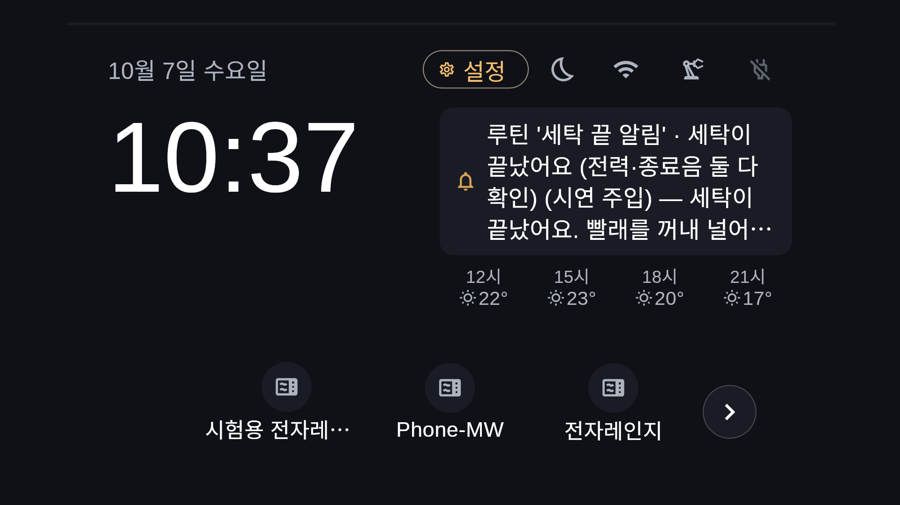

# 작품소개서 — SimpleLay

팀 자비스 · 박성원(소프트웨어) · 서예솔(하드웨어) · 제24회 임베디드SW경진대회 결선

2026-10-10 기준 본문이다. 편집 목표는 A4 2쪽, 나눔명조 11pt다. 아래 두 부분 사이에서 쪽을 나누고, 그림은 쪽마다 하나씩 작게 넣는다. 최종 양식에서 쪽수를 다시 확인한다.

## 1쪽 — 작품의 목적과 구성

### 기존 가전에 승인과 확인을 더하다

SimpleLay는 버튼식 가전을 바꾸지 않고 조작을 돕는 부착형 가전 제어 시스템이다. 작은 버튼이나 반복 메뉴가 부담스러운 사용자를 위한 것이다. 사진에서 등록한 버튼 순서를 루틴으로 저장하고, 실행 전에 승인을 받는다. 조작 부담을 줄이는 것이 목표다. 당사자 사용성 평가와 비용 절감 효과는 아직 확인하지 않았다.

핵심은 명령 전송과 실제 동작 확인을 구분하는 것이다. 버튼 눌림, 가전의 입력 수용, 가전의 동작을 나눠 판단하도록 설계했다.
- **L1:** 누름 장치 쪽 전류로 판정한다. 음향은 보조 신뢰도다.
- **L3:** CT 전력(설계)으로 판정한다.
- **L2:** 음향은 RPi4 운영 경로에 아직 연결하지 않았다.

확인에 실패하면 재시도하거나 안전 정지한다. 결과를 잃으면 자동으로 다시 보내지 않는다. 현재는 층별 판정 계약과 모의 입력 시험까지다. L2를 RPi4 운영 경로에 독립적으로 연결하는 일과 실제 센서 통합이 남았다. 실제 모터·센서 검증은 0건이다. <!-- L2-C -->

### 보드와 사용자 화면

| 보드 | 역할 | 현재 수준 |
|---|---|---|
| RPi5 | 해석·제안·승인·기록, 15.8형 키오스크 | 실제 보드 배포 |
| RPi4 | 실행·검증·정지(계획서 RPi Zero 자리, 팀 확정 역할 매핑) | 실제 보드 배포 |
| 모션 MCU(ESP32) | CoreXY 구동, FIT0482 모터 2개 | 팀원의 Touch Bridge CoreXY 펌웨어 제어 핵심을 가져와 통신·안전 규약을 맞춤. 컴파일까지, 실물 미연결 |
| 콘센트 모듈(ESP32) | CT 2개(ch0 전자레인지, ch1 세탁기), 전자레인지 릴레이 | 펌웨어 컴파일, 수신·판정은 가짜 모듈 시험까지 |

- **세 보드 연동:** RPi5·RPi4·ESP32가 한 흐름에서 함께 동작한 증거는 아직 없다(모의·미측정).
- **Z 누름:** 팀원 코드 기준 솔레노이드다. 실물 시험 뒤 확정한다.
- **세탁기:** CT로 계측만 한다. 릴레이로 끊지 않는다.
- **남은 일:** 회로 배선과 보정.

**폰 앱**은 홈·루틴·기록·설정 네 탭이다. 가전 등록은 다섯 단계다.
1. 사진
2. 프레임 네 모서리
3. 버튼 이름과 위치
4. 정지 버튼과 보관 위치
5. 확인 주행(모의 수준)

**키오스크**는 평소·다가오면·동작 중·내 가전 네 상태다. 사용자 루틴과 제안 카드를 보여 준다.
- 루틴을 호출해도 바로 실행하지 않고 승인을 거친다.
- 접근 감지 하드웨어는 없다. 재실은 수동 입력이다.

그림 1. 보드 역할과 CT 두 채널 구성. 초록 실선은 실제 보드에서 확인한 구간(모션·판정은 모의), 주황 점선은 설계·실물 미연결이다.

<!-- 여기서 쪽 나눔 -->

## 2쪽 — 한 사람의 하루와 개발 결과

### 한 사람의 하루

시연 v3는 전자레인지·세탁기·인터폰을 쓰는 6분 6장면이다(도입·마무리 각 20초). 여러 종류의 가전에 같은 승인·조작 흐름을 적용한다. 가전끼리 서로 동작을 이어 주는 구조는 아니다.

1. **아침:** '아침 데우기' 루틴을 승인하면 전자레인지의 즉석밥 → 시작을 모의 실행한다. 시작을 확인한 뒤 복약 시간을 안내한다. 의료 판단은 하지 않는다. 햇반 실제 가열은 운영 런북 §3-7 체크리스트를 모두 통과했을 때만 한다.
2. **외출 전:** 세탁기 전원 → 표준 → 시작을 실행한다. 실패를 일부러 주입해 보정 재시도를 보인다. 실제 누름 성공 사례로 제시하지 않는다.
3. **낮:** 사람이 인터폰 문 열기 루틴을 호출하고 승인한다. 호출 자동 감지와 실제 문 열림 확인은 없다.
4. **귀가:** 세탁 완료를 CT 전력 하강 + 종료음 교차 확인으로 판단한다.
   - 둘이 맞으면 완료로 안내하고, 하나뿐이면 확인을 요청한다.
   - 알림까지이며 다른 가전 동작으로 이어지지 않는다.
   - 무대에서는 세탁기를 돌리지 않으므로 '시연 주입' 표시를 유지한다.
5. **비상:** 콘센트 모듈의 비상정지 래치와 실행 차단을 모의로 보인다.
   - 버튼을 푼 뒤 사람이 확인(`POST /stop/ack`)해야 풀린다.
   - 화면 정지와 실행 중 음성 "멈춰"(폰 음성 인식)도 같은 정지 요청을 보낸다.
   - 전자레인지 전원 차단 회로는 미조립이고, 모터 전원 차단과는 별개다.
6. **사용자 통제:** '다음에'로 제안을 넘기고, 수동 부재 입력으로 카드를 철회한다. 시스템이 거둔 제안은 사용자의 거절로 학습하지 않는다.

전자레인지 갠트리 1대를 먼저 준비한다. 세탁기·인터폰은 조작부 모형이며 누름 장치 배치는 미정이다. 장면마다 실물·부분 실물·전부 모의 여부를 표시한다.

### 확인한 범위와 남은 과제

실기기에서 확인한 것은 넷이다.
- RPi5↔RPi4 LAN 통신(모션 모의)
- 폰 에뮬레이터에서 두 보드를 거친 모의 실행
- 15.8형 패널 표시·부팅 자동 실행
- 기상청 날씨 실제 호출

자동 시험(2026-10-08 `8b70fff`)은 모두 모의·합성 입력 중심이다.
- 백엔드+rpi4 2,538 통과
- 폰 576 통과
- 키오스크 255 통과
- 골든 화면 폰 55·키오스크 42장(위 수치와 별도)

ThinQ는 공통 승인·결과 계약을 모의로 시험한 범위다. 실제 가전 연동은 하지 않았다. 누름 성공률은 【실측 후 기입】, 정지 지연은 【실측 후 기입】이다. 다음 과제는 모터·센서 실물 검증, CT 보정, 비상정지 회로 검증, 당사자 평가다.

그림 2. 루틴 승인 카드 — 실제 15.8형 패널 캡처(2026-10-06). 승인 후 실행은 모의 실행이며 완료 화면에 "모의 실행 · 실제 조작 아님"이 표시된다.

그림 3. 세탁 완료 안내 — 실제 15.8형 패널 캡처(2026-10-07). **시연 주입**(전력 하강·종료음 입력을 주입)으로 만든 화면이며 실제 세탁기·CT·마이크로 잰 값이 아니다. 화면에도 "(시연 주입)"이 표시된다.

근거: README, 시연 v3, 하드웨어 방향 확정, UI 확정, 10/5~10/10 개발 로그. 상세 시험 기준과 한계는 개발완료보고서 §6에 있다.
