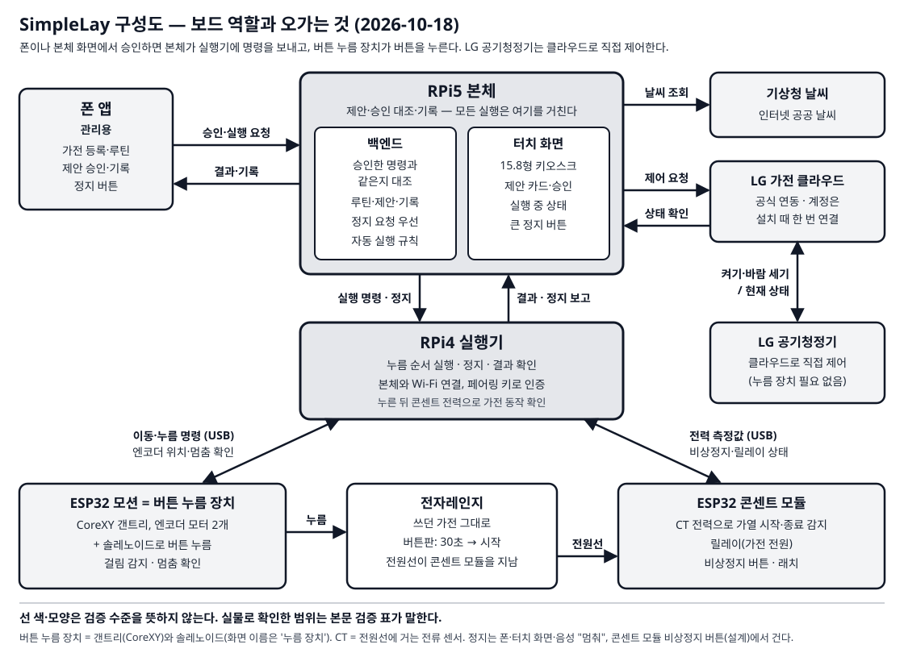

# 작품소개서 — SimpleLay

팀 자비스 · 박성원(소프트웨어) · 서예솔(하드웨어) · 제24회 임베디드SW경진대회 결선

2026-10-06 기준 본문이다. A4 2쪽, 나눔명조 11pt 편집을 목표로 한다. 아래 두 부분 사이에서 쪽을 나누고 그림은 각 쪽에 한 개씩 작게 배치한다. 최종 양식의 여백·줄간격에 따른 쪽수 확인은 남아 있다.

## 1쪽 — 작품의 목적과 구성

### 기존 가전에 승인과 확인을 더하다

SimpleLay는 버튼식 가전을 교체하지 않고 조작을 보조하려는 부착형 가전 제어 시스템이다. 작은 버튼이나 반복되는 메뉴 조작이 부담스러운 사용자를 대상으로, 사진에서 등록한 버튼 순서를 루틴으로 저장하고 실행 전에 승인을 받는 구조를 개발했다. 사용자의 조작 부담을 줄이는 것이 목표이며, 당사자 사용성 평가나 비용 절감 효과는 아직 확인하지 않았다.

핵심은 명령 전송과 실제 동작 확인을 구분하는 데 있다. 버튼 눌림, 가전의 입력 수용, 가전의 동작을 나누어 판단하도록 설계했다. L1은 누름 장치 쪽 전류로 판정하고 음향은 보조 신뢰도로만 쓰며, L3는 CT 전력(설계)이다. L2 음향은 RPi4 운영 경로에 아직 연결하지 않았다. 확인 실패 시 재시도하거나 안전 정지하고, 결과를 잃으면 자동으로 다시 보내지 않는다. 현재는 층별 판정 계약과 모의 입력 시험까지이며, L2를 RPi4 운영 경로에 독립적으로 연결하는 일과 실제 센서 통합은 남아 있다. 실제 모터·센서 검증은 0건이다. <!-- L2-C -->

### 보드와 사용자 화면

RPi5는 해석·제안·승인·기록과 15.8형 키오스크를 맡는다. RPi4는 실행·검증·정지를 맡는다. 팀은 계획서의 RPi Zero 자리를 RPi4가 맡는 것으로 확정했다(역할 매핑). 세 보드(RPi5·RPi4·ESP32)가 한 흐름에서 함께 동작한 실제 연동 증거는 아직 없고 현재 모의·미측정이다. RPi4에 연결할 모션 MCU는 Arduino 또는 ESP32 중 미정이다. CoreXY는 FIT0482 모터 2개를 쓰는 구성이고, Z 누름 방식은 스위치봇 또는 솔레노이드 중 미정이다.

별도의 ESP32 콘센트 모듈은 CT 2개로 ch0 전자레인지와 ch1 세탁기의 전력을 계측하도록 구성했다. 릴레이 차단 대상은 전자레인지이며 세탁기는 CT로 계측만 한다. 두 채널 펌웨어는 컴파일, 수신·판정은 가짜 모듈 시험까지 확인했다. 실제 회로 배선과 보정은 남아 있다.

폰 앱은 홈·루틴·기록·설정 네 탭으로 구성했다. 가전 등록은 사진, 프레임 네 모서리, 버튼 이름과 위치, 정지 버튼과 보관 위치, 확인 주행의 다섯 단계다. 확인 주행은 모의 수준이다. 키오스크는 평소·다가오면·동작 중·내 가전 네 상태로 구성하며, 사용자 루틴과 제안 카드를 보여 준다. 가전 상세 진입이나 루틴 호출만으로 실행하지 않고 승인을 거친다. 접근 감지 하드웨어는 없고 재실은 수동 입력이다.

그림 1. 보드 역할과 CT 두 채널 구성. 초록 실선은 실제 보드에서 확인한 구간(모션·판정은 모의), 주황 점선은 설계·실물 미연결이다.

<!-- 여기서 쪽 나눔 -->

## 2쪽 — 한 사람의 하루와 개발 결과

### 한 사람의 하루

시연 v3는 전자레인지·세탁기·인터폰을 이용한 6분 6장면이다. 여러 종류의 가전에 같은 승인·조작 흐름을 적용하는 모습을 보이며, 가전끼리 서로 동작을 이어 주는 구조는 아니다. 도입과 마무리는 각각 20초이며 다음 장면은 총 5분 20초다.

1. 아침에는 '아침 데우기' 루틴을 호출하고 승인 후 전자레인지의 즉석밥 → 시작 순서를 모의 실행한다. 시작 확인 뒤 복약 시간을 안내하며 의료 판단은 하지 않는다. 햇반 실제 가열은 운영 런북 §3-7 체크리스트를 모두 통과한 경우에만 한다.
2. 외출 전에는 세탁기의 전원 → 표준 → 시작 순서를 제안한다. 실패를 일부러 주입해 보정 재시도 흐름을 보인다. 실제 누름 성공 사례로 제시하지 않는다.
3. 낮에는 사람이 인터폰 문 열기 루틴을 호출하고 승인한다. 호출 자동 감지와 실제 문 열림 확인은 지원하지 않는다.
4. 귀가 장면에서는 세탁 완료를 CT 전력 하강 + 종료음 교차 확인으로 판단하는 흐름을 보인다. 두 신호가 맞을 때 완료로 안내하고 하나뿐이면 확인을 요청한다. 세탁 완료는 알림까지이며 다른 가전 동작으로 이어지지 않는다. 무대에서는 세탁기를 돌리지 않으므로 '시연 주입' 표시를 유지한다.
5. 비상 장면에서는 콘센트 모듈의 비상정지 래치와 실행 차단을 모의로 보인다. 버튼을 푼 뒤 사람이 확인하는 `POST /stop/ack` 경로로 해제한다. 전자레인지 전원을 차단하는 회로는 미조립이며 모터 전원 차단과는 별개다.
6. 마지막에는 '다음에'로 제안을 넘기고 수동 부재 입력으로 카드를 철회한다. 시스템이 거둔 제안은 사용자의 거절로 학습하지 않는다.

전자레인지 갠트리 1대를 먼저 준비하고 세탁기·인터폰은 조작부 모형을 사용할 계획이다. 모형의 누름 장치 배치는 미정이다. 각 장면에는 실물·부분 실물·전부 모의 여부를 표시한다.

### 확인한 범위와 남은 과제

실기기에서 확인한 것은 RPi5↔RPi4 LAN 통신(모션 모의), 폰 에뮬레이터에서 두 보드를 거친 모의 실행, 15.8형 패널 표시·부팅 자동 실행, 기상청 날씨 실제 호출이다. 자동 시험 기록은 백엔드+rpi4·폰·키오스크와 골든 화면 비교를 따로 적는다(2026-10-07 중간 기록: 백엔드+rpi4 2,493·폰 541·키오스크 255 통과, 골든 폰 55·키오스크 42장, 모두 모의·합성 입력 중심 시험).

ThinQ는 공통 승인·결과 계약을 모의로 시험한 범위이고 실제 가전 연동은 미완성이다. 누름 성공률은 【실측 후 기입】, 정지 지연은 【실측 후 기입】이다. 모터·센서 실물 검증, CT 보정, 비상정지 회로 검증, 당사자 평가를 다음 과제로 남긴다.

그림 2. 루틴 승인 카드 — 실제 15.8형 패널 캡처(2026-10-06). 승인 후 실행은 모의 실행이며 완료 화면에 "모의 실행 · 실제 조작 아님"이 표시된다.

【그림 예정: 세탁 완료 "(시연 주입)" 안내 화면 — 미캡처(2026-10-06)】

근거: README, 시연 v3, 하드웨어 방향 확정, UI 확정, 10/5·10/6 개발 로그. 상세 시험 기준과 한계는 개발완료보고서 §6에 기록했다.
