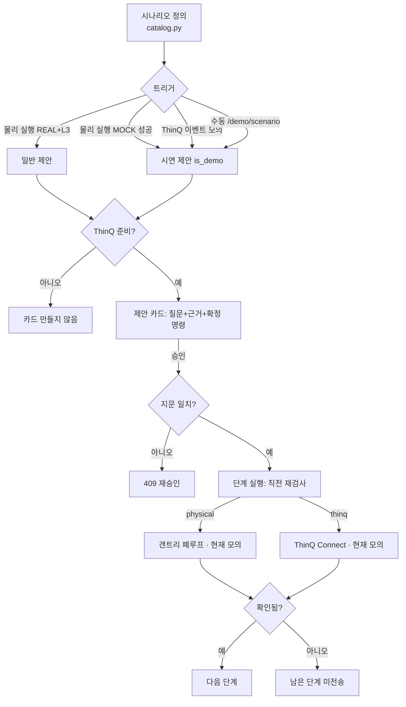

# 전문가 의견 대응표 — 2026-09-29

> **현재 기준(2026-10-14) — 먼저 읽기.** 이 문서의 본문(§1~§6)은 **9/29 당시 기록**이다. 아래 줄은 그 뒤 바뀌었으므로
> 본문의 "말할 수 있다" 문장을 그대로 인용하지 말고 이 표와 [README](../README.md) 검증 수준 표·[시연 v4](본선-시연-계획-v4.md) §8 문장표를 쓴다.
>
> | 9/29 본문 서술 | 지금(10/14) |
> |---|---|
> | "실물 검증 항목이 없다", "§6-1 실물 검증 0건" | 모터 축 구동·엔코더·조이스틱 이동·정지 전달(10/12), 실행 순서·정지 세 단계 10회(10/13), 모터 걸림 정지·USB 재연결(10/14)을 실물로 확인. 캐리지 이동·실제 누름·CT 판정·ThinQ 실가전은 제출 전 수행 |
> | "`RealThinqClient`는 항상 `NotImplementedError`", "ThinQ 실물 호출 코드는 없다"(E3·§5 4번) | 10/13 공식 SDK(`thinqconnect`)를 부르는 클라이언트·기기 찾기·추가가 들어왔다. **모의 클라우드 끝-끝까지**, 실제 클라우드·실가전 미검증([devlog](devlog/devlog_2026-10-13-thinq-sdk.md)) |
> | "`rpi4/act_main.py`에 L3 검증기가 연결돼 있지 않다"(E1·E2·§3-1·§6-2) | 10/7부터 실행마다 대상 가전의 CT 채널 판정기를 꽂는다(`rpi4/services/act_executor.py`). L2(가전 소리)는 여전히 운영 경로에 없다. CT 실측은 전 |
> | "승인 없는 자동 실행은 없다"(E4·C3·§3-2) | 버튼 누름은 여전히 매번 승인. 10/13부터 **사용자가 카드에서 조건·동작을 확인하고 허용한 경우에 한해** 낮은 위험 ThinQ 동작(공기청정기 풍량)만 자동 실행([devlog](devlog/devlog_2026-10-13-auto-rule.md)) |
> | 대표 시나리오 `cook_then_air`(물리 실행 완료 → 공기청정기 제안) | 시연 v4는 CT **가열 종료 감지**(조리 완료가 아닐 수 있음) → 공기청정기 제안·허용 규칙(`cook_done_air`) |
> | 전원 차단형 비상정지 회로 없음(C4·§6-9) | 그대로(회로 미제작). 정지 보고는 보냄 → 모션 보드 확인 → 멈춤 확인 세 단계로 나눴다(10/13 실물, 모터 축) |
>
> 남은 일·말할 문장의 현행판은 [개발완료보고서 초안](submission/개발완료보고서-초안.md) §5 표에 있다.

## 머리말 (9/29 당시)

**목적.** 예선 심사평, 9/22 컨설팅, 9/29 전문가 의견을 한 문서에 모으고, 의견마다 지금까지 한 일과
남은 일을 적는다. 최종 보고서와 발표 자료의 근거 문서로 쓴다. 기준 커밋은 `c18f29b`(main)이다.

**판정 기준 — 검증 수준 표기 규칙.**

| 표기 | 뜻 | 쓰면 안 되는 경우 |
|---|---|---|
| **실물 검증** | 실제 보드·모터·센서·LG 가전·ThinQ 클라우드로 동작을 확인했다 | **현재 이 문서에 해당 항목이 없다.** 하드웨어는 수령 대기이고, ThinQ 실물 호출 코드는 없다 |
| **모의** | 코드가 있고 모의 입력(가짜 MCU, 모의 ThinQ 클라이언트, 합성 센서, 통신 시뮬레이터)으로 자동 테스트를 통과했다 | "동작한다", "제어한다"라고만 쓰는 경우. 반드시 "모의에서"를 붙인다 |
| **컴파일** | 빌드·링크까지 확인했다(펌웨어) | 플래시·부팅·통신이 된다는 뜻으로 쓰는 경우 |
| **설계** | 문서로 계약·순서를 정했고 코드는 없거나 일부만 있다 | 구현 완료로 쓰는 경우 |
| **미구현** | 코드도 설계 확정도 없다 | — |

테스트 수치는 이 문서를 쓰며 2026-09-29에 다시 실행한 결과다. 실행 명령은
`.venv/Scripts/python.exe -m pytest -q -p no:cacheprovider --basetemp=<쓰기 가능한 임시 폴더> rpi/tests/<파일>`이다.
`--basetemp` 없이 돌리면 이 PC의 사용자 임시 폴더 권한 문제로 `test_pat_not_persisted_in_sqlite` 1건이
`PermissionError`로 실패한다. 코드 결함이 아니라 테스트 환경 문제다(9/29 ThinQ devlog §8에 적힌 것과 같다).

| 테스트 파일 | 결과 |
|---|---|
| `rpi/tests/test_thinq_u1.py` | 30 passed |
| `rpi/tests/test_auth.py` | 25 passed |
| `rpi/tests/test_result_outcome.py` | 33 passed |
| `rpi/tests/test_serial_motion.py` | 29 passed |
| `rpi/tests/test_kinematics.py` | 29 passed |
| `rpi/tests/test_jog_cli.py` | 16 passed |
| `rpi/tests/test_twin_view.py` | 13 passed |
| `rpi/tests/test_stop_endpoint.py` | 4 passed |

위 수치는 전부 **모의** 수준이다. 백엔드 전체 테스트와 Flutter 테스트는 이번에 다시 돌리지 않았다.

---

## §1. 의견 원문

### 1-1. 2026-09-29 전문가 의견(원문 그대로)

> 작품에 대한 의견: - 상황을 인지하고 이를 하드웨어 적으로 조절하는 아이디어는 좋음 / - 하나의 가전이 아닌 복합적인 상황을 인지, 문제를 해결하는 아이디어로 확장되면 좋을 것으로 판단됨
>
> 보완사항: - 하드웨어적 버튼 뿐만 아니라, 소프트웨어적 가전 제어 부분도 포함하는게 더 효율적 (버튼 맵) https://www.home-assistant.io/integrations/lg_thinq/#button / - 하나의 제품을 제어하는 것 뿐만 아니라 특정 situation을 시나리오화 하고, 그 안에서 시스템이 공조해 문제 혹은 상황에 대응하는 구조를 만들면 좋겠음

### 1-2. 2026-09-22 컨설팅 요점

출처: [데스크톱 Claude 인계](archive/데스크톱-Claude-인계-2026-09-22.md) §2. 사용자가 제공한 전사문을 요약한 것이다.
오인식·화자 구분 문제가 있어 **원문 인용이 아니다.**

| # | 요점 |
|---|---|
| C1 | 물리 버튼 외에 정전식 터치와 소프트웨어 트리거도 고려하면 확장성이 커진다. HA 버튼 맵 자료를 전달하겠다 |
| C2 | 제품 하나의 기술 설명보다 **사용자 상황과 여러 기기가 협력해 주는 혜택**이 부족하다 |
| C3 | 자동화 가능성을 넓게 보되, 사용자가 직접 개입할 지점을 고민하라 |
| C4 | 앱·키오스크가 **먹통이거나 접근하기 어려울 때도 정지할 방법**이 필요하다 |
| C5 | **전자레인지 동작 시 통신 간섭**이 생겼다가 회복되는 시간을 확인하라 |

관련 내부 평가: [Claude 계획 평가](archive/Claude-계획평가-2026-09-22.md)(시나리오가 규칙 자동화와 구분되지 않는다,
물리 검증 결과를 다음 기기의 조건으로 쓰라, 시연장 인터넷·클라우드 확인 불가·정지 시 API 기기 처리를 넣으라),
[본선 준비 평가](archive/본선-준비-평가-2026-09-21.md)(웹 키오스크 P0 2건, 무키 인증·연결 유실 표시 P1 2건),
[교차 평가·후속 계획](archive/교차평가-후속개발계획-2026-09-09.md)(R1~R5·F1~F5, 실기기 필요 항목은 완료 표시 금지).
이 세 문서는 팀 내부·AI 교차 평가이며 심사위원 의견이 아니다.

### 1-3. 예선 심사평

출처: [roadmap.md](roadmap.md) "예선 심사평 대응" 표, [전력버짓.md](전력버짓.md) 머리말,
[본선 준비 평가](archive/본선-준비-평가-2026-09-21.md) "대회 방향과 연결". 심사평 원문 전체는 저장소에 없고,
아래는 저장소에 기록된 항목명이다.

| # | 항목 |
|---|---|
| P1 | 가전 모델별 조작 방식 차이(버튼맵 일반화) |
| P2 | 구동 전력·작동 통일·전력 관리 |
| P3 | 액추에이터 장착 안정성 |
| P4 | 누름·다이얼 오차 보정 |

---

## §2. 의견별 대응 표 (9/29 당시 — 검증 수준 칸은 머리 표로 갱신해 읽는다)

열: 의견 | 해석 | 현재 구현(파일·API·테스트) | 검증 수준 | 남은 일 | 발표에서 말할 수 있는 문장 / 말하면 안 되는 문장

### 2-1. 9/29 의견

| 의견 | 해석 | 현재 구현 | 검증 수준 | 남은 일 | 말할 수 있다 / 말하면 안 된다 |
|---|---|---|---|---|---|
| **E1.** 상황을 인지해 하드웨어적으로 조절하는 아이디어는 좋음 | 핵심 방향(물리 버튼 가전 + 상황 판단 + 폐루프 확인)은 유지 | 폐루프 L1~L3 층별 검증(`rpi/controller/closed_loop.py`, `layered.py`, `power_operation.py`), 모션 어댑터 뼈대 `rpi/controller/serial_motion.py`·CoreXY 변환 `kinematics.py`, 홈·조그 CLI `python -m rpi.tools.jog`, 원시 기록기(`rpi/verifier/recorder.py`), 디지털 트윈 `GET /simulator/twin`. 테스트: `test_serial_motion` 29, `test_kinematics` 29, `test_jog_cli` 16, `test_twin_view` 13 | **모의.** 기본 실행 경로는 여전히 `MockGrblClient`(`SIMPLELAY_MOTION_MODE` 기본 `mock`). `rpi4/act_main.py`의 `ClosedLoopController`에는 L3 검증기(`operation=`)가 연결돼 있지 않다. 펌웨어는 **컴파일**까지 | H0~H1: 실물 조립 후 홈·조그 → 누름 1회 → 센서 원시 기록 → 임계값 결정 → L3 연결. 누름 성공률·오판율 실측 | ○ "버튼이 눌렸는지를 센서로 확인하는 폐루프 구조를 설계·구현했고, 모의 입력으로 검증했습니다. 실기기 측정은 하드웨어 수령 후입니다." / ✕ "전류로 가열을 확인합니다", "모터가 버튼을 누릅니다"(현재형 단정) |
| **E2.** 하나의 가전이 아닌 복합 상황을 인지해 문제를 해결하는 방향으로 확장 | 단일 가전 원격 조작이 아니라 **한 가전의 결과·이벤트가 다른 가전의 제안으로 이어지는 구조** | 시나리오 정의(데이터) `rpi/scenarios/catalog.py`: `cook_then_air`(조리 확인 → 공기 관리), `evening_rest`(저녁 휴식). 트리거 엔진 `rpi/scenarios/engine.py`(물리 실행 완료 / ThinQ 이벤트 / 수동). `GET /scenarios`, `GET /scenarios/last-run`, `POST /demo/scenario/{id}`. 테스트: `test_cook_then_air_end_to_end_with_mock`, `test_evening_rest_is_a_registered_scenario`, `test_real_run_without_l3_does_not_trigger`, `test_unconfirmed_step_halts_the_rest` | **모의.** 상황 "인지"는 현재 ① 물리 실행 결과(실물에서는 L3 미연결이라 일반 제안이 나올 수 없음 — 모의 성공으로만 **시연 제안**이 나옴), ② 모의 ThinQ 이벤트, ③ 수동 시연 트리거뿐이다. 귀가·재실 인지는 없다 | 실물 L3 연결 후 `cook_then_air` 일반 트리거 확인. 세탁 완료(`wash_complete`) 이벤트를 쓰는 기본 시나리오 정의(엔진 경로는 있으나 기본 목록에 없음). 앱·키오스크 카드 문구 분기 | ○ "상황을 시나리오로 정의하고, 한 가전의 실행 결과가 다음 가전의 제안을 만드는 구조를 서버에 넣었습니다. 지금은 모의 환경에서 확인했습니다." / ✕ "집 안 상황을 스스로 인지합니다", "귀가를 알아채고 켭니다" |
| **E3.** 하드웨어 버튼뿐 아니라 소프트웨어적 가전 제어(버튼 맵)도 포함 — HA `lg_thinq` #button | 물리 경로 옆에 **ThinQ Connect 클라우드 경로**를 두고, 같은 승인·실행·이력 흐름에 태운다. HA의 "버튼 엔티티"는 화면 좌표가 아니라 호출 가능한 동작(예: 세탁기 시작/일시정지)이다(§4) | 명령 계약 `rpi/commands/`(대상+경로+동작+인자, 지문, 확인 수준). ThinQ 서비스 `rpi/services/thinq/`: `client.py`(포트·`RealThinqClient` 자리), `mock_client.py`(공기청정기 전원·풍량·모드, 세탁기 읽기 전용+이벤트 주입), `controller.py`(준비 상태·정지 의미), `bindings.py`(동작 대응표), `config.py`. API `rpi/api/thinq_router.py`: `GET /thinq/devices`, `GET /thinq/status/{id}`, `POST /thinq/command`, `GET /readiness/{id}`, `POST /demo/thinq/event`, `GET /thinq/events`; `POST /execute`가 ThinQ 가전이면 ThinQ 경로로. 테스트 `test_thinq_u1.py` 30건 | **모의.** `RealThinqClient`는 호출 시 항상 `NotImplementedError`. `SIMPLELAY_THINQ_MODE` 기본 `off`. `bindings.py`의 속성 이름·허용값은 SDK 소스에서 옮긴 **추측/확인 필요**. (9/29 갱신) 폰·키오스크는 ed9697d부터 경로·확인 수준·시나리오 카드를 표시한다. 단 키오스크 웹 빌드는 재빌드 전이고, 모의 등급의 "상태 확인됨"에 (모의) 표기는 아직 없다 | PAT·보유 가전 확보(§5) → U0 프로필 덤프 → `bindings.py` 교체 → `RealThinqClient` 구현 → U2 단일 제어 실기기. 앱·키오스크 문구 분기(1-7) | ○ "물리 버튼 경로와 LG ThinQ Connect 경로를 같은 명령·승인 계약으로 묶었습니다. ThinQ 쪽은 모의 클라이언트로 검증했고 실제 가전 호출은 등록 가전 확보 뒤입니다." / ✕ "LG 가전을 ThinQ로 제어합니다", "ThinQ 연동 완료" |
| **E4.** 특정 situation을 시나리오화하고 그 안에서 시스템이 공조해 대응하는 구조 | 시나리오 = 트리거 + 근거 문장 + 여러 단계(가전·경로·동작·인자). 실행은 승인 뒤, 단계별 결과 확인 후 다음 단계 | §3 구조 전체. 승인 고정(`rpi/commands/approval.py`의 `ApprovalMismatchError` 409, `service._check_approved`), 단계별 `CommandResult`, 앞 단계가 확인되지 않으면 남은 단계 미전송(`service_commands`), ThinQ 준비 안 되면 카드 미생성(`engine._unavailable`). `evening_rest`는 ThinQ 1단계 + 물리 1단계(선풍기는 `MockButtonController`) | **모의** | 원복 제안(이전 설정 저장·사용자 변경 확인), 전자레인지 종료 지속 감지(U3), 제안 수락 선호도 별도 집계, 가전 운전 정지 동작 UI | ○ "시나리오 안의 여러 단계를 승인 한 번에 묶되, 승인한 내용과 다른 명령은 실행하지 않고, 앞 단계가 확인되지 않으면 다음 단계를 보내지 않습니다(모의 검증)." / ✕ "여러 가전이 자동으로 협력합니다"(승인 없는 자동 실행은 없다) |

### 2-2. 9/22 컨설팅

| 의견 | 해석 | 현재 구현 | 검증 수준 | 남은 일 | 말할 수 있다 / 말하면 안 된다 |
|---|---|---|---|---|---|
| **C1.** 소프트웨어 트리거·HA 버튼 맵 | E3과 같음. 정전식 터치는 하드웨어 항목 | E3 참조. 정전식 터치 대응은 코드 없음 | ThinQ: **모의** / 정전식: **미구현** | HA 자료 해석은 §4. 정전식 터치 누름 방식은 HW 담당 결정 | ○ "소프트웨어 제어 경로를 모의로 붙였습니다." / ✕ "정전식 터치 패널도 조작합니다" |
| **C2.** 사용자 상황·여러 기기 협력 혜택 부족 | 기술 나열 대신 생활 시나리오 하나로 혜택을 보인다 | `cook_then_air`, `evening_rest`(§3). 시나리오 선택 근거는 2차 조사 보고서(저장소 밖 팀 로컬 자료, 공개하지 않음) 후보 A·B(§3-3) | **모의 + 설계** | 당사자(고령·장애 사용자) 평가 없음 — 혜택은 아직 **주장할 수 없다**(보고서 §4 "당사자 평가 없이는 주장할 수 없는 효과") | ○ "두 가전이 이어지는 저녁 흐름을 시나리오로 만들었습니다." / ✕ "사용자 부담이 줄었습니다"(측정 없음) |
| **C3.** 자동화 범위와 사용자 개입 지점 | 행동별 자동/승인/수동 등급 | 시나리오·제안은 **항상 승인 후 실행**(`engine.py` 머리말 "승인 없는 자동 실행은 없다"). 승인 고정·재승인. 가전 운전 정지(전원 끄기)는 자동 전송 안 함 | **모의** | 행동별 등급 정책(U4)의 사용자 설정 화면은 없음 | ○ "모든 시나리오 실행은 사용자 승인 뒤이고, 가열 기기는 무승인 자동 실행하지 않습니다." / ✕ "상황에 따라 알아서 실행합니다" |
| **C4.** 앱·키오스크 먹통 시 정지 수단 | 화면·네트워크와 독립된 정지 경로 | `POST /stop`(폰·키오스크), ESP32 비상정지 버튼 인터럽트 → UART 정지 메시지(`firmware/src/estop.cpp`), 모션 어댑터 `request_stop()` 즉시 호출(9/28), 조그 CLI Ctrl+C → 정지 전송, UART 결과 `outcome`(stopped / safety_stop 구분, `/status`·SSE `last_outcome`, 9/29). ThinQ: 전송 전 명령만 취소, 전송 후는 `sent_uncancellable`로 보고. 테스트 `test_stop_endpoint` 4, `test_result_outcome` 33 | 소프트웨어: **모의**. 펌웨어: **컴파일**. **전원 차단형 비상정지 회로는 없다**([하드웨어 연결 설계](하드웨어-연결-설계.md) §5) | 전원 차단 회로(1차) + 소프트웨어 메시지(2차) HW 결정, 물리 정지 확인(엔코더 속도 0), 정지 지연 실측. 화면이 `last_outcome`을 아직 쓰지 않음 | ○ "화면과 별개인 물리 정지 버튼 신호 경로를 펌웨어에 두었고, 전원 차단 회로는 하드웨어 담당과 설계 중입니다." / ✕ "비상정지 버튼으로 모터 전원이 끊깁니다", "멈췄어요"(물리 정지 확인 전) |
| **C5.** 전자레인지 통신 간섭·회복 시간 | 가열 중 Wi-Fi/ESP-NOW 끊김과 복구 후 중복 실행 여부를 **측정**해야 함 | 소프트웨어 대비만 있음: 결과 유실 시 `unknown`/확인 불가로 두고 **자동 재전송하지 않음**(`rpi/commands/physical.py`, ThinQ 확인 수준 표), 작업 ID 대조. 통신 시뮬레이터의 응답 유실 시나리오([하드웨어 통신 시뮬레이터](archive/하드웨어-통신-시뮬레이터-2026-09-27.md)) | **모의**(유실 처리 논리만). 간섭 자체는 **미측정** | 실측: 가열 중 통신 끊김 발생 여부·지속 시간·복구 시간·복구 후 중복 실행 0건. 결과를 [실측 기록표](실측-기록표.md)에 추가(현재 항목 없음) | ○ "통신 결과가 끊기면 확인 불가로 두고 자동 재전송하지 않도록 만들었고, 실제 간섭 시간은 측정 예정입니다." / ✕ "간섭 영향이 없습니다" |

### 2-3. 예선 심사평

| 의견 | 해석 | 현재 구현 | 검증 수준 | 남은 일 | 말할 수 있다 / 말하면 안 된다 |
|---|---|---|---|---|---|
| **P1.** 가전 모델별 조작 방식 차이 | 가전마다 버튼 배치·순서가 다르다 → 버튼맵을 데이터로 | 앱 격자 편집기, 버튼맵 확장(누름/다이얼·딸깍 수·누름 시간·mm 좌표·목적별 시퀀스·보정 버전), 조작부 사진 → 버튼맵 초안 `POST /panel-scan`(기본 꺼짐), 내장 `docs/button-maps/microwave.json`. **추가(9/29):** 버튼이 없는 가전은 ThinQ 동작 대응표(`bindings.py`)로 같은 명령 계약에 들어간다 | 버튼맵 저장·편집: **모의**(앱 테스트). 사진 인식: 실제 서비스 응답 **미확인**. mm 좌표는 실측 보정 전 | 실물 보정(기준점 → mm), 두 번째 가전 버튼맵 실측 | ○ "가전마다 버튼맵을 데이터로 등록하고, 스마트 가전은 동작 대응표로 같은 명령 형식을 씁니다." / ✕ "사진만 찍으면 자동으로 버튼맵이 만들어집니다" |
| **P2.** 구동 전력·전력 관리 | 12 V 단일 입력·레일 분리·보호 | [전력버짓.md](전력버짓.md): 설계 근거·부하 목록·최악 조건 산정 틀·실측 체크리스트 | **설계.** 스톨 전류 등 실측값 없음, 패널 PD 공급 방식 `확인 필요` | 조립 후 실측값 채우기, 6 V 모터용 강압/듀티 제한 결정 | ○ "12 V 단일 입력 설계와 부하 산정 틀을 만들었고 실측값은 조립 후 채웁니다." / ✕ 측정하지 않은 전류·전력 숫자 |
| **P3.** 액추에이터 장착 안정성 | 기구 강성·재부착 재현성 | CoreXY 소프트 리밋·홈 확인 전 이동 거절(`serial_motion.py`), 기구 값 미설정 시 누름 거절. 기구 자체는 HW 담당 제작 중 | 소프트웨어 안전장치: **모의**. 기구: **미검증** | 재부착 후 보정 시간·위치 오차 실측 | ○ "기구 값이 확정되지 않으면 움직이지 않도록 소프트웨어가 막습니다." / ✕ "장착 후에도 오차 없이 누릅니다" |
| **P4.** 누름·다이얼 오차 보정 | 누름은 폐루프 재시도, 다이얼은 별도 | L1 보정 재시도(버튼당 3회)·L2 재입력 1회·L3 재시도 없이 안전 정지(모의). **다이얼 구동은 실행 거절**([개발현황](개발현황.md) §3) | 누름: **모의**. 다이얼: **미구현(거절)** | 센서 임계값 실측 후 L1~L3 실물 확인. 다이얼 기구 결정 | ○ "누름 실패를 센서로 감지해 보정 재시도하는 구조를 모의로 검증했고, 다이얼은 현재 실행을 거절합니다." / ✕ "다이얼 오차도 폐루프가 보정합니다"([roadmap.md](roadmap.md)의 옛 문구는 최신 구현과 다르다) |

### 2-4. 본선 준비 평가(9/21) 결함 — 9/29 수리분

심사 의견은 아니지만 시연 신뢰도와 직결돼 함께 적는다. 출처: [9/29 결함 로그](devlog/devlog_2026-09-29-defects.md).

| 결함 | 수리 | 검증 수준 |
|---|---|---|
| 웹 키오스크가 `dart:io` 직접 사용 | `*_io.dart`/`*_web.dart` 분리(설정 localStorage, 음성 speechSynthesis), 경계 회귀 테스트 | Flutter 테스트(로그 기준, 이번 미재실행). **RPi5 Chromium 실배포 미검증** |
| 배포 base href 누락 | `deploy_kiosk.ps1`에 `--base-href /kiosk/`와 산출물 검사 | 스크립트 파싱 확인(로그 기준). 실배포 미검증 |
| API 키 미설정 시 LAN 전체 개방 | 키 없으면 루프백만 허용, LAN 개방은 `SIMPLELAY_ALLOW_UNAUTHENTICATED=1` 명시 | `test_auth` 25 passed(모의) |
| UART 결과에서 정지와 실패 구분 불가 | `result`에 `outcome`(stopped/safety_stop) | `test_result_outcome` 33 passed(모의). 화면은 아직 `last_outcome` 미사용 |

---

## §3. 상황 시나리오·다가전 공조 구조

9/29 의견 E2·E4에 대한 구조 설명이다. **전부 모의 수준이다.**

```
[시나리오 정의]  rpi/scenarios/catalog.py  (데이터: 트리거 + 질문 + 단계들)
      │
      ▼
[트리거]  rpi/scenarios/engine.py
  ├─ 물리 실행 완료: REAL + L3(operation_confirmed) → 일반 제안
  │                  MOCK 성공(allow_mock_success) → 시연 제안(is_demo, 근거에 "모의" 명시)
  │                  L1·보고만 받은 성공·UNKNOWN → 트리거 아님
  ├─ ThinQ 이벤트: on_thinq_event (모의 wash_complete 등)  ※ 기본 시나리오에는 아직 없음
  └─ 수동(시연): POST /demo/scenario/{id} → 항상 시연 제안
      │
      ▼  ThinQ 대상이 준비 안 됨(미등록·오프라인)이면 카드를 만들지 않는다
[제안 카드]  질문 + 근거 한 줄 + 확정 명령 목록(commands[])  →  GET /suggestions
      │
      ▼  사용자 승인 (승인 없는 실행 없음)
[승인 고정]  승인 시 정의로 다시 만든 명령의 지문과 카드의 명령을 대조
      │      다르면 409 ApprovalMismatchError → 카드 내림 → 재승인
      ▼
[경로별 실행]  단계마다 실행 직전 재검사(준비 상태·동작 지원·인자 범위, 실패 시 412)
  ├─ physical: 기존 execute(buttons) → 폐루프 갠트리 (지금은 MockGrbl / MockButtonController)
  └─ thinq:    ThinqController.execute_command → 모의 클라이언트 (실물은 NotImplementedError)
      │
      ▼
[확인 수준]  receipt(accepted / unknown / not_dispatched) × confirmation
             (none / reported / press_confirmed / state_confirmed / operation_confirmed)
      │
      ▼
[다음 단계 게이트]  이 단계가 succeeded(확인)가 아니면 남은 단계는 보내지 않는다
                    자동 재전송 없음. 결과는 GET /scenarios/last-run, /status, /history
```



### 3-1. 기본 시나리오 두 개

| | `cook_then_air` 조리 확인 → 공기 관리 | `evening_rest` 저녁 휴식 |
|---|---|---|
| 트리거 | 전자레인지 물리 실행 완료(REAL+L3 → 일반, MOCK 성공 → 시연) | 수동 시연 트리거만 |
| 카드 | "공기청정기 강풍으로 바꿀까요?" | "저녁 휴식 — 공기청정기를 켜고 선풍기를 약풍으로 켤까요?" |
| 단계 | ① 공기청정기(ThinQ) `set_wind_strength HIGH` | ① 공기청정기(ThinQ) `set_power POWER_ON` ② 선풍기(물리) `전원 → 약풍` |
| 근거 문장 | 실물: "전자레인지 가열을 전류로 확인했어요(L3)…" / 모의: "시연: 모의 실행이 성공으로 끝났어요 — 실제 가열을 확인한 것은 아니에요" | "시연: 합성 이력 … 실제 사용 기록이 아니에요" |
| 현재 한계 | 실물 L3 검증기가 실행 진입점에 연결되지 않아 **일반 제안 경로는 실물에서 아직 도달 불가**. 가열 확인만으로 강풍이 필요하다고 단정하지 않으므로 "제안"이다 | 선풍기는 모의 물리 실행기라 확인 근거가 `reported`. 합성 이력 기반 |

### 3-2. 설계 원칙(코드로 강제된 것)

- 승인 없는 자동 실행 없음. 시나리오 단계 실행은 자연 사용 습관 학습에 넣지 않는다.
- ThinQ 결과는 `state_confirmed`일 때만 성공. 접수만 됐으면 `unconfirmed`(실패도 성공도 아님).
- 오프라인·준비 안 됨은 실행 전 412. "성공"으로 끝나지 않는다.
- 정지: ThinQ는 전송 전 명령만 취소, 전송 후는 취소 불가로 보고, 전원 끄기는 자동 전송하지 않음.
- 실행 환경(real/mock/unknown), 제어 경로(physical/thinq), 확인 수준은 서로 독립된 축이다.

### 3-3. 2차 조사 보고서와의 관계

출처: `SimpleLay 2차 조사 보고서 공감지능과 생활 시나리오.md`(팀 조사, 2026-09-27, 저장소 밖 팀 로컬 자료, 공개하지 않음).

- **후보 A(저녁 휴식 준비)** → `evening_rest`의 모양(공기청정기 + 선풍기, 두 가전 연쇄, 승인 후 실행).
  보고서 A는 두 가전 모두 물리 버튼으로 가정했고 "LG 스마트 가전이 있으면 SW 제어로 대체"라고 적었다.
  구현은 공기청정기를 ThinQ로, 선풍기를 물리(모의)로 두었다. 보고서의 "최근 2주간 7번" 같은 이력 근거는
  아직 없고 합성 이력이라고 카드에 적는다.
- **후보 B(세탁 완료 후 건조 지원)** → 모의 세탁기 읽기 전용 + `wash_complete` 이벤트 주입 경로
  (`POST /demo/thinq/event`, `engine.on_thinq_event`). 보고서의 "API 오프라인이면 제안 없음(오탐보다 미제안)"은
  준비 안 되면 카드를 만들지 않는 규칙과 같은 방향이다. **B를 쓰는 기본 시나리오 정의는 아직 없다.**
- **후보 C(취침 전 가전 정리)** → 미구현. "꺼졌다"를 입증할 수단이 없으면 설득력이 약하다는 보고서 지적이 그대로 남아 있다.
- 문헌 원리 차용: 한 줄 근거(보고서 [8] G11, [9]), 승인·거절 분리와 오학습 방지([4], [6], [7]),
  완전 자동 실행을 기본값으로 두지 않음([13] deskilling 우려, [2] opt-in). 복수 트리거·복수 액션이
  단순 예약으로 표현되지 않는다는 근거는 [1]. **이 문헌들은 대부분 스마트폰·추천·데스크톱 도메인이며
  "원리 차용"이라고 밝혀야 한다**(보고서 §1 머리말).
- `cook_then_air`는 보고서 후보가 아니라 [ThinQ 연동 검토](ThinQ-연동-검토-2026-09-22.md) §4에서 정한 대표 시나리오다
  (트리거를 없는 기능인 귀가 인지가 아니라 이미 만든 폐루프 검증 결과로 삼기 위해).

---

## §4. HA `lg_thinq` 버튼 엔티티 링크에 대한 답

**링크가 가리키는 것.** HA `lg_thinq` 연동 문서의 Button 절은 식기세척기·세탁기·건조기·스타일러·워시타워 등의
**운전 버튼(시작/일시정지)** 을 버튼 엔티티로 노출한다(2026-09-29 문서 확인). 즉 "소프트웨어 버튼 맵"은 조작부의
좌표가 아니라 **가전이 클라우드에 공개한 쓰기 가능한 동작 목록**이다. 이는 `bindings.py`의 동작 대응표와 같은 층이다.

**왜 HA가 아니라 직접 ThinQ Connect SDK인가**([ThinQ 연동 검토](ThinQ-연동-검토-2026-09-22.md) §0·§5·§7, 사용자 결정):

| | 직접(공식 파이썬 SDK `thinqconnect`) | HA 경유 |
|---|---|---|
| 런타임 | 서버 컨테이너 안 라이브러리 1개 | RPi5에 세 번째 런타임과 자원·유지 부담 |
| 인증 | PAT 1개 | PAT + HA 토큰 |
| 기기 프로필 | SDK가 그대로 줌 | 엔티티로 가공돼 옴 |
| 판단 주체 | SimpleLay | HA를 중계로만 쓰면 하나로 유지 가능, HA 자동화를 켜면 정책 충돌 관리 필요 |
| 실익 | 시연 의존성 최소 | 전문가 자료 해석, 타 브랜드 확장 |

직접 SDK도 인증·연결 수명·MQTT 재연결·비동기↔동기 연결을 직접 관리해야 한다(§7에서 정정). "어댑터 하나만
늘린다"는 과장이었다.

**두 경로는 같은 클라우드를 쓴다.** HA `lg_thinq`도 LG ThinQ Connect API와 PAT로 동작하는 클라우드 푸시 연동이다.
그래서 가전이 공개한 동작 범위(버튼 엔티티가 되는 것)는 두 경로가 같고, 차이는 중간 런타임 유무다.
HA에서 버튼으로 보이는 세탁기 시작/일시정지는 SDK에서도 같은 프로필 속성으로 보인다(속성 이름은 U0 덤프로 확인 필요).

**HA는 대안으로 남긴다.** 노트북에서 전문가 자료를 읽는 조사용으로 쓰고, 직접 SDK 구현이 막히면(예: 인증·프로필
해석 실패) HA를 중계로만 쓰는 경로로 바꿀 수 있다. 어느 쪽이든 판단·승인은 SimpleLay 하나가 맡는다.
포트(`ThinqClientPort.list_devices / get_status / post_control`)가 분리돼 있어 클라이언트 구현만 교체하면 된다(설계상,
HA 클라이언트는 **미구현**).

**발표 답변 문장(안).** "HA 버튼 엔티티가 가리키는 것은 가전이 ThinQ Connect에 공개한 동작입니다. 저희는 같은
ThinQ Connect API를 공식 파이썬 SDK로 직접 부르도록 계약과 모의 어댑터를 만들었고, HA는 대체 경로로 남겨 두었습니다.
실제 가전 호출은 등록 가전과 토큰을 확보한 뒤입니다."

---

## §5. 실물 전환 조건 (9/29 당시 — 4번 클라이언트는 10/13 구현, 현행 순서는 [ThinQ 실물 확인 절차](ThinQ-실물-확인-절차.md))

ThinQ 경로를 "모의"에서 "실물 검증"으로 바꾸려면 아래가 모두 필요하다. 현재 **하나도 확보되지 않았다.**

| # | 조건 | 현재 상태 | 비고 |
|---|---|---|---|
| 1 | **PAT**(connect-pat.lgthinq.com, 기기 제어·푸시 권한) | 미발급 | 계정 소유자가 로컬에서 발급. 채팅·Git에 넣지 않는다. 서버는 `SIMPLELAY_THINQ_PAT`의 유무만 기억(테스트로 로그·이력·CSV·응답·SQLite 미보관 확인, 모의) |
| 2 | **ThinQ 앱에 등록된 지원 가전** | **팀 보유 없음.** 확보 경로: 대회 사무국 문의 중 / 지인 보유 가전 공유(소유자 동의·현장 확인) / 소형 ThinQ 가전 확보 검토 | 공기청정기가 1순위(시나리오 두 개 모두 사용). 원격 제어 활성화 여부 확인 필요. 구매는 요청·결정되지 않았다 |
| 3 | **device profile 덤프 → `bindings.py`** | 미실행 | U0 스파이크: 저장소 밖 스크립트로 `async_get_device_list`·`async_get_device_profile`·`async_get_device_status` 덤프 → 모델명·날짜·속성 이름·허용값·쓰기 가능 여부 표 → `bindings.py` 교체. 원문 출력은 커밋하지 않음 |
| 4 | **`RealThinqClient` 구현** | 자리만(`NotImplementedError`) | 전용 asyncio 스레드 + aiohttp 세션, 설치별 UUID4 `client_id`, SDK 오류 코드 → `ThinqOfflineError`/`ThinqCommandRejected`/`ThinqTransportError` 매핑 |
| 5 | **시연장 인터넷** | 미확인 | ThinQ는 클라우드 필수. 회선 미보장이면 ThinQ 장면은 부가로 격하하고 물리 가전만으로 완결되는 순서를 준비 |
| 6 | U2 단일 제어 실기기 기록 | 미착수 | 동작 1개를 요청 접수 / 상태 변경 / 실제 결과로 나눠 기록, 소유자 현장 확인 |

물리 경로의 실물 전환 조건(참고): 하드웨어 수령 → `python -m rpi.tools.jog`로 홈·조그 → 누름 1회 → 원시 기록
(`SIMPLELAY_RECORDER_PATH`) → 센서 임계값 → L3 검증기를 `rpi4/act_main.py`에 연결 → `cook_then_air` 일반 트리거
확인. 순서는 [홈·조그 CLI devlog](devlog/devlog_2026-09-29-jog-cli.md)의 "하드웨어 도착 첫날".

---

## §6. 남은 위험과 정직한 한계 (9/29 당시 — 1·2·4·6번은 머리 표의 현재 기준으로 바뀜)

1. **실물 검증 0건.** 모터·센서·ESP32·RPi4 UART·ThinQ 클라우드 어느 것도 실물로 확인하지 않았다. 펌웨어는 컴파일까지.
2. **`cook_then_air`의 실물 트리거는 현재 도달 불가.** L3 검증기가 실행 진입점에 연결되지 않았고, RPi4 → RPi5 결과는
   집계 보고(`reported`)라 `operation_confirmed`가 오지 않는다. 지금 보이는 카드는 모두 시연 제안이다.
3. **ThinQ 동작 이름·허용값은 추측.** `bindings.py`는 SDK 소스에서 옮긴 값이며 보유 모델 프로필로 확인하지 않았다.
   원격 시작은 "지원 모델에서만"이며 전자레인지 가열 시작은 가정하지 않는다.
4. **등록 가전이 없으면 ThinQ는 끝까지 모의다.** 이 경우 발표는 "계약·모의 검증까지"로 한정한다.
5. **상태 확인 상한 3초는 추측.** 구형 기기는 상태가 5분 주기일 수 있어 `unconfirmed`가 정상일 수 있다. MQTT 푸시 구독은 U2 이후.
6. **화면 반영(9/29 갱신).** ed9697d부터 앱·키오스크가 `last_outcome`·`last_confirmation`·시나리오 카드를 표시한다(골든 c2efef0). 남은 것: 키오스크 웹 재빌드(현재 배포본은 9/27이라 시나리오 카드 실행 버튼 비활성), 모의 등급 "상태 확인됨(모의)" 표기, `last_retry_count`·`operation_confirmed` 표시.
7. **상황 인지 범위가 좁다.** 트리거는 물리 실행 결과·모의 ThinQ 이벤트·수동뿐이다. 재실·귀가·다중 사용자 인지는 없다.
   세탁 완료 이벤트를 쓰는 기본 시나리오는 정의되지 않았다(엔진 경로만 있음).
8. **사용자 혜택은 주장할 수 없다.** 당사자 평가가 없다. 2차 조사 보고서의 문헌은 대부분 다른 도메인의 원리다.
9. **정지 보장 범위.** 전원 차단형 비상정지 회로가 없다. `/stop`은 요청이며 물리 정지 확인은 없다. 이미 보낸 ThinQ 명령은 취소를 보장하지 않는다.
10. **전자레인지 통신 간섭은 미측정.** 유실 처리 논리만 모의로 있다.
11. **원복·종료 감지·제안 수락 선호도 집계는 미구현**(U3).
12. 9/22 컨설팅 요점은 전사문 요약이라 전문가 발언의 정확한 문구가 아니다.

## 출처

- 코드: `rpi/scenarios/`, `rpi/services/thinq/`, `rpi/api/thinq_router.py`, `rpi/api/thinq_wiring.py`, `rpi/commands/`,
  `rpi/controller/serial_motion.py`, `rpi/controller/kinematics.py`, `rpi/tools/jog.py`, `rpi4/act_main.py`, `rpi/api/auth.py`
- 개발 로그: [ThinQ U1](devlog/devlog_2026-09-29-thinq-u1.md), [결함 4건](devlog/devlog_2026-09-29-defects.md), [홈·조그 CLI](devlog/devlog_2026-09-29-jog-cli.md),
  [모션 어댑터](devlog/devlog_2026-09-28-motion-adapter.md), [디지털 트윈](devlog/devlog_2026-09-28-digital-twin.md), [펌웨어 빌드](devlog/devlog_2026-09-28-firmware-build.md)
- 설계: [ThinQ 연동 검토](ThinQ-연동-검토-2026-09-22.md), [U1-a 계약](ThinQ-U1a-명령-결과-승인-계약-2026-09-22.md), [하드웨어 연결 설계](하드웨어-연결-설계.md), [전력버짓](전력버짓.md)
- 외부: https://www.home-assistant.io/integrations/lg_thinq/#button (2026-09-29 확인), https://github.com/thinq-connect/pythinqconnect
